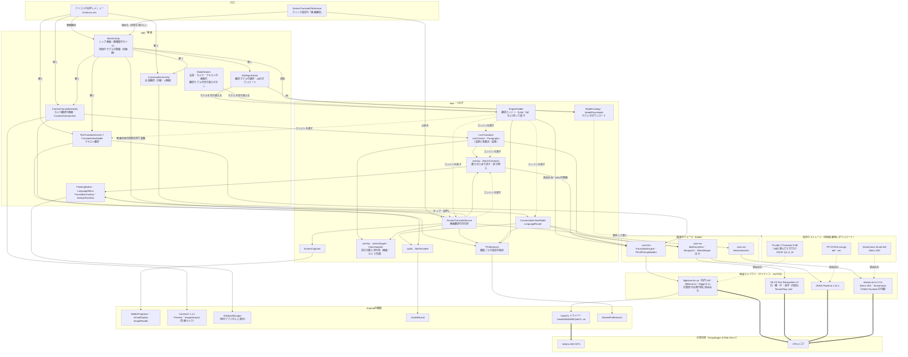
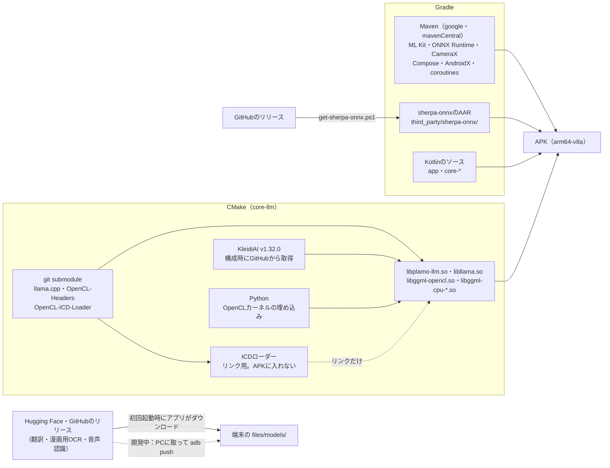
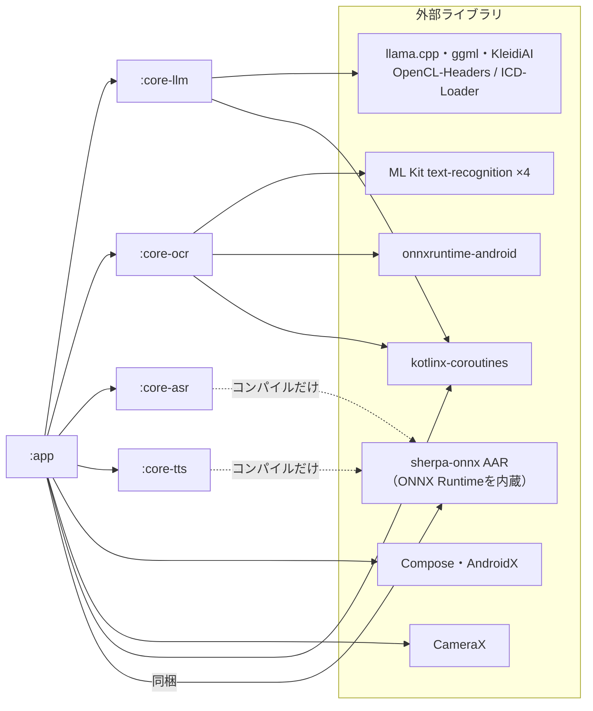
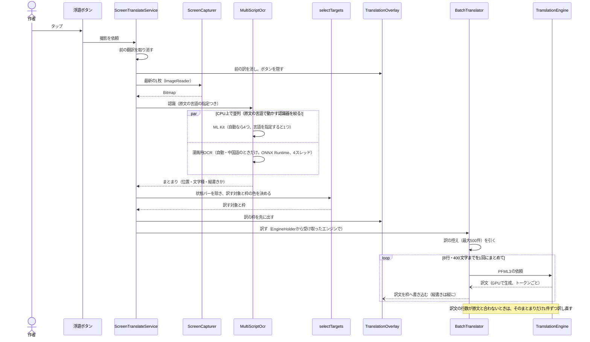
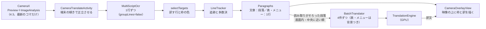
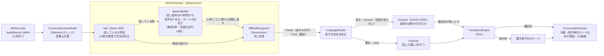

# アーキテクチャ

更新日：2026-11-06

このアプリは、REDMAGIC 11 Proの中だけで「文字を読む」「声を聞く」「訳す」を行う。3つの仕事をそれぞれ専門の推論ライブラリに任せ、Kotlinのアプリがそれらをつなぐ。

- **訳す**：llama.cppでPLaMo 3 Translateを動かす。モデルは0.8B（既定）と2Bを選べる。
- **文字を読む**：ML Kitと、ONNX Runtimeで動かす漫画用OCRを使う。画面翻訳は撮った画面を、カメラ翻訳はCameraXで取り込んだ映像のコマを読む。
- **声を聞く**：sherpa-onnxで、Silero VADとSenseVoiceを動かす。

機能は、会話翻訳・カメラ翻訳・画面翻訳・テキスト翻訳の4つで、どれも上の3つの組み合わせでできている。

推論ライブラリはどれもネイティブ（C/C++）で、APK（正式版0.2.1で約80MB）の大半を占める。ML Kitのモデルは小さいのでAPKに入れている。翻訳（0.8Bで573MB）・漫画用OCR（23MB）・音声認識（240MB）の重いモデルはAPKに入れず、初回起動時にアプリがHugging Face・GitHubからダウンロードして、端末の外部ストレージに置く。2B（1.8GB）は、設定の画面で作者が選んだときだけ追加でダウンロードする（「モデルのダウンロード」）。

翻訳は、Snapdragon（Qualcomm）の端末ではGPU（OpenCL）で、それ以外の端末やGPUの準備に失敗したときはCPUで動く（「GPUとCPUの切り替え」）。2026-11-06に、APKを配るため、REDMAGIC 11 Pro 以外の端末でも動く形にした。

この文書は、採用した技術の全体像、それらの関係、ビルドのされ方、処理の流れ、計算資源の割り当てを示す。各機能の詳しい設計は、次の設計書にある。

- `docs/03_翻訳コア.md`：翻訳、翻訳モデルの選択
- `docs/04_会話翻訳.md`：音声認識
- `docs/05_画面翻訳.md`：文字認識と重ね表示
- `docs/10_カメラ翻訳.md`：カメラの映像の取り込み、行の追跡と段落

## 読むための用語

C#・.NETの近い概念を添える。

| 用語 | 意味 | C#・.NETで近いもの |
| --- | --- | --- |
| JNI | KotlinからC/C++の関数を呼ぶ仕組み | P/Invoke |
| AAR | Androidのライブラリの配布形式。コードとネイティブライブラリ（`.so`）を含む | ネイティブDLL入りのNuGetパッケージ |
| Gradle、Maven | ビルドの道具と、ライブラリの配布元 | MSBuild、NuGet |
| コルーチン、`Flow` | 非同期処理と、値を少しずつ流すストリーム。キャンセルを呼び出し先へ伝える | `async`/`await`、`IAsyncEnumerable`、`CancellationToken` |
| Activity、Service | 画面1枚と、画面なしで動き続ける処理。フォアグラウンドサービスは通知を出して動き続ける | フォーム、Windowsサービス |
| GGUF、Q4_K_M | llama.cppのモデルのファイル形式と、重みを約4ビットに縮める量子化の種類 | — |
| PFML3 | PLaMo 3 Translateのプロンプトの書式。原文の言語・訳先・文体をタグで渡す | — |
| OpenCL | GPUで計算させるための標準API。Adreno（SnapdragonのGPU）は端末のドライバーが提供する | DirectCompute |
| ICDローダー | OpenCLの関数を各社のドライバーへ振り分ける共通ライブラリ。ここではビルド時のリンク先にだけ使う | インポートライブラリ（.lib） |
| MediaProjection | 他のアプリを含む画面全体を撮るAndroidの仕組み。作者の同意が要る | 画面キャプチャのAPI |
| CameraX | カメラを扱うJetpackのライブラリ。映像の表示（`Preview`）と、コマを1枚ずつ受け取る処理（`ImageAnalysis`）を画面の寿命に合わせて動かす | `Windows.Media.Capture`（`MediaCapture`） |
| アプリのショートカット | アプリのアイコンを長押しすると出るメニュー。項目から特定の画面を直接開ける（`res/xml/shortcuts.xml`） | タスクバーのジャンプリスト |
| クイック設定のタイル | 通知欄を下ろしたところに並ぶ切り替えボタン。アプリを開かずに機能を始め・止められる（`TileService`） | 通知領域（タスクトレイ）のアイコン |
| KleidiAI | Armが配るCPU向けの行列演算の高速化部品。llama.cppのCPU側が使う | — |
| VAD | 音声区間の検出。無音で発話を区切る | — |
| int8 | 重みを8ビット整数にした軽量版のモデル | — |
| イテレーション | 実機で触れる版で区切る開発の1回分（`docs/07_進め方とバックログ.md`）。4は会話翻訳の確定訳、5は話している最中の途中訳（どちらも2026-11-06に完了） | スプリント |

## 実行時の全体像

アプリの部品が、どのライブラリとAndroidの機能を使い、どの計算資源の上で動くかを示す。矢印の意味は図の下の凡例のとおり。

凡例：実線の矢印は「呼び出す・作って動かす」、点線の矢印は「値やファイルを渡す・受け取る」、太線の矢印は「その上で計算する」。`入口`・`:app／画面`・`:app／つなぎ` は、どれも `app` モジュールの中のクラスと定義で、役割で分けて描いている。アイコンの長押しメニューとクイック設定のタイルから画面翻訳を始めるときは、画面共有の同意を取るため `MainActivity` を経由する（`ACTION_SCREEN_TRANSLATE`）。

設計の考え方は3つある。

- **翻訳エンジンはアプリ全体で1つ**：PLaMoの読み込みとGPUの準備には数秒かかり、メモリも食う。そこで `EngineHolder` が1つだけ読み込んで持ち、テキスト翻訳・画面翻訳・カメラ翻訳・会話翻訳の各部品へ渡す。訳すときは、各部品が `TranslationEngine` を直接呼ぶ。0.8Bと2Bの切り替え（`EngineHolder.select`）は今のエンジンを閉じてから読み直すので、エンジンを持ち続ける部品（`BatchTranslator`）は、エンジンが同じかを見て作り直す（`BatchTranslator.reuseOrCreate`）。
- **文字認識と音声認識はインターフェース経由で呼ぶ**：呼び出しは `OcrEngine`・`AsrEngine` を通すので、エンジンを入れ替えるときに `app` で直すのは、エンジンを作る箇所（`ScreenTranslateService`・`LiveTranslator`・`ConversationViewModel`、デバッグ版の `BenchActivity`）だけで済む。翻訳はPLaMo専用で、差し替え口を設けていない。
- **重い計算をGPUとCPUに分ける**：翻訳はGPU、文字認識と音声認識はCPUで動かす。理由は「計算資源の割り当て」に書く。

## 採用している技術

### 推論ライブラリとモデル

| 役割 | 技術・版 | 使う場所 | 選んだ理由 | ライセンス |
| --- | --- | --- | --- | --- |
| 翻訳の推論 | llama.cpp（ggml）。コミット `9c9074e`（2026-11-05）をgit submoduleで固定 | `core-llm`。共有ライブラリ（`libllama.so`・`libggml*.so`）にし、自作JNI `libplamo-llm.so` から呼ぶ | PLaMo 3（アーキテクチャ `plamo3`）のGGUFを本家で動かせる。AndroidのビルドとOpenCLバックエンドがある | MIT |
| 翻訳のGPU実行 | ggmlのOpenCLバックエンド（Adreno向けの最適化カーネルを使う）。実行時に読み込む別ファイル `libggml-opencl.so`。リンク用にOpenCL-Headers・OpenCL-ICD-Loader v2026.05.29（submodule） | 実行時は端末のドライバー `/vendor/lib64/libOpenCL.so`。Qualcommの端末だけ読み込む | CPUのクロック上限の影響を受けない。ICDローダーはリンクのためだけに作り、APKに入れない | ggmlはMIT、OpenCL-Headers・ICD-LoaderはApache-2.0 |
| 翻訳のCPU実行 | ggmlのCPUバックエンド＋KleidiAI v1.32.0。ARMの世代ごとの7つの版（`libggml-cpu-android_armv8.0_1.so`〜`armv9.2_2`）を作り、端末で動く一番速い版を実行時に選ぶ | 同上 | GPUに載らない処理と、GPUを使わない端末の翻訳を受け持つ。KleidiAIはArmのCPUで行列演算を速くする | MIT、KleidiAIはApache-2.0 |
| 翻訳モデル | PLaMo 3 Translate 0.8B（既定）と2B、どちらもGGUF Q4_K_M | `files/models/llm/` | 日・韓・英・中を訳せる小型の翻訳専用モデル。PFML3で原文の言語・訳先・文体・背景を指定できる。2Bは約2.5倍遅いが意味の取り違えが減る（`docs/03_翻訳コア.md`「翻訳モデルの大きさ」） | PLaMo Community License（学習・趣味などの個人利用と非商用利用は、事前登録なしで無料。モデルのページの記載） |
| 文字認識 | ML Kit Text Recognition v2 16.0.1。日本語・韓国語・中国語・英字の4つ、モデル同梱版 | `core-ocr` の `MultiScriptOcr`。画面翻訳はまとまりにして、カメラ翻訳は1行ずつ（`groupLines = false`）返させる | 端末内で速く、文字の位置も返す。認識器ごとに得意な文字が違うので、行ごとに結果を選ぶ | ML Kit利用規約（無料） |
| 漫画用OCR | PP-OCRv6 manga（Kellenok）。ONNX Runtime Android 1.31.1で動かす | `core-ocr` の `MangaOcr`、`files/models/ocr/manga/`。画面翻訳だけで使い、カメラ翻訳では遅いので使わない | ML Kitが読み落とす縦書きの漫画の文字を読める。中国語の文字の正解率が16〜76%から80〜98%に上がった | モデルはApache-2.0、ONNX RuntimeはMIT |
| 音声認識の実行 | sherpa-onnx 2.0.1。ONNX Runtimeを静的に組み込んだAAR | `core-asr` の `SenseVoiceAsr` | SenseVoice・Qwen3-ASR・Nemotronなどの音声認識モデルを同じAPIで動かせ、エンジンを比べやすい |
| 読み上げ | Supertonic 3（Supertone、約99Mパラメーター、sherpa-onnx向けのint8版にvocoderだけ公式のfp32版を合わせて約220MB、OpenRAIL-M）をsherpa-onnx 2.0.1で動かす。設定で選んだときだけダウンロードする | `core-tts` の `SupertonicSpeaker` | 31言語（日本語・韓国語・英語を含む）を端末内で読める小さなモデル（2026-11-08時点）。sherpa-onnxは音声認識で使っているので部品が増えない。中国語は読めないので、Androidの読み上げエンジンで補う（`SystemSpeaker`） | Apache-2.0（組み込まれたONNX RuntimeはMIT） |
| 音声認識モデル | SenseVoice Small int8（2024-07-17版。日・韓・英・中・広東語） | `files/models/asr/sense-voice/` | 軽く速い発話単位の認識で、言語も判定する。2025-09-09版は広東語向けに追加学習した派生なので使わない | FunASRのモデルライセンス |
| 発話の区切り | Silero VAD（sherpa-onnx配布の `silero_vad.onnx`） | `files/models/asr/` | 無音で発話を区切り、一括認識へ渡す | MIT |

**ONNX Runtimeを2つ持つ理由**：ONNX Runtimeはアプリに2つ入っている。1つは漫画用OCRが使う `libonnxruntime.so`（34MB）で、もう1つはsherpa-onnxの中に静的に組み込まれた分である。sherpa-onnxの通常版AARは `libonnxruntime.so` を別ファイルで持つので、漫画用OCRのものとファイル名がぶつかる。どちらか一方に寄せると、もう一方は作られたときと違う版のONNX Runtimeで動くことになる。そこで組み込み版を選んだ（2026-11-06）。組み込み版のAARでも、x86用だけはONNX Runtimeを別ファイルで持っている。アプリはarm64だけを同梱するので、x86の分は同梱から外している（`app/build.gradle.kts`）。

### Androidの機能

| 機能 | 使うAPI | 使う場所 | 権限 |
| --- | --- | --- | --- |
| 画面共有の開始 | MediaProjectionの同意画面（Android 14以降は画面全体を既定にする `createConfigForDefaultDisplay`） | `MainActivity` | 作者の同意 |
| 画面の撮影 | MediaProjection（停止の `Callback` を登録）、VirtualDisplay（`AUTO_MIRROR`）、ImageReader（RGBA_8888、最新の1枚を保持）。撮影は専用のHandlerThreadで受ける | `ScreenCapturer` | — |
| 撮影の継続 | フォアグラウンドサービス（`mediaProjection` 型）、通知チャンネル、通知の「終了」ボタン（PendingIntent） | `ScreenTranslateService` | `FOREGROUND_SERVICE`、`FOREGROUND_SERVICE_MEDIA_PROJECTION`、`POST_NOTIFICATIONS` |
| 他のアプリの上への表示 | WindowManager（`TYPE_APPLICATION_OVERLAY`）、独自View（縦書きの `VerticalTextView`、横書きの `HorizontalTextView`）。許可の確認と設定画面（`Settings.canDrawOverlays`、`ACTION_MANAGE_OVERLAY_PERMISSION`） | `OverlayViews.kt`、`Tategaki.kt`、`Yokogaki.kt`、`MainActivity` | `SYSTEM_ALERT_WINDOW`（作者が設定画面で許可） |
| マイク | AudioRecord（16kHz・モノラル・PCM16、音源 `VOICE_RECOGNITION`） | `MicRecorder` | `RECORD_AUDIO` |
| カメラ | CameraX（`ProcessCameraProvider`、背面カメラ）。`Preview`（`PreviewView`、中央を切り抜いて全体を埋める）と `ImageAnalysis`（RGBA_8888、`STRATEGY_KEEP_ONLY_LATEST`）を同じ4:3（1280×960を目安）にそろえる。ライトは `CameraControl.enableTorch`。カメラが無い端末にも入れられる（`uses-feature android:required="false"`） | `CameraTranslateActivity` | `CAMERA` |
| 端末の傾き | `OrientationEventListener`（画面は縦向きに固定したまま、文字認識と訳の描画だけを持っている向きに合わせる） | `CameraTranslateActivity` | — |
| 実行時の権限の要求 | Activity Result API | `MainActivity`（通知）、`ConversationActivity`（マイク）、`CameraTranslateActivity`（カメラ） | — |
| 会話中の画面 | `FLAG_KEEP_SCREEN_ON`、縦向きに固定（`screenOrientation="portrait"`） | `ConversationActivity`（縦向きの固定は `CameraTranslateActivity` も） | — |
| アイコンの長押しメニュー | 静的ショートカット（`res/xml/shortcuts.xml`）。会話・カメラ・画面・テキストの4項目。画面翻訳は `MainActivity` を `ACTION_SCREEN_TRANSLATE` で開き、同意を取って始める（動作中なら止める） | マニフェスト、`MainActivity` | — |
| クイック設定のタイル | `TileService`（動作中は `STATE_ACTIVE`）。始めるときは `startActivityAndCollapse` で `MainActivity` を開き、止めるときはその場で止める | `ScreenTranslateTileService` | `BIND_QUICK_SETTINGS_TILE`（システムがタイルにつなぐための権限） |
| GPUドライバー | `<uses-native-library android:name="libOpenCL.so" android:required="false">`。無い端末にも入れられる | マニフェスト | なし（端末が `public.libraries.txt` で公開） |
| チップの判定 | `Build.SOC_MANUFACTURER`（Qualcommは `QTI`）、`Build.HARDWARE` | `EngineHolder.preferGpu` | — |
| モデルのダウンロード | `HttpURLConnection`（リダイレクト、続きからの取得のRange） | `ModelDownloads` | `INTERNET`（ダウンロードだけに使う） |
| アプリの更新 | `HttpURLConnection`（GitHubのAPI `releases/latest`）、`PackageInstaller`（セッションで入れる）、署名の照合（`GET_SIGNING_CERTIFICATES`） | `update/AppUpdater`、`InstallResultReceiver` | `INTERNET`、`REQUEST_INSTALL_PACKAGES`（設定で押したときだけ） |
| CPUの性能の要求 | APerformanceHint（NDK、API 33以上） | `plamo_llm.cpp` | なし。REDMAGICのクロック上限は外れなかったが、計測の切り替え用に残す |
| コピーと貼り付け | ClipboardManager（`copyToClipboard`。Android 13以降はシステムがコピーしたことを知らせる）。貼り付けは `primaryClip` を読む | `Clipboard.kt`、`TextTranslateActivity`（「原文をコピー」「訳をコピー」と貼り付け） | — |
| ほかのアプリへの共有 | `ACTION_SEND`（テキスト）と共有先の選択画面 | `ConversationLogExport`（会話ログ） | — |
| ファイルへの保存 | Storage Access Framework（`CreateDocument`。保存先は作者が選ぶ） | `ConversationLogExport`（会話ログをMarkdownで保存） | なし（選んだ場所にだけ書ける） |
| 設定の保存 | SharedPreferences | 機能ごとの `*Preferences`：`TranslationPreferences`（翻訳モデル・CPUの詳細）、`SpeechPreferences`（読み上げ）、`ScreenPreferences`（画面翻訳の原文の言語）、`CameraPreferences`（カメラ翻訳の原文・訳す先・表のモード）、`ConversationPreferences`（会話翻訳の表示・自分の言語）。SharedPreferencesを開くのはこの型だけ | — |

会話翻訳には、まだマイク用のフォアグラウンドサービスが無い。そのため、画面を離れると録音を止める（`ConversationActivity.onStop`）。

### 画面とアプリの基盤

| 技術 | 版 | 使う場所 |
| --- | --- | --- |
| Android SDK | compileSdk・targetSdk 36（Android 16）、minSdk 33（Android 13。APerformanceHintのため）。ネイティブはarm64-v8aだけ | 全モジュール |
| Kotlin、Composeのコンパイラープラグイン | 2.3.0 | 全モジュール、Composeの画面 |
| kotlinx-coroutines | 1.10.2 | `app`・`core-llm`・`core-ocr`。訳文をトークンごとに `Flow` で流し、取り消しをキャンセルで伝える。ML Kitの非同期処理（Google Play servicesの `Task`）もコルーチンで待つ |
| Jetpack Compose、Material 3 | Compose BOM 2025.12.01 | `MainActivity`・`TextTranslateActivity`・`SettingsActivity`・`ConversationActivity`・`CameraTranslateActivity`。色は共通の `AppTheme`（`Theme.kt`、端末のダーク設定に合わせる） |
| CameraX（camera-camera2・camera-lifecycle・camera-view） | 1.4.2 | `CameraTranslateActivity`（2026-11-06、作者了承） |
| AndroidX core-ktx、activity-compose | 1.17.0、1.12.2 | `app` |
| AndroidX Lifecycle（ViewModel、`collectAsStateWithLifecycle`） | 2.10.0 | `TranslateViewModel`、`ConversationViewModel` |
| Android View | — | 他のアプリの上に出す浮遊ボタン・訳の枠・メニュー、カメラの映像に訳を描く `CameraOverlayView`、評価用の `BenchActivity`（Composeは使わない） |
| JUnit | 4.13.2 | 4つのモジュールの単体テスト |

### ビルドと開発の道具

| 道具 | 版 | 用途 |
| --- | --- | --- |
| Gradle、Android Gradle Plugin | 8.14.3、8.13.2 | ビルド。版の組み合わせはllama.cppのAndroidサンプルに合わせた |
| JDK | 21（出力はJava 17相当） | Gradleの実行 |
| NDK、CMake、Ninja | 29.0.14206865、3.31.6（SDK同梱のNinja） | `core-llm` のネイティブビルド。llama.cppはデバッグ版でもReleaseで最適化する。共有ライブラリに分けたので、C++の標準ライブラリも共有（`c++_shared`）にする |
| 署名鍵 | keytoolで作ったPKCS12（RSA 4096） | 配布用の正式版の署名。鍵とパスワードはGitに入れず、ユーザーフォルダーの `.plamotranslate/` に置く（`docs/06_開発環境.md`「配布用のAPK」） |
| Python 3 | — | llama.cppのビルドでOpenCLカーネルをソースへ埋め込む。`tools/` の採点・比較スクリプト |
| PowerShellのスクリプト | `tools/` | sherpa-onnxとモデルの取得（`get-sherpa-onnx.ps1`）、画面翻訳の評価（`run-bench.ps1`）、英語の合成画面（`make-en-screen.ps1`）、CLIでの翻訳の計測（`device-translate.ps1`） |

## ビルド時の構成

APKは、Gradleが集めるKotlinとライブラリと、CMakeがソースから作る翻訳コアでできている。モデルはAPKに入れず、配った端末では初回起動時にアプリがダウンロードする。開発中は、PCに取ったモデルをadbで端末へ送ることもできる。

新しいPCで初めてビルドするときは、ネットにつながっている必要がある。Mavenのライブラリと、llama.cppの構成時に取得されるKleidiAIをダウンロードするためである。sherpa-onnxのAARはGitに入れていないので、先に `tools/get-sherpa-onnx.ps1` で取得する（ハッシュで照合する）。手順は `docs/06_開発環境.md`。

## モジュールと依存

| モジュール | 主なクラス | 役割 | 外部ライブラリ |
| --- | --- | --- | --- |
| `core-llm` | `TranslationEngine`、`Pfml3PromptBuilder`（`TranslationRequest`）、`Language`（53言語。`isChinese`・`sameAs`）、`LlamaNative`（JNI）、`plamo_llm.cpp` | モデルの読み込み、PFML3プロンプトの組み立て（任意の背景 `context` を含む）、貪欲法での生成、訳文を `Flow` で流す、取り消し | llama.cpp（CMakeでソースからビルド）、coroutines |
| `core-ocr` | `OcrEngine`（`OcrLanguage`・`OcrBlock`）、`MultiScriptOcr`（`Recognizers`）、`MangaOcr`、`BlockMerger`、`LineClusterer`、`VerticalColumns`、`ScriptDetector`、`EnglishText`、`TextQuality`、`Geometry` | 原文の言語に応じて認識器を選んで並列に動かし、行ごとに文字種に合う結果を選んで、吹き出し・段落のまとまりにする（`groupLines = false` なら1行ずつ返す）。`Geometry`（枠の重なりの計算）は公開し、カメラ翻訳の行の追跡も使う | ML Kit、ONNX Runtime、coroutines |
| `core-asr` | `AsrEngine`（`AsrEvent`・`Utterance`）、`SenseVoiceAsr`、`SpeechBuffer`、`WavFile` | 発話を区切って認識し、言語を判定する。話している間は途中の文字も返す。`WavFile` は動作確認でマイクの代わりに流す音声ファイルを読む | sherpa-onnx |
| `core-tts` | `Speaker`、`SupertonicSpeaker`、`SystemSpeaker` | 訳文の読み上げ。Supertonic 3（sherpa-onnx）は音を作ったそばから `AudioTrack` で流す。中国語など読めない言語は、Androidの読み上げエンジン（`SystemSpeaker`）で読む | sherpa-onnx、coroutines |
| `app` | 直下：`MainActivity`（トップ画面・初回のモデルの準備）・`TextTranslateActivity`＋`TranslateViewModel`・`SettingsActivity`（`SpeechSettings.kt`・`PerformanceSettings.kt`）・`ReadAloud`（読み上げの選択と1件ずつの再生）・`ModelSwitch`・`EngineHolder`（翻訳モデルの読み込みと共有）・`EngineBenchmark`（速さの計測）・`TranslationPreferences`・`SpeechPreferences`・`Theme.kt`（`AppTheme`）・`Clipboard.kt`（`copyToClipboard`）。`models/`：`ModelCatalog`（`ModelFile`・`TranslationModel`・`ModelBundle`）・`ModelDownloads`。`update/`：`AppUpdater`・`AppVersion`・`InstallResultReceiver`・`UpdateSection.kt`（アプリの更新）。`audio/`：`MicRecorder`（会話翻訳とテキスト翻訳の音声入力）。`overlay/`（画面翻訳とカメラ翻訳の共通部品）：`TranslationTargets.kt`（`selectTargets`・`OverlaySlot`）・`ColorSampler`・`BatchTranslator`・`Units.kt`（`spToPx`・`dp`）。`screen/`：`ScreenTranslateService`・`ScreenTranslateTileService`・`ScreenCapturer`・`OverlayViews.kt`（`FloatingButton`・`TranslationOverlay`・`LanguageMenu`・`OverlayStyle`）・`Tategaki.kt`・`ScreenLanguage.kt`（`SCREEN_TARGET`）・`ScreenPreferences`。`camera/`：`CameraTranslateActivity`・`LiveTranslator`・`LineTracker`・`Paragraphs`・`TextSimilarity`・`CameraGeometry`・`CameraOverlayView`・`CameraLanguage.kt`・`CameraPreferences`。`conversation/`：`ConversationActivity`（画面の組み立て）・`ConversationCards.kt`・`ConversationControls.kt`・`ConversationLogExport`・`ConversationViewModel`・`LanguageRouter`・`ConversationLog`・`ConversationPreferences`。`res/xml/shortcuts.xml` | 画面、権限、サービス、重ね表示、モデルの選択とダウンロード、各モジュールのつなぎ | Compose、AndroidX、CameraX、coroutines、sherpa-onnx（同梱） |
| `app`（debugだけ） | `BenchActivity`、`TranslateBenchActivity`、`src/debug/AndroidManifest.xml` | 保存したスクリーンショットで画面翻訳を評価する。翻訳モデル（0.8B・2B）で同じ文の組を訳して時間と訳文を比べる（`docs/03_翻訳コア.md`「モデルの比べ方」）。会話翻訳の画面をadbから開けるようにし（`exported`）、`--es wav` で音声ファイルを流して確かめる | なし |

依存の向きは `app` → `core-*` だけで、`core-*` どうしは依存しない。`core-ocr` は翻訳を知らず、文字の位置・文字種・縦書きかを返す。`core-asr` は発話の文と言語のコード（"ja" など）を返す。何をどの言語へ訳すか、どう描くかは `app` 側で決める。`app` の中では、機能（`screen`・`camera`・`conversation`・テキスト翻訳）どうしは互いに依存しない。複数の機能が使う部品は、画面翻訳とカメラ翻訳が使う訳す対象の選別・枠の色・まとめ訳し・単位の換算を `overlay/`、マイクを `audio/` に置く（2026-11-09、`docs/11_リファクタリング候補.md`「5」「2」）。ただし、英文の大文字・ハイフンの整え（`EnglishText`）と崩れの判定（`TextQuality`）は、文字種の知識に属するので `core-ocr` に置く。カメラ翻訳の行の追跡・段落のまとめ方は、コマをまたぐカメラだけの処理なので `app` の `camera/` に置き、枠の重なりの計算だけ `core-ocr` の `Geometry` を使う。

sherpa-onnxはMavenに無いので、GitHubのリリースのAARを使う。Androidのライブラリモジュールはローカルのアーカイブを同梱できないので、`core-asr`・`core-tts` はコンパイルにだけ使い、`app` が同梱する。版は `gradle/libs.versions.toml` の `sherpa-onnx` で1か所に決める。

## 処理の流れ

### 画面翻訳

浮遊ボタンを押すと、撮影から重ね表示までが1回流れる。ボタンを押すたびに前の翻訳を取り消す。長押しすると言語のメニューが開き、選んだ言語は `ScreenPreferences` に保存する。

### カメラ翻訳

CameraXのコマを、文字認識が終わるたびに最新の1枚だけ読む。行をコマをまたいで追い、読み取りがそろった段落から訳す。文字認識と翻訳は別々に回り、翻訳は文字認識より遅いので、訳は原文で控えて使い回す。詳しくは `docs/10_カメラ翻訳.md`。

### 会話翻訳（イテレーション4・5）

マイクの音声を0.1秒ずつ音声認識へ流す。話している間は、聞き取り中の文字（途中結果）を0.5秒ごとに出し、その文字を訳した途中訳も出す。カードが確定したら、確定訳を出す。カードは、無音が2秒続いたとき、話し手が代わった（言語が変わった）とき、14秒話し続けたときに区切る（`docs/04_会話翻訳.md`「カードの区切り方」）。区切っても音声の受け付けは止めない。停止したときは、話しかけだった分も確定させて訳す。

音声認識は、出来事（`AsrEvent`）を3種類返す。

- **Speaking**：話し始めたことと、話し終わったことを知らせる。画面は、話し始めると聞き取り中のカードを出す。
- **Partial**：途中の文字。SenseVoiceは発話をまとめて認識する方式なので、話し始めから今までの音声を0.5秒ごとに認識し直す（疑似ストリーミング）。VADは話し始めを少し遅れて検出するので、`SpeechBuffer` は直前の0.5秒を常に残しておき、頭に足す。認識し直す間隔は、1回の認識にかかった時間の3倍より短くしない。発話が長くなってもCPUを使い切らないためである。文字が前と同じなら知らせない（話し終わってから区切るまでの2秒の無音の間に、同じ文を訳し直さないため）。
- **Final**：確定したカード。`SpeechBuffer` にためた音声のうち、区切りまでを最後にもう一度認識する。VADが切り出す音声は使わず、VADは「話しているか」と「文の終わり」の合図にだけ使う。区切った後ろの音声は次のカードの頭に残す。

日本語と中国語の認識結果では、SenseVoiceが語の間に空白を入れる。この空白は取り除く（`SenseVoiceAsr.removeCjkSpaces`）。韓国語と英語の空白は残す。

画面は「対面」と「1画面」を切り替えられる（`ViewMode`）。選んだ方は、`ConversationPreferences`（SharedPreferencesの `conversation`）に保存する。対面では、相手側の半分は各カードだけを180°回し、並びを下から上にする（`reverseLayout`）。一覧ごと回すと、スクロールで指を離したときに急に止まったためである。操作欄には、マイクの音量のバーを出す。カードの文字の大きさ・見出し・色、話し中のカードの枠は `docs/04_会話翻訳.md`「カードのデザイン」。

`LanguageRouter` は訳す方向を次のように決める。

- **自分の言語**：既定は日本語。2026-11-08から韓国語・英語・中国語も選べる。自分の言語の発話は相手の言語へ、それ以外は自分の言語へ訳す（以下は自分が日本語のときの例）。
- **自動のとき**：相手が韓国語か英語で話すと、その言語を覚える。自分の日本語の発話は、覚えた言語へ訳す。初期値は韓国語。覚えるのは確定した発話だけで、途中結果では覚えない（判定が揺れやすいため。`LanguageRouter.preview`）。
- **相手の言語を固定したとき**：日本語以外の発話は、判定に関係なく固定した言語として日本語へ訳す。
- **中国語・広東語と判定されたとき**：自分も相手も中国語でなければ、文字の種類で日本語・韓国語・英語を決め直す。

途中訳は `ConversationViewModel` が受け持つ。途中の文字が届くたびに訳す依頼を出すが、依頼は最新の1件だけを持つ（`Channel.CONFLATED`）。訳している間に届いた古い依頼は上書きされるので、訳が遅れて溜まることはない。訳し終わったとき、まだ同じ発話なら聞き取り中のカードに出す（発話の区切りごとに進める世代番号で見分ける）。新しい途中の文字を訳し終わるまでは、前の途中訳を出しておく。

試験用の音声ファイル（日・韓・英）では、次の結果だった（2026-11-06）。

- 確定の認識：0.06〜0.1秒（途中の文字を出すようにした後は0.15〜0.2秒）
- 翻訳：0.2〜0.7秒
- 途中の文字：0.5秒ごとに出る。途中訳はその0.1〜0.9秒後に付く
- 話し終わってから確定訳が出るまで：約2.5〜3秒（無音を待つ2秒を含む）。その間も途中訳は出ているので、読む人は待たされない

## 計算資源の割り当てと翻訳の順番

REDMAGICは、前面のアプリに応じてCPUの全コアのクロックを1.79GHz程度に抑える。本来は3.63GHz・4.61GHzで、性能ヒント（APerformanceHint）でも外れない。そこで一番重い翻訳を、この制限を受けないGPUに載せている（実測は `docs/00_現在地.md`「押さえておく事実」）。

| 処理 | 実行先 | スレッド |
| --- | --- | --- |
| 翻訳（llama.cpp） | Adreno 840 GPU（OpenCL、全層）。GPUに載らない処理はCPU。Qualcomm以外の端末とGPUの準備に失敗したときはCPUだけ（「GPUとCPUの切り替え」） | 専用スレッド `PlamoInference` 1本から呼ぶ。CPU側のスレッドプールは「コア数−2」本（2〜6本、REDMAGICは6本）で常駐する。コンテキストは2048トークン、生成は1回1024トークンまで |
| 撮影 | CPU | `ScreenCapturer` 専用のHandlerThread |
| カメラのコマの受け取り | CPU | `ImageAnalysis` に渡した専用スレッド1本（`Executors.newSingleThreadExecutor`）。画像にしたら、文字認識はメインスレッドのコルーチンから呼ぶ |
| 文字認識（ML Kit） | CPU | ML Kitが内部で管理 |
| 漫画用OCR（ONNX Runtime） | CPU | `Dispatchers.Default` から呼び、推論は4スレッド |
| 音声認識（SenseVoice） | CPU | 専用スレッド `PlamoAsr` から呼び、推論は4スレッド |
| 発話の区切り（Silero VAD） | CPU | 1スレッド（`PlamoAsr` の中） |
| 録音 | CPU | `Dispatchers.IO` |
| 画面の更新・処理のつなぎ | CPU | メインスレッド |

会話中は、llama.cppの常駐スレッド6本と、音声認識の4本とVADの1本が同じCPUに載る。話している間は、途中の文字のために0.5秒ごとに認識し直し、途中訳のために翻訳もほぼ休みなく動くので、確定だけのときより負荷は高い。翻訳の主な計算はGPUなので、CPUの取り合いは小さいと見込んでいる。ただし会話翻訳ではまだ測っていない。

GPUのカーネルの準備（初回約4秒）は、モデルを読んだ直後に短い文を1回訳して済ませる。カーネルのコンパイル結果は、環境変数 `GGML_OPENCL_KERNEL_CACHE_DIR` でアプリのキャッシュ `cl-cache/` に残し、2回目以降の起動を速くする。

**翻訳の順番**：`TranslationEngine` は、1つのllama.cppのコンテキストを1本のスレッドで順番に使う。各機能は次のように依頼する。

- テキスト翻訳と画面翻訳は、新しい依頼のたびに前の翻訳を取り消す。ジョブを取り消すと、生成も次のトークンで止まる。
- カメラ翻訳は、訳したい段落の一覧から4件ずつ取り出して訳す。訳している最中の依頼は取り消さず、次の4件を取るときに、その時点で画面に見えている段落・中央に近い段落を先にする。
- 会話翻訳は、確定した発話を話した順に1件ずつ訳す。途中訳は確定訳より後回しにする。確定した発話が来たら走っている途中訳を取り消し、確定訳が残っている間は途中訳を始めない。

機能をまたいで同時に依頼すると、同じスレッドで順番待ちになり、機能の間の優先順位は無い。

### GPUとCPUの切り替え

2026-11-06、APKを配るため、REDMAGIC 11 Pro（Snapdragon 8 Elite Gen 5）以外の端末でも翻訳が動くようにした。それまでは、自作JNIが端末のOpenCLのライブラリに直接つながっていて、OpenCLの無い端末（Pixelなど）では起動時にライブラリを読み込めず落ちた。

llama.cppを共有ライブラリにし、計算部分を実行時に読み込む別ファイルにした（`GGML_BACKEND_DL`）。読み込みは `LlamaNative.nativeInit` が、アプリのネイティブライブラリの置き場（`nativeLibraryDir`）から行う。

| 端末 | 読み込むもの | 翻訳の実行先 |
| --- | --- | --- |
| Qualcomm（`Build.SOC_MANUFACTURER` が `QTI`） | すべて（`ggml_backend_load_all_from_path`）。OpenCLのドライバーが無ければ `libggml-opencl.so` だけ読み込みに失敗する | GPU（全層）。GPUで読み込めなければCPUでやり直す |
| それ以外（Tensor・Exynos・Dimensityなど） | CPUの部分だけ（`libggml-cpu-*.so` のうち、端末で動く一番点数の高い版） | CPUだけ（GPUのデバイスを一切使わず、計算の一部をGPUへ回す既定の動きも止める） |

Qualcomm以外でGPUを使わないのは、llama.cppのOpenCLバックエンドがAdreno向けに作られていて、Mali（Tensor・Exynos・Dimensity）では正しく速く動く保証が無いためである。CPUの版は世代ごとに7つあり（armv8.0〜armv9.2）、古い端末でもそのCPUで使える一番速い命令を使う。

設定の画面の「パフォーマンス」で「CPUだけで動かす」を選ぶと、Snapdragonの端末でもCPUで動く。CPUの速さを確かめるためである（`docs/03_翻訳コア.md`「パフォーマンスの設定」）。

画面翻訳・会話翻訳の文字認識と音声認識は、もともとCPUで動くので、どの端末でも同じように動く。

### モデルのダウンロード

モデルはAPKに入れず、初回起動時に全画面の「モデルの準備」からダウンロードする（`ModelCatalog`・`ModelDownloads`）。翻訳・認識の処理そのものは通信しない。`INTERNET` の権限は、このダウンロードと、設定で押したときのアプリの更新（`docs/06_開発環境.md`「アプリの更新」）だけに使う。

| ファイル | 取得元 | 置き場（`files/models/` の下） | 大きさ |
| --- | --- | --- | ---: |
| 翻訳モデル | Hugging Face `pfnet/plamo-3-translate-0.8b-GGUF` | `llm/plamo-3-translate-0.8b-Q4_K_M.gguf` | 573MB |
| 音声認識 | Hugging Face `csukuangfj/sherpa-onnx-sense-voice-zh-en-ja-ko-yue-2024-07-17`（`model.int8.onnx`・`tokens.txt`） | `asr/sense-voice/` | 239MB |
| 話しているかの判定 | GitHub `k2-fsa/sherpa-onnx` のリリース `asr-models`（`silero_vad.onnx`） | `asr/silero_vad.onnx` | 0.6MB |
| 漫画用OCR | Hugging Face `Kellenok/PP-OCRv6_manga`（`det/manga_det_v0.2.onnx`・`rec/manga_rec_v0.2.onnx`・`ppocrv6_dict.txt`） | `ocr/manga/det.onnx`・`rec.onnx`・`dict.txt` | 23MB |
| 翻訳モデルの2B（選んだときだけ） | Hugging Face `pfnet/plamo-3-translate-2b-GGUF` | `llm/plamo-3-translate-2b-Q4_K_M.gguf` | 1.8GB |

- 初回に取るのは2B以外で、合わせて約836MB。Wi-Fiでの実行を案内する。2Bは設定の画面の「2Bをダウンロード」から、読み上げのモデルは設定の画面の「Supertonic 3をダウンロード」から取る。一緒に取るファイルの組は `ModelBundle`（初回の組・2B・読み上げ）で、一度に取るのは1組だけ。初回の準備が済んでいれば、2B・読み上げのモデルを取っている間もトップ画面を使える。
- 途中で切れたら、次は続きから取る（HTTPのRange）。途中のファイルは `.part` として置く。
- 取り終えたらSHA-256を照合し、合えば置き場へ移す。合わなければ捨てる。照合の値は、2026-11-06にダウンロード元から取り、開発で使ってきたファイルと一致することを確かめたもの。
- 置かれているかは、起動のたびにファイルの大きさで見る（毎回ハッシュを計算すると起動が遅くなるため）。
- 重みはアプリに同梱せず、使う人の端末が公式の配布元から直接取る。アプリの配布は重みの再配布にならない。

## APKの中身

APKに入るネイティブライブラリは arm64-v8a だけで、正式版のAPKは約80MB（0.2.1、2026-11-06。CameraXを足す前に作った版）。ネイティブライブラリをインストール時に展開する形（`useLegacyPackaging`）にしたので、APKの中では圧縮されている。下の大きさは展開後。

| ファイル | 大きさ | 中身 |
| --- | ---: | --- |
| `libllama.so`、`libggml.so`、`libggml-base.so`、`libplamo-llm.so` | 43.5MB | llama.cppと自作JNI |
| `libggml-cpu-android_armv*.so`（7つ） | 37.6MB | CPUの計算部分（世代ごとの版、KleidiAI入り）。実行時に1つだけ読み込む |
| `libggml-opencl.so` | 10.8MB | GPU（OpenCL）の計算部分。OpenCLカーネルを埋め込み |
| `libc++_shared.so` | 8.9MB | C++の標準ライブラリ（llama.cppの共有ライブラリ間で共用） |
| `libonnxruntime.so`、`libonnxruntime4j_jni.so` | 32.7MB | ONNX Runtime（漫画用OCR） |
| `libsherpa-onnx-jni.so` | 23.1MB | sherpa-onnx（ONNX Runtimeを内蔵） |
| `libmlkit_google_ocr_pipeline.so` と `assets/mlkit-google-ocr-models/` | 10.6MB＋モデル | ML Kitの4つの認識器（TensorFlow Liteのモデル） |
| `libimage_processing_util_jni.so`、`libsurface_util_jni.so` | 0.04MB | CameraXの画像の変換と映像の表示の補助（2026-11-06に追加。デバッグ版のビルドで確かめた大きさ） |

APKをさらに小さくする案（ONNX Runtimeを1つにまとめる、使わないCPUの版を外す）はバックログにある（`docs/07_進め方とバックログ.md`）。

## データの置き場

| データ | 場所 |
| --- | --- |
| 重みファイル | `getExternalFilesDir("models")`（`/sdcard/Android/data/app.plamotranslate/files/models/`）の下に、次の名前で置く。初回起動時にアプリがダウンロードする（「モデルのダウンロード」）。開発中にadbで置く手順は `docs/06_開発環境.md`。アプリを削除すると一緒に消える |
| | `llm/plamo-3-translate-0.8b-Q4_K_M.gguf`（2Bを選んだら `llm/plamo-3-translate-2b-Q4_K_M.gguf` も） |
| | `ocr/manga/det.onnx`・`ocr/manga/rec.onnx`・`ocr/manga/dict.txt` |
| | `asr/sense-voice/model.int8.onnx`・`asr/sense-voice/tokens.txt`・`asr/silero_vad.onnx` |
| GPUカーネルのコンパイル結果 | アプリのキャッシュ `cl-cache/`。消しても次の起動で作り直す |
| 設定 | SharedPreferences。`translation`（翻訳モデル：0.8Bか2Bか。GPUで落ちたときの記録も置く）、`cpu`（CPUの詳細）、`speech`（読み上げ）、`screen_translate`（画面翻訳の原文の言語）、`camera_translate`（カメラ翻訳の原文・訳す先と、表・メニューのモードか）、`conversation`（会話翻訳の表示と自分の言語）。読み書きは機能ごとの `*Preferences` が行う |
| 会話の記録 | アプリの中には残さず、画面を閉じると消える。残したいときは、操作欄の「ログ」からほかのアプリへ共有するか、Markdownのファイル（`会話ログ_YYYY-MM-DD_HHmm.md`）に保存する。書式は `ConversationLog` が作る |

## デバッグ用の入口

デバッグ版だけに、動作確認と計測の入口がある。手順は `docs/06_開発環境.md`、`docs/04_会話翻訳.md`「動作確認」、`docs/05_画面翻訳.md`「評価」。

| 入口 | 用途 |
| --- | --- |
| `BenchActivity` | 保存したスクリーンショットに、画面翻訳と同じ処理（`selectTargets` まで共通）をかけて採点する |
| `TranslateBenchActivity` に `--es model`・`--es set`・`--es context` | 選んだ翻訳モデルで文の組（`tools/translate-*.tsv`）を訳し、時間と訳文をファイルに書く（`docs/03_翻訳コア.md`「モデルの比べ方」） |
| ブロードキャスト `DEBUG_TRANSLATE`・`DEBUG_CONFIG` | 画面翻訳を1回動かす。性能ヒントとスレッド数を切り替える |
| `ConversationActivity` に `--es wav <パス>` | マイクの代わりに音声ファイルを流す |
