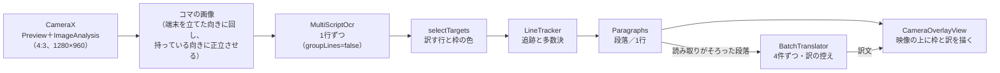

# カメラ翻訳

更新日：2026-11-08

## 何をするか

看板・メニュー・商品のラベルにカメラを向けると、読めた文字の上に日本語の訳を重ねる（2026-11-06、作者の要望「カメラ画像のリアルタイム翻訳」）。画面をタップすると一時停止し、そのコマの画像と訳を止めて読める。もう一度タップで再開する。

| 操作 | 動き |
| --- | --- |
| カメラを向ける | 文字のある行に枠が出て、読み取りがそろった行から訳が重なる |
| 画面をタップ | 一時停止。そのときのコマを止めて出し、見えている行を（読み取りがそろうのを待たずに）全部訳す |
| 言語のチップ（自動・韓国語・英語・中国語・他の言語 ▾） | 原文の言語を決める。決めると要らない認識器を動かさないので速く、読み違いも減り、翻訳にも原文の言語を渡す。「他の言語」のメニューに、繁体字の中国語とラテン文字で書く24言語を並べる（「原文の言語」）。選んだ言語は次も使う（SharedPreferencesの `camera_translate` の `source`） |
| 文章／表・メニュー | 文章は行を段落にまとめて訳す（文がつながり、訳が自然）。表・メニューは1行（1セル）ずつ訳す。表を段落にまとめると隣のセルや下の行がつながって訳の質が下がった（2026-11-06、作者の指摘）。選んだ方を次も使う |
| 翻訳モデル（上のバー「2B・GPU ⚙」） | 今のモデルと状態を出し、押すと0.8B／2Bを切り替える。読み込み中・失敗のときは上のバーの下に青・赤の帯を出す（2026-11-06、作者の要望「モデル読み込み中かどうか判断つくように」）。切り替えたら前のモデルの訳は捨てる |
| 💡 ライト | 暗い店内でメニューを読むときのライト |
| 表・メニューのモードの細かな扱い | 訳の枠を広げず、元の文字の範囲に収めて描く（広げると隣のボタンを覆った）。行間がほとんどなく中央がそろった上下2行（ボタンの2段書き「바람／세기」）は1つにまとめる（1語ずつだと「세기」が「世紀」、2語なら「風の強さ」）。翻訳に「機器のボタン・表示画面、メニュー、看板、表などに書かれた短い表記」という背景（PFML3の context）を渡す。2026-11-06、エアコンのリモコンで作者が試した結果から |
| 横向きに持つ | 端末の傾き（`OrientationEventListener`）から持っている向き（0・90・180・270°）を判定し、その向きに正立させた画像で文字を読み、訳も同じ向きに描く（2026-11-06、作者の要望「横向きで文章を読むこともある」）。画面のボタン類は縦向きのまま。今の向きから60°を超えて傾けたときだけ切り替え、切り替えたら追っていた行は捨てる |

入口は、トップ画面の「カメラ」のタイルと、アイコンの長押しメニューの「カメラ翻訳」。

## 部品

`app` の `camera/` に置く（2026-11-06の整理で、`LiveTranslator` に入っていた処理を役割ごとのファイルに分けた）。

| クラス | 役割 |
| --- | --- |
| `CameraTranslateActivity` | 画面（Compose）。CameraXの映像の取り込み、カメラの許可、端末の傾きの判定、一時停止・言語・モード・ライト・翻訳モデルの切り替え（`ModelSwitch`）の操作 |
| `LiveTranslator` | 中身の司令塔。コマごとの文字認識、追跡と段落の組み立て、訳す順番と翻訳の一覧（`wanted`）、訳の控え。画面に渡す1コマ（`LiveFrame`・`LiveBox`）を作る |
| `LineTracker` | コマをまたいで同じ行を追い、多数決で読み取りを決める（`Reading`・`Track`） |
| `Paragraphs` | 安定した行を、文章のモードでは段落に、表・メニューのモードでは1行（ボタンの2段書きだけ2行）にまとめる（`Paragraph`） |
| `TextSimilarity` | 読み揺れを吸収する比べ方。キー（文字と数字だけを小文字に）とDice係数。多数決と訳の控えで共通に使う |
| `CameraGeometry` | 縦持ちの画像・正立した画像・画面の座標の変換と、画面に見えている範囲（`visibleRect`）。描画と訳す順番で共通に使う |
| `CameraOverlayView` | 映像（または一時停止の画像）の上に、枠と訳を描く（Android View） |
| `CameraLanguage` | 選べる原文の言語と、言語ごとに動かす認識器（`Language.ocrLanguage`） |
| `CameraPreferences` | 選んだ原文の言語・訳す先・表のモードの保存。以前の形式（認識器の種類）で保存した原文の言語も読み替える |

## 原文の言語

2026-11-08、作者の要望「ライブラリやローカルモデルで対応できる言語は全て選べるように」で広げた。翻訳（PLaMo 3 Translate）は53言語を訳せるので、選べる言語は文字認識が読める文字で決まる。アプリに同梱しているML Kitの認識器は、ラテン文字・中国語・日本語・韓国語の4つ。

| 選べる言語 | 動かす認識器（`OcrLanguage`） |
| --- | --- |
| 自動 | すべて。PLaMoが原文の言語を判定する |
| 韓国語 | 韓国語 |
| 中国語（簡体字）・中国語（繁体字） | 中国語（ML Kitの中国語の認識器は簡体字・繁体字の両方を読む） |
| 英語、アゼルバイジャン語、イタリア語、インドネシア語、ウズベク語、エストニア語、オランダ語、カタルーニャ語、クロアチア語、ジャワ語、スペイン語、スロバキア語、スロベニア語、スワヒリ語、セブアノ語、タガログ語、ドイツ語、ハンガリー語、バスク語、フランス語、ベトナム語、ポーランド語、マレー語、ラトビア語、リトアニア語 | ラテン文字（`LATIN`。2026-11-08に `ENGLISH` から改名。画面翻訳の「英語」も同じ値） |

- ラテン文字の行は、英語と同じ整え方（行末のハイフンをつなぐ、大文字だけの文を文頭だけ大文字にする。`EnglishText`）を通してから訳す。ドイツ語の名詞の大文字も小文字になるが、訳には大きく響かないと見てそのままにした（実機では確かめていない）。
- ベトナム語のように記号（声調の印）の多い言語を、英字の認識器がどこまで正しく読めるかは確かめていない。
- セルビア語は看板がキリル文字のことが多いので選択肢に入れていない。
- 日本語は原文の選択肢に出さない。訳す先を日本語以外にして日本語を読むときは、自動（すべての認識器を動かす）で読む。
- 選べない言語：ロシア語・ブルガリア語などのキリル文字、アラビア語・ペルシア語・ウルドゥー語、ヘブライ語、タイ語、クメール語、ビルマ語、ジョージア語、アルメニア語、ヒンディー語などインド系の文字の言語。ML Kitのデーヴァナーガリーの認識器（`text-recognition-devanagari`）を足せば、ヒンディー語・マラーティー語・ネパール語は読める（APKが大きくなるので未採用）。

## 訳す先の言語

既定は日本語。2026-11-08、作者の要望で、下の欄の「訳：日本語 ▾」からPLaMoの53言語のどれにでも変えられるようにした。選んだ言語は次も使う。変えたら、前の言語で訳した控えは捨てて訳し直す（一時停止中なら、見えている段落をすぐ訳し直す）。日本語以外を選んでいる間は、チップを選んだ状態の色にして気付けるようにした。

訳す対象を選ぶとき（`selectTargets`）も、選んだ訳す先で「訳す必要があるか」を決める。訳す先を日本語以外にすると、仮名を含む日本語の行も訳す。訳す先が韓国語なら、ハングルの行は訳さない。2026-11-09に直す前は、画面翻訳の訳す先（日本語）で決めていた。そのため、訳す先を英語・韓国語などにしても日本語の行を訳さず、訳す先が韓国語でもハングルの行を韓国語へ訳していた（コードの整理の途中で見つけた）。

## 仕組み

- **映像の取り込み**：CameraX 1.4.2（`camera-camera2`・`camera-lifecycle`・`camera-view`、2026-11-06作者了承）。映像（`Preview`）と文字認識に渡す画像（`ImageAnalysis`）を同じ4:3にそろえ、どちらも「中央を切り抜いて全体を埋める」表示にして、枠の位置を同じ計算で画面の座標へ移す。文字認識が終わるまで次のコマは捨てる（`STRATEGY_KEEP_ONLY_LATEST` と `busy`）。
- **文字認識**：画面翻訳と同じ `MultiScriptOcr` だが、行を段落・吹き出しにまとめない（`groupLines = false`）。カメラはコマごとに読み揺れるので、大きなまとまりにすると同じ文としてそろわず、訳が出なかった（2026-11-06実機。ラベルの表面が1つのまとまりになり、成分表示は数百文字のまとまりになった）。漫画モデルは縦書きの漫画用で遅いので使わない。1文字だけの読み取りは捨てる（韓国語のラベルを中国語の認識器が「太」「我」と読み違える雑音が多い）。
- **追跡と多数決**（連続して読めることを使う。作者の要望「連続読み取りの特性を活かして、ロバストな読み取りを」）：
  - 各行を、前のコマの位置が重なる行（IoU 0.3以上）、なければ近くにある同じ内容の行に結び付ける。
  - 行ごとに直近8回の読み取りを持ち、ほかの読み取りといちばん似ているもの（2文字ずつの組の重なり＝Dice係数の合計が最大）を原文とする。1回崩れて読めても結果は乱れない。
  - ほぼ同じ読み取り（Dice係数0.8以上）が2回そろった行だけを表示・翻訳する。1回しか読めなかった行（雑音）は出さない。
  - 読めなかったコマが2回までなら行を残す（1コマの読み落としで枠がちらつかないように）。ただし、そのコマで読めた行に重なる古い行は消す（カメラが動いてずれた枠）。
- **段落にまとめる**（2026-11-06、作者の提案「重なる枠は1段落として統合した方が欠落が無くなる」「長い文の方が翻訳品質も上がるのでは」）：読み取りの安定は行ごと、表示と翻訳は段落ごとにする。
  - 同じ行が二重に読めた枠（小さい方の5割以上が重なる。認識器ごとに少しずれた枠ができる）は、段落にする前に `LineTracker` が、読み取りが確かな方（そのコマで読めた・多数決で同じ読み取りが多い）だけを残す。
  - 文章のモード（`Paragraphs`）：少し重なる行と、すぐ下に続く行（行間が行の高さの0.8倍以内、横にも重なる、高さが1.6倍以内）は同じ段落にする。
  - 番号・記号（「1.」「1 」「①」「・」「※」など）で始まる行は新しい段落にする。段落は6行まで。注意書きの9項目が1段落になると、訳に10秒近くかかり、1行の読み揺れで全体を訳し直すため。項目の中で折り返した文（「ご注意くだ／さい」）は1文として訳せる。
  - 表・メニューのモード（`Paragraphs`）：1行（1セル）ずつにする。ただし、行間がほとんどなく（行の高さの0.3倍以内）、中央がそろい、幅が近い上下2行（ボタンの2段書き）だけは1つにまとめる。
  - 段落どうしの文脈：`BatchTranslator` が数段落を改行でつないで1回で訳すので、隣の段落もモデルに見えている。
  - すべての行の読み取りがそろった段落から訳す。
- **描き方**（`CameraOverlayView`）：日本語の訳は原文より長くなりやすいので、文章のモードでは訳の枠を、右は同じ段落の右端まで（元の幅の半分まで）、下は次の段落の手前まで広げ、その中に収まる大きさ（7〜26sp）で描く。収まらない分は切って、ほかの枠に被せない（作者の指摘「四角形が折り重なって読めない」）。表・メニューのモードでは広げない。座標の計算は `CameraGeometry` にまとめ、正立した画像の座標で配置を決めてから画面の座標へ回す。
- **訳す順番**（2026-11-06、作者の要望「翻訳待ちは画面内の文章を優先に」）：文字認識の画像は4:3で、縦長の画面では左右（縦持ちで横幅の約4割）がはみ出して見えない。画面に見えている範囲を画像の座標で求め（`visibleRect`、横持ちにも対応）、見えている段落を先に、その中では画面の中央に近い順に訳す。画面の外の段落は最後。状態表示の件数と「訳待ち」も見えている枠だけを数える。
- **翻訳**：画面翻訳と同じ `BatchTranslator`（数行まとめて1回で訳す。2026-11-12にChrome拡張から持ち込んだ訳し漏れの行の訳し直し・繰り返しの打ち切り・重複除去・長文の分割もカメラに効く。`docs/05_画面翻訳.md`「訳す対象と翻訳」。訳の控えのデータベースはカメラでは使わない）。訳したい文は一覧（`wanted`）に持ち、4件ずつ訳す（8件だと2Bで10秒ほどかかり、カメラを動かした後に新しく映った文へ切り替わるのが遅い）。映している間は、そのコマで読み取りがそろった文で一覧を入れ替える（画面から外れた文は訳さない）。一時停止中は一覧に足すだけで消さず、一時停止の後に終わったコマの読み取りは捨てる。訳は原文の文字と数字だけのキー（`TextSimilarity.key`）で300件まで控え、ほぼ同じ文（`TextSimilarity.similar`）にも使い回す。訳が空なら「（訳せませんでした）」として控える（控えないと、枠が「訳待ち」のまま残る）。原文の言語・訳す先・モード・翻訳モデルを変えたら控えを捨てる（表・メニューのモードは背景を渡すので訳が変わる）。訳す先は下の欄で選んだ言語（「訳す先の言語」）。
  - 最初は「最新の依頼1件だけを持つ」作りで、一時停止の直後に終わったコマの小さな依頼が「全部訳す」を上書きし、囲まれたまま訳されない枠が残った（2026-11-06、作者の指摘）。

## 実機で見たこと（2026-11-06、REDMAGIC 11 Pro、2B・GPU）

- 文字認識は1コマ0.1〜0.5秒（自動判定。成分表示のような細かい文字が多いと1.2秒）。
- 短い行の翻訳は1件0.2〜0.7秒、5件まとめて約2.5秒。
- 韓国語のペットボトルで、枠は文字の位置に重なった。
- 韓国語の取扱説明（品質保証・警告・取り扱いの注意）で、段落にまとめた版は品質保証の3項目がつながった自然な日本語になった（作者が試した）。
- 横向き：作者が横に持った取扱説明で、枠が行に重なり、訳が持っている向きに正立して出ることを確かめた。
- 枠の広げすぎ（作者の指摘「四角形の範囲が大きすぎる」）は、右へ広げるのを元の幅の半分まで、下を次の行までか行の高さの半分までにして直した。表・メニューのモードでは広げない。

## 残る問題

- 番号の点を落とした行（「1 」）で項目が分かれない問題は直したが、直した版は実機で確かめていない。
- 赤い見出しの帯と、その直前の項目が同じ段落になることがある。
- 2Bでは、一時停止から全部の訳が出るまで4件で約8秒かかる（横向きの取扱説明で）。
- 短い語の訳（2026-11-06、`tools/translate-labels.tsv`・`translate-labels-batch.tsv`、2B）：リモコンの語をきれいな文字で渡すと、背景がなくても「정지→停止」「일월화수목금토→日月火水木金土」と正しく訳せ、改行でつないだまとめ訳しでも同じだった。背景が効いたのは「송풍」（宋風→送風）だけで、「세기」は背景があっても「世紀」。カメラで出た「正地」「花」は、文字認識の読み違いか1文字の切り離しが原因とみている。
- 縦書きは扱わない（訳は横書きで描く）。
