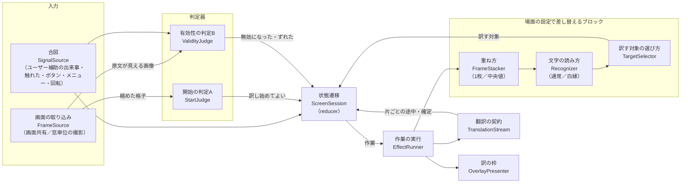
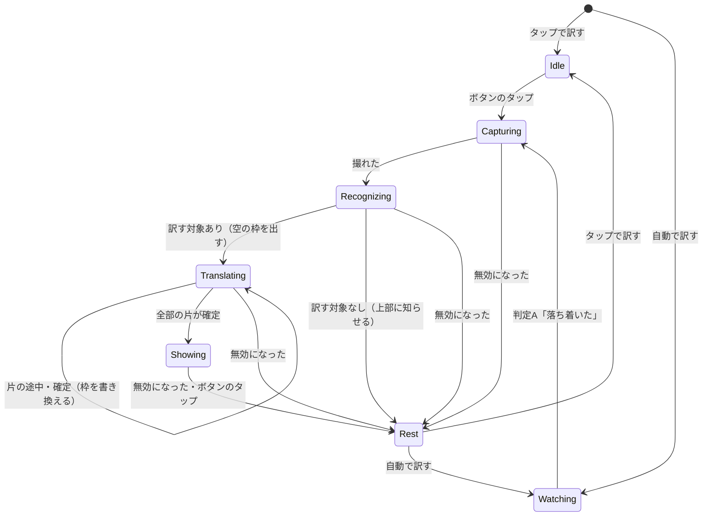
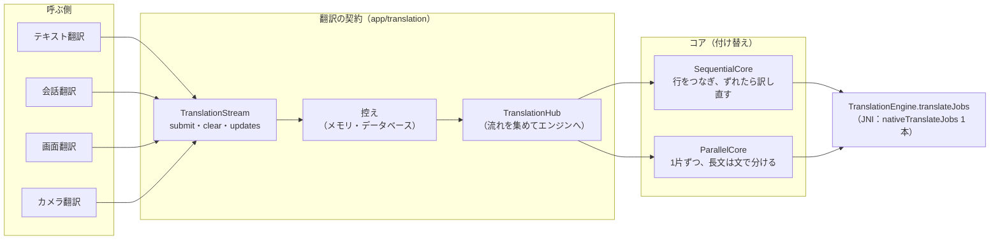

# 画面翻訳と翻訳の流れの構成

更新日：2026-11-12（作り替えの設計。実装はこの文書に沿って順に進める）

この文書は、画面翻訳の「幹」の設計である。状態遷移、判定器、差し替え可能なブロック、翻訳の契約を定める。個々の工夫（色・吹き出し・白縁の文字など）の中身は `docs/05_画面翻訳.md`、翻訳コアの中身は `docs/03_翻訳コア.md`、設計の前提にした端末の事実は `docs/12_機能テスト.md` にある。

## なぜ作り替えるか

2026-11-12に、自動翻訳で訳し始めた直後に戻っても訳が止まらず、前の画面の訳が次の画面に出た。調べると、原因は1か所の誤りではなく構成にあった（作者の指摘「設計の幹が無い」）。

- **状態遷移が無い**：画面翻訳サービスは約15個の変数とブール値の組み合わせで状態を持ち、取り消しは14か所に散らばって、場所ごとに「何を止めて何を戻すか」が違った。
- **判定が結合している**：「いつ訳し始めるか」と「出している訳がまだ有効か」を1つの比較で兼ね、ゲーム用の雑音の除き方（中央値・動いたます目の除外）が有効性の判定にも効いて、画面の8割を見ないまま判定していた。
- **モードがブロックになっていない**：動く画面のモードの分岐が if 文として9か所以上に散らばり、性質の違う2つの事（背景が動く・白縁の文字）を1つに束ねていた。
- **翻訳の入口が2つ**：1文の翻訳（テキスト・会話）と同時に訳す翻訳（画面・カメラ）で入口・受け取り口・コアの生成の処理が別々だった。入力の作り方（行をつなぐ・長文を分ける）が、コアの選び方に応じて呼ぶ側に漏れていた。
- **戻る操作は届いていなかった**：このアプリは戻る操作を受け取る仕組みを持たず、画素の変化だけで推し量っていた（`docs/12_機能テスト.md`）。

## 前提にする事実と、見込む機能

端末で確かめた事実（`docs/12_機能テスト.md`）：

- 戻る操作そのものは受け取れない。受け取れるのは結果の出来事：別の画面・窓への切り替わり（`TYPE_WINDOW_STATE_CHANGED`・`TYPE_WINDOWS_CHANGED`）、スクロール（`TYPE_VIEW_SCROLLED`、移動量つき）、選択（`TYPE_VIEW_SELECTED`）。アプリの中の画面移動では切り替わりの出来事が来ないアプリがある。
- ユーザー補助の窓単位の撮影は、自分の重ね表示を写さずに前面のアプリの窓を撮れる。専用の描画面（ゲーム・動画）も写る。ただし約0.33秒に1回まで。
- 画面共有は自分の重ね表示も写す。速く撮れる（画面が変わるたびに届く）。
- REDMAGICのゲーム支援が、ユーザー補助を止めて切り離したままにすることがある。

見込む機能（`docs/01_要件.md`・`docs/07_進め方とバックログ.md`・各設計書の「残る問題」から）：

- 画面翻訳の訳す先を日本語以外にする。原文の言語を足す。
- 場面ごとの設定（チャット・漫画・ゲーム）と、アプリごとの自動の切り替え。
- 訳の枠をスクロールに追従させる。
- 画面の回転・大きな画面への対応。縦書きの改善。
- 文字認識・翻訳モデルの差し替え（ほかのOCR、画像を直接訳すモデル）。
- 会話翻訳を画面を離れても続ける（翻訳の契約を共有する）。

## 設計の原則

1. **状態遷移は1か所**：画面翻訳の制御は、1つの状態遷移（`ScreenSession` の reducer）だけが決める。「何かが起きた」はすべて出来事（`SessionEvent`）として入り、状態遷移が次の状態と、行う作業（`Effect`）を返す。取り消しは「待ちの状態へ移る遷移」の1つで、後片付け（翻訳の取り消し・訳の枠を消す）はその遷移の作業として必ず同じものが出る。
2. **1回の翻訳はセッション番号を持つ**：撮影・文字認識・翻訳の結果は、どのセッションのものかを番号で持って戻る。今のセッションでない結果は捨てる。取り消した後に遅れて届いた結果が、次の画面に出ることが構造的に起きない。
3. **判定器は役割ごとに独立させる**：「いつ訳し始めるか」（開始の判定A）と「出している訳がまだ有効か」（有効性の判定B）は別の部品で、互いを呼ばない。どちらも入力（画面・合図）を受け取って判定を返すだけの、端末に依存しない関数にし、単体テストで確かめる。
4. **差し替えはブロック単位**：撮り方、重ね方（1枚・数枚の中央値）、文字の読み方、判定器の設定、訳の枠の出し方は、それぞれ差し替え可能な部品にする。「場面の設定（`SceneProfile`）」は、その組み合わせに名前を付けたものにすぎない。
5. **翻訳の契約は1本**：テキスト・会話・画面・カメラは、同じ入口（`TranslationStream`）に「訳す片」を出し、同じ形の結果（片ごとの途中・確定）を受け取る。1件ずつ訳すか同時に訳すか、行をつなぐか長文を分けるかは、契約の裏のコア（`SequentialCore`・`ParallelCore`）が決める。
6. **使える能力に応じて組み立てる**：ユーザー補助がつながっていれば、窓単位の撮影（原文が見える）と合図を使う。つながっていなければ、画面共有と訳の枠を隠す方法で動く。どちらでも状態遷移は同じで、入力の部品だけが替わる。ユーザー補助が「有効なのにつながっていない」なら利用者に知らせる。

## 層とモジュール

クリーンアーキテクチャの考え方のうち、「判断の中身は外の都合（端末・ライブラリ・画面）に依存しない」「依存は内側へだけ向ける」を取り入れる（作者の指示「層ごとに共通部品と機能特化を分け、ブロックを共有する」）。層の決まりを文書だけにすると崩れるので、端末に依存しない部品は Android に依存できないモジュールに置き、依存の向きをビルドで強制する。

| 層 | 中身 | 置き場 | 依存してよいもの |
| --- | --- | --- | --- |
| 中核（純粋） | 型（訳す片・格子・枠）、判定（下の表）、状態遷移（reducer）、翻訳の入力の作り方（コアの計画）、翻訳の点検 | `core-pipeline`（Kotlin/JVM のモジュール。Android に依存しない。単体テストはここで書く） | Kotlin の標準とコルーチンだけ |
| 機能 | 機能ごとの組み立て：画面翻訳のセッション、カメラの行の追跡、会話の振り分け、テキスト翻訳 | `app` の機能ごとのパッケージ | 中核、共通部品 |
| 共通部品 | 複数の機能で使う部品：翻訳の流れ（`TranslationStream`）、文字認識、訳す対象の選び方、訳の枠の文字の組み方、色 | `app/translation`・`app/overlay`、`core-ocr` | 中核 |
| 外とつなぐ | 端末やライブラリの実装：画面共有・窓単位の撮影、ユーザー補助の合図、重ね表示、llama.cpp のエンジン、データベース | `app` の各 `adapter`、`core-llm`・`core-ocr`・`core-asr`・`core-tts` | 中核の差し込み口（インターフェース） |

- 中核は、外とつなぐ部品を「差し込み口（インターフェース）」で受け取る。例：翻訳のコアの計画は `JobEngine`（訳す依頼を受け取って訳す口）に対して書き、llama.cpp のエンジンはそれを実装する。
- 言語の型（`Language`）・翻訳の依頼（`TranslationRequest`）・プロンプトの組み立て（`Pfml3PromptBuilder`）は端末に依存しないので中核へ移し、`core-llm` が中核に依存する向きにする。

## データの流れの型：命令と購読

どの層の部品も、同じ形でつなぐ（作者の指示「コマンドレスポンス式かコマンドクエリ式か、データフローを1本にする」）。

- **命令**：返り値を持たない。受け取ったらすぐ戻る（重い仕事は部品の中で非同期に行う）。
- **購読**：結果・状態・出来事は、部品が出す流れ（状態は `StateFlow`、出来事は `Flow`）で受け取る。
- 「頼むと結果が返る」形は作らない。1文だけ訳したい画面のための便利な関数は、命令と購読の上に薄く作る。

| 部品 | 命令 | 購読 |
| --- | --- | --- |
| 翻訳の流れ `TranslationStream` | `submit(片の列)`・`clear()`・`close()` | `updates`（片ごとの途中・確定・失敗） |
| 画面翻訳のセッション `ScreenSession` | `dispatch(出来事)` | `state`（状態）、`effects`（行う作業） |
| 画面の取り込み `FrameSource` | `start()`・`stop()`・`requestStill(セッション番号)` | `thumbs`（縮めた格子）、`stills`（セッション番号つきの1枚） |
| 合図 `SignalSource` | `start()`・`stop()` | `signals` |
| 訳の枠 `OverlayPresenter` | `render(表示の状態)`（前の表示との差だけを描き直す） | — |

## 部品の種類

差し替え可能な部品は、役割で4種類に分ける（作者の問い「制御ブロックだけか」への答え：制御は1つだけで、差し替えるのは変換と判定）。

| 種類 | 形 | 例 | 差し替えるか |
| --- | --- | --- | --- |
| 変換 | データを受け取り、データを返す | 重ね方・文字の読み方・訳す対象の選び方・翻訳の入力の作り方 | 場面の設定・設定で差し替える |
| 判定 | 観測と前の状態を受け取り、判断と次の状態を返す（純粋な関数） | 下の表 | 場面の設定で、判定の設定を差し替える |
| 制御 | 出来事を受け取り、次の状態と作業を返す | 画面翻訳のセッションの状態遷移 | 差し替えない（1つだけ） |
| 外とつなぐ | 命令を受け、結果を流す | 画面の取り込み・合図・訳の枠・エンジン・データベース | 使える能力に応じて差し替える |

### 判定の一覧

開始の判定A・有効性の判定B のほかにも、観測から判断を出す部品が層ごとにある（作者の問い「判定器は2つだけか」）。どれも同じ形（観測と前の状態 → 判断と次の状態）にそろえ、中核に置く。

| 層 | 判定 | 判断 | 今の場所 |
| --- | --- | --- | --- |
| 画面の取り込み | 撮った1枚が使えるか | 使える／捨てる（回転の途中・大きさ違い・自分の表示が写った） | `ScreenCapturer` の中に埋もれている |
| 訳す対象 | どの文字を訳すか | 訳す対象の列（言語・崩れた認識・重要度・吹き出しまで広げるか） | `selectTargets`・`needsTranslation` |
| セッション | 開始の判定A | 待つ／訳し始める | `StartJudge`（2026-11-12までは画面翻訳サービスの `watchScreen` に結合） |
| セッション | 有効性の判定B | 有効／無効（理由）。将来は「ずれた（dx, dy）」 | `ValidityJudge`（2026-11-12までは `watchScreen`・`switched`・`guardSwitch`・`peekUnderBoxes` に散らばっていた） |
| 合図 | 誰への操作か | 自分の窓／ほかのアプリ | `OwnTouch` |
| 場面 | どの場面の設定を使うか | 場面の設定（将来はアプリ名から自動） | 利用者が手で選ぶだけ |
| 翻訳 | 訳の点検 | 訳されていない／繰り返しが止まらない（打ち切る位置） | `TranslationChecks` |
| 翻訳 | 同じ原文か | 控えを使える／訳す | 控えの鍵、カメラの `TextSimilarity` |

## 全体の構成

- 矢印の向きがデータの流れ。状態遷移（`ScreenSession`）は、出来事を受け取って作業を返すだけで、撮影・文字認識・翻訳・表示を自分では行わない。作業の実行（`EffectRunner`）は、作業を端末の部品へ渡し、結果を出来事として状態遷移へ返す。
- 判定器A・Bは、状態遷移が「今どちらを使うか」を決める。Aは待ちの間だけ、Bは訳している間と表示している間だけ使う。

## 状態遷移

`Rest` は「後片付けをして待ちに戻る」ための遷移の名前で、状態ではない。後片付けの作業は、どこから来ても同じ3つ：今のセッションの翻訳を取り消す、文字認識・撮影を取り消す、訳の枠を消す。

無効になる出来事（どれも同じ `Rest` へ）：

| 出来事 | 出どころ | 備考 |
| --- | --- | --- |
| 別の画面・窓に切り替わった | ユーザー補助（`TYPE_WINDOW_STATE_CHANGED`・`TYPE_WINDOWS_CHANGED`）。自分の窓の出し入れは除く | アプリの切り替え・ホーム・最近使ったアプリ・画面の移動・ダイアログ |
| 原文が動いた・変わった | 判定B（窓単位の撮影で原文の場所を比べる、または訳の枠の外周を比べる）、ユーザー補助のスクロール | 追従の機能を入れたら、スクロールは「ずれた」として枠を動かす出来事に変える |
| ほかのアプリの画面に触れた | `TouchWatcher` | 訳している途中なら無効。表示中は判定Bにのぞいて確かめさせる |
| ボタンのタップ・メニューを開いた・止めた | 浮遊ボタン・メニュー | |
| 画面を回した | `onConfigurationChanged` | |
| 翻訳モデルを切り替えた | メニュー | |
| 失敗した | 撮影・文字認識・翻訳 | 上部に知らせてから待ちへ |

## 判定器

### 開始の判定A（`StartJudge`）

問い：「画面が落ち着いたので訳し始めてよいか」。自動で訳すときの待ちの間だけ使う。

- 入力：画面の取り込みから届く縮めた格子（`Thumb`）と時刻。
- 出力：待つ／訳し始める。
- 場面で替える：通常は1枚ずつ比べ、ゲームは直近の数枚の中央値で比べて動いたます目を外す。しきい値・待ちの上限も場面の設定に持つ。
- ここで使う雑音の除き方は、判定Bには渡さない。

### 有効性の判定B（`ValidityJudge`）

問い：「訳した原文が、まだ同じ場所にあるか」。訳している間と表示している間だけ使う。

- 入力：訳した時点の原文の場所（訳す対象の枠）と、その時の原文の画像（基準）。新しく撮った「原文が見える画像」。合図。
- 出力：有効／無効（理由つき）。将来、追従を入れたら「ずれた（dx, dy）」も返す。
- 画像で見る場所は、原文の枠とそのすぐ周り（吹き出しの縁・メッセージの周り）だけ。画面全体の雑音（ゲームの動く背景）は見ないので、場面によらず同じ基準で判定できる。
- 原文が見える画像の手に入れ方は、使える能力で替える：
  - ユーザー補助あり：窓単位の撮影（訳の枠が写らない）を約0.5秒ごと。
  - ユーザー補助なし：画面共有の画像で、訳の枠の外周だけを比べる。触れたときは訳の枠を隠して枠の下も比べる（今の「のぞく」）。
- 合図（切り替わり・スクロール）は、画像を待たずにすぐ無効にする。

## 差し替えるブロックと場面の設定

| ブロック | 役割 | 今ある実装 | 差し替えの例 |
| --- | --- | --- | --- |
| `FrameSource` | 画面を取り込む。縮めた格子と、文字認識・判定B用の画像を出す。自分の重ね表示が写るか・撮れる間隔を持つ | 画面共有（`ScreenCapturer`） | 窓単位の撮影（ユーザー補助） |
| `FrameStacker` | 文字認識に渡す1枚を作る | 1枚、数枚の中央値（`FrameStack`） | — |
| `Recognizer` | 文字を読む | 通常（`MultiScriptOcr.recognize`）、白縁（`recognizeOutlined`） | ほかのOCR、画像を直接訳すモデル |
| `TargetSelector` | 訳す対象と枠の位置・色を決める | `selectTargets`・`ColorSampler`・`BubbleFit` | 縦書きの改善 |
| `StartJudge` | 判定A | 1枚で比べる、中央値で比べる | — |
| `ValidityJudge` | 判定B | 原文の場所で比べる | 追従（ずれを返す） |
| `OverlayPresenter` | 訳の枠を出す | ユーザー補助の重ね表示（透けない）、ふつうの重ね表示（0.8） | — |

場面の設定（`SceneProfile`）は、`FrameStacker`・`Recognizer`・`StartJudge` の設定の組み合わせ：

| 場面 | 重ね方 | 文字の読み方 | 開始の判定 |
| --- | --- | --- | --- |
| 通常（チャット・ウェブ・漫画） | 1枚 | 通常 | 1枚で比べる（変わった6%・止まった2%・0.6秒） |
| 動く画面（ゲーム） | 5枚の中央値 | 白縁 | 中央値で比べ、動いたます目を外す（35%・4%、最大3秒） |

白縁の文字を読む・背景の動きを消すは独立した軸なので、将来「白縁の文字の漫画」などの組み合わせを足せる。アプリごとの自動の切り替えは、切り替わりの出来事のアプリ名から場面の設定を選ぶ部品を足すだけにする。

## 使える能力と組み立て

今の作り（2026-11-12）：

| 状態 | 画面の取り込み | 判定Bの画像 | 訳の枠 | 合図 |
| --- | --- | --- | --- | --- |
| ユーザー補助がつながっている | 画面共有 | 画面共有（訳の枠の外周・画面全体。触れたら枠を隠してのぞく） | ユーザー補助の重ね表示（透けない） | ユーザー補助の画面の切り替わりとスクロール、触れた知らせ |
| ユーザー補助が無効 | 画面共有 | 同じ | ふつうの重ね表示（0.8） | 触れた知らせ |
| 有効なのにつながっていない（切り離された） | 無効と同じ | 同じ | 同じ | 同じ。画面翻訳を始めて3秒後と、つながりが切れたときに、上部の表示とトーストで知らせる。設定の画面にも出す |

窓単位の撮影（ユーザー補助で、訳の枠を写さずに前面のアプリの窓を撮る）は、機能テストで使えると確かめたが、今は入れていない（判断の記録）。入れるときは、`FrameSource` の実装を1つ足し、判定Bに「訳の枠の下（原文そのもの）」の規則を足す。状態遷移は変えない。

## 実装の状況

| 段階 | 状況 |
| --- | --- |
| 0. 中核のモジュール | 済（2026-11-12） |
| 1. 翻訳の契約 | 済。テキスト・会話・カメラ・画面の4機能を移し、作者が実機で4機能とも確かめた |
| 2. 画面翻訳の状態遷移と判定器 | 済。作者が実機で、Discord（動く画面モードで訳し始めと同時に戻る・通常モードでスクロール）・漫画（ページ送り・メニュー）を確かめた。ログで、判定Bの「原文の周りが変わった」（0.32〜0.45）・「画面が切り替わった」（0.76）・「画面が変わった」、ユーザー補助の切り替わり、触れた知らせ、のぞきが、どれも働いた |
| 3. ユーザー補助の合図 | スクロールの合図と、切り離されたときの知らせを足した。窓単位の撮影は見送り。**スクロールの合図は効いていない（調べる途中）**：作者の確認（Discordのスクロール・漫画のページ送り、2026-11-12 22:13）で、ログ「画面翻訳: スクロールしたので取り消した」が1件も出なかった（取り消しは触れた知らせと判定Bで起きたので、見た目は正常だった）。設定アプリをPCからスクロールさせると、本体のユーザー補助に移動量つき（dy=404 など）で届くことは確かめた（`OverlayAccessibilityService` に調査用のログ「スクロールの知らせ（調査）」を残してある）。疑い：画面翻訳サービスの `onScrolled` まで届いていない、または届いた時点でセッションが無い（触れた知らせで先に取り消されている）。切り離されたときの知らせは、まだ実機で見ていない |
| 4. 文書 | `docs/02`・`03`・`05`・`10`・`11` をこの構成に合わせた |

## 翻訳の契約

- **入口**：`TranslationStream` を1つ開き（訳す先・原文の言語・背景・控えを使うか）、`submit(片の列)` で訳す片（番号つきの文）を出す。`clear()` でまだ訳していない片と訳している途中の片を取り消す。結果は `updates`（片の番号ごとの途中の訳・確定の訳・失敗）で受け取る。
- **控え**：同じ原文は控え（メモリ、画面翻訳はデータベースも）から確定として返し、エンジンへ渡さない。
- **コア**：設定の「同時に訳す数」が1なら `SequentialCore`、2以上なら `ParallelCore`。入力の作り方（行をつなぐ・長文を文で分ける・訳し直す）はコアの中に閉じ、呼ぶ側は片の単位で受け取る。
- **エンジン**：`TranslationEngine.translateJobs` だけ。1文の翻訳も、流れ1本でこれを使う。JNIの生成の処理は `nativeTranslateJobs` の1本にする。
- **順番**：`TranslationHub` が開いている流れを集め、空いた流れへ次の片を入れる。カメラ翻訳の「4件ずつ頼んで全部終わるまで待つ」は無くなり、訳したい段落が変わるたびに `clear` と `submit` をする。
- テキスト翻訳と会話翻訳は、片1つの流れとして使う。会話の途中訳は、新しい途中訳を出すときに `clear` してから `submit` する。

## スレッドと取り消し

- 状態遷移はメインスレッドだけで動かす。出来事は1つずつ順に処理する。
- 撮影の変換・文字認識・判定の計算は別のスレッド（コルーチン）で行い、結果はセッション番号つきの出来事としてメインスレッドへ戻す。
- 翻訳はエンジンの推論のスレッドで行う。取り消しは `TranslationStream.clear()` で、エンジンは次のトークンで止まる。
- 1つのセッションの作業は1つの親のコルーチン（セッションのスコープ）の子にし、後片付けでスコープごと取り消す。

## 将来の機能の差し込み口

| 機能 | 差し込む場所 |
| --- | --- |
| 訳す先の言語を選ぶ | 画面翻訳の設定と `TranslationStream` を開くときの訳す先。状態遷移・判定器は変えない |
| 原文の言語を足す | `Recognizer`（認識器の組み合わせ）と言語の対応 |
| アプリごとの場面の自動の切り替え | 切り替わりの出来事のアプリ名 → `SceneProfile` を選ぶ部品 |
| 訳の枠の追従 | 判定Bが「ずれた（dx, dy）」を返し、状態遷移が「枠を動かす」作業を出す。スクロールの合図の移動量を使う |
| ほかのOCR・画像を直接訳すモデル | `Recognizer` の実装。画像を直接訳すモデルは `Recognizer`＋翻訳を1つにした部品として、状態遷移には「訳す対象と訳」が同時に届く形で入れる |
| 会話翻訳を画面を離れても続ける | 翻訳の契約は同じ。会話翻訳のサービス側の話 |

## 試験

- 単体テスト（端末なしで動く）：
  - 状態遷移：出来事の並びを与え、状態と作業を確かめる。例：訳している途中に切り替わりの出来事が来たら、翻訳の取り消しと枠を消す作業が出て、待ちに戻る。取り消した後に前のセッションの翻訳の結果が届いても、枠に出ない。
  - 判定A・B：作った格子の並びで、落ち着いた・無効になったの判定を確かめる。ゲームの動く背景（原文の外が動く）では判定Bが有効のまま、原文の場所が変われば無効になる。
  - 翻訳の契約：偽のエンジンで、控え・同時に訳す・取り消し・長文の分割・行のずれの訳し直しを確かめる。
- 実機の確認（`tools/` の試験用の画面と作者のアプリ）：Discordで訳し始めと同時に戻る・スクロールする、漫画のページ送り、背景が動く試験の画面（ゲームの代わり）、画面の回転、メニュー、ユーザー補助を切った状態。どの操作でも約1秒以内に訳が消えること、背景が動いても誤って消えないことを見る。

## 移行の順番

0. **中核のモジュール**：`core-pipeline`（Kotlin/JVM）を作り、`Language`・`TranslationRequest`・`Pfml3PromptBuilder`・`TranslationChecks` を移す。`core-llm` と `app` が中核に依存する向きにする。
1. **翻訳の契約**：中核に翻訳の計画（片への分け方、2つのコア、`JobEngine` の差し込み口）を、`app/translation` に `TranslationStream`（命令と購読）と控えを作り、テキスト・会話・画面・カメラを移す。JNIの1文の生成の処理を取り除く。偽のエンジンで単体テスト、実機で4機能を確かめる。
2. **画面翻訳の状態遷移と判定器**：`ScreenSession`（reducer）・判定A・判定B・`EffectRunner` を作り、画面翻訳サービスを「部品をつなぐだけ」にする。入力は今の画面共有のまま、振る舞いを今と同じにしてから、判定Bを原文の場所で見る形に替える。
3. **ユーザー補助の合図と窓単位の撮影**：切り替わり・スクロールの合図と、窓単位の撮影を入力の部品として足す。切り離されたときの知らせも足す。
4. 調査用のログを消し、`docs/02_アーキテクチャ.md`・`docs/05_画面翻訳.md` をこの構成に合わせる。

## 判断の記録

| 日付 | 判断 | 理由 |
| --- | --- | --- |
| 2026-11-12 | 状態遷移を1つの reducer にし、取り消しを1つの遷移にする | 取り消しが14か所に散らばり、場所ごとに後片付けが違った。合図を足すたびに漏れる形だった |
| 2026-11-12 | 判定A・Bを独立した部品にし、判定Bは原文の場所だけを見る | ゲーム用の雑音の除き方が判定Bに効き、画面の8割を見ないまま判定していた。原文の場所なら場面によらず同じ基準で判定できる |
| 2026-11-12 | ユーザー補助がつながっていれば窓単位の撮影で原文を見る | 機能テストで、自分の重ね表示を写さず、描画面も写ると確かめた。訳の枠を隠すちらつきも無くなる |
| 2026-11-12 | 戻るキーを受け取る権限は足さない | 機能テストで、ジェスチャーの戻るはキーとして届かないと確かめた。ハードウェアキーボードの入力が見える権限で、得るものが無い |
| 2026-11-12 | 翻訳の契約を `TranslationStream` の1本にし、コアを付け替える | 作者の指示「入口・受け取り口・データフローは1種類、コアを付け替える」。入力の作り方がコアの選び方に応じて呼ぶ側に漏れていた |
| 2026-11-12 | 場面の設定はブロックの組み合わせの名前にする | 動く画面のモードが、背景が動く・白縁の文字という独立した2つを束ねていた |
| 2026-11-12 | 端末に依存しない部品を `core-pipeline`（Kotlin/JVM）に置き、依存の向きをビルドで強制する | 作者の指示「クリーンアーキテクチャのエッセンスで、層ごとに共通と個別を分ける」。決まりを文書だけにすると崩れる |
| 2026-11-12 | どの部品も「返り値の無い命令」と「購読する流れ」でつなぐ | 作者の指示「データフローを1本にする」。翻訳は頼むと結果が返る形、訳の枠は直接書き換える形、見張りはフラグを読む形と、ばらばらだった |
| 2026-11-12 | 窓単位の撮影は今は入れない | 作者の確認で、判定Bが訳の枠の外周で、Discord・漫画・動く画面のモードとも取り消せた。入れるには、ユーザー補助に窓の一覧と撮影の権限を足し、利用者に有効化をやり直してもらう必要がある（使って不満が出た所だけ作り込む、の方針。CLAUDE.md「進め方」）。差し込み口は「使える能力と組み立て」に書いた |
| 2026-11-12 | ユーザー補助のスクロールの知らせを取り消しの合図にする | 機能テストで、Discord・漫画のアプリとも約0.1秒ごとに移動量つきで届くと確かめた。画素の変化より先に気づける。権限は増えない（受け取る出来事の種類を足すだけ） |
| 2026-11-12 | ユーザー補助が切り離されたら知らせる | REDMAGICのゲーム支援が黙って切り離し、透けない訳の枠と合図が失われる。利用者がオフ・オンし直すまで戻らない |
| 2026-11-12 | 判定は8種類を同じ形にそろえて中核に置く | 作者の問い「判定器は2つだけか」。調べると、撮った1枚が使えるか・訳す対象・誰への操作か・場面・訳の点検・同じ原文かも判定で、層ごとに散らばっていた |
