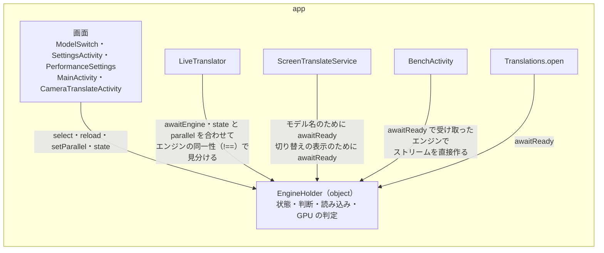
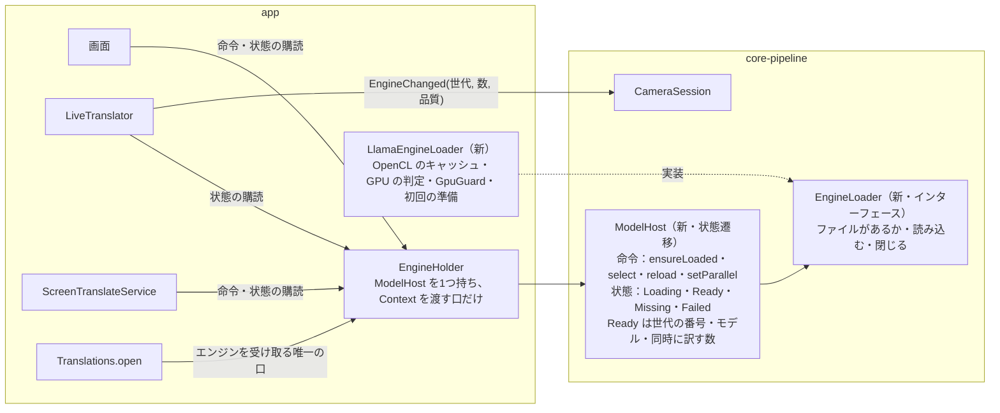

# EngineHolder を中核の状態遷移にする計画

構造の直し。振る舞いは、下の「決めてほしいこと」の1点を除いて変えない。`docs/バックログ.md`「構造の既知の問題」の次の3件を一緒に解く。

- `EngineHolder` が画面と結び付いている（翻訳の契約を迂回している残りの3か所を含む）
- カメラ翻訳でエンジンが替わったかを `app` が見分けている
- `CameraSession.Event.EngineChanged` の品質の既定値が0

## 望む状態

- 翻訳モデルの読み込み・切り替え・読み直し・同時に訳す数の変更の判断を、中核で単体テストできる（読み込み中に切り替えた、ファイルが無い、読み込みに失敗した、など）。
- 画面とサービスは、命令（選ぶ・読み直す・数を変える）を出して状態を購読するだけで、エンジンそのものを受け取らない。エンジンを受け取るのは、翻訳のストリームを開く入口（`Translations.open`）と、`docs/設計/翻訳コア.md`「ストリームを通さない呼び出し」の例外（速さの計測と初回の準備）だけにする。
- カメラ翻訳がストリームを開き直すかを、`CameraSession` が出来事の中身だけで決める。

## 今の構造の問題

- 状態（読み込み中・使える・ファイルが無い・失敗）と、判断（読み込み中なら二重に読まない、同じモデルなら何もしない、切り替えは古いエンジンを閉じてから）と、Android の処理（OpenCL のキャッシュの場所、GPU を使うかの判定、`GpuGuard`）が、1つの `object` に入っている。判断を試験できない。
- `ModelState.Ready` がエンジンそのものを持つので、状態を購読するどこからでもエンジンを使える。翻訳の契約を迂回する3か所はここから来ている。
  - `LiveTranslator`：エンジンが同じものか（`!==`）と、同時に訳す数の変化から、`EngineChanged` と `IntakeChanged` を出し分けている。この判断に試験が無い。
  - `ScreenTranslateService`：ログに出すモデル名のために、ストリームとは別に `awaitReady` を呼んでいる。
  - `BenchActivity`：`Translations.open` を通らずにストリームを作っている。
- `CameraSession.Event.EngineChanged(intake, quality = 0)`：品質を渡し忘れても品質0として動き、品質の低い訳を頼み直す規則が効かない。
- 読み込み中にモデルを選ぶと、選んだモデルは設定に保存されるが、読み込みは前に選んだモデルのまま終わる（`select` が読み込み中なら何もしない）。画面の表示は読み込んだモデル、設定は選んだモデル、と食い違い、次に起動したときに選んだモデルになる。判断が `object` の中にあり試験が無いので、見つかっていなかった。

## 直した後の構造

- **`ModelHost`（中核）**：今の `EngineHolder` の判断を移す。エンジンは `JobEngine` として持ち、状態には出さない。`Ready` は、世代の番号（読み込むたびに増える）、モデル、同時に訳す数、読み込みにかかった時間を持つ。エンジンを受け取る口は `awaitEngine` の1つだけにし、`Translations.open` と例外の2か所だけが呼ぶ。
- **`EngineLoader`（中核のインターフェース）**：読み込みの JNI を差し替える口。試験では偽物を渡し、読み込みの遅れ・失敗・ファイルが無い、を作る。
- **`LlamaEngineLoader`（`app`）**：OpenCL のキャッシュの場所、Snapdragon かの判定、`GpuGuard`、初回の準備の推論（`warmUp`）を今のまま移す。
- **`EngineHolder`（`app`）**：`ModelHost` を1つ持ち、`Context` から設定（`TranslationPreferences`）とローダーを渡すだけの薄い口にする。画面からの呼び方（`select`・`reload`・`setParallel`・`ensureLoaded`・`state`）は名前を変えないので、画面の書き換えは `ModelState.Ready.engine` を読んでいる所だけで済む。
- **カメラ翻訳**：`LiveTranslator` は `Ready` の世代の番号・同時に訳す数・品質をそのまま `CameraSession.Event.EngineChanged(generation, intake, quality)` にして渡す。品質の既定値は外す。開き直すか（世代が変わった）、渡しておく数だけ変えるか（世代が同じ）は `CameraSession` が決め、`IntakeChanged` はなくす。この判断に中核の試験を足す。
- **画面翻訳**：モデル名は、ストリームが訳したモデルを結果の数（`TranslationStream.Stats`）に載せて返し、`TranslationRun` はそれをログに出す。切り替えの表示（「〜を読み込んでいます」→「〜にしました」）は、`awaitReady` ではなく状態の購読で出す。
- **`BenchActivity`**：`Translations.open` で開く（画像ごとに新しいメモリのキャッシュを渡し、永続キャッシュは渡さない。今と同じ条件）。
- デバッグの放送（`DEBUG_CONFIG`）でエンジンの設定を変える所は、計測の例外として `awaitEngine` を使ったまま残し、例外の一覧に足す。

翻訳の契約（`TranslationStream` の命令と購読）は変えない。`Stats` に1つ項目が増えるだけ。モジュールの依存も変えない（中核は `JobEngine` だけを知り、`core-llm` を知らない）。

## 移す順番

1. **`ModelHost` と `EngineLoader` を中核に作り**、状態遷移の単体テストを書く（同じモデルを選んでも何もしない、ファイルが無い、失敗、読み直し、数の変更で世代が変わらない、読み込み中に選んだとき）。
2. **`EngineHolder` を `ModelHost` の口にし**、`LlamaEngineLoader` を作る。画面の `ModelState.Ready.engine` を読んでいる所を直す。
3. **カメラ翻訳**：`EngineChanged` に世代の番号を持たせ、品質の既定値と `IntakeChanged` を外す。`CameraSession` の試験を足す。
4. **画面翻訳**：モデル名を `Stats` から取り、切り替えの表示を状態の購読にする。
5. **`BenchActivity`** を `Translations.open` で開くようにする。
6. 設計書（`docs/設計/翻訳コア.md`「ストリームを通さない呼び出し」・`docs/設計/アーキテクチャ.md`）、`tools/check-design.ps1` の約束（エンジンを受け取る口の制限を機械で見られれば足す）、バックログを直し、この計画を畳む。

## 確かめ方

- **単体テスト**：`:core-pipeline:test` と `:app:testDebugUnitTest`（`--max-workers=2`）。
- **端末**（デバッグ版を入れて）：
  - アプリを開いて、モデルが読み込まれる。読み込み中に設定で別のモデルを選んだときは、下の決めたとおりになる。
  - テキスト翻訳・会話翻訳・カメラ翻訳・画面翻訳のそれぞれで、0.8B と 2B を切り替えて訳せる。
  - カメラ翻訳で、訳している途中にモデルを切り替えると訳が出直し、同時に訳す数を変えると訳は出直さない。
  - 画面翻訳のメニューでモデルを切り替えると「読み込んでいます」→「にしました」が出る。ログの完了の行にモデル名が出る。
  - 設定の「性能」で CPU の詳細を変えると読み直す。
  - 評価の `BenchActivity` が今までと同じ形の結果を出す。
- **レビュー**：全部のコミットの後に、`design-reviewer` に差分を読ませる。

## 決めてほしいこと

- **読み込み中に別のモデルを選んだとき**：推奨は、今の読み込みが終わったら、選んだモデルを続けて読み込む（設定と表示が食い違わない）。今のまま（その起動の間は前のモデル）にもできる。
- 端末の確認は私が行い、最後に作者に4機能を一通り触ってもらう。
