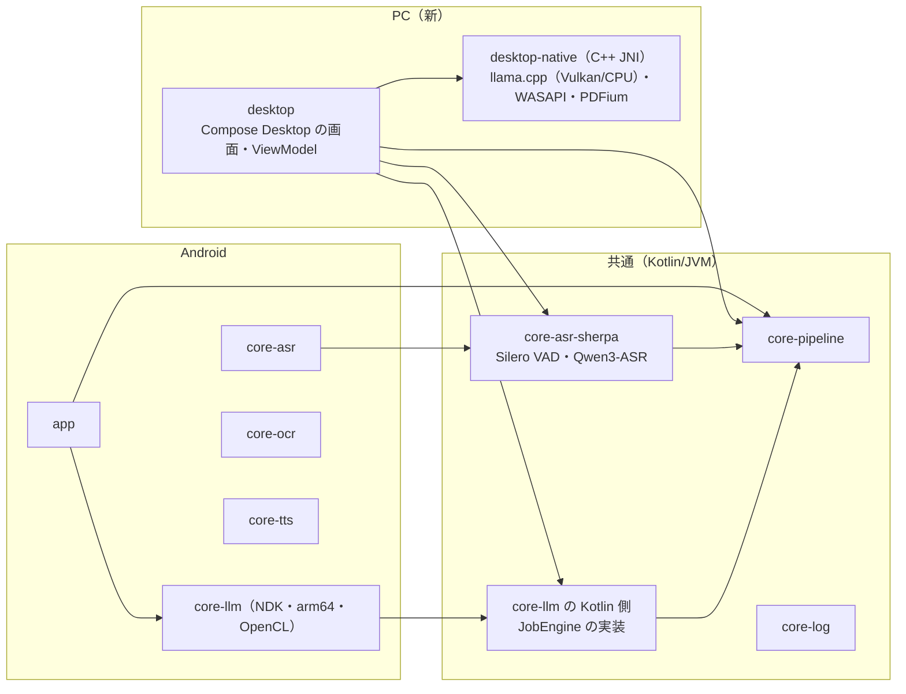
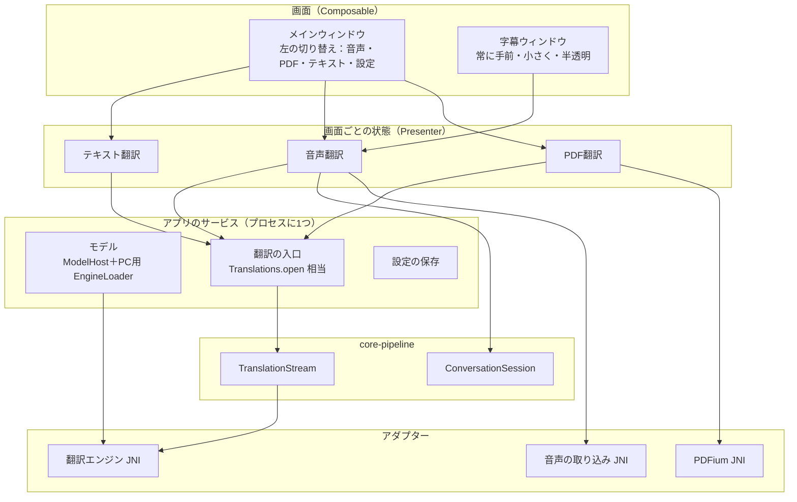

# PC版を足す計画

機能の追加と、それを差し込むための構造の直し。要件は `docs/要件.md`「PC版」。Android版の振る舞いは変えない。

## 望む状態

- Windows 11 x64 のPCで、音声翻訳（マイクと再生音の書き起こしと訳）・PDF翻訳・テキスト翻訳が、PCの中だけで動く。後から画面翻訳を足せる。
- 判断と状態遷移（`core-pipeline`）と翻訳の契約（`TranslationStream`）は、Android版とPC版で同じものを使う。PC版のために中核へ分岐を足さない。
- PC版で変わるのは、外側の部品（推論のビルド、音声の取り込み、画面、モデルの置き場）だけにする。

## 構成

- **`desktop`（新）**：Compose Multiplatform Desktop のアプリ。画面と ViewModel は、Android の `AndroidViewModel` に依存するので、初めは PC 用に別に持つ。共通にしたくなった画面だけ、状態とコールバックを受ける Composable を共有のモジュールへ出す。
- **翻訳エンジン**：`core-llm` の `plamo_llm.cpp` と Kotlin の `JobEngine` の実装を、Android と PC で同じものにする。Android 固有の部分（logcat、`APerformanceHint`、OpenCL の設定、`/proc`）は、ビルドの条件で分ける。Kotlin 側を Kotlin/JVM のモジュールに出すかは、手順1で JNI の読み込み方の違いを見て決める。
- **`desktop-native`（新）**：PC 用の C++ をまとめる。llama.cpp は今の固定版を使い、GPU は Vulkan で始める（CUDA は配る大きさが数百MB増えるので、Vulkan で速さが足りないときだけ比べる）。
- **音声認識**：中核のインターフェース（`VoiceActivity`・`SpeechRecognizer`）を実装する Silero VAD と Qwen3-ASR は、`core-asr-sherpa`（Kotlin/JVM）で共有する。Windows は PC のリプレイと同じ sherpa-onnx の Kotlin API と Windows x64 JNI を使う。Android の組み立て、SenseVoice、Whisper tiny は `core-asr` に置く。
- **データの置き場**：モデルと設定は `%LOCALAPPDATA%` の下に置く。

## GUIの構成

GUI は Kotlin で書き、Compose Multiplatform Desktop（JVM の上で動き、Windows では普通のウィンドウのアプリになる）で描く。C++ は、速さが要る部品と OS の機能（翻訳エンジン・音声の取り込み・PDF の描画）にだけ使う。

| 案 | 採るか | 理由 |
| --- | --- | --- |
| Compose Desktop（Kotlin） | 採る | 中核（`core-pipeline`）を同じプロセスでそのまま呼べる。Android と同じ書き方・色の決まりを使える |
| C++ の GUI（Qt・WinUI 3 など） | 捨てる | 中核が Kotlin なので、判断を C++ に書き直すか、別プロセスとやり取りする必要がある。Qt は LGPL・GPL の条件が付く |
| Web の画面（Tauri・Electron） | 捨てる | 同じく中核との間に別プロセスのやり取りが要る。Electron は配る大きさとメモリが大きい |

- **画面は状態を描くだけにする**：Composable は Presenter の `StateFlow` を描き、操作を返り値の無い命令として Presenter に渡す。画面の中で判断しない。
- **Presenter は機能ごとに1つ**：画面の状態を組み立て、命令を中核とサービスに渡す。判断（訳す順番・区切り・どのページを先に訳すか）は中核に置き、単体テストで確かめる。PDF の「どの段落を次に訳すか」も中核の判定として作る（カメラ翻訳の `TranslationPlan` と同じ形）。
- **サービスはプロセスに1つ**：モデル・翻訳の入口・設定を、起動時に1か所（組み立ての関数）で作り、Presenter に渡す。DI のライブラリは使わない。翻訳エンジンはウィンドウを閉じても作り直さない。
- **スレッド**：画面は Swing の UI スレッド（`kotlinx-coroutines-swing` の `Dispatchers.Main`）、翻訳・音声・PDF の描画はそれぞれの部品の中のスレッドで動く。
- **ウィンドウ**：メインウィンドウ1つに機能を並べる。音声翻訳は、動画や会議の画面の上に出す字幕ウィンドウ（常に手前、半透明、位置と大きさを覚える）を持つ。画面翻訳は手順5で、クリックを下のアプリへ通す透明なウィンドウを足す（Compose だけでは通せないので、Win32 の設定を JNI で効かせる）。
- **PDF の画面**：ページは PDFium で画像に描き、その上に訳を Compose で重ねる。訳の段落にマウスを乗せると、原文の範囲を光らせる（訳と原文の対応）。原文と訳の並べ表示にも切り替えられる。ページの画像は先の数ページ分を描いておく。
- **Android との共有**：初めは画面を共有しない。色の決まり（`docs/設計/デザイン言語.md`）は PC にも使い、色の値を PC 用のテーマに写す。同じ画面を両方で使いたくなったら、その Composable だけを共有のモジュールへ出す。

## 技術の選択

| 用途 | 選ぶもの | 理由と捨てた案 |
| --- | --- | --- |
| 画面 | Compose Multiplatform Desktop | Android の画面の書き方と部品を流用できる |
| 翻訳 | llama.cpp（今の固定版）＋Vulkan、無ければCPU | どのGPUでも動き、配る大きさが小さい。CUDA は必要になったら比べる |
| 音声の取り込み | 小さな C++ JNI で WASAPI を直接使う。再生音はプロセスループバックで自分の音を除く | Java Sound は再生音を取れない。自分の読み上げを拾わない仕組みが OS にある |
| 音声認識 | sherpa-onnx 2.0.1 の JVM 版、Silero VAD＋Qwen3-ASR から | Android と同じモデル。SenseVoice は Windows で落ちる既知の問題（`docs/バックログ.md`）を解いてから |
| 読み上げ | Supertonic 3（sherpa-onnx）＋Java Sound。中国語は Windows の音声 | Android と同じモデル。速さを測ってから入れる |
| PDF | PDFium（C の API を JNI で呼ぶ）で描画と文字の位置を取る | 速さが要件の上位にある。PDFium はブラウザの PDF 表示と同じ描画の部品で、PDFBox（Java）より描画が速い。BSD・Apache 系で GPL ではない |
| 配布 | Compose の `packageMsi` で MSI を作り、GitHub のリリースに置く | 更新は、新しいリリースを知らせて取りに行かせる形から始める |

## 作る順番

区切りは「PCに入れて触れる版」。各手順の終わりで、作者の PC（`docs/要件.md`「PC版」）で触って確かめる。

1. **土台とテキスト翻訳**：`desktop` を作り、llama.cpp を PC 向けにビルドして、入力欄に入れた文を訳す。CPU と Vulkan のバックエンドを同じビルドに入れる。テキスト翻訳は、土台を端から端まで通すための最小の画面として作る。
2. **音声翻訳**：マイクと再生音を取り込み、書き起こしと訳を出し続ける。マイクは `ConversationSession` をそのまま使う。再生音は相手の言語を指定した一方向の字幕として始め、字幕の画面を作る。読み上げは、ここで速さを測ってから入れるかを決める。
3. **PDF翻訳**：PDFium でページを描き、文字の位置から段落を組み、見ているページから訳して重ねる。訳は翻訳のストリームで並べて訳し、次のページを先に訳しておく。訳は永続のキャッシュ（`PersistentCache`）に残し、開き直したときに訳し直さない。
4. **テキスト翻訳の仕上げ**：Android 版のテキスト翻訳の機能（言語の選択・読み上げ・コピー）をそろえる。モデルのダウンロードとアプリの更新の確認を PC に移す。
5. **画面翻訳**：ウィンドウを撮って文字認識し、透明なウィンドウに訳を重ねる。PC の文字認識（PP-OCR を ONNX Runtime の JVM 版で）はここで入れる。

## 先に確かめること

- **ネイティブのライブラリの衝突**：sherpa-onnx と ONNX Runtime の JVM 版が、同じ名前の `onnxruntime.dll` を持つ。ONNX Runtime の JVM 版は、Whisper の言語の判定と文字認識で要る。手順2では言語を指定して始め、JVM 版を読み込まない。読み込む段になったら、sherpa-onnx を ONNX Runtime を静的に組み込んでビルドする案から試す。
- **指定した言語の受け渡し**：利用者が発話言語を指定したときは、`SpeechLanguages.specified` を渡してその言語で直接書き起こす。`ConversationSession` も明示された発話者の言語から翻訳方向を決める。言語候補の数と利用者の指定は別に扱う。Android の既存の呼び出しはこれまでと同じ候補と言語判定を使う。
- **CPU だけの速さ**：`-PdesktopCpuOnly=true` で起動し、Qwen3-ASR と翻訳を同時に回して字幕が遅れ続けないかを測る。自動で選ばれたスレッド数、モデルごとの「速さを調整」の結果、計測に使った「同時に訳す数」を記録する。Vulkan でも同じ条件を記録し、字幕の遅れを比較する。
- **PDF の読む順**：段組み・縦書き・表で、文字の位置から段落を正しく組めるか。手順3で、作者の読みたい PDF で確かめる。
- **PDF 翻訳の動作確認に使う資料**：作者が用意した、USB の CAN インターフェース（Kvaser 製）の英語の取扱説明書2冊（20ページと26ページ。どちらも文字を取り出せる PDF で、1冊は独自の符号化の Type1 フォントを使う）。著作物なので Git に入れず、作者の手元に置く。手順3では、この2冊で、開いてから最初のページが出るまで・訳がそろうまでの時間と、表・箇条書き・図の説明の段落の組み方を確かめる。

## 進め方

- 構成とPDFiumは作者と合意した。
- PC版は試作として作り、使った結果で丸ごと作り直すこともあり得るものとして進める。そのため、共通の部品（`core-pipeline`・`core-log`・翻訳エンジン）に入れる変更は、PC版が無くなっても Android 版にとって正しい形のものだけにする。PC版のための都合は `desktop` と `desktop-native` の中に閉じる。
- `desktop` の中でも設計の幹（`docs/設計/アーキテクチャ.md`「設計の原則」）を守る。判断は中核に置き、翻訳は `TranslationStream` を通し、部品は命令と購読でつなぐ。

## 手順1の実装と確認

- `core-llm` は Android の JNI ビルドと難読化設定を持つ。Kotlin の `TranslationEngine`・`LlamaNative` は `core-llm-jvm` に移し、元のパッケージとクラス名を保った。同じ JNI 名で両 OS から呼べ、Android 側も推論の契約を Android SDK なしで試験できる。`core-pipeline`・`core-log` に PC 版の分岐は入れない。
- `desktop-native` は独立した CMake プロジェクトにした。Android の Gradle ビルドに PC 用の C++ ツールを要求せず、`desktop` の起動にはビルド済みの DLL だけを渡せる。
- Visual Studio Community 2026（18.12.1）、CMake 3.31.6、Ninja で CPU 向け DLL 9種と Vulkan 向け DLL を同時にビルドした。Core i3-12100 で `ggml-cpu-alderlake.dll` が選ばれ、Vulkan0 は NVIDIA GeForce RTX 4060 として認識された。`:desktop:run` の検証用エントリーポイントから 0.8B を Vulkan で読み込み、製品のテキスト翻訳処理で英語1文を日本語に訳せた。
- `desktop` の偽エンジンで、途中訳から確定訳への更新、コピー、取り消し、モデル未配置時の状態を確かめた。`core-llm-jvm` と `core-pipeline` の単体試験も通過した。
- Android 用の CMake は変更していない。共有 JNI の差分では、Android で有効な行がログ定数、性能ヒントの有無、ファイル名抽出の等価な書き換えを除き従来と同じであることを確かめた。Android APK のビルドは未実施。`docs/手順/開発環境.md` の Android 開発環境で `.\gradlew.bat :app:assembleDebug` を実行して確かめる。

### PCの翻訳速度（未計測）

音声翻訳と PDF 翻訳を実装した状態で、CPU と Vulkan を比較する。測定条件は Windows 11 x64、Core i3-12100、RTX 4060、メモリ 32 GB。同じ llama.cpp と Q4_K_M の GGUF を使う。

| モデル | バックエンド | 翻訳完了（ms） | 生成速度（token/s） |
| --- | --- | --- | --- |
| 0.8B | CPU | 未計測 | 未計測 |
| 0.8B | Vulkan | 未計測 | 未計測 |
| 2B | CPU | 未計測 | 未計測 |
| 2B | Vulkan | 未計測 | 未計測 |

1. 2つの GGUF を `ModelCatalog.kt` の固定 URL から取得し、`Get-FileHash -Algorithm SHA256` で照合して Git の外に置く。`docs/手順/開発環境.md`「Windows版のビルドと実行」の手順で DLL を1回作る。Vulkan は既定の設定で起動し、CPU は `-PdesktopCpuOnly=true` を付けて起動する。
2. 「設定」でモデルを選び、使用中のバックエンドを確認する。CPU 用 DLL の版と Vulkan のデバイス名を起動ログから記録する。モデルを読み込むたびに、本計測とは別の文を1回訳して初回の準備を済ませる。Vulkan の欄に記録するのは GPU で実行できた測定に限る。
3. 原文「明日の朝は雨が降るので傘を持っていこう。」を日本語から英語へ3回訳す。起動した端末の `翻訳完了: … ms（キャッシュ=false）` から依頼から確定までの時間を、`生成: … トークン/秒` から最初の生成トークン以降の速度を採り、条件ごとの中央値を記録する。前者にモデルの読み込み時間は含めない。1件で終わらない場合は生成速度の測定条件を見直す。

## 手順2の実装と確認

- マイクは利用者が発話側を選んで開始し、同じ言語の組で開始し直すと前のカードを残す。再生音は指定した原文言語から一方向に訳す。取り込み、認識、翻訳、字幕ウィンドウの構成は `docs/設計/会話翻訳.md`「Windows 版の音声翻訳」。
- Vulkan 版に音声取り込み用の JNI を追加して Visual Studio 2026 でビルドし、`:desktop:run` のウィンドウが開くことを確認した。Windows の実モデルで別プロセスから英語の合成音声を再生し、書き起こし、日本語の確定訳、字幕用の原文と訳の組を確認した。マイクは開始・停止と PCM の受信を確認した。マイクへの発話と字幕ウィンドウの復元の確認は `docs/バックログ.md` に残す。
- Windows のシステム DLL と sherpa-onnx の ONNX Runtime の衝突は、配布物の DLL を絶対パスで先に読み込んで解消した。別プロセスの Qwen3-ASR 録音リプレイと、中核・共有認識・Presenter の単体試験が通る。音声翻訳の性能は未計測。
