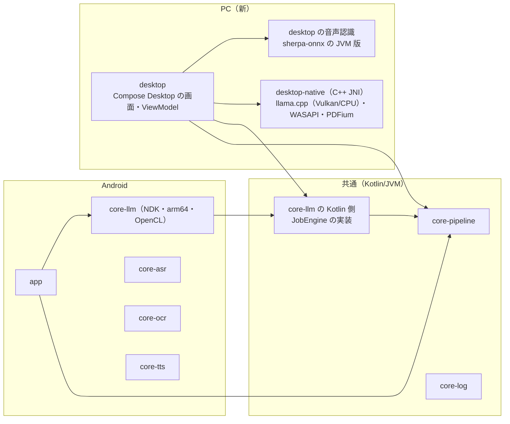

# PC版を足す計画

機能の追加と、それを差し込むための構造の直し。要件は `docs/要件.md`「PC版」。Android版の振る舞いは変えない。

## 望む状態

- Windows 11 x64 のPCで、音声翻訳（マイクと再生音の書き起こしと訳）・PDF翻訳・テキスト翻訳が、PCの中だけで動く。後から画面翻訳を足せる。
- 判断と状態遷移（`core-pipeline`）と翻訳の契約（`TranslationStream`）は、Android版とPC版で同じものを使う。PC版のために中核へ分岐を足さない。
- PC版で変わるのは、外側の部品（推論のビルド、音声の取り込み、画面、モデルの置き場）だけにする。

## 構成

- **`desktop`（新）**：Compose Multiplatform Desktop のアプリ。画面と ViewModel は、Android の `AndroidViewModel` に依存するので、初めは PC 用に別に持つ。共通にしたくなった画面だけ、状態とコールバックを受ける Composable を共有のモジュールへ出す。
- **翻訳エンジン**：`core-llm` の `plamo_llm.cpp` と Kotlin の `JobEngine` の実装を、Android と PC で同じものにする。Android 固有の部分（logcat、`APerformanceHint`、OpenCL の設定、`/proc`）は、ビルドの条件で分ける。Kotlin 側を Kotlin/JVM のモジュールに出すかは、手順1で JNI の読み込み方の違いを見て決める。
- **`desktop-native`（新）**：PC 用の C++ をまとめる。llama.cpp は今の固定版を使い、GPU は Vulkan で始める（CUDA は配る大きさが数百MB増えるので、Vulkan で速さが足りないときだけ比べる）。
- **音声認識**：中核のインターフェース（`VoiceActivity`・`SpeechRecognizer`）の実装を、sherpa-onnx の JVM 版で置く。PC のリプレイ（`docs/手順/開発環境.md`）で Silero VAD・Qwen3-ASR が Windows で動くことは確かめてある。
- **データの置き場**：モデルと設定は `%LOCALAPPDATA%` の下に置く。

## 技術の選択

| 用途 | 選ぶもの | 理由と捨てた案 |
| --- | --- | --- |
| 画面 | Compose Multiplatform Desktop | Android の画面の書き方と部品を流用できる |
| 翻訳 | llama.cpp（今の固定版）＋Vulkan、無ければCPU | どのGPUでも動き、配る大きさが小さい。CUDA は必要になったら比べる |
| 音声の取り込み | 小さな C++ JNI で WASAPI を直接使う。再生音はプロセスループバックで自分の音を除く | Java Sound は再生音を取れない。自分の読み上げを拾わない仕組みが OS にある |
| 音声認識 | sherpa-onnx 2.0.1 の JVM 版、Silero VAD＋Qwen3-ASR から | Android と同じモデル。SenseVoice は Windows で落ちる既知の問題（`docs/バックログ.md`）を解いてから |
| 読み上げ | Supertonic 3（sherpa-onnx）＋Java Sound。中国語は Windows の音声 | Android と同じモデル。速さを測ってから入れる |
| PDF | PDFium（C の API を JNI で呼ぶ）で描画と文字の位置を取る | 速さが要件の上位にある。PDFium はブラウザの PDF 表示と同じ描画の部品で、PDFBox（Java）より描画が速い。BSD・Apache 系で GPL ではない |
| 配布 | Compose の `packageMsi` で MSI を作り、GitHub のリリースに置く | 更新は、新しいリリースを知らせて取りに行かせる形から始める |

## 作る順番

区切りは「PCに入れて触れる版」。各手順の終わりで、作者の PC（`docs/要件.md`「PC版」）で触って確かめる。

1. **土台とテキスト翻訳**：`desktop` を作り、llama.cpp を PC 向けにビルドして、入力欄に入れた文を訳す。CPU で通してから Vulkan を足し、0.8B と 2B の速さを測る。テキスト翻訳は、土台を端から端まで通すための最小の画面として作る。
2. **音声翻訳**：マイクと再生音を取り込み、書き起こしと訳を出し続ける。マイクは `ConversationSession` をそのまま使う。再生音は相手の言語を指定した一方向の字幕として始め、字幕の画面を作る。読み上げは、ここで速さを測ってから入れるかを決める。
3. **PDF翻訳**：PDFium でページを描き、文字の位置から段落を組み、見ているページから訳して重ねる。訳は翻訳のストリームで並べて訳し、次のページを先に訳しておく。訳は永続のキャッシュ（`PersistentCache`）に残し、開き直したときに訳し直さない。
4. **テキスト翻訳の仕上げ**：Android 版のテキスト翻訳の機能（言語の選択・読み上げ・コピー）をそろえる。モデルのダウンロードとアプリの更新の確認を PC に移す。
5. **画面翻訳**：ウィンドウを撮って文字認識し、透明なウィンドウに訳を重ねる。PC の文字認識（PP-OCR を ONNX Runtime の JVM 版で）はここで入れる。

## 先に確かめること

- **ネイティブのライブラリの衝突**：sherpa-onnx と ONNX Runtime の JVM 版が、同じ名前の `onnxruntime.dll` を持つ。ONNX Runtime の JVM 版は、Whisper の言語の判定と文字認識で要る。手順2では言語を指定して始め、JVM 版を読み込まない。読み込む段になったら、sherpa-onnx を ONNX Runtime を静的に組み込んでビルドする案から試す。
- **CPU だけの速さ**：作者の PC の CPU は4コア。Qwen3-ASR と翻訳を同時に回して、字幕が遅れ続けないかを手順2で測る。翻訳は GPU に載せるので、CPU は音声認識に回せる見込み。
- **PDF の読む順**：段組み・縦書き・表で、文字の位置から段落を正しく組めるか。手順3で、作者の読みたい PDF で確かめる。

## 進め方

- 構成とPDFiumは作者と合意した。
- PC版は試作として作り、使った結果で丸ごと作り直すこともあり得るものとして進める。そのため、共通の部品（`core-pipeline`・`core-log`・翻訳エンジン）に入れる変更は、PC版が無くなっても Android 版にとって正しい形のものだけにする。PC版のための都合は `desktop` と `desktop-native` の中に閉じる。
- `desktop` の中でも設計の幹（`docs/設計/アーキテクチャ.md`「設計の原則」）を守る。判断は中核に置き、翻訳は `TranslationStream` を通し、部品は命令と購読でつなぐ。
