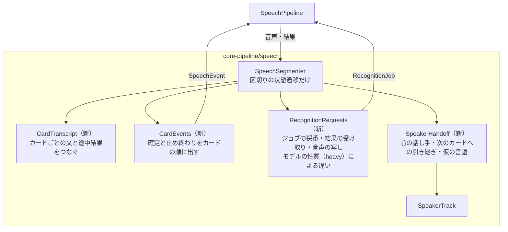

# SpeechSegmenter を責務ごとに分ける計画

振る舞いを変えない構造の直し。`docs/バックログ.md`「構造の既知の問題」の「`SpeechSegmenter` が大きい」を解く。

## 望む状態

- 会話翻訳の次の改善（翻訳に会話の文脈を渡す、区切り待ちの数え方など）で `SpeechSegmenter` を触るとき、区切りの状態遷移だけを読めば済む。
- 書き起こしをつなぐ処理、確定をカードの順に出す処理、話し手の引き継ぎを、それぞれ単体テストで確かめられる。
- 区切り・書き起こし・確定の出来事は、前後で1つも変わらない。

## 今の構造の問題

`SpeechSegmenter`（約830行）が、次の5つの責務を1つのクラスに持つ。会話翻訳の変更のたびにここが変わり（これまでに26回）、局所修正が重なっている。

| 責務 | 今の場所 | 問題 |
| --- | --- | --- |
| 区切りの状態遷移（VAD の文の終わり・話し終わり・長い発話・手で区切る・交代で区切る） | `accept`・`cutAt`・`close`・`findSeam`・`closeAfterSeam` | ほかの責務と変数を共有していて、状態遷移だけを読めない |
| 文ごとに書き起こしてつなぐ（文・区切った残り・途中結果をつないで途中結果と確定の文字にする） | `Phrase`・`Closing`・`Card.tail`・`showStitched`・`finishIfReady` の前半・`stitchedEnd` | 状態遷移の変数（`buffer`・`bufferStart`）と混ざり、単体で試せない |
| 確定をカードの順に出す | `Card.held`・`Card.after`・`send`・`sendLast`・`pump` | 出来事の順番の約束が、状態遷移の中に埋もれている |
| ジョブの出し方と、モデルの性質による間隔 | `job`・`transcribe`・`scores`・`capture`・`watchInterval`・`partialInterval`・`heavy` | 書き起こしが重いか（`heavy`）の分岐が、`capture` と途中結果の間隔の2か所に散っている |
| 話し手の決め方の残り | `lastLang`・`fallbackLang`・`CARD_LANG_MAX_SAMPLES`・`cutAt` の `lang`/`sure`・`judgePhrase` と `follow` | 話し手は `SpeakerTrack` が決める約束なのに、次のカードへの引き継ぎと、決まらないときの仮の言語はセグメンターが決めている。判定（`SpeakerTrack.Verdict`）の実行も `judgePhrase`（`Cut`）と `follow`（それ以外）の2か所にある |

## 直した後の構造

- **`CardTranscript`**：1枚のカードの文（`Phrase`）、まだ終わっていない文の途中結果（`tail`）、区切ると決めたときの部品（`Closing.parts`）を持ち、「今出す途中結果の文字」「確定の文字（全部届いていれば）」を返す。音声のバッファーは持たず、位置は聞き始めからのサンプル数だけで扱う。
- **`CardEvents`**：カードの番号ごとに出来事を受け、先頭のカードが終わるまで後ろのカードの確定を持っておく。今の `held`・`after`・`pump` をそのまま移す。
- **`RecognitionRequests`**：ジョブの番号と、結果を渡す関数（`handlers`）、`transcribe`・`scores`・`seam` のジョブの組み立て、音声の写し（`capture`）、途中結果と監視の間隔の計算を持つ。書き起こしが重いモデルかの分岐はここだけに置く。
- **`SpeakerHandoff`**：前のカードの話し手（`lastLang`）、交代で区切ったときの次のカードの話し手（言語と確かか）、決まらないときの仮の言語（カードの言語→前の話し手→自分の言語、5秒たっても決まらないとき）を持つ。`SpeakerTrack` はカードごと、`SpeakerHandoff` はカードをまたぐ、と分ける。
- **判定の実行を1か所にする**：`SpeakerTrack.Verdict` を実行する関数を1つにし、`Cut` も `Seek`・`Assign` と同じ場所で実行する。`judgePhrase` は判定を受けて書き起こすかだけを決める。
- **`SpeechSegmenter`**：VAD の信号と結果から、文の終わり・話し終わり・長い発話・区切りを決める状態遷移だけが残る。見込みは350〜450行。

公開の口（`accept`・`onResult`・`flush`・`cut`・`reset`・`close`・`idle`・`openCardId`・`languages`）と、`SpeechEvent`・`RecognitionJob` の契約は変えない。モジュールの依存も変えない。

## 移す順番

1コミット1部品で、各コミットの後に既存の単体テストがすべて通ることを確かめる。

1. **`CardEvents`** を分ける。出来事の順番の単体テストを足す（後ろのカードが先に終わっても、確定は前のカードの後に出る。止め終わりは最後のカードの後）。
2. **`RecognitionRequests`** を分ける。`heavy` の分岐をここに集める。
3. **`CardTranscript`** を分ける。つなぐ処理の単体テストを足す（文の書き起こしが途中まで届いたとき、途中結果が古いとき、全部届いたときの確定の文字）。
4. **`SpeakerHandoff`** を分け、判定の実行を1か所にする。引き継ぎの単体テストを足す（交代で区切ったときは確か、長い発話で区切ったときは前のカードの話し手が確かかを引き継ぐ、話し終わりの後は前の話し手を仮に使う）。
5. 設計書（`docs/設計/会話翻訳.md` の部品の一覧）とバックログを直し、この計画を畳む。

## 確かめ方

- **単体テスト**：各コミットで `:core-pipeline:test`（`--max-workers=2`）。`SpeechSegmenterTest` は直さずに通す。直さないと通らなければ、振る舞いが変わったとみなして止める。
- **PC のリプレイ**：変更前と変更後で、`tools/make-conv.py` の試験音声3本（重ねる交代のもの3本を含め6本）を `ConversationReplayTest`（Qwen3-ASR）で流し、出力（カードの一覧と区切りの経過）が完全に一致することを確かめる。リプレイは処理時間の式で時間を進めるので、同じ入力なら同じ出力になる。長い試験なので、作者が指定した時間に、変更前を1回・全部のコミットの後に1回だけ回す。
- **端末**：最後に、試験音声を端末に流し（`--es wav`）、`score-conv.py` の採点の結果が変更前と揺れの範囲で同じであることを見る。SenseVoice は PC のリプレイで落ちるので、端末でだけ確かめる。
- **レビュー**：全部のコミットの後に、`design-reviewer` に差分を読ませる。

## 決めてほしいこと

- PC のリプレイ（変更前と後の2回。それぞれ数分〜十数分、CPU を使う）と端末の確認を回す時間。
