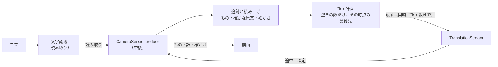

# カメラ翻訳の読み取りと訳し方を作り直す（計画・合意済み、段階1を実装）

カメラ翻訳で、一時停止の後に見えている20件ほどの訳がそろうまで数十秒待たされる。症状を抑えるのではなく、常に読み続けられるカメラの性質を生かした「あるべき姿」から、読み取りと訳し方を作り直す計画。中核に判断を移し、カメラ翻訳の制御を状態遷移にするので、作者の合意を取ってから進める。

## 今の作りで起きていること

実機（REDMAGIC 11 Pro、0.8B、CPU だけ、同時に訳す数4）で、一時停止の後のログを見た。

- 見えていたのは20件ほどなのに、翻訳エンジンは1回で67件を訳した（25秒）。続けて35件（19秒）。
- 1件ごとの「頼んでから訳が出るまで」は1.2秒から21秒まで、頼んだ順に伸びた。今見ている文が、前に頼んだ文の後ろで待たされている。

原因は3つある。どれも、訳を「文字列」に結び付けていることから来ている。

1. **読み取りが確かにならない**：行ごとに直近8回の読み取りを持ち、ほかといちばん似ている1つを選ぶ（`LineTracker.Track.consensus`）。選べるのは読み取りのどれか1つで、読み続けても1回の読み取りより良い文にはならない。2回そろったらすぐ訳に回す。
2. **同じ段落を何度も頼む**：訳を文字列で持つので、後で少し違って読めた同じ段落は別の文になり、また頼む。訳がまだ1文字も出ていない頼み済みの文とは「ほぼ同じ」の照合が効かない（`LiveTranslator.translationOf`）。画面から外れた文も取り消さない。
3. **頼んだ順にしか訳さない**：翻訳の流れ（`TranslationStream`）は頼まれた順に訳す。一時停止で「見えている文を先に」と並べ替えても、並べ替わるのはまだ流れに渡していない一覧だけで、渡し済みの文の後ろに付く（11月12日に「4段落ずつ頼む」から「頼んだ順にすぐ訳す」へ変えたときに入った）。

## あるべき姿

- **見ているものから訳がそろう**：画面の中央・見えている文から先に訳が出る。一時停止しても、映し続けても同じ規則で訳が進む。
- **読み続けるほど文が確かになる**：同じ文字の塊を何度も読むほど、原文が正しくなり、その確かさが上がる。確かになった原文で訳が改まる。
- **翻訳エンジンを無駄なく使う**：エンジンに渡すのは、その時点でいちばん価値のある文だけ。見えなくなった文・読み揺れの重複・古い読み取りで、エンジンの時間を使わない。

成功条件（実機で測る）：一時停止から、見えている文の訳がそろうまでの時間が、見えている文の数 ÷ エンジンの速さに近い（20件・CPU なら10秒以内、最初の訳は1秒以内）。エンジンに渡した件数が、見えている文の数とほぼ同じ（ログで比べる）。

## 設計

### 1. 訳は「追っている文字の塊」に結び付ける

追跡の単位（行と、それをまとめた段落）を、文字列ではなく「もの」として扱い、番号を付ける。原文は、そのものの持つ「今いちばん確かな読み」で、読み続けるほど変わり得る属性にする。訳は「どのものの、どの版の原文の訳か」として持つ。

- 同じものの原文が少し変わっても、別の文として頼み直さない。訳し終わった版を出し続け、原文が確かに変わったときだけ（下の3）訳し直す。
- 訳の控え（文字列 → 訳）は今どおり残し、同じ文が別のものとして現れたとき（カメラを戻したとき）に使う。

### 2. 読み取りを文字ごとの多数決で積み上げる

行ごとの読み取りを、1つを選ぶのではなく文字ごとに重ね合わせる。

- いちばん中心的な読み取りを土台にし、ほかの読み取りを編集距離で土台に並べ、位置ごとに文字を多数決する（音声認識の結果を合わせる ROVER と同じ考え方）。1回1回は崩れても、重ねた文は1回の読み取りより正しくなる。
- 原文の確かさを数で持つ：文字ごとの得票の割合と、読み取りの回数から決める。読み取りが増え、一致するほど上がる。文字認識が確信度を返すもの（PP-OCR。ML Kit の行の確信度も使えるか確かめる）は票の重みに使う（段階3）。
- 段落の確かさは、行の確かさのいちばん低いもの。

### 3. 訳す計画は「空いた分だけ、その時点で選んで渡す」

翻訳の流れに深い待ち行列を作らない。流れに渡しておく文を、エンジンの同時に訳す数（`JobEngine.parallel`）までにとどめ、1件訳し終わるたびに、その時点の候補からいちばん価値のある1件を選んで渡す（引く形）。

- 優先度を後から入れ替える仕組みは要らない。並んで待つ文が無いので、選ぶ瞬間の状態がそのまま優先度になる。カメラを動かしても、一時停止しても、次に渡す1件が変わるだけ。
- 取り消しは、ほぼ要らない。渡した文は同時に訳す数までなので、見えなくなっても訳し切らせる（無駄は最大でも同時に訳す数の分）。訳し直しで古い版になった文は、渡す前なら候補から消えるだけ。
- 候補と優先の順（上ほど先）：
  1. 見えていて、まだ訳の無いもののうち、原文が確かなもの（画面の中央に近い順）
  2. 一時停止中は、見えていて、まだ訳の無いもの（確かさが足りなくても）
  3. 見えていて、訳した後に原文が確かに変わったもの（訳し直し）
  4. 見えていて、まだ確かでないもの（エンジンが空いているときの先読み。段階1で入れた）
- 見えていないものは候補にしない。

この計画は、候補の一覧・渡し済みの文・空き数を受け取って「次に渡す文」を返す純粋な判断として中核に置き、単体テストで確かめる。

### 4. 一時停止は「読むのを止めるだけ」

一時停止しても、訳し方は変えない。読み取りを止めて、見えているものを固定するだけにする。訳は3の規則で続き、候補に「確かさが足りないもの」が加わる。再開しても、訳は捨てずに残す（同じものを読み続ければ、そのまま使える）。今の `translateAll`（一覧の並べ替え）は無くなる。

### 5. 層と制御

- **中核（`core-pipeline` に `pipeline.camera` を置く）**：追跡（今の `LineTracker`）、読み取りの積み上げと確かさ（2）、段落のまとめ（今の `Paragraphs`。まとめ方の規則は今も中核）、訳す計画（3）。座標は中核の型で持ち、Android の `Rect` を使わない。
- **制御（`CameraSession.handle`）**：画面翻訳の `ScreenSession` と同じ考え方にする（追った行の読み取りの履歴を持つので、状態は中に持つ。段階1で決めた）。出来事（コマの読み取り・一時停止・再開・訳の途中／確定／失敗・設定の変更・画面の範囲）を受け取り、次の状態と作業（流れに渡す・描く）を返す。今の `LiveTranslator` に散っている「いつ頼むか・いつ捨てるか」をここに集める。
- **外とつなぐ（`app` の `camera/`）**：CameraX のコマ、文字認識、翻訳の流れ（`TranslationStream` の `submit`・`cancel` だけを使う。契約は変えない）、描画。

### 6. 文字認識と翻訳の CPU の分け合い（段階3）

CPU だけで訳す端末では、休まず読む文字認識と翻訳が CPU を取り合う（同じ設定で、画面翻訳のときの約3分の1の速さだった）。見えているものがすべて確かで、画面がほとんど動いていないときは、読む間隔を延ばして翻訳に CPU を回す。どれだけ延ばすかは実機で測ってから決める。

## 流れ

## 進め方

1. **段階1（苦痛を取る。実装した。今の姿は `docs/設計/カメラ翻訳.md`）**：訳を「もの」に結び付ける（1）、空いた分だけ渡す計画（3）、一時停止は読むのを止めるだけ（4）。読み取りは今の選び方のまま。判断を中核に移し、`CameraSession` を作る（5）。
2. **段階2（読むほど確かに）**：文字ごとの多数決と確かさ（2）、確かに変わったときの訳し直し。
3. **段階3（詰める）**：文字認識の確信度を票の重みにする（`OcrLine` に確信度を足す。`core-ocr` の契約の変更）、読む間隔の調整（6）。

各段階で、ログに「渡した件数・見えている件数・一時停止から訳がそろうまでの時間」を出して実機で比べ、判断の記録に残す。

## 決めてほしいこと

- この方向（訳をものに結び付ける、空いた分だけその時点で選んで渡す、一時停止は読むのを止めるだけ）でよいか。
- 段階1から順に、段階ごとに実機で確かめて出す進め方でよいか。
- カメラ翻訳の制御を、画面翻訳と同じ状態遷移（`CameraSession.handle`）にしてよいか。

## 捨てた案

- **翻訳の流れに優先度と並べ替えを足す**：深い待ち行列に、見えなくなった文や古い読み取りが溜まることは変わらない。並べ替えの規則が流れ（契約）とカメラ翻訳の両方に散る。
- **今の作りに取り消しと重複の判定を足す**：苦痛は減るが、訳が文字列に結び付いたままなので、読み揺れのたびに頼み直しと取り消しが続く。読み続けても確かにならない。
