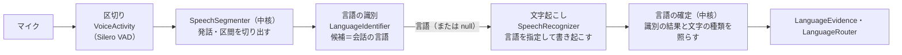

# 会話翻訳に守備範囲の広い音声認識を足す

会話翻訳で聞き取れる言語の守備範囲を広げるための設計の計画。音声認識を「区切り・言語の識別・文字起こし」の処理ブロックに分け、音声認識モデルを設定の画面で選べるようにする。実装の前に「作者に確かめること」の合意を取り、終わったら `docs/設計/`・`docs/判断/`・`docs/バックログ.md` へ畳んでこの文書を消す。

## 望む状態

- 会話翻訳で、SenseVoice の5言語の外の相手とも話せる。ロシア語・ヒンディー語は発端の例で、そこに絞らない。
- 音声認識モデルは、翻訳モデルと同じく設定の画面で前もって選ぶ。会話の言語で認識器を自動で切り替えることはしない。
- 会話翻訳で選べる言語は、選んだ音声認識モデルが聞ける言語（のうち PLaMo が訳せるもの）で決まる。
- 言語の識別は認識モデルに頼らず、独立した処理ブロックにする。認識モデルを替えても、言語の判定・話し手の交代・訳す方向の仕組みはそのまま使える。
- SenseVoice を選んだときの日・韓・英・中の会話は、今と品質も速さも変わらない。端末の中だけで、REDMAGIC 11 Pro で会話に使える速さで動く。

範囲の外：カメラ・画面翻訳。テキスト翻訳の音声入力は同じ設定に従わせる（「直した後の構造」）。

## 今の構造の問題

インターフェース（`VoiceActivity`・`SpeechRecognizer`）はあるが、言語の識別が「認識器のおまけ」になっている。

1. **言語の識別が認識器の中にある**：話し手の交代（`LanguageEvidence`）も訳す方向（`LanguageRouter`）も、SenseVoice が文字起こしと一緒に返す言語タグを頼りにしている。言語を返さない認識器（Qwen3-ASR、Whisper の多く、Parakeet など）に替えると、両方が働かない。
2. **言語の一覧が SenseVoice に決め打ち**：`CONVERSATION_LANGUAGES` が「SenseVoice が聞き分けられる言語」で、モデルごとに聞ける言語を持つ形になっていない。自動の相手の候補（日・韓・英）も同じ。
3. **組み立てが SenseVoice の名前**：`SenseVoiceAsr.load`・`missingFiles` を `ConversationViewModel` と `TranslateViewModel` が直接呼ぶ。モデルを選ぶ入口が無い。
4. **文字の種類の判定が2か所にある**：`LanguageEvidence.Letters` と `LanguageRouter.byScript` が別々に数えている。

## 直した後の構造

音声の流れを4つの処理ブロックに分け、中核（`SpeechSegmenter`）が順に呼ぶ。判断は中核、実装は `core-asr`、モデルの選択と画面は `app` に置く。

| ブロック | インターフェース（中核） | 実装（`core-asr`） |
| --- | --- | --- |
| 区切り | `VoiceActivity`（今のまま） | Silero VAD（共通） |
| 言語の識別 | `LanguageIdentifier.identify(samples, candidates): String?` | `WhisperLanguageIdentifier`（sherpa-onnx の `SpokenLanguageIdentification`、Whisper tiny、99言語）。SenseVoice は自分で言語タグを返すので、その結果を使う実装（`RecognizerTag`）で足りる |
| 文字起こし | `SpeechRecognizer.recognize(samples, language: String?)`。言語を受け取れるモデルは、その言語として書き起こす | `SenseVoiceRecognizer`（言語は自分で判定）、`Qwen3Recognizer`（`setOption("language", …)` で指定） |
| 言語の確定 | `ScriptLanguage`（中核の判定） | ― |

決まりは次のとおり。

- **識別は2層にする**：下の層は既定の実装で、どのモデルにも使える sherpa-onnx の Whisper の識別。上の層はモデルごとの差し替えで、モデル自身が言語を判定でき、その方が確かなら、そちらを使う。どちらを使うかは `SpeechModel` の1か所で宣言し、`SpeechEngines.load` が組み立てる。SenseVoice はモデル自身の言語タグを使う（追加の時間が無く、日・韓・英・中の判定に今の実績がある）。Qwen3-ASR は、モデルが「language Russian」の頭で言語を出すが（技術報告で正解率97.1%）、sherpa-onnx がそれを捨てる。取り出せたらモデル側へ差し替える。差し替えるかは、端末で正解率と時間を比べて決める。
- **識別は会話の言語に絞る**：`LanguageIdentifier` には候補（自分と相手の言語）を渡す。Whisper の識別が候補の外を返したら null とし、文字の種類で決める（`ScriptLanguage`：候補のうち文字の種類が合う1つ。決まらなければ null）。識別が当たれば、英語↔フランス語のように文字が同じ組でも話し手を見分けられる。
- **識別した言語を文字起こしに渡す**：言語を指定できるモデルには識別の結果を渡す。違う言語として崩れて書き起こされるのを防げる。会話は2人が交互に話すが、発話ごとに識別するので、1つの言語に固定する問題は起きない。
- **識別は要るところだけ**：確定した発話と、話し手の交代を監視する区間（今 `SpeechSegmenter` が言語を判定している所）だけで識別する。途中結果は直前の識別を使い回す。
- **モデルの一覧**：中核に `SpeechModel`（名前・聞ける言語・言語を指定できるか・言語を自分で判定するか）を置く。`SENSE_VOICE`（日・韓・英・中・繁）と `QWEN3_ASR`（Qwen3-ASR の30言語のうち PLaMo の言語にあるもの）。設定の画面で選び、`core-asr` の `SpeechEngines.load(model, …)` が4つのブロックを組み立てる。
- **会話の言語**：`CONVERSATION_LANGUAGES` を廃し、選んだモデルの言語にする。自動の相手の候補も、そのモデルの言語のうち日・韓・英（今のまま）。
- **ダウンロード**：Qwen3-ASR（約900MB）と Whisper tiny の識別モデルは、設定の画面でそのモデルを選んだときに取る（読み上げの Supertonic 3 と同じ組の形）。URL はコミットで固定し、大きさと SHA-256 で照合する。
- **区切るボタンの名前・聞き違いの一覧**：言語ごとの表を持ち、無い言語は英語の「Done」で代える。あいづちの一覧（`TranscriptCleanup`）は録音で出てから足す。

## 検証

実装の途中で、端末で次を測ってから先へ進む。判断に使った数値は `docs/判断/` に残し、目安は `docs/設計/会話翻訳.md`「性能の目安」に置く。

- **試験の音声**：Qwen3-ASR のモデルに付いてくる試験音声（ja・ru・fr・de・es・ar ほか）と、今の日・韓・英の録音（`tools/testdata/asr/`、Gitに入れない）。
- **測るもの**：1回の文字起こしと1回の識別の時間（3〜6秒の発話と14秒の発話）、識別の正解率（候補を2言語に絞ったとき）、翻訳0.8Bと同時に読み込んだときのメモリ。
- **通す条件（案）**：5秒の発話の識別と文字起こしの合計が1.0秒以内。翻訳0.8Bと同時に読み込んでも落ちない。
- **結果（2026-11-15、REDMAGIC 11 Pro、デバッグ版の `AsrBenchActivity`）**：5秒前後の発話で、Whisper tiny の識別が0.23〜0.3秒、Qwen3 の文字起こしが4スレッドで1.3〜2.0秒、6スレッドで0.6〜1.5秒（SenseVoice は約0.15秒）。条件の1.0秒には届かない。識別は日・露・仏・独・西・英で正しく、アラビア語をトルコ語と誤った。仏語は言語を指定しないと崩れ、指定すると正しくなった。違う言語を指定すると崩れる（アラビア語がローマ字になった）ので、識別は会話の言語に絞ってから渡す。Qwen3 の読み込みでメモリが約1.1GB増えた。sherpa-onnx 2.0.1 は Qwen3 自身の言語の判定を返さない（PCで確かめた）。会話に使えるかは、作者が検証版で手触りを見て決める。

## 応答の速さ（作者の試用を受けて）

作者が検証版を試すと、Qwen3-ASR を選んだときに次の3つが起きた。話し中のマイクのバーが止まる（最も不安）。話し中のカードの文字が止まりがちになる。確定したカードに切り替わるときに引っかかる。カードの一覧のスクロールは止まらないので、画面のスレッドではなく音声認識のスレッドが詰まっている。

原因は、音量の更新と認識が同じ1本のスレッドに並んでいることと、重い書き起こしを何度も繰り返していることである。途中結果のたびに、カード全体の書き起こし（1〜2秒）と、言語の監視の書き起こし（2〜3回）が走る。確定のときもカード全体を書き起こし直す。途中結果の間隔は書き起こしの3倍に延びる。

方針は「止まってはいけない処理を、重い処理から切り離す。それぞれの今の状態を、できるだけ早く画面に出す」。次の3つを行う。

- **A 音量は録音の側で測る**：マイクの音声は録音のスレッドで音量を測って画面に出し、音声認識のスレッドへは上限の無い列で渡す。音声を落とさず、認識が遅れても音量のバーは動き続ける。認識が1秒以上遅れたら、その秒数を話し中のカードに出す。
- **B 書き起こしの重いモデルは文ごとに書き起こしてつなぐ**（`SpeechModel.byPhrase`。SenseVoice は今のまま）：
  - 言語の監視（カードの頭・直近の区間・次の文の頭・継ぎ目探し）は、書き起こさずに言語の識別だけで行う（`SpeechRecognizer.identify`）。
  - 途中結果は、終わった文の書き起こしをつなぎ、まだ終わっていない文だけを書き起こす。文が終わったときに、その文を1回書き起こして覚える。
  - 確定は、覚えた文をつなぐ。区切る位置が文の途中なら、残りの部分だけを書き起こす。話し終わり（後ろは無音）では書き起こし直さない。
  - 途中結果の間隔は、監視を含めた1回の手間の2倍（SenseVoice は今の3倍のまま）。
- **C 今の状態をすぐ見せる**：カードの言語は話し始めの1秒を識別して決め、文字より先に向き（相手側・自分側）を出す。文字がまだ無い話し中のカードには「書き起こし中」と話し始めからの秒数を出す。話し中のカードに音量のバーを出し、相手の画面からも聞いていることが分かるようにする。途中訳は今もあり、B で途中結果が早く届くぶん早くなる。

最終手段として、日・韓・英・中の発話を SenseVoice へ振り分ける案（D）がある。メモリが増え、モデルを事前に選ぶ合意からも外れるので、A〜C で足りなければ作者と相談する。

## 認識を段に分ける

A〜C の後も、作者の試用で「書き起こし中」が5〜7秒続き、話し中のカードに文字が出ないまま確定することがあった。区切り（`SpeechSegmenter`）が VAD・識別・書き起こしを1本のスレッドで順に呼んでいたため、重い書き起こしが1回入ると、その後ろの音声・区切り・言語の監視がすべて待たされていた。同じ音声を途中結果と文の終わりで2回書き起こし、書き起こしのたびに Whisper の識別も走っていた。

そこで、区切りを「音声と認識の結果を受け取り、出来事と認識の仕事を出す」状態遷移にし、重い処理を担当のスレッドへ分けた（`SpeechPipeline`）。

- **段**：区切りのスレッド（VAD・区切り・状態。止まらない）、書き起こしの担当、識別の担当（言語だけを識別できる認識器のとき）。区切りは仕事（`RecognitionJob`）を出して待たずに進み、結果を受け取ってから次を決める。
- **順番**（`RecognitionQueue`）：確定の残り → 文の書き起こし → 言語の判定 → 途中結果。途中結果と言語の監視はカードごとに1件ずつ。閉じたカードの途中結果と言語の判定は捨てる。
- **出来事の順**：前のカードの確定が届くまで、次のカードの出来事を持っておく。区切るボタンの区切り終わり（`CutDone`）と止め終わり（`Flushed`）も出来事として届く。
- **識別を繰り返さない**：カードの言語が決まった後の書き起こしは、言語を指定して識別を省く。継ぎ目探しは二分探索で区間を減らす（約10回→4回）。
- **頭の無音を渡さない**：書き起こしの重いモデルには、話し始めの前に足した音声のうち、声の始まり（足した区間の部屋の音との比）の0.3秒前から渡す。言葉は落とさない。
- **カードの言語を決める長さ**：`SegmentationProfile.cardLanguageSeconds`（既定2秒）。設定の詳細設定で変えて、端末で正解率と最初の文字までの時間を測る。

## CPU の割り当て

翻訳（llama.cpp）は GPU で動いていても CPU のスレッドを6本持ち、スピン待機で仕事を待つ。話している間は途中訳がほぼずっと走るので、Qwen3-ASR（6）と Whisper（2）と合わせて、8コアの端末で CPU を取り合っている見込みがある。決まりは次のとおり。

- 音声認識が確定に要る書き起こしを抱えている間（`RecognitionLoad.urgent`）は、途中訳を始めない（`ConversationSession`）。最新の途中の文字を持っておき、空いたら訳す。
- スレッド数（書き起こし・識別・会話中の翻訳）は1か所（`AsrTuning` と調整の設定）で決める。llama.cpp は2の累乗のスレッド数で速く、3や6で遅くなった経験がある（作者）。Qwen3-ASR は4と6しか測っていない。2・4・6・8を、翻訳を同時に動かした場合と動かさない場合で測ってから既定を決める。

## 計測

設定の詳細設定の「音声認識の調整」で、書き起こしと識別のスレッド数、カードの言語を決める長さ、VAD のしきい値と話し始めの最短、会話中の翻訳のスレッド数を変えられる（次に開いたときに効く）。仕事ごとの待ち時間と処理時間は、ログの「会話の認識: 認識 …」の行に出る（話した言葉を含まないので、いつも書く）。区切りの経過（詳しい記録を残すとき）は「会話の認識: 書き起こし…」「言語…」「確定…」の行。

測るもの：
- 短い文（2〜3秒）で、話し始めから最初の文字までと、話し終わりから確定までの時間。前と後を同じ録音（`asr-rec/`）で比べる。
- 書き起こしのスレッド数（2・4・6・8）ごとの処理時間。途中訳を止めた場合と比べる。
- カードの言語を決める長さ（0.8・1.0・1.5・2.0秒）ごとの、カードの言語の正解率。
- VAD の値を変えたときの、話し始めの検出の遅れ。

## 計測の後に直すもの

ベータの前の設計のレビューで見つかり、計測の後の清書と一緒に直すもの。

- 区切りの状態遷移に、モデルの性質（文をつなぐか）の分岐が散っている。書き起こしの方針を部品に分け、倍率などの値はモデルの値の組へ移す。出来事をカードの順に出す仕組みも分けて、`SpeechSegmenter` を短くする。
- 区切るボタンの書き起こし待ちを、画面側と認識側が別々に数えている。出来事にカードの番号を持たせて対応させる（音声認識の契約に及ぶ）。
- 止める順番（止め終わりを待ってから止まる）を、`ConversationViewModel` から `ConversationSession` の状態遷移へ移す。
- 確定の書き起こしが、前のカードの文の書き起こしを追い越す。急ぐ仕事どうしはカードの順に出す。
- 待ち行列で捨てた仕事のコールバックが、始め直すまで残る。
- `AppUpdater.newestRelease` の試験と、`SpeechPipeline` の捨てる・始め直す場合の試験。
- sherpa-onnx の認識器を、作ったスレッドと別のスレッドから呼べることを `docs/資料/端末の能力.md` に書く。
- 「詳しい記録を残す」をオフにしたときに、それまでの利用者の文を含むログと `asr-rec/` の音声をどうするか（消す・知らせる）。
- カードの言語の判定の区間（広げ方と、手がかりの言語にする時）を、状態遷移から判定器に出して単体試験を付ける。値（文の全体で確かめる最短の長さ、区間の上限と刻み）を `SegmentationProfile` へ移し、間ありの交代の区間をカードの言語を決める長さと分ける（beta.2 の前のレビュー）。
- 判定の結果が遅れると、5秒の区間を試さずに手がかりの言語にすることがある。最後の1回は刻みによらず判定させる。
- 手がかりの言語でカードの言語を決めるのは、文ごとに書き起こすモデルの文字を出すため。SenseVoice では監視の基準にしか使わないので、書き起こしに渡す言語と監視の基準を分ける（記録で実害を確かめてから）。
- 話し中の交代で区切った後、移す文を足す前にカード全体の途中結果を頼み、捨てている（重い書き起こし1回分の無駄）。
- 自動の覚えた相手を、「会話を消す」で忘れるか。
- 設計書（`docs/設計/会話翻訳.md`）を、段に分けた今の形に書き直し、コードの参照先をこの計画から設計書へ付け替える。

## 進み具合

| 段 | 状態 |
| --- | --- |
| 技術検証（端末での計測） | 済み。結果は上の「検証」 |
| 中核のインターフェース（`LanguageIdentifier`・`IdentifiedRecognizer`・`ScriptLanguage`・`SpeechModel`）、組み立ての一般化（`SpeechEngines`） | 済み。SenseVoice の振る舞いは変えていない |
| 設定の画面の「音声認識モデル」、会話の言語の選択肢、区切るボタンの名前 | 済み |
| 応答の速さ（上の A〜C）、話し中のカードの見出し（誰が何語で）と話し手の色 | 済み。作者が検証版を試している |
| 区切るボタンをその場で効かせる（書き起こし待ちのカードを並べる）、識別できない区間をカードの言語で書き起こす | 済み。作者が検証版を試している |
| 認識を段に分ける、CPU の割り当て、計測の調整（上の3節） | 実装と単体試験は済み。端末での計測が次 |
| 計測の後の直し（数値で既定を決める、設計書の清書） | 計測の後 |
| 設定の画面からのダウンロード（Qwen3-ASR・Whisper tiny を1ファイルずつ取れる置き場、大きさと SHA-256） | 未着手。今は adb で置く |
| 文書を畳む（`docs/判断/` に識別の2層と文ごとの書き起こしの判断を残し、この文書を消す） | ダウンロードの後 |

## 作者と合意したこと（2026-11-15）

1. 言語の識別は独立したブロックにし、既定は Whisper tiny。モデル自身の判定の方が確かなモデルは、そちらへ差し替えられるようにする。
2. Whisper tiny の識別モデルは Qwen3-ASR と一緒に取る。取るのは、設定の画面でそのモデルに切り替えたとき（読み上げの Supertonic 3 と同じ）。
3. テキスト翻訳の音声入力も、同じ「音声認識モデル」の設定に従う。
4. 会話で選べる言語は「選んだモデルが聞ける」かつ「PLaMo が訳せる」言語。
5. 応答の速さは A〜C で直す。日・韓・英・中を SenseVoice へ振り分ける案は最終手段として残す。
6. 話し中のカードには誰が何語で話しているかを出し、枠の色を話した人の色にする（話し手が代わったと分かるように）。
7. 区切るボタンは押したその場でカードを区切って見せ、書き起こしが追いつくまで待ちのカードとして並べる。
8. 会話に無い言語の文（日本語とロシア語の会話に中国語の文）が出ないように、カードの言語は2秒で決め、識別できない区間はカードの言語として書き起こす。日本語では使わない漢字がある漢字だけの文は中国語とみなす。漢字だけの文を日本語として書き起こし直す案は採らない。
9. 認識を段に分け（「認識を段に分ける」）、CPU を全体で割り当てる（「CPU の割り当て」）。話した言葉は落とさない。確定の前に、話し中の言語の監視で誤りを直して見せることは残す。同じ音声を何度書き起こすかは、モデルの性質で決めてよい。進め方は、実装→計測→設計書の清書→直し。カードの言語を決める長さは設定で変えられるようにし、作者も手元で調べる。

## 未確認

- Qwen3-ASR がヒンディー語をローマ字で書くことがあるか。
- CPU だけの端末（MediaTek）で、翻訳と同時に動かしたときの認識の遅れ。
