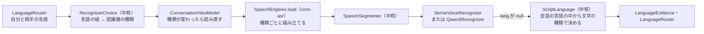

# 会話翻訳に守備範囲の広い音声認識を足す

会話翻訳で、ロシア語・ヒンディー語のように SenseVoice が聞き取れない言語の相手とも話せるようにするための、検証と設計の計画。2本目の認識器として Qwen3-ASR-0.6B を sherpa-onnx で足し、会話の言語の組で認識器を選ぶ。実装の前に「作者に確かめること」の合意を取り、終わったら `docs/設計/`・`docs/判断/`・`docs/バックログ.md` へ畳んでこの文書を消す。

## 望む状態

- 会話翻訳の相手に、ロシア語とヒンディー語を選べる。海外でロシア語の人に話しかけられて応じられなかったこと、同僚がインドで使いたいことが発端である。
- 日本語・韓国語・英語・中国語の会話は、今の SenseVoice のまま品質も速さも落とさない。
- 端末の中だけで動き、REDMAGIC 11 Pro で会話に使える速さで動く。
- 認識器は「守備範囲の広いものを1本増やす」。ロシア語・ヒンディー語の専用品を言語ごとに足すことはしない。後でほかの言語を足すときも、同じ仕組みで足せる形にする。

範囲の外：テキスト翻訳の音声入力（SenseVoice のまま）、カメラ・画面翻訳。

## 認識器の候補と選んだ理由

Qwen3-ASR-0.6B を選ぶ。今使っている sherpa-onnx 2.0.1 がすでに対応していて、ライブラリを増やさずに、日・韓・英・中・露・印を含む30言語を1本で聞ける。

| 候補 | 端末に載るか | 結論 |
| --- | --- | --- |
| Qwen3-ASR-0.6B | sherpa-onnx 2.0.1 が公式に対応（int8版、2026-03-25）。大きさは1GB前後の見込み（未確認） | 採る |
| Nemotron 3.5 ASR Streaming 0.6B | sherpa-onnx で動くか未確認。ストリーミング型なので `SpeechEngine` ごと作ることになる | 次点。日本語・中国語が弱い（下の表） |
| Parakeet TDT 0.6B v3 | sherpa-onnx の int8 版あり（約640MB） | 欧州25言語だけで、ヒンディー語とアジアの言語が無い |
| Omnilingual ASR 300M（CTC） | sherpa-onnx の int8 版あり（300MB台） | 言語の指定を受けず、出力が小文字で句読点が無い。今の区切り（句読点・言語の交代）と合わない |
| Whisper（turbo など） | sherpa-onnx で動く | 30秒の窓で処理するため会話には遅い。ヒンディー語が弱い |
| Voxtral Mini 4B Realtime | 量子化しても約2.5GBで、翻訳モデルと同居しにくい | 見送り |
| ML Kit GenAI Speech Recognition | 高品質の Advanced モードは Pixel 10 だけ。AICore 経由でモデルと回数の上限をGoogleが握る | 見送り（作者の決定） |

誤り率（FLEURS、%。日・韓・中は文字単位、英・露・印は単語単位）は次のとおり。出典ごとに測り方が違うので、行をまたいだ比べは目安にとどめ、決め手は端末での計測にする（「検証」）。

| 候補 | 日 | 韓 | 英 | 中 | 露 | 印 | 出典 |
| --- | --- | --- | --- | --- | --- | --- | --- |
| SenseVoice Small（今） | 6.78 | 7.85 | — | 7.69 | ✕ | ✕ | Whisper Notes の測定 |
| Qwen3-ASR-0.6B | 8.33 | 3.72 | 4.39 | 2.88 | 9.91 | 19.12 | Qwen3-ASR 技術報告 表A.2 |
| Nemotron 3.5（ONNX int4） | 15.12 | 6.19 | 7.91 | 22.88 | 13.52 | 9.79 | onnx-community のモデルカード |

- 同じ条件の比べは2つだけある。`docs/判断/2026-11-06_音声認識はSenseVoiceとSileroのVADで始める.md` の韓国語のベンチマーク（SenseVoice 12.72%、Qwen3-0.6B 17.29%）と、Whisper Notes の同じ音声での測定（SenseVoice と Qwen3-1.7B）である。両者から推すと、日・韓・中では Qwen3-0.6B は SenseVoice と同程度か劣る。だから SenseVoice は残し、聞けない言語のときだけ Qwen3 を使う。
- Qwen3-0.6B の言語の判定の正解率は FLEURS で97.1%（技術報告 表6）。ただし下の「sherpa-onnx で確かめたこと」のとおり、sherpa-onnx はこの判定を返さない。
- ヒンディー語は、英語の混ざる会話（Hinglish）で誤りが増える。Qwen3-0.6B の会話データでの単語の誤り率は24.73%（追加学習した Srota のモデルカード）。

出典：Qwen3-ASR Technical Report（arXiv 2601.21337）、Whisper Notes「Qwen3-ASR vs Whisper」「SenseVoice vs Whisper」、onnx-community/nemotron-3.5-asr-streaming-0.6b-onnx-int4、Surajgameramp/srota。

## sherpa-onnx 2.0.1 で確かめたこと

`k2-fsa/sherpa-onnx` のタグ `v2.0.1` のソース（`sherpa-onnx/kotlin-api/OfflineRecognizer.kt`、`sherpa-onnx/csrc/offline-recognizer-qwen3-asr-impl.cc`）を読んで確かめた。端末ではまだ動かしていない。

- **設定**：`OfflineModelConfig(qwen3Asr = OfflineQwen3AsrModelConfig(convFrontend, encoder, decoder, tokenizer), tokens = "")`。ファイルは `conv_frontend.onnx`・`encoder.int8.onnx`・`decoder.int8.onnx` と、`vocab.json` を含む `tokenizer/` のフォルダー。生成の上限は `maxNewTokens`（既定128）、プロンプトと生成の合計は `maxTotalLen`（既定512）。sherpa-onnx の例は `numThreads = 3`。
- **言語は返らない**：モデルは「language Russian<asr_text>本文」の形で言語を出すが、sherpa-onnx はこの頭を取り除き、`OfflineRecognizerResult.lang` を埋めない。`Recognition.lang` はいつも null になる。
- **言語は指定できる**：ストリームに `setOption("language", 言語名)` を渡すと、プロンプトに「language 言語名<asr_text>」を足して、その言語として書き起こさせる。言語名の綴り（`Russian`・`Hindi` など）は未確認。
- **時刻は返らない**：`tokens` は返るが `timestamps` は埋めない。`Recognition.breaks` は空になり、長い発話は「切れ目が無ければ直近4秒の一番静かな0.1秒で切る」方に落ちる（`docs/設計/会話翻訳.md`「カードの区切り方」）。
- **自己回帰**：文字を1つずつ生成するので、SenseVoice（5秒の発話で0.1〜0.2秒）より遅い。途中結果の間隔は「1回の認識の3倍より短くしない」決まりで自動的に延びる（`docs/設計/会話翻訳.md`「途中結果」）。

## 今の構造で足りないところ

差し込み口（`SpeechRecognizer`）はあるので、認識器そのものは `core-asr` に1クラス足せば差さる。足りないのは次の4つである。

1. **言語を返さない認識器を想定していない**：話し手の交代（`LanguageEvidence`）も訳す方向（`LanguageRouter.spokenLanguage`）も、認識器の言語の判定を頼りにしている。Qwen3 では言語が null になり、話し手の交代で区切れない。
2. **文字の種類の判定が2か所にある**：`LanguageEvidence.Letters`（ハングル・英字・仮名・漢字）と `LanguageRouter.byScript`（ハングル・英字・仮名と漢字）が別々に数えている。キリル文字とデーヴァナーガリーを足すと、2か所を同じに直すことになる。
3. **会話の言語が SenseVoice の言語に決め打ち**：`CONVERSATION_LANGUAGES` が「SenseVoice が聞き分けられる言語」で決まっていて、認識器ごとに聞ける言語を持つ形になっていない。
4. **組み立てが SenseVoice の名前**：`SenseVoiceAsr.load`・`missingFiles` を `ConversationViewModel` と `TranslateViewModel` が直接呼ぶ。認識器を選ぶ入口が無い。

## 直した後の構造

判断（どの認識器を使うか、文字から何語か）は中核に置き、`core-asr` は認識器の実装と組み立て、`app` は読み込みと画面だけを持つ。

| 部品 | 置き場 | 役割 |
| --- | --- | --- |
| `Script`（名前は仮） | 中核 `pipeline.speech` | 文の文字の種類ごとの数（ハングル・英字・仮名・漢字・キリル・デーヴァナーガリー）。`LanguageEvidence` と `LanguageRouter` の数え方を1か所にする |
| `ScriptLanguage`（仮） | 中核 `pipeline.speech` | 判定。認識器が言語を返さないとき、会話の言語（`SpeechLanguages`）のうち文字の種類が合う1つを言語とする。合うものが1つでなければ null |
| `SpeechRecognizer.detectsLanguage`（仮） | 中核の差し込み口 | 認識器が言語を判定するか。`false` のときだけ `SpeechSegmenter` が `ScriptLanguage` で補う。SenseVoice の null（雑音・判定なし）は今のまま扱う |
| `RecognizerKind`・`RecognizerChoice`（仮） | 中核 `pipeline.conversation` | 判定。自分と相手の言語が両方 SenseVoice の言語なら SenseVoice、そうでなければ Qwen3。Qwen3 は文字の種類で話し手を見分けるので、自分と相手の文字の種類が違う組だけを選べるようにする |
| `Qwen3Recognizer` | `core-asr` | `SpeechRecognizer` の実装。`lang = null`、`breaks` は空、`detectsLanguage = false` |
| `SpeechEngines`（仮） | `core-asr` | 今の `SenseVoiceAsr` を一般化した組み立て。種類ごとの `missingFiles(kind)`・`load(kind, modelDir, profile)`。VAD（Silero）は共通 |
| `ModelCatalog` | `app` | Qwen3 の組を、読み上げの Supertonic 3 と同じく「選んだときだけダウンロード」で足す。URL はコミットで固定し、大きさと SHA-256 で照合する |
| `ConversationViewModel` | `app` | `RecognizerChoice` の種類で読み込む。言語を変えて種類が変わったら、聞いているなら止め、閉じて読み直す。モデルが無ければ取りに行く案内を出す |

決まりは次のとおり。

- **会話の言語**：`CONVERSATION_LANGUAGES` を、日・韓・英・中・繁に露・印を足した一覧にする。どの言語が選べるかは、認識器ごとに聞ける言語（SenseVoice は今の5つ、Qwen3 は30言語）で決まると書き直す。
- **露・印は相手の固定だけ**：自動の相手の候補（日・韓・英）は変えない。自動は認識器の言語の判定で相手を覚える仕組みで、Qwen3 は判定を返さないためである。自分の言語に露・印を入れるかは作者に確かめる。
- **言語の指定は使わない**：会話は2人が交互に話すので、1つの言語に固定して書き起こさせると、もう一方の発話を崩す。`setOption("language", …)` は、1人しか話さない使い方（テキスト翻訳の音声入力）に広げるときに使う。
- **言語ごとの決まり**：`LanguageEvidence` の「判定した言語と文字の種類が合う」「中身が1語より多い」に、ロシア語（キリル文字、2語以上）とヒンディー語（デーヴァナーガリー、2語以上）を足す。`LanguageRouter.spokenLanguage` の文字の種類での決め方にも足す。雑音の聞き違い（`TranscriptCleanup`）の、露・印のあいづちの一覧は、録音で出てから足す。
- **区切るボタンの名前**：露「Готово」、印「हो गया」を候補にする（作者か話者に確かめる）。`cutLabel` の言語の抜けを捕まえる試験も足す（`docs/バックログ.md` の「会話翻訳の小さな残り」）。
- **ライセンス**：Qwen3-ASR の重みは Apache-2.0。ライセンスの画面と `tools/collect-licenses.py` に足す。

## 検証

実装の前半で、端末で次を測ってから先へ進む（移す順番の2）。判断に使った数値は `docs/判断/` に残し、目安は `docs/設計/会話翻訳.md`「性能の目安」に置く。

- **試験の音声**：ロシア語・ヒンディー語は各20発話。作者が録れなければ FLEURS のテスト音声（CC BY 4.0）で代える。日・韓・英は今の録音（`tools/testdata/asr/`、Gitに入れない）を使う。16kHz・モノラルのWAVと正解の文の組にする。
- **測るもの**：誤り率（日・韓・中は文字、英・露・印は単語）、1回の認識の時間（3〜6秒の発話と14秒の発話）、確定までの時間、使うメモリ（翻訳0.8Bと同時に読み込んだとき）、スレッド数（3・4）での違い。
- **通す条件（案）**：
  - 露・印の誤り率が、技術報告の値（9.91%・19.12%）の1.5倍以内。
  - 5秒の発話の認識が1.0秒以内（途中結果の間隔が3秒以内に収まる）。
  - 翻訳0.8Bと同時に読み込んでも、会話の途中でアプリが落ちない。
- **測り方**：デバッグ版の `ConversationViewModel.startFromWav` で流し、ログの認識の時間と文字を取る。誤り率の採点は `tools/` に小さな道具を足す（正解の文と認識の文から文字・単語の誤り率を出す）。
- **通らなかったら**：Nemotron 3.5（ストリーミング型）を、sherpa-onnx で動くかから確かめる。

## 移す順番

1つの目的を1つのコミットにする。構造の直し（1・3・4）と機能（5）を混ぜない。

1. **構造の直し：文字の種類の数え方を1か所にする**。`Script` を中核に作り、`LanguageEvidence` と `LanguageRouter` をそれに寄せる。振る舞いは変えない（今の単体テストが通る）。
2. **計測**：`Qwen3Recognizer` を `core-asr` に足し、モデルを adb で置いて（`docs/手順/開発環境.md`「モデルの取得と置き場」の要領）、上の「検証」を行う。結果を判断の記録に残し、作者と続けるかを決める。
3. **中核の判定**：`ScriptLanguage`、`SpeechRecognizer.detectsLanguage`、`RecognizerKind`・`RecognizerChoice` と、露・印の文字の種類の決まり。単体テストを書く（キリル・デーヴァナーガリーの文、言語が null のとき、文字の種類が同じ組を選べないこと）。
4. **組み立ての一般化**：`SenseVoiceAsr` を `SpeechEngines` にし、`ConversationViewModel`・`TranslateViewModel` の呼び出しを替える。振る舞いは変えない。
5. **機能**：`ModelCatalog` に Qwen3 の組、会話の言語の選択肢、認識器の読み直し、区切るボタンの名前、ライセンスの表示。
6. **文書**：`docs/設計/会話翻訳.md`（音声認識のエンジン、言語の判定、性能の目安）、`docs/設計/アーキテクチャ.md`（モジュールの中身、判定の一覧、採用している技術、ダウンロードの組）、`docs/現在地.md`「固定した版」、判断の記録、`docs/バックログ.md`「実測で決める事項」の「音声認識のエンジン」の項目を消す。この文書を畳んで消す。
7. **実機での確認**：作者がロシア語・ヒンディー語の相手を固定して、録音を流して会話翻訳がカードと訳まで通るか、日・韓・英の会話が今と同じかを見る。

2と3〜5の間で `design-reviewer` に差分を読ませる（中核と差し込み口に触れるため）。

## 作者に確かめること

1. Qwen3-ASR-0.6B の1本に絞って、上の順番で進めてよいか（Nemotron 3.5 は次点として残す）。
2. ロシア語・ヒンディー語の試験の音声を自分で用意するか、FLEURS の公開音声で代えるか。
3. 自分の言語にもロシア語・ヒンディー語を入れるか（今の案は相手の固定だけ）。
4. Qwen3 のモデル（1GB前後の見込み）を、相手にロシア語・ヒンディー語を選んだときに取りに行く形でよいか。
5. 区切るボタンのロシア語・ヒンディー語の名前。

## 未確認

- sherpa-onnx の Qwen3-ASR の int8 版の大きさと、取り先のURL（sherpa-onnx のリリース `asr-models` と Hugging Face の写し）。
- `setOption("language", …)` に渡す言語名の綴り。
- Qwen3 がヒンディー語をデーヴァナーガリーでなくローマ字で書くことがあるか（あれば文字の種類での決め方が崩れる）。
- 英語の混ざるヒンディー語（Hinglish）を、文字の種類の数え方でヒンディー語と決められるか。
