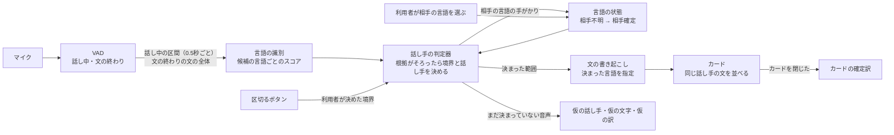

# 会話翻訳の処理を、重い音声認識モデルの前提から組み直す

会話翻訳の言語の判定と区切りの流れを、Qwen3-ASR のような重いモデルの前提から組み直す計画。作者と方向を合意した提案（2026-11-15）と、それに沿って入れた範囲を置く。終わったら `docs/設計/会話翻訳.md`・`docs/判断/`・`docs/バックログ.md` へ畳んでこの文書を消す。

## スコアと話し手の判定器で組み直す範囲

- 言語の識別の契約を、候補の言語ごとのスコア（確率）を返す形にする。Whisper tiny は ONNX Runtime で直接動かす（`core-asr` に onnxruntime-android を足す。漫画用OCRと同じ版で、アプリのライブラリは増えない）。SenseVoice は、書き起こした結果の言語をスコア1の判定として同じ契約に載せる。
- 話し手の判定器（`SpeakerJudge`）を中核に置く。「自分か、それ以外か」の確率で決め、届かなければ決めない（前の話し手として扱う）。区間（1.5秒）と文の全体で確率のしきい値を分ける。
- 文が終わったら、文の全体で話し手を決め、その言語を指定して文を書き起こす（すべてのモデルで文ごと。SenseVoice のカード全体の書き起こし直しをやめる）。カードの話し手と違えば、文の頭で区切る。
- 話し中の切り出しは、カードの話し手が確かなとき（文の判定か、区間が3回続けて同じ言語）だけ行い、境界の後ろの音声を長い区間で確かめてから区切る。まだ確かでなければ、カードの仮の言語を替えるだけにする。カードの頭の区間・次の文の頭の区間は、話し中の区間と文の全体の判定に置き換える。
- 言語の判定の順位を2段にする（文の判定を、話し中の区間より先に）。
- 言語の状態を2段にする（相手不明 → 相手確定）。相手不明の間は、モデルが聞けるすべての言語（自分が日本語なら中国語を除く。自分が中国語なら日本語を除く）から「それ以外」を探し、相手の確定が1回来たら相手確定。
- 相手が分かる前の自分の発話は原文だけを出し、相手が決まったらさかのぼって訳す。利用者が相手を選び直したら、自分の発話を新しい相手の言語へ訳し直す。自動で決まった相手は画面に「（自動で判定）」と出す。

入れていないもの：音声認識の出来事を「境界と話し手」「文の確定の文字」「カードの閉じ」に分けること（今の出来事のままでも、文の確定の文字は途中結果のつなぎで先に出る）。中国語の候補を自分の言語で書き起こし直して仮名を見る決まり（今は、自分が日本語なら中国語を、自分が中国語なら日本語を、相手不明の候補から外すだけにする）。

設計のレビューで見つかり、決まっていないもの・直していないもの：

- 話し手のしきい値（`SpeakerJudge.WINDOW`・`PHRASE`）の根拠を、実機の区間と文の全体のスコアの分布に置き換える。相手不明の間は「自分以外の合計」と比べるので候補の多いモデルでは相手に傾き、相手は1回で決まる。相手を決める確定だけ高いしきい値にするかを、分布を見て決める。
- 2つの ONNX Runtime（sherpa-onnx の組み込みと `onnxruntime-android`）を1つのプロセスで動かして落ちないこと、言語の識別1回の時間を、実機で確かめて `docs/資料/端末の能力.md` と性能の目安に置く。
- `SpeakerJudge` の試験を別のファイルに分ける。
- 話し手の時系列（`SpeakerTrack`）に残りを移して `SpeechSegmenter` を小さくする：次のカードの話し手（言語と確かか）の引き継ぎ、確かめの結果が古いかの判断、言語が決まらないときの仮の言語。判定（`Verdict`）を入口ごとの型に分けるか、実行を1か所にする。
- リプレイ（`ConversationReplayTest`）が `SpeechPipeline` のジョブの取り出しと結果の届け方を書き写している。`SpeechPipeline` に時計と実行の仕方を差し込む口を作って共通にする。端末の処理時間の式（`DeviceTiming`）の元の記録を手順に書く。
- 相手不明の間に、弱い名指し1回で相手の言語が決まり、会話の終わりまで固定される（0.11.0-beta.3 の会話の録音とリプレイで、最初の2秒の英語「OK.」を韓国語 0.55 と名指しし、以後の英語を韓国語として書き起こした）。直すのは相手を決める側：判定器が「相手（言語は未定）」を返し分け、相手の言語を決めるのは言語が確かな相手の発話だけにする。判定器と音声の出来事の約束が変わる（判定器を締める直しは、根拠が1例で直す層が違うので戻した。`docs/判断/2026-11-15_改善の一巡で足した決まりを原因の層で見直す.md`）。
- 利用者が相手を選び直したときの訳し直しを、新しい発話の確定訳より後ろにするか、件数に上限を置くか。
- `Effect.TranslateFinal`・`TranslatePartial` に null にならない訳す先を持たせ、`ConversationViewModel` の null の確かめを消す。
- `core-asr` の `testImplementation(libs.onnxruntime.jvm)` は使う試験が無い。`WhisperMel` を Whisper の log-mel と照らす試験を足すか、外す。

## カードの話し手の時系列

0.11.0-beta.3 の実機の会話では、言語の識別・切り替え・書き起こし・翻訳がかみ合わなかった。会話の録音（約7分、日本語と英語）を PC でリプレイし、端末と同じ崩れを再現して、原因を3つに絞った。

- 話し中の交代に気づくのは違う区間が3回続いてから（数秒後）なのに、境界は気づいた時点から3.5秒前〜1秒前だけを探していた。新しい話し手の頭が前のカードに残る。
- カードを閉じるとき、区切った残りの話し手を残りだけのスコアで決め直していた。交代で区切ったカードの残りが新しい話し手の言語になり、前の話し手の文を違う言語で書き起こした。カードの話し手を決める所が、区間・文・カードの全体・残りに散っていた。
- Qwen3-ASR が話していない短い音声（0.4〜1.7秒）に、会話の型の役の名前（「system」「システム」）を返し、確定の文の頭や末尾につながっていた。

入れるもの：

- カードの話し手の時系列（`SpeakerTrack`、中核の純粋な判定）を置き、カードの話し手と交代の判断をここだけにする。`SpeechSegmenter` は判定を実行するだけにし、区切った残りはカードの話し手の言語で書き起こす（決め直さない）。境界は、カードの話し手だと分かっている最後の根拠から今までで探す（定数の幅を置かない）。
- Qwen3-ASR の役の名前だけの結果を、認識器の実装（`Qwen3Recognizer`）が空にする。一覧は観測した書き方だけにし、増やさない。
- 自動で相手が決まったら、相手のボタンに「英語（自動）」のように出す（作者の指摘：自動のままだと何に決まったか見えない）。
- 検証の道具：会話の録音を PC でリプレイする試験（`ConversationReplayTest`。端末と同じ VAD・識別・書き起こしで、時間は端末の記録から測った式で模擬する）と、録音の全体から作る言語の基準で区切りを採点する `tools/score-speaker.py`。直し方はリプレイで比べ、端末では改善した版だけを確かめる。
- 試験の方針：区切りの試験は、部品の約束（`SpeakerTrackTest`）と、利用者に見える振る舞いを守るものだけにする。部品の約束と重なるもの、設定の値の効き目を固定するだけのもの、場面の値を通る経路に合わせたものは置かない。

検証の扱い（作者の方針：録音は増やさない）：手元の録音は約7分の1本で、基準も判定と同じ Whisper tiny。数字の小さな差を改善の根拠にせず、採点は悪化していないかの確認に使う。直しの採否は、原因に対して正しい層を直したかで決める。決まりを足すより、足した決まりを減らす方へ見直す。

リプレイの結果（約7分の録音、基準は日本語と英語、声336秒・交代31回。悪化の確認として見る）：相手を英語に固定すると、言語の違う声 20%→17%、交代の平均の遅れ 1.09秒→0.66秒、幻 8個→2個で、悪化は無い。相手を自動にすると 71%→73% で変わらない。日本語と英語の混ざった文を Whisper tiny が文の全体で韓国語 0.70 と判定し、相手が韓国語に決まる（この録音には本物の韓国語のあいさつも入っている）。取りこぼしの多く（13回）は、基準で1.5〜3秒の短い交代。

入れていないもの：操作（区切る・相手を選ぶ）の時刻を録音と一緒に残すこと（リプレイで手の区切りを再現するため）。ほかのモジュールの試験の見直し。Qwen3-ASR の役の名前を、出どころ（話していない短い音声を書き起こしに出していること）で止められるか（短い返事は落とさない）。

## 連続区間で話し手を決める

0.11.0-beta.4 を相手を英語にして実機で流すと、会話の途中の取り違え（英語の文が日本語のカードに入る、日本語が英語のカードに入る）が残った。作者の評価では、最初の発話の言語の誤り（相手のボタンで直せる）より深刻だった。直しの優先が、最初につまずいた自動の判定に引きずられていた。

取りにいくことと諦めること（作者と合意）：

- 取りにいく：3秒以上続く話し手の交代を正しいカードに分けること。
- 諦める：2秒より短い返事や割り込み、1文の中の言語の混ぜ、同時の発話。交代の確定は1〜2秒遅れてよい。
- この範囲では扱わない：相手を自動にしたときの最初の発話の言語の誤り。「system」の残り（今の一覧のまま置く）。

リプレイで言語の違う声 53.7秒（19区間）を判断の経路ごとに分けると、約7割は区間が新しい言語をはっきり出しているのに、2人をまたぐ文の全体の多数決で古い言語に書き起こされていた。残りは、違う区間が3回続く前に長い発話や話し終わりでカードが閉じていた。

入れるもの：

- 話し手は連続区間（続けて同じ言語と決まった区間の並び）から決める。2回以上の判定が2秒（`SegmentationProfile.minTurnSeconds`）以上の音声にわたれば確か。回数（`liveSwitchChecks`）はやめる。
- 文の全体のスコアは、区間が話し手を決めていない文にだけ使う。仮のカードをカードの全体のスコアで確かめることはやめ、違う確かな連続区間で仮の言語を替える。
- 境界探しは位置を探すだけにし、境界の後ろの全体の多数決で確かめ直さない。探す範囲は、最後に同じ言語だった根拠から新しい言語の連続区間の最初の区間の終わりまで。
- 境界を探している間は、話し終わりと長い発話でカードを閉じない（話し終わりは位置を覚え、境界の結果の後に分ける）。
- 方針を設計の原則（同じものは1本の根拠から1か所で決める、取りにいくことと諦めることを機能ごとに決める）と、変更の進め方（優先と線引き）に置く。

入れていないもの：交代の費用を置いた最尤の経路で区切る形（今の連続区間はその簡単な形。端末で区間を細かく出す負荷は測っていない）。区間の根拠の無い短い文（1秒ほど）の全体の判定1回でカードの話し手が確かになり、続く交代の境界が遅れる（PC のリプレイで1件、181秒。端末では起きていない）。1回の判定では決めない決まりを文の全体にも広げるかは、間を空けた短い返事を区切る役目と合わせて決める。

## 提案（2026-11-15）

### 答え

推奨は、要件から会話翻訳の処理を組み直すことです。柱は3つあります。会話の言語は自分と相手の2つにすること。言語の状態は「相手が分からない段」と「相手が分かった段」に分けること。誰が話しているかは1つの判定器が決め、根拠がそろった時点で、話し中でもその場でカードを切り出すこと。前回の提案は、今の流れのまま言語の識別の部分だけを直す案で、この水準のものではありませんでした。

### 今の処理の棚卸し

今の流れでは、「この音声は誰が話しているか」という同じ問いを、5つの入口が別々の時に、別々の区間としきい値で判定しています。Qwen3-ASR のときの処理は次のとおりです（言語の判定は識別のワーカー、書き起こしは書き起こしのワーカーで動く。SenseVoice では言語の判定も書き起こしのワーカーで動く）。

| 処理 | 動く時 | 目的 |
| --- | --- | --- |
| カードの頭の言語 | 話し始めから2秒、判定できなければ1秒ごとに5秒まで | カードの言語（識別できない区間の書き起こしに渡す言語） |
| 次の文の頭・文の全体 | 次の文が2秒たまったとき、または文の終わり | 間を空けた交代 |
| 直近の監視 | 話した音声0.5秒ごと（重さで延びる） | 間を空けない交代 |
| 境界探し | 交代と決めたとき | 区切る位置 |
| 文の終わりの言語 | 文の終わり | 直前の文の言語（手がかり） |
| 途中の書き起こし | 0.5秒ごと（重さで延びる）。優先は最下位 | 仮の文字 |
| 文の書き起こし | 文の終わり | 確定の文字の部品 |
| カードの確定の書き起こし | カードの区切り。優先は最上位 | 確定の文字 |

beta.1 の誤りは、この並びから起きました。どの入口も1〜2秒の短い区間で判定するので外れやすく、識別できない区間が多くなります。識別できない区間はカードの言語で書き起こすので、カードの頭の判定が誤ると、後の入口が気づいて直すまで、その言語で書き起こしが進み、誤りが固まります。識別できない割合は、beta.1 の作者の会話の記録（不具合の記録の log.txt。端末にだけある）で数えると、Qwen3-ASR の会話（11月15日 13:47〜14:06、REDMAGIC 11 Pro、識別は2スレッド）の直近の監視の判定79回のうち28回（35%）でした。

この形は、SenseVoice のような速いモデルの前提から来ています。

| 速いモデルの前提 | 重いモデル（Qwen3-ASR）で起きたこと |
| --- | --- |
| 書き起こしが安く、ためた音声の全体を何度でも書き起こし直せる | 文ごとに書き起こしてつなぐ、ワーカーを分ける、順番を付ける、を後から足した |
| 書き起こすと言語も付いてくるので、途中結果のたびに話し手を監視できる | 言語を別に識別することになり、短い区間の識別に頼った |
| 聞ける言語が5つで、自動の相手は日・韓・英の3つから当てれば足りる | 21言語を聞けるのに、候補は3つのまま |

日・韓・英の3つという前提は、SenseVoice の時代の要件の名残りです。中国語を候補から外したのは、漢字の多い日本語を中国語と聞き違えるためでした。崩れた前提を `SpeechSegmenter` の1つの状態機械の中で補ってきたので、状態と分岐が増えました。自動の相手の覚え方が識別の候補を変え、識別が相手の覚え方を変える循環もできました。

### 理想の流れ

話し手の判定器が、音声の区間ごとのスコアをためて、「どこからどこまでが誰の話か」を決めます。決まった範囲から順に、確定の書き起こし・カードの確定・確定訳へ進みます。リアルタイムの流れは、まだ決まっていない音声の仮の文字・仮の話し手・仮の訳を出すだけで、何も決めません。

### 話し手の判定器

- **入れるもの：** 話し中の区間（0.5秒ごと、1.5秒）のスコアと、文が終わったときの文の全体のスコアを、同じ形（時刻つきの、候補の言語ごとのスコア）で入れます。区切るボタンの位置も、利用者が決めた境界として入れます。
- **決めること：** 境界の位置と、その前後の話し手です。今の5つの入口は、判定器にスコアを入れるジョブの頼み方の違いになり、決まりは判定器の1か所だけになります。判定器は中核（`core-pipeline`）の純粋な判定にし、単体試験をここに付けます。
- **話し中の交代：** 新しい話し手の区間が十分に続き、スコアの差が十分に大きくなったら、その場で交代を確定します。境界の位置で音声を分け、前のカードをその場で閉じて確定の書き起こしと確定訳を始めます。後ろは、新しい話し手のカードとして話し中のまま続きます（今の `cutAt` の振る舞い）。
- **文の終わり：** 話し中に根拠がそろわなかった交代は、文の全体のスコアで決めます。間を空けた交代も、同じ決まりで決まります。
- **決められない音声：** 短い文、雑音、あいづちのように、2つの言語のスコアの差が小さい音声は「決められない」とし、前の話し手として扱います。境界にはしません。
- **区切るボタン：** 押した位置で境界を確定します。前後の話し手は、それぞれの音声のスコアで決めます。

### 確定の流れ

- 話し手が決まった文から、その言語を指定して書き起こし、確定の文字としてカードに足します。カードを閉じるのを待ちません。
- 訳はカードごとにします。VAD の文は言いよどみ（無音0.6秒）でも切れるので、文ごとに訳すと断片を訳すことになるためです。文が足されるたびにカードの文字を仮に訳し直し、カードを閉じたときに確定訳を出します。
- カードを閉じる条件は、判定器が交代を確定した、無音3秒、区切るボタンの3つです。14秒話し続けて文の終わりが来ないときは、今と同じく静かなところで文を区切ります。

### リアルタイムの流れ

- まだ決まっていない音声を、仮の話し手の言語で書き起こし、仮の文字と仮の訳を出します。仮の話し手は、判定器がためているスコアの今の優勢な側です。外れても、判定器が決めたところで置き換わります。
- 書き起こしのワーカーの順番は今のまま（確定に要る書き起こしを仮の書き起こしより先に）にします。識別のワーカーでは、文の全体の判定を話し中の区間の判定より先に回すため、今は1段しかない言語の判定の順位を2段に分けます。

### 言語の状態

言語の状態は、会話の側（中核）の1か所が持ちます。状態を変えるのは、次の移り変わりだけです。

| 段 | 話し手の決定 | 次の段へ移る条件 |
| --- | --- | --- |
| 相手不明（自動の始まり） | 文の全体で、自分の言語か、それ以外か。それ以外なら、モデルが聞ける言語のどれかも出す | 「それ以外」の文が来たら、その言語を相手にして相手確定へ |
| 相手確定 | 自分と相手の2択 | 利用者が相手の言語を選び直したときだけ |

- 相手を固定したときは、最初から相手確定の段です。
- 相手確定の後は2択なので、相手を誤って決めると自動では直りません。誤ったときは利用者が選び直します（作者の判断）。気づけるように、自動で決まった相手の言語を画面にはっきり出します（例：「相手：英語（自動で判定）」）。
- 1回の誤りで固まらないよう、相手を決める前に「仮の相手」の段を挟む案もあります。今の流れで2回の決まりが要ったのは、1〜2秒の区間で判定していて聞き違いが多かったためです。新しい流れでは文の全体で判定するので、2段にします。自分の発話を「それ以外」と誤る割合が目立つなら、仮の相手の段が要ります。
- 漢字の多い日本語を中国語と取り違える問題は、自分が日本語のとき、相手を探す段だけの問題になります（自分が中国語なら逆向き）。中国語が候補になった文は自分の言語でも書き起こし、仮名が出れば自分の発話とみなします（今の `LanguageEvidence` と同じ決まり）。ただし、中国語の音声を日本語の指定で書き起こしても仮名が出るなら、本当の中国語の相手を見落とします。これは確かめていません。
- 相手が分かる前の自分の発話は、原文だけを出し、相手が決まった時点でさかのぼって訳します。利用者が相手を選び直したら、それまでの自分の発話を新しい相手の言語へ訳し直します。

### 遅れの見込み

- **確定の文字：** 文の終わり（無音0.6秒）の後に、文の全体の識別（設計書の目安で3〜6秒の発話に0.23〜0.3秒）と文の書き起こし（同じ記録の同じ会話で、Qwen3-ASR 6スレッドの54文の中央0.92秒、最大4.75秒）が済めば出ます。話し終えてから1.8秒ほど（中央）の見込みです。文の中の交代を探す文と、中国語の候補を書き起こし直す文は、これより延びます。今は、カードの言語が決まるまで書き起こせないことがありました。
- **確定の訳：** カードを閉じてから訳します。無音3秒と区切るボタンで閉じるときは今と同じです。交代で閉じるときは、判定器が交代を確定した時点で閉じます。話し中に確定できれば今と同じか早く、確定できなければ、次の話し手の文が終わるまで遅れます。どちらになるかは、短い区間の2択の当たりで決まります。
- **仮の文字と仮の訳：** ジョブの量と順番が今と同じなので、出方も今と同じ見込みです。

### 変わる契約と要件

- **言語の識別の契約：** 言語名を1つ返す今の形から、候補の言語ごとのスコアを返す形に変えます。sherpa-onnx の Whisper の識別は言語名しか返さないので、Whisper tiny の ONNX を ONNX Runtime で直接動かします。音声から特徴量を作る前処理と、言語を選ぶデコーダーの1ステップを自前で書く必要があります。アプリのライブラリは増えません。`core-asr` に、`core-ocr` が使っている onnxruntime-android（1.31.1）を足し、sherpa-onnx に組み込まれた ONNX Runtime と2つを同じプロセスで使います。
- **識別の置き場所：** 識別は書き起こしのモデルから独立した1段にし、SenseVoice でも同じ識別を使います。文ごとの識別（3〜6秒の発話に0.23〜0.3秒）と話し中の区間の識別を SenseVoice にも払う代わりに、モデルの性質による流れの分岐が消えます。
- **音声認識の出来事：** 判定器が決めた「境界と話し手」、文ごとの「確定の文字」、カードの「閉じた」を分けます。話し手は、言語の名前ではなく自分か相手かで渡します。
- **要件（`docs/要件.md`）：** 会話翻訳の節を、2言語、2段の言語の状態、話し中の切り出し、文ごとの確定の文字で書き直します。今の要件は、SenseVoice の5言語と、日・韓・英から当てる自動を前提にしています。

### 決まったこと（2026-11-15、作者）

- 話し手の言語の状態は、相手不明と相手確定の2段にする。
- 相手が分かる前の自分の発話は、原文だけを出し、相手が決まった時点でさかのぼって訳す。
- 確定の文字は文ごと、確定の訳はカードごとにする。Qwen3-ASR では今と同じ形で、変わるのは文を書き起こす言語の決め方（カードの言語ではなく、文ごとに判定器が決めた話し手の言語）。SenseVoice も、カードを閉じるときの全体の書き起こし直しをやめ、文ごとの書き起こしにそろえる。
