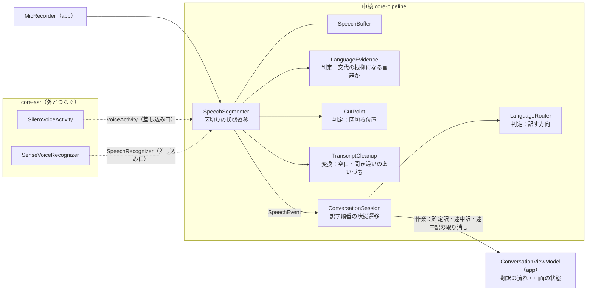

# 会話翻訳の制御と区切りを作り直す（計画・合意済み、段階1から）

会話翻訳を、画面翻訳・カメラ翻訳と同じ設計の幹（`docs/設計/アーキテクチャ.md`「設計の原則」）にそろえ、作者が使って感じている3つの不満を、録音で原因を確かめてから直す計画。

## 目的

**目的**：話した人ごとに、話したまとまりのまま1枚のカードになり、聞き取った文と訳が、話した内容と食い違わないこと。

作者の不満（使って感じているもの）：

1. **カードがぶつ切りになる**：聞き違いで、別の言語の英字や中国語が少し混ざると、話し手が代わったとみなされてカードが切れる。
2. **確定した文が途中の文と違う**：途中の聞き取りは合っていたのに、確定した文が思ったものと違うことがある。
3. **言いよどみの後の言い始めが消える**：「えー」「あー」のように伸ばした後に話し始めると、言い始めのところがまとめて切られる。カードは日本語のまま切り替わらず、文の頭が欠ける。

## 今の作りの問題（棚卸しから）

- **制御が1か所に無い**：確定訳の待ち行列、確定訳の残りの数、途中訳の世代番号、途中訳の取り消しを、`ConversationViewModel` が2つのスレッドから触っている。確定訳を優先する決まりを単体テストで確かめられない。
- **区切りの判断が中核に無い**：2段の区切り（文とカード）、言語の見張り、区切る位置の探し方が、`SenseVoiceAsr.accept` の中で sherpa-onnx の呼び出しと音声のため方と一緒になっている（Android のモジュール）。区切りの判断が SenseVoice の言語判定を呼ぶので、モデル無しでは試験できない。今の試験は文字の後処理だけ。
- **用途ごとの違い**：テキスト翻訳の音声入力が、会話のカードの区切り（言語の交代・14秒）でも止まり、後ろの音声を捨てる。区切り方を用途ごとの値の組にしていない。
- **数字で比べる仕組みが無い**：デバッグ版で音声ファイルを流せるが、作者の実際の会話の録音が無く、区切りと認識の前後を比べられない。

## 録音で分かった原因（作者の会話の録音1本、約5分、カード29枚）

録音は作者の端末で、自分は日本語、相手は自動（韓国語・英語）。作者が日本語で話し続けたもので、ほかの言語の発話は無い。

| 不満 | 起きた数 | 原因 |
| --- | --- | --- |
| 1. ぶつ切り | 言語の交代での区切り8回のうち7回が誤り（誤った交代4回と、そこから日本語へ戻る区切り3回） | 言語の判定と、認識した文字の種類が食い違う判定を使っていた（「ま」「これ?」を韓国語、「やぱ」「我」を英語と判定）。1語だけの判定を使っていた（話の間の「Now.」「No。」を英語と判定し、2回続いたので区切った）。1回は、日本語を韓国語の文（「저는 어 좋죠」）と聞き違えたもので、文字の種類では見分けられない |
| 2. 確定が途中と違う（語尾が欠ける） | 1回 | 話し終わりの確定を、VADが文の終わりとした位置で切っている。VADが小さい声の語尾（-47〜-57dBFS）を話していないと判定し、途中の文には出ていた「…どうなんでしょうね」が「…どうな」になった |
| 2. 確定が途中と違う（語が消える） | 1回 | 14秒の区切りの位置を、直近4秒のうち一番静かな0.1秒にしている。語の中の0.1秒の途切れ（「ジーピーユー」の中）で切り、区切りの前後どちらの認識からも語が消えた |
| 2. 確定が途中と違う（聞き違い） | 4回 | ほぼ同じ音声でも、認識するたびに結果が揺れる（「検討」と「検闘」、「ひとつ」と「ひとず」）。途中の文の方が合っていた例が多い |
| 3. 言い始めが消える（音が入っていない） | 2回 | VADが話し始めを検出するのが、実際の話し始めより0.7〜1.3秒遅れた。足している直前の音声は0.5秒なので、言い始めの0.1〜0.8秒が音声に入っていなかった（「フォークした」が「ォクした」） |
| 3. 言い始めが消える（音は入っている） | 3回 | 言い始めの音はカードの音声に入っているのに、認識が落とした（「そうですかね」が「おですかね」）。途中の文の列には言い始めが出ていた例がある |

## 直し方（録音を流し直して前後を比べる）

- **言語の判定を、話し手の交代の根拠に使う条件**（不満1）：判定した言語と認識した文字の種類が合うこと（韓国語ならハングル、英語なら英字、日本語なら仮名か漢字）、中身が1語より多いこと、変わった先が会話の言語であること。1つ目と2つ目で、誤った交代4回のうち3回（戻る区切りを含めて7回のうち6回）が消える。
- **話し終わりの確定は、ためた音声の全体で認識する**（不満2の語尾）：話し終わりの後ろは無音なので、文の終わりで切る理由が無い。最後の途中の文と同じ音声になる。
- **14秒の区切りは、続いた静かさで選ぶ**（不満2の語が消える）：直近の文の終わり（VADの区切り）があればそこで、無ければ0.1秒でなく続いた静かな区間の真ん中で切る。
- **話し始めの前に足す音声を、VADの遅れより長くする**（不満3の音が入っていない）：0.5秒を、測った遅れ（最大1.3秒）を覆う長さにする。話し終わりの後に聞き直した音声だけなので、前のカードの音は入らない。
- **確定の文を、何度もの認識の多数決で決める**（不満2の聞き違い・不満3の音は入っている）：段階3b。中核に移した後に行う。

## 段階

### 段階1：会話の録音と再生（デバッグ版）

- デバッグ版の会話翻訳で、聞いている間に音声認識へ渡した音声を WAV で端末に書く（アプリの外部ファイルの `asr-rec/`。adb で取り出せる。会話の中身なので Git にも PC の共有の場所にも置かない。区切りで消す）。
- 書いた音声を、今の入口（`ConversationViewModel.startFromWav`）でそのまま流し直せるようにする。
- ログに、区切りごとに理由（話し終わり・言語の交代（間あり・間なし）・14秒・停止）と位置、言語を判定した窓の言語と文字、途中の文の列と確定の文を出す（話した言葉を含むので、デバッグ版だけ）。
- 作者に、不満の出る話し方（混ざる言語、言いよどみ）で会話してもらい、録音を集める。

### 段階2：構造をそろえる（振る舞いは変えない。実装した。`docs/判断/2026-11-13_会話翻訳の区切りと訳す順番を中核に置く.md`）

録音で分かった直す場所（言語の判定の使い方、確定の範囲、区切る位置、話し始めの前に足す長さ、確定の文の決め方）が、それぞれ1つの判定か値になるように組み直す。段階2では振る舞いを変えず、段階3で判定の中身と値だけを替える。

- **区切り**（`pipeline.speech`）：`SenseVoiceAsr.accept` の区切りを、中核の `SpeechSegmenter`（音声と VAD の合図を受け取り、出来事を返す状態遷移）に移す。音声のため方（`SpeechBuffer`）も中核に移す。VAD と認識は差し込み口（`VoiceActivity`：話しているか・文が終わったか、`SpeechRecognizer`：音声から文字と言語）で受け取り、`core-asr` が sherpa-onnx で実装する。`core-asr` は、`core-llm` と同じく中核の差し込み口を実装するモジュールになり、中核に依存する。
- **判定と変換を分ける**：区切りの中の判断を、次の部品に分ける。どれも観測を受け取って判断を返し、ほかの判定を呼ばない。
  - `LanguageEvidence`：言語を判定した窓の認識結果（文字と言語）を受け取り、話し手の交代の根拠になる言語か（使わないなら無し）を返す。今は、認識器の言語をそのまま使い、中国語を日本語と同じに扱う（`separateChinese`）だけ。
  - `CutPoint`：区切る範囲と音声を受け取り、区切る位置を返す。今は、一番静かな0.1秒（言語の継ぎ目探しの後も同じ）。
  - `TranscriptCleanup`：認識した文字の後処理（日本語・中国語の空白、聞き違いのあいづち）。今の `removeCjkSpaces`・`dropFillers`。
- **用途ごとの値の組**（`SegmentationProfile`）：話し終わりの無音、文の区切りの無音、話し始めの前に足す長さ、長い発話の区切り、話し手の交代で区切るか、話し終わりの確定の範囲（文の終わりまでか、ためた音声の全体か）。会話とテキスト翻訳の音声入力で組を分ける（音声入力の止まり方の違いもここに入る）。
- **契約**：`AsrEvent`・`Utterance`・`AsrEngine` を中核へ移す（名前は `SpeechEvent` などにそろえる）。テキスト翻訳の音声入力も、同じ `SpeechSegmenter` を自分の値の組で使う。
- **訳す順番**（`pipeline.conversation`）：`ConversationViewModel` の確定訳の待ち行列、確定訳の優先、途中訳の最新の1件、古い途中訳を捨てる、を中核の `ConversationSession.handle`（出来事：音声の出来事・訳の途中と確定・設定、作業：確定訳を渡す・途中訳を渡す・途中訳を取り消す）に移す。`LanguageRouter`（方向）も中核に移す。`ConversationViewModel` は、マイク・認識のスレッド・翻訳の流れ・画面の状態をつなぐだけにする。
- **確かめ方**：先に、今の振る舞いを中核の単体テストで固定する（偽の VAD の合図と、時間の範囲ごとに文字と言語を返す偽の認識で、話し終わり・間ありの交代・話し中の交代・長い発話・停止・雑音の聞き違い・中国語の扱い、の区切りを確かめる。訳す順番は、確定訳の順、確定が来たら途中訳を取り消す、古い途中訳を捨てる）。端末では、段階1の録音を移す前と後で流し、区切りのログ（理由・位置・確定の文）が同じになることを見る。

段階2で入れたもの：`SpeechSegmenter`・`LanguageEvidence`・`CutPoint`（長い発話と言語の継ぎ目で入口を分けた）・`TranscriptCleanup`（聞き違いの判定。SenseVoice の空白の癖は `SenseVoiceRecognizer` へ）・`SegmentationProfile`（話し終わり・文の区切り・前に足す長さ・長い発話の4つ）、`ConversationSession`・`LanguageRouter`。カードは数値と理由だけを持ち、表示の文は画面の側が作る。端末で録音を移す前後で流し、区切り34回の理由・位置・確定の文がすべて同じだった（この録音では中国語の判定は出ていない。中国語の判定は、文の言語のログで組（日本語）に置き換えて出るようになった）。

段階3の直しが入る場所（設計のレビューで分かった前提を含む）：

| 直すこと | 入る場所 | 前提 |
| --- | --- | --- |
| 言語の判定を交代の根拠に使う条件（文字の種類・1語より多い・会話の言語） | `LanguageEvidence` の中身 | 根拠の判定は、間ありの交代・カードの頭・直近の窓・文の終わりで使う。継ぎ目探しは根拠の判定を通さない（`LanguageEvidence.group`）ので変わらない。会話の言語を渡すには、`SpeechEngine.separateChinese` を会話の言語の組に替える（中核の契約の変更） |
| 話し終わりの確定を、ためた音声の全体で認識する | `SegmentationProfile` に確定の範囲の値を足す | 段階2では足していない |
| 14秒の区切りを、続いた静かさで選ぶ | `CutPoint.longUtterance` の中身 | 言語の継ぎ目（`languageSeam`）は変わらない |
| 話し始めの前に足す音声を長くする | `SegmentationProfile.prerollSeconds` | 前に足した音声は、カードの言語の窓（最初の2秒）・最初の文の言語にも入る。延ばすときは、言語の窓を話し始めの位置から測るように合わせて直す |
| 確定の文を、何度もの認識の多数決で決める | `SpeechSegmenter` がカードごとに認識の結果の列を持ち、確定のときに多数決の判定（カメラ翻訳の `ReadingFusion` と同じ形の部品）に渡す | 段階3bで足す |
| テキスト翻訳の音声入力の値の組（止まり方の違い） | `SegmentationProfile` に「話し手の交代で区切るか」などを足し、音声入力の組を作る | 段階2では会話と同じ組を使っている |

段階2のレビューで見つけた、今の振る舞いのままにしたもの（不満が出たら直す）：止めた後も、持っていた途中の文字を訳す（`Event.Stopped` で捨てない）。消した後も、待っている確定訳を訳す（`Event.Cleared` で捨てない）。翻訳モデルが使えないときに途中訳を渡さない判断が、`ConversationViewModel` に残っている。

### 段階3：不満を直す（録音で前後を比べる）

- **3a. 録音で分かった4つを直す**：上の表の、言語の判定の使い方・確定の範囲・区切る位置・話し始めの前に足す長さ。1つずつ直し、そのたびに録音を流し直して、区切りのログを前と比べる。
- **3b. 確定の文を、何度もの認識の多数決で決める**（不満2・3）：話している間、同じ音声の頭を0.5秒ごとに何度も認識し直しているので、カメラ翻訳の文字ごとの多数決（`ReadingFusion`）と同じ考え方で、何回もの認識で一致した部分（ストリーミングの音声認識で使われる、続けて同じだった頭を確かとみなす方法）を確定の文の根拠に使える。段階1の録音で、確定の文が途中の文と違う例と、言い始めが消える例を、「途中の文の列では一致していたのに確定で変わった」か「どの時点の認識にも無かった」かに分けてから決める。前者が多ければ、確定の文を途中の文の列との多数決で決める。後者はモデルの性質で、区切りでは直らない。区切りの位置が原因の例は、区切りを直す。
- **3c. 区切りのボタン**（作者の案。作者の要望で3aより先に入れた。操作欄の真ん中の丸いボタン。`docs/判断/2026-11-13_対面のカードは読む人の言語に面を譲り真ん中に区切るボタンを置く.md`）：操作欄に「区切る」ボタンを置き、押したら今の話を確定して次のカードにする（`SpeechEngine` に、話しかけの分を確定して聞き続ける命令を足す。`flush` と違い止めない）。人が明確に区切れるなら、自動の話し手の交代は根拠を多めに求めて粘る（1枚にまとまる方へ寄せる）ことができる。自動で区切り損ねたときの逃げ道になるので、3aで交代の根拠を厳しくした後に、区切り損ねが目立つかを見て足す。両手がふさがる場面ではボタンに頼れないので、自動の区切りを無くすことはしない。
- **途中訳の揺れ**：途中の文の確かな頭が決まれば、訳も頭を固定して後ろだけ訳し直せる。段階1・3bの後に、途中訳の揺れが不満として出たら行う。

## 作り込みすぎを防ぐ決まり

- 不満と録音の数字で原因が分かったものだけを直す。録音が無いまま、しきい値を作者の印象に合わせて動かさない。
- 次は、不満が出たときの候補としてバックログに置く：声の特徴（話者埋め込み）での話し手の交代（同じ言語どうしの会話）、直近の会話を文脈として翻訳に渡す、途中訳の前と同じ頭を固定して揺れを減らす、マイクの読み上げの声を消す仕組み（エコーキャンセラー）。

## 決めたこと

- 作者の端末（REDMAGIC 11 Pro）は、録音のためにデバッグ版へ入れ替えた（設定は初期化された）。次のリリースの前に、同じ手順（`docs/手順/開発環境.md`「ビルドと実行」）で正式版へ戻す。

- 作者がこの計画で進めることに合意した。段階1の録音は、デバッグ版だけで端末に書く（会話の中身を含むので、区切りで消す）。
