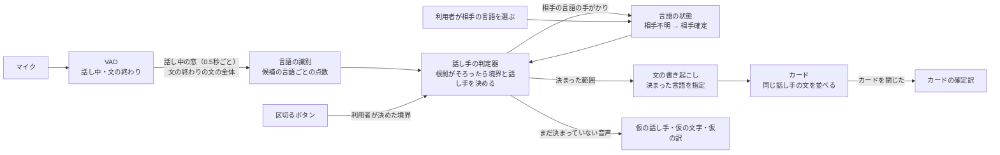

# 会話翻訳の流れを、重い音声認識モデルの前提から組み直す

会話翻訳の言語の判定と区切りの流れを、Qwen3-ASR のような重いモデルの前提から組み直す計画。作者と方向を合意した提案（2026-11-15）に、0.11.0-beta.3 で入れる範囲を足したもの。beta.3 を作者の端末で評価してから、`docs/要件.md`・`docs/設計/会話翻訳.md`・`docs/判断/` へ畳んでこの文書を消す。

## beta.3 で入れる範囲

- 言語の識別の契約を、候補の言語ごとの点数（確率）を返す形にする。Whisper tiny は ONNX Runtime で直接動かす（`core-asr` に onnxruntime-android を足す。漫画用OCRと同じ版で、アプリのライブラリは増えない）。SenseVoice は、書き起こした結果の言語を点数1の判定として同じ契約に載せる。
- 話し手の判定器（`SpeakerJudge`）を中核に置く。「自分か、それ以外か」の確からしさで決め、届かなければ決めない（前の話し手として扱う）。窓（1.5秒）と文の全体で確からしさのしきい値を分ける。
- 文が終わったら、文の全体で話し手を決め、その言語を指定して文を書き起こす（すべてのモデルで文ごと。SenseVoice のカード全体の書き起こし直しをやめる）。カードの話し手と違えば、文の頭で区切る。
- 話し中の切り出しは、カードの話し手が確かなとき（文の判定か、窓が3回続けて同じ言語）だけ行い、継ぎ目の後ろの音声を長い窓で確かめてから区切る。まだ確かでなければ、カードの仮の言語を替えるだけにする。カードの頭の窓・次の文の頭の窓は、話し中の窓と文の全体の判定に置き換える。
- 言語の判定の順位を2段にする（文の判定を、話し中の窓より先に）。
- 言語の状態を2段にする（相手不明 → 相手確定）。相手不明の間は、モデルが聞けるすべての言語（自分が日本語なら中国語を除く。自分が中国語なら日本語を除く）から「それ以外」を探し、相手の確定が1回来たら相手確定。
- 相手が分かる前の自分の発話は原文だけを出し、相手が決まったらさかのぼって訳す。利用者が相手を選び直したら、自分の発話を新しい相手の言語へ訳し直す。自動で決まった相手は画面に「（自動で判定）」と出す。

後に回すもの：音声認識の出来事を「境界と話し手」「文の確定の文字」「カードの閉じ」に分けること（今の出来事のままでも、文の確定の文字は途中結果のつなぎで先に出る）。中国語の候補を自分の言語で書き起こし直して仮名を見る決まり（beta.3 では、自分が日本語なら中国語を、自分が中国語なら日本語を、相手不明の候補から外すだけにする）。

beta.3 の前の設計のレビューで後に回したもの（評価の後に決める）：

- 話し手のしきい値（`SpeakerJudge.WINDOW`・`PHRASE`）の根拠を、実機の窓と文の全体の点数の分布に置き換える。相手不明の間は「自分以外の合計」と比べるので候補の多いモデルでは相手に傾き、相手は1回で決まる。相手を決める確定だけ高いしきい値にするかを、分布を見て決める。
- 2つの ONNX Runtime（sherpa-onnx の組み込みと `onnxruntime-android`）を1つのプロセスで動かして落ちないこと、言語の識別1回の時間を、実機で確かめて `docs/資料/端末の能力.md` と性能の目安に置く。
- 区切りに足したカードの話し手の決まり（`Card.lang`・`sure`・`agreeing`・`mismatches` と `watchLanguage`・`recheckCard`・`findSeam`・`judgePhrase`）を、純粋な状態遷移に分けて `SpeechSegmenter` を小さくする。`SpeakerJudge` の試験を別のファイルに分ける。
- 利用者が相手を選び直したときの訳し直しを、新しい発話の確定訳より後ろにするか、件数に上限を置くか。
- `Effect.TranslateFinal`・`TranslatePartial` に null にならない訳す先を持たせ、`ConversationViewModel` の null の確かめを消す。
- `core-asr` の `testImplementation(libs.onnxruntime.jvm)` は使う試験が無い。`WhisperMel` を Whisper の log-mel と照らす試験を足すか、外す。

## 提案（2026-11-15）

### 答え

推奨は、要件から会話翻訳の流れを組み直すことです。柱は3つあります。会話の言語は自分と相手の2つにすること。言語の状態は「相手が分からない段」と「相手が分かった段」に分けること。誰が話しているかは1つの判定器が決め、根拠がそろった時点で、話し中でもその場でカードを切り出すこと。前回の提案は、今の流れのまま言語の識別の部分だけを直す案で、この水準のものではありませんでした。

### 今の処理の棚卸し

今の流れでは、「この音声は誰が話しているか」という同じ問いを、5つの入口が別々の時に、別々の窓としきい値で判定しています。Qwen3-ASR のときの処理は次のとおりです（言語の判定は識別の担当、書き起こしは書き起こしの担当で動く。SenseVoice では言語の判定も書き起こしの担当で動く）。

| 処理 | 動く時 | 目的 |
| --- | --- | --- |
| カードの頭の言語 | 話し始めから2秒、判定できなければ1秒ごとに5秒まで | カードの言語（識別できない区間の書き起こしに渡す言語） |
| 次の文の頭・文の全体 | 次の文が2秒たまったとき、または文の終わり | 間を空けた交代 |
| 直近の見張り | 話した音声0.5秒ごと（重さで延びる） | 間を空けない交代 |
| 継ぎ目探し | 交代と決めたとき | 区切る位置 |
| 文の終わりの言語 | 文の終わり | 直前の文の言語（手がかり） |
| 途中の書き起こし | 0.5秒ごと（重さで延びる）。優先は最下位 | 仮の文字 |
| 文の書き起こし | 文の終わり | 確定の文字の部品 |
| カードの確定の書き起こし | カードの区切り。優先は最上位 | 確定の文字 |

beta.1 の誤りは、この並びから起きました。どの入口も1〜2秒の短い窓で判定するので外れやすく、識別できない区間が多くなります。識別できない区間はカードの言語で書き起こすので、カードの頭の判定が誤ると、後の入口が気づいて直すまで、その言語で書き起こしが進み、誤りが固まります。識別できない割合は、beta.1 の作者の会話の記録（不具合の記録の log.txt。端末にだけある）で数えると、Qwen3-ASR の会話（11月15日 13:47〜14:06、REDMAGIC 11 Pro、識別は2スレッド）の直近の見張りの判定79回のうち28回（35%）でした。

この形は、SenseVoice のような速いモデルの前提から来ています。

| 速いモデルの前提 | 重いモデル（Qwen3-ASR）で起きたこと |
| --- | --- |
| 書き起こしが安く、ためた音声の全体を何度でも書き起こし直せる | 文ごとに書き起こしてつなぐ、担当を分ける、順番を付ける、を後から足した |
| 書き起こすと言語も付いてくるので、途中結果のたびに話し手を見張れる | 言語を別に識別することになり、短い窓の識別に頼った |
| 聞ける言語が5つで、自動の相手は日・韓・英の3つから当てれば足りる | 21言語を聞けるのに、候補は3つのまま |

日・韓・英の3つという前提は、SenseVoice の時代の要件の名残りです。中国語を候補から外したのは、漢字の多い日本語を中国語と聞き違えるためでした。崩れた前提を `SpeechSegmenter` の1つの状態機械の中で補ってきたので、状態と分岐が増えました。自動の相手の覚え方が識別の候補を変え、識別が相手の覚え方を変える循環もできました。

### 理想の流れ

話し手の判定器が、音声の窓ごとの点数をためて、「どこからどこまでが誰の話か」を決めます。決まった範囲から順に、確定の書き起こし・カードの確定・確定訳へ進みます。リアルタイムの流れは、まだ決まっていない音声の仮の文字・仮の話し手・仮の訳を出すだけで、何も決めません。

### 話し手の判定器

- **入れるもの：** 話し中の窓（0.5秒ごと、1.5秒）の点数と、文が終わったときの文の全体の点数を、同じ形（時刻つきの、候補の言語ごとの点数）で入れます。区切るボタンの位置も、利用者が決めた境界として入れます。
- **決めること：** 境界の位置と、その前後の話し手です。今の5つの入口は、判定器に点数を入れる仕事の頼み方の違いになり、決まりは判定器の1か所だけになります。判定器は中核（`core-pipeline`）の純粋な判定にし、単体試験をここに付けます。
- **話し中の交代：** 新しい話し手の窓が十分に続き、点数の差が十分に大きくなったら、その場で交代を確定します。継ぎ目の位置で音声を分け、前のカードをその場で閉じて確定の書き起こしと確定訳を始めます。後ろは、新しい話し手のカードとして話し中のまま続きます（今の `cutAt` の振る舞い）。
- **文の終わり：** 話し中に根拠がそろわなかった交代は、文の全体の点数で決めます。間を空けた交代も、同じ決まりで決まります。
- **決められない音声：** 短い文、雑音、あいづちのように、2つの言語の点数の差が小さい音声は「決められない」とし、前の話し手として扱います。境界にはしません。
- **区切るボタン：** 押した位置で境界を確定します。前後の話し手は、それぞれの音声の点数で決めます。

### 確定の流れ

- 話し手が決まった文から、その言語を指定して書き起こし、確定の文字としてカードに足します。カードを閉じるのを待ちません。
- 訳はカードごとにします。VAD の文は言いよどみ（無音0.6秒）でも切れるので、文ごとに訳すと断片を訳すことになるためです。文が足されるたびにカードの文字を仮に訳し直し、カードを閉じたときに確定訳を出します。
- カードを閉じる合図は、判定器が交代を確定した、無音3秒、区切るボタンの3つです。14秒話し続けて文の終わりが来ないときは、今と同じく静かなところで文を区切ります。

### リアルタイムの流れ

- まだ決まっていない音声を、仮の話し手の言語で書き起こし、仮の文字と仮の訳を出します。仮の話し手は、判定器がためている点数の今の優勢な側です。外れても、判定器が決めたところで置き換わります。
- 書き起こしの担当の順番は今のまま（確定に要る書き起こしを仮の書き起こしより先に）にします。識別の担当では、文の全体の判定を話し中の窓の判定より先に回すため、今は1段しかない言語の判定の順位を2段に分けます。

### 言語の状態

言語の状態は、会話の側（中核）の1か所が持ちます。状態を変えるのは、次の移り変わりだけです。

| 段 | 話し手の決定 | 次の段へ移る条件 |
| --- | --- | --- |
| 相手不明（自動の始まり） | 文の全体で、自分の言語か、それ以外か。それ以外なら、モデルが聞ける言語のどれかも出す | 「それ以外」の文が来たら、その言語を相手にして相手確定へ |
| 相手確定 | 自分と相手の2択 | 利用者が相手の言語を選び直したときだけ |

- 相手を固定したときは、最初から相手確定の段です。
- 相手確定の後は2択なので、相手を誤って決めると自動では直りません。誤ったときは利用者が選び直します（作者の判断）。気づけるように、自動で決まった相手の言語を画面にはっきり出します（例：「相手：英語（自動で判定）」）。
- 1回の誤りで固まらないよう、相手を決める前に「仮の相手」の段を挟む案もあります。今の流れで2回の決まりが要ったのは、1〜2秒の窓で判定していて聞き違いが多かったためです。新しい流れでは文の全体で判定するので、2段から始めます。最初の検証で、自分の発話を「それ以外」と誤る割合が目立てば、仮の相手の段を入れます。
- 漢字の多い日本語を中国語と取り違える問題は、自分が日本語のとき、相手を探す段だけの問題になります（自分が中国語なら逆向き）。中国語が候補になった文は自分の言語でも書き起こし、仮名が出れば自分の発話とみなします（今の `LanguageEvidence` と同じ決まり）。ただし、中国語の音声を日本語の指定で書き起こしても仮名が出るなら、本当の中国語の相手を見落とします。これは最初の検証で確かめます。
- 相手が分かる前の自分の発話は、原文だけを出し、相手が決まった時点でさかのぼって訳します。利用者が相手を選び直したら、それまでの自分の発話を新しい相手の言語へ訳し直します。

### 遅れの見込み

- **確定の文字：** 文の終わり（無音0.6秒）の後に、文の全体の識別（設計書の目安で3〜6秒の発話に0.23〜0.3秒）と文の書き起こし（同じ記録の同じ会話で、Qwen3-ASR 6スレッドの54文の中央0.92秒、最大4.75秒）が済めば出ます。話し終えてから1.8秒ほど（中央）の見込みです。文の中の交代を探す文と、中国語の候補を書き起こし直す文は、これより延びます。今は、カードの言語が決まるまで書き起こせないことがありました。
- **確定の訳：** カードを閉じてから訳します。無音3秒と区切るボタンで閉じるときは今と同じです。交代で閉じるときは、判定器が交代を確定した時点で閉じます。話し中に確定できれば今と同じか早く、確定できなければ、次の話し手の文が終わるまで遅れます。どちらになるかは、短い窓の2択の当たりで決まります。
- **仮の文字と仮の訳：** 仕事の量と順番が今と同じなので、出方も今と同じ見込みです。

### 変わる契約と要件

- **言語の識別の契約：** 言語名を1つ返す今の形から、候補の言語ごとの点数を返す形に変えます。sherpa-onnx の Whisper の識別は言語名しか返さないので、Whisper tiny の ONNX を ONNX Runtime で直接動かします。音声から特徴量を作る前処理と、言語を選ぶデコーダーの1手を自前で書く必要があります。アプリのライブラリは増えません。`core-asr` に、`core-ocr` が使っている onnxruntime-android（1.31.1）を足し、sherpa-onnx に組み込まれた ONNX Runtime と2つを同じプロセスで使います。両方が問題なく動くかは、検証で確かめます。
- **識別の置き場所：** 識別は書き起こしのモデルから独立した1段にし、SenseVoice でも同じ識別を使います。文ごとの識別（3〜6秒の発話に0.23〜0.3秒）と話し中の窓の識別を SenseVoice にも払う代わりに、モデルの性質による流れの分岐が消えます。
- **音声認識の出来事：** 判定器が決めた「境界と話し手」、文ごとの「確定の文字」、カードの「閉じた」を分けます。話し手は、言語の名前ではなく自分か相手かで渡します。
- **要件（`docs/要件.md`）：** 会話翻訳の節を、2言語、2段の言語の状態、話し中の切り出し、文ごとの確定の文字で書き直します。今の要件は、SenseVoice の5言語と、日・韓・英から当てる自動を前提にしています。

### 進め方

最初に、点数で比べる識別が当たるかを確かめます。この結果で、判定器の作り方と、話し中に切り出せるかが決まるからです。

1. 検証：作者の会話の音声で、Whisper tiny を「自分と相手の2択」と「自分かそれ以外か」で比べます。話し中の切り出しの当たりを決める1〜1.5秒の窓と、文の全体のそれぞれで測ります。中国語の音声を日本語の指定で書き起こしたときに仮名が出ないか、自分の発話を「それ以外」と誤る割合、ONNX Runtime で直接動かせるかも、ここで確かめます。当たらなければ、識別の方法から考え直します。
2. 要件と設計書：要件の会話翻訳の節と `docs/設計/会話翻訳.md` を書き直し、`docs/作業中/` の計画で合意を取ります。
3. 実装：言語の状態、話し手の判定器、確定の流れ、リアルタイムの流れの順に作ります。今の試験の場面は、判定器の試験に移します。

beta.2 はこのまま使ってもらい、作り直した版と比べる基準にします。

### 決まったこと（2026-11-15、作者）

- 話し手の言語の状態は、相手不明と相手確定の2段にする。
- 相手が分かる前の自分の発話は、原文だけを出し、相手が決まった時点でさかのぼって訳す。
- 確定の文字は文ごと、確定の訳はカードごとにする。Qwen3-ASR では今と同じ形で、変わるのは文を書き起こす言語の決め方（カードの言語ではなく、文ごとに判定器が決めた話し手の言語）。SenseVoice も、カードを閉じるときの全体の書き起こし直しをやめ、文ごとの書き起こしにそろえる。

### 次の作業

- `docs/作業中/` に作り直しの計画を書く。
- 検証の道具を作る。作者の会話の音声（beta.2 の「詳しい記録を残す」で録ったもの）が届いたら、検証を行う。
