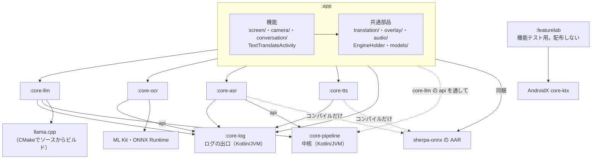
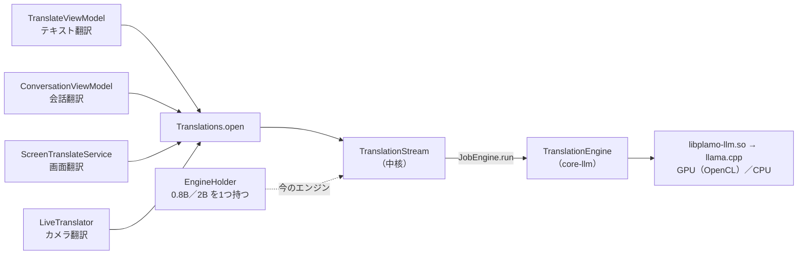
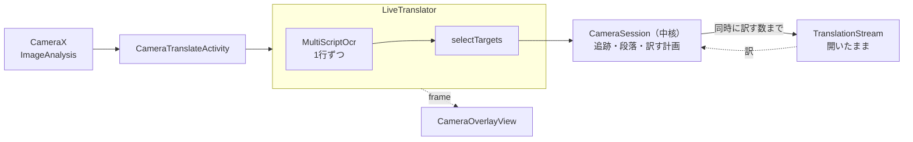
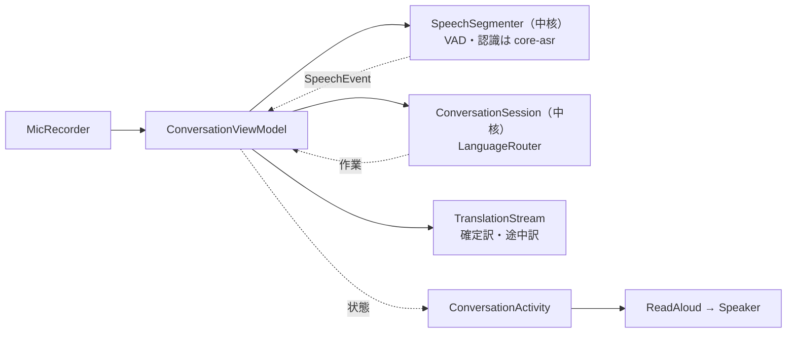
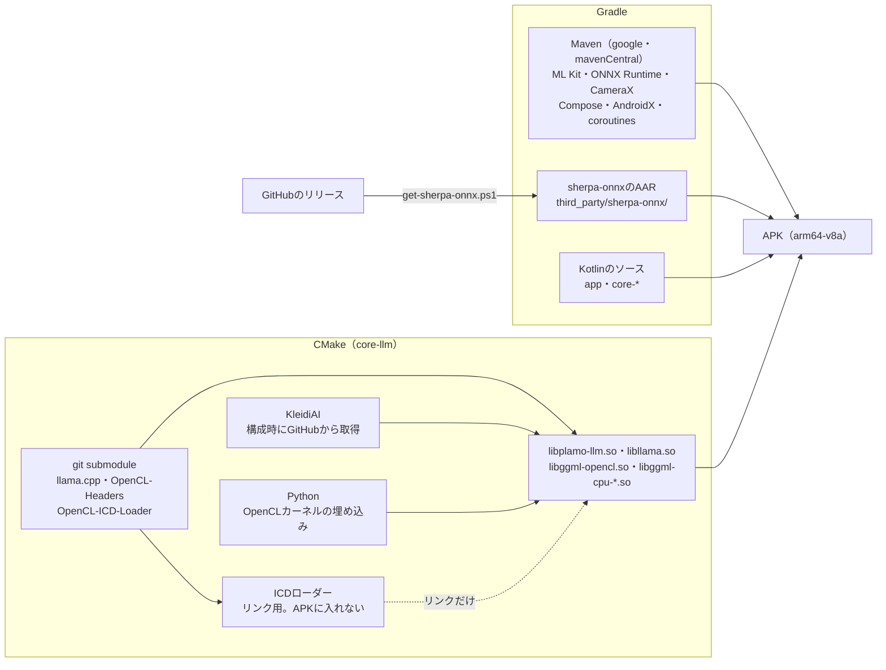

# アーキテクチャ

Mockingword（旧名 PLaMo翻訳。リポジトリとパッケージ名は `PlamoTranslate`・`app.plamotranslate` のまま）は、端末の中だけで「訳す」「文字を読む」「声を聞く」「読み上げる」を行う。判断と計画は Android に依存しない中核 `core-pipeline` が持ち、`app` が端末の部品（撮影・カメラ・マイク・重ね表示）と中核をつなぎ、推論はネイティブのライブラリ（llama.cpp・ML Kit・ONNX Runtime・sherpa-onnx）に任せる。4つの機能の翻訳は、どれも翻訳の流れ `TranslationStream` を通り、アプリで1つの翻訳エンジンに集まる。

この文書は、アプリ全体の組み方（設計の原則、層とモジュール、部品のつなぎ方、機能ごとの部品のつながり、採用している技術、計算資源、APK、データの置き場）を示す。各機能の中身は次の文書にある。

- `docs/設計/翻訳コア.md`：翻訳の契約（`TranslationStream`）の中身、エンジン、プロンプト、翻訳モデル
- `docs/設計/会話翻訳.md`：会話翻訳、音声認識、テキスト翻訳の音声入力、読み上げ
- `docs/設計/画面翻訳.md`：画面翻訳の状態遷移・判定器・工程・場面、文字認識、まとめる（カメラ翻訳と共通）、重ね表示
- `docs/設計/カメラ翻訳.md`：カメラ翻訳、行の追跡と段落
- `docs/設計/デザイン言語.md`：色（2つのテーマ）、部品の並べ方、名前
- `docs/資料/端末の能力.md`：設計が前提にする、端末とOSの振る舞い

## 用語

このリポジトリで決めた言葉だけを挙げる。

| 用語 | 意味 |
| --- | --- |
| 中核 | `core-pipeline` モジュール。Android に依存しない判断と計画の部品 |
| 翻訳の流れ | `TranslationStream`。機能が開き、命令（`submit`・`cancel`・`clear`・`close`）を出し、結果（`updates`）を購読する翻訳の窓口 |
| 文・片 | 機能が流れに頼む単位が文（`Segment`）。流れの中のコアが、エンジンに渡す単位の片（`Piece`）に分ける |
| 控え | 一度訳した原文と訳。翻訳の契約の多層の控えで、1次がメモリの控え（`MemoryCache`）、2次が永続の控え（`PersistentCache`。今は画面翻訳がデータベース `SqlitePersistentCache` で使う）。鍵と約束は `docs/設計/翻訳コア.md`「控え」 |
| セッション | 画面翻訳の1回の翻訳（撮影から表示まで）。番号を持ち、今のセッションでない結果は捨てる |
| 判定A・判定B | 画面翻訳の開始の判定（`StartJudge`）と有効性の判定（`ValidityJudge`） |
| 場面の設定 | `SceneProfile`。画面翻訳の撮り方・読み方・判定器の値の組（通常・動く画面、触れるまで残す）。場面から組み立てる |
| 場面 | `ScreenPreset`。画面翻訳の工程の中身の組（`ScreenSettings`：認識モード・まとめ方・訳の枠・訳の消え方）に名前を付けたデータ（漫画・チャット・ゲーム） |
| 工程 | 画面翻訳の1回の翻訳が通る、撮る → 読む → まとめる → 選ぶ → 枠を決める → 訳す → 流し込む、の並び |
| 訳の単位 | 行をまとめた訳と表示の単位（`TextUnit`）。種類（`UnitKind`：吹き出し・段落・メニューの項目・1行）で枠の広げ方が決まる |
| 占めてよい範囲 | 訳の単位ごとの、隣の単位との境までの範囲（`Rooms`）。訳の枠はこれを出ない |
| PFML3 | PLaMo 3 Translate のプロンプトの書式。原文の言語・訳先・文体・背景をタグで渡す |

## 設計の原則

コードを足すときに守る決まりは6つある。機能を足すときは、`docs/設計/画面翻訳.md`「将来の機能の差し込み口」の場所に差し、症状に合わせた例外の判定やフラグを足さない。差し込み口が無ければ、先に設計書を直す。

1. **判断は中核に置く**：判定・状態遷移・翻訳の入力の作り方は、Android に依存できない `core-pipeline` に置き、単体テストで確かめる。外の部品は差し込み口（翻訳のエンジンは `JobEngine`、永続の控えは `PersistentCache`）で受け取るので、単体テストでは偽物に替えられる。
2. **制御は状態遷移の1か所に置く**：出来事を受け取って次の状態と作業を返す1つの関数だけが制御を決め、部品は作業の結果を出来事として戻す。画面翻訳では `ScreenSession.reduce` がこれに当たる（`docs/設計/画面翻訳.md`「状態遷移」）。
3. **判定は役割ごとに独立させる**：判定は観測を受け取って判断を返す部品にし、ほかの判定を呼ばない（画面翻訳の判定A・Bは `docs/設計/画面翻訳.md`「判定器」）。
4. **翻訳は1本の契約を通す**：テキスト・会話・画面・カメラの翻訳は、どれも `Translations.open` で開く `TranslationStream` を通す。1件ずつ訳すか同時に訳すか、行をつなぐか長文を分けるかは、流れの中のコア（`SequentialCore`・`ParallelCore`）が決め、呼ぶ側に漏らさない。この形を通さない呼び出しは、エンジンそのものを準備し測る道具とデバッグ版の評価だけに限る（`docs/設計/翻訳コア.md`「流れを通さない呼び出し」）。
5. **部品は命令と購読でつなぐ**：部品は「返り値の無い命令」を受け、結果・状態・出来事を「購読する流れ」で出す（「部品のつなぎ方」）。
6. **差し替えは部品の単位で行う**：文字認識・読み上げはインターフェース（`OcrEngine`・`Speaker`）の裏に、音声認識は中核の差し込み口（`VoiceActivity`・`SpeechRecognizer`）の裏に実装を置く。画面翻訳の場面ごとの違いは、工程の中身の組（`ScreenPreset`・`ScreenSettings`）と値の組（`SceneProfile`）で表し、if 文で分けない。使っていない実装を先回りして作らない。

実装を替えるときに `app` で直す場所は、エンジンを作る箇所である。音声認識は `core-asr` の `SenseVoiceAsr.load`、文字認識は `ScreenTranslateService`・`LiveTranslator`・デバッグ版の `BenchActivity`、読み上げは `ReadAloud`。ただし画面翻訳とカメラ翻訳は `MultiScriptOcr` の型で持ち、白縁の文字の読み方（`recognizeOutlined`）は `OcrEngine` に無いので、文字認識を替えるときはこの2か所の型も直す。翻訳はエンジンの差し込み口（`JobEngine`）があるが、プロンプトはPLaMoの書式（PFML3）に決め打ちしている。

これらの原則を決めた理由は、`docs/判断/2026-11-12_端末に依存しない部品をcore-pipelineに置く.md`・`docs/判断/2026-11-12_部品を返り値の無い命令と購読する流れでつなぐ.md`・`docs/判断/2026-11-12_判定を同じ形にそろえて中核に置く.md` にある。

## 層とモジュール

層の決まりは Gradle のモジュールで強制する。中核は Kotlin/JVM のモジュールなので、Android の型を書くとビルドが通らない。

依存の向きは次のとおり。

- `app` は `core-*` に依存し、`core-*` は `app` を知らない。
- `core-*` どうしでは、中核の差し込み口を実装する `core-llm`（`JobEngine`）と `core-asr`（`VoiceActivity`・`SpeechRecognizer`）だけが中核に依存する。`api` で公開するので、`app` もこれらを通して中核を使う。`core-ocr`・`core-tts` は中核に依存しない。
- 中核が使うのは Kotlin の標準とコルーチン（`kotlinx-coroutines-core`）だけ。
- `core-log`（ログの出口）はどのモジュールにも依存せず、ログを出すモジュール（`app`・`core-llm`・`core-ocr`・`core-asr`・`core-tts`）が依存する（「ログ」）。
- `featurelab` はほかのモジュールに依存しない別のアプリ（`docs/資料/端末の能力.md`）。

`core-ocr` は翻訳を知らず、文字の位置・文字種・縦書きかを返す。`core-asr` は VAD の合図と、音声の文字と言語のコードを返す。発話の区切り方と、何をどの言語へ訳すかは中核が決め、どう描くかは `app` が決める。

### モジュールの中身

中核は判断と計画を、`core-*` は推論のエンジンを、`app` は画面と端末の部品とつなぎを持つ。

| モジュール | 主なクラス | 役割 |
| --- | --- | --- |
| `core-pipeline` | `pipeline.translation`：`TranslationStream`、`SequentialCore`・`ParallelCore`、`JobEngine`、`PersistentCache`、`TranslationChecks`。`pipeline.screen`：`ScreenSession`、`StartJudge`・`ValidityJudge`、`SceneProfile`、`ScreenPreset`。`pipeline.layout`：`TextLayout`、`LineGrouper`（吹き出し・文章・メニュー）、`Rooms`。`pipeline.camera`：`CameraSession`、`TranslationPlan`、`LineTracker`・`ReadingFusion`・`Sharpness`・`StableGrouping`、`TextSimilarity`。`pipeline.speech`：`SpeechEngine`（契約）・`SpeechSegmenter`、`VoiceActivity`・`SpeechRecognizer`（差し込み口）、`SpeechBuffer`、`LanguageEvidence`・`CutPoint`・`TranscriptCleanup`、`SegmentationProfile`。`pipeline.conversation`：`ConversationSession`、`LanguageRouter`。`pipeline.diagnostics`：`ProcessExit`・`ProcessMark`・`ExitJudge`・`ExitSelection`、`CrashJournal`・`CrashJournals`、`CrashReports`、`CrashArchive`、`ProcessLogs`。`llm`：`Language`、`TranslationRequest`、`Pfml3PromptBuilder` | 翻訳の流れとコア、訳の点検、PFML3の組み立て、画面翻訳の状態遷移と判定と場面、行のまとめ方と占めてよい範囲（画面翻訳とカメラ翻訳で共通）、カメラ翻訳の追跡と訳す計画と制御、音声の区切り方と会話の訳す順番と方向、プロセスの終わり方の判定と不具合の記録の保存 |
| `core-llm` | `TranslationEngine`（`JobEngine` の実装）、`LlamaNative`（JNI）、`plamo_llm.cpp` | モデルの読み込み、複数の依頼を同時に訳す生成、取り消し |
| `core-ocr` | `OcrEngine`、`MultiScriptOcr`、読み手（`MlKitReader`・`PaddleReader`）、`BlockMerger`、`LineChoice`、`Geometry` ほか | 読み手を選んで並列に動かし、行ごとに文字種に合う読みを選んで、1行ずつ返す。まとめるのは中核の `LineGrouper` |
| `core-asr` | `SenseVoiceAsr`、`SileroVoiceActivity`、`SenseVoiceRecognizer`、`WavFile` | 中核の差し込み口の実装（Silero VAD の合図、SenseVoice の文字と言語）と、組み立て（`SenseVoiceAsr.load` が中核の `SpeechSegmenter` に差す） |
| `core-tts` | `Speaker`、`SupertonicSpeaker`、`SystemSpeaker` | 訳文の読み上げ |
| `core-log` | `Logs`、`LogSink` | ログの出口。書き先は `app` が差す（「ログ」） |
| `app` | 下の表 | 画面、権限、サービス、重ね表示、モデルの選択とダウンロード、各モジュールのつなぎ |
| `featurelab` | `LabA11yService`、`CaptureService`、`SurfaceTestActivity`、`MainActivity` | 端末で届く合図・撮れるものを1つずつ確かめる |

英文の整え（`EnglishText`）と崩れの判定（`TextQuality`）は文字種の知識なので `core-ocr` に置く。枠の重なりの計算（`Geometry`）も `core-ocr` に置き、カメラ翻訳の行の追跡が使う。

### `app` のパッケージ

`app` の中では、機能のパッケージどうしは互いに依存しない。複数の機能が使う部品は共通のパッケージに置く。端末の部品の実装は、それを使う機能のパッケージに置く（例：画面の撮影・重ね表示・ユーザー補助は `screen/`）。

| パッケージ | 主なクラス | 役割 |
| --- | --- | --- |
| 直下 | `App`（Application）、`MainActivity`、`TextTranslateActivity`・`TranslateViewModel`、`SettingsActivity`、`EngineHolder`・`GpuGuard`、`ModelSwitch`、`ReadAloud` | プロセスの始まり（不具合の記録を用意する）、トップ画面と初回のモデルの準備、テキスト翻訳、設定、翻訳エンジンの読み込みと共有、読み上げの選択 |
| `translation/` | `Translations`、`SqlitePersistentCache` | 4機能が翻訳の流れを開く入口。`EngineHolder` の今のエンジンを流れに渡す。永続の控えのデータベースの実装（`PersistentCache`） |
| `overlay/` | `groupLines`、`selectTargets`（`chooseTargets`・`SlotLayout`）、`ColorSampler`、`BubbleFit` | 画面翻訳とカメラ翻訳の共通部品：中核のまとめ方の呼び出し、訳す対象の選び方、枠の位置と色 |
| `audio/` | `MicRecorder` | マイク（会話翻訳とテキスト翻訳の音声入力） |
| `models/` | `ModelCatalog`、`ModelDownloads` | モデルの一覧とダウンロード |
| `update/` | `AppUpdater` | アプリの更新 |
| `diagnostics/` | `Diagnostics`、`LogcatSink`・`ProcessLogFile`、`FileCrashJournal`、`ProcessMarks`、`CrashRecorder`、`ExitIntake`、`ProcessExits`、`DiagnosticsSettings.kt` | ログの書き先（「ログ」）と不具合の記録（「不具合の記録」）。OS が残す前回までのプロセスの終わり方を中核の `ProcessExit` に読み替える部品もここにある |
| `screen/` | `ScreenTranslateService`、`ScreenCapturer`、`OverlayAccessibilityService`、`OverlayViews.kt`、`ScreenMenu.kt`、`ScreenTranslateSettings.kt` | 画面翻訳（`docs/設計/画面翻訳.md`）と、その設定のページ |
| `camera/` | `CameraTranslateActivity`、`LiveTranslator`、`CameraOverlayView` | カメラ翻訳（`docs/設計/カメラ翻訳.md`） |
| `conversation/` | `ConversationActivity`、`ConversationViewModel` | 会話翻訳（`docs/設計/会話翻訳.md`）。制御と方向は中核の `ConversationSession`・`LanguageRouter` |
| `src/debug` | `BenchActivity`、`TranslateBenchActivity` | 評価と計測（「デバッグ用の入口」） |

## 部品のつなぎ方

部品は命令と購読でつなぎ、役割で変換・判定・制御・外とつなぐの4種類に分かれる。

### 命令と購読

部品どうしは、返り値を持たない命令と、部品が出す流れの購読でつなぐ。

- **命令**：受け取ったらすぐ戻る。重い仕事は部品の中で非同期に行う。
- **購読**：結果と出来事は `Flow`、状態は `StateFlow` で出す。
- 「頼むと結果が返る」関数は、命令と購読の上に薄く作る便利な関数としてだけ置く（例：1文を訳して結果を待つ `translateOne`）。

今のコードでこの形になっている部品は次のとおり。

| 部品 | 命令 | 購読 |
| --- | --- | --- |
| `TranslationStream` | `submit(文の列)`・`cancel(番号)`・`clear()`・`close()` | `updates`（文ごとの途中・確定・失敗） |
| `EngineHolder` | `ensureLoaded`・`select`（0.8B・2Bの切り替え）・`reload` | `state`（読み込み中・使える・ファイルが無い・失敗） |
| `LiveTranslator` | 原文の言語・訳す先・モード・一時停止を変える（`source`・`target`・`groupParagraphs`・`paused`） | `frame`（枠と訳） |
| `OverlayAccessibilityService` | — | `connected`（つながっているか） |

次のものは、まだ命令と購読の形になっていない。命令と購読の部品に分けるのは、差し替えが要ったときに行う。

- 画面翻訳の状態遷移は、命令と購読ではなく純粋な関数 `ScreenSession.reduce` である（`docs/設計/画面翻訳.md`「状態遷移」）。`ScreenTranslateService` の作業は、撮影（`ScreenCapturer.capture` は撮った画像を返す）・文字認識・訳の枠（`TranslationOverlay` を直接書き換える）を直接呼ぶ。ユーザー補助の合図はコールバックの差し込み（`OverlayAccessibilityService.onWindowChanged`・`onScrolled`）で受ける。
- カメラ翻訳のコマを渡す `LiveTranslator.process` は、文字認識が終わるまで戻らない suspend 関数で、呼ぶ側はその間の新しいコマを渡さない。

### 部品の種類

差し替える部品は、役割で4種類に分かれる。制御は1つだけで、差し替えるのは変換・判定・外とつなぐ部品である。

| 種類 | 形 | 例 | 差し替え方 |
| --- | --- | --- | --- |
| 変換 | データを受け取り、データを返す | 重ね方（`FrameStack.median`）、文字の読み方（`MultiScriptOcr.recognize`・`recognizeOutlined`）、行のまとめ方（`TextLayout.arrange`）、訳す対象の選び方（`selectTargets`）、翻訳の入力の作り方（`SequentialCore`・`ParallelCore`） | 場面の設定・設定の画面で選ぶ |
| 判定 | 観測を受け取り、判断を返す | 下の表 | 場面の設定で判定の設定値を替える |
| 制御 | 出来事を受け取り、次の状態と作業を返す | `ScreenSession.reduce`、`CameraSession.handle`、`ConversationSession.handle`。音声の区切り `SpeechSegmenter.accept` は、VAD と認識（差し込み口）を同期で呼ぶ、状態を持つ区切り | 差し替えない |
| 外とつなぐ | 端末やライブラリを動かす | `ScreenCapturer`、`TouchWatcher`・`OverlayAccessibilityService`、`TranslationOverlay`、`TranslationEngine`、`SqlitePersistentCache` | 使える能力（ユーザー補助がつながっているか など）で選ぶ |

状態遷移として切り出した制御は、画面翻訳（`ScreenSession.reduce`）、カメラ翻訳（`CameraSession.handle`）、会話翻訳の訳す順番（`ConversationSession.handle`）である。音声の区切り（`SpeechSegmenter.accept`）も制御を1か所に持つが、VAD と認識を中から同期で呼ぶ（1回で認識を何度も呼ぶ）ので、作業を返す形ではない。テキスト翻訳は `TranslateViewModel` が制御を持つ。

### 判定の一覧

観測から判断を出す部品は、層ごとに次のものがある。中核にあるのは判定A・判定B・訳の点検・まとめ方・占めてよい範囲・終わり方の判定・音声の区切りの判定・訳す方向で、行の選び方は `core-ocr`、ほかは `app` にある。

| 判定 | 判断 | 場所 |
| --- | --- | --- |
| 撮った画像を使えるか | 画面の大きさが変わる前の画像を捨てる | `ScreenCapturer` |
| どの文字を訳すか | 状態バーと、訳す必要の無いまとまりを除く | `chooseTargets`・`needsTranslation`（`overlay/`） |
| 開始の判定A | 待つ／訳し始める | `StartJudge`（中核） |
| 有効性の判定B | 有効／無効（理由つき） | `ValidityJudge`（中核） |
| どの読みを採るか | 同じ行の読み手ごとの読みから1つ選ぶ | `ChoicePolicy`・`LineChoice`（`core-ocr`） |
| どの行をまとめるか・どこまで占めてよいか | 行を訳の単位にまとめ、隣の単位との境までの範囲を付ける | `LineGrouper`・`Rooms`（中核） |
| 枠を広げるか | 単位の種類と範囲から、背景いっぱいまで広げるか決める | `SlotLayout`・`BubbleFit`（`overlay/`） |
| 誰への操作か | 自分の窓に触れた直後なら、ほかのアプリへの操作として扱わない | `OwnTouch`（`screen/`） |
| 訳の点検 | 訳されていない／繰り返しが止まらない（打ち切る位置） | `TranslationChecks`（中核） |
| 同じ原文か | 控えを使う／訳す | 控えの鍵（`TranslationStream`）、カメラ翻訳の `TextSimilarity`（中核） |
| どの段落を次に訳すか | カメラ翻訳で、空いた数だけ、見えていて中央に近い段落を選ぶ | `TranslationPlan`・`CameraSession`（中核） |
| 話し手の交代の根拠になる言語か | 言語を判定した音声の窓の認識結果を、交代の根拠に使うか | `LanguageEvidence`（中核） |
| 話している音声をどこで区切るか | 区切ると決めた範囲の中で、区切る位置 | `CutPoint`（中核） |
| 訳す方向 | 会話の発話の話した言語と話した人、訳す先の言語 | `LanguageRouter`（中核） |
| 異常終了か・記録するか | 前回のプロセスの終わり方が意図した終わりか・異常終了か（GPU を外す判断）、不具合として記録するか、同じプロセスの記録か | `ExitJudge`（中核）。OS の値の読み替えは `ProcessExits`（`diagnostics/`） |

判定A・Bの規則と設定値は `docs/設計/画面翻訳.md`「判定器」、訳の点検は `docs/設計/翻訳コア.md` にある。

## 機能ごとの部品のつながり

4つの機能は、翻訳では同じ入口・流れ・エンジンを共有し、入力の取り込み方と制御の持ち方が違う。

### 入口と翻訳エンジン

トップ画面（`MainActivity`）から4機能と設定を開く。アイコンの長押しメニュー（`res/xml/shortcuts.xml`）とクイック設定のタイルからも開ける。タイルは、画面翻訳が始め・止める切り替え（`ScreenTranslateTileService`）、カメラ翻訳と会話翻訳が画面を開くだけ（`QuickTiles.kt` の `CameraTranslateTileService`・`ConversationTileService`。開き方は長押しメニューと同じ）。画面翻訳を始めるときは、画面共有の同意を取るため、どの入口からも `MainActivity` を経由する（`ACTION_SCREEN_TRANSLATE`）。

翻訳エンジンはアプリ全体で1つで、`EngineHolder` が読み込んで持つ。読み込みとGPUの準備には数秒かかり、メモリも食うためである。機能はエンジンを直接呼ばず、`Translations.open` で流れを開く。流れは訳し始めるたびに `EngineHolder` から今のエンジンを受け取るので、0.8Bと2Bを切り替えた（`EngineHolder.select`）後は、次の依頼から新しいモデルで訳す。

各機能が流れをどう開いて頼み、どうやめるか、機能をまたいで頼んだときの順番は `docs/設計/翻訳コア.md`「機能ごとの使い方」「スレッドと取り消し」にある。

### 設定の画面

`SettingsActivity` は、トップに項目のまとまりを並べ、押すとそのページへ進む階層にしている。戻る操作で上の階層へ戻る。依存は足さず、画面の中の状態でページを切り替える。ページは `SettingsPage` に、題・まとまり・トップに添える一言・中身を1つの定義として並べる。機能ごとのページの中身は、その機能のパッケージに置く（画面翻訳は `screen/ScreenTranslateSettings.kt`）。

| まとまり | ページ | 中身 |
| --- | --- | --- |
| 翻訳 | 翻訳モデル | 今のモデルの状態、0.8B・2B の選択と 2B のダウンロード |
| 機能 | 画面翻訳 | 訳の枠を透かさない（ユーザー補助）、訳の控え |
| 機能 | 読み上げ | Supertonic 3・端末の読み上げ、ダウンロードと同意、声・速さ |
| 詳細 | 性能 | 同時に訳す数、スレッド、CPU の設定、速さを測る |
| 詳細 | 不具合の記録 | アプリが落ちたときの記録の一覧、zip への書き出し、消す（「不具合の記録」） |
| アプリ | 画面の色 | 端末に合わせる・ライト（さえずりの紙）・ダーク（夜の鳥）。選ぶとすぐ変わる（`docs/設計/デザイン言語.md`） |
| アプリ | このアプリについて | 版と更新、非公式であること、通信とプライバシー |
| アプリ | ライセンス | 使っているモデルとソフトウェアのライセンスと全文 |

まとまりは、何についての設定かで分ける：全機能で共通（翻訳）、機能ごと（機能）、ふつうは触らない調整と不具合を調べるためのもの（詳細）、アプリそのもの（アプリ）。設定を足すときは、どのまとまりかを決めてページに足す（`SettingsPage` に1つ足すだけでよい）。機能ごとの設定が増えたら「機能」にページを足し（カメラ翻訳・会話翻訳など）、1ページが長くなったらページを分ける。トップの各行には、今の状態を一言で添える。

### テキスト翻訳

`TextTranslateActivity` の入力を `TranslateViewModel` が流れで訳す。音声入力は `MicRecorder` から中核の `SpeechSegmenter`（`SpeechEngine`。`SenseVoiceAsr.load` が組み立てる）へ流し、確定した文を入力欄に入れる。読み上げは `ReadAloud` が `Speaker` を選んで流す。

### 画面翻訳

`ScreenTranslateService`（フォアグラウンドサービス）が、浮遊ボタン・メニュー・触れた知らせ・ユーザー補助の合図・判定器の結果を出来事にして状態遷移へ渡し、返った作業を端末の部品で行う。撮影はMediaProjection、文字認識は `MultiScriptOcr`、訳の枠は他のアプリの上に重ねる窓である。部品のつながりの図は `docs/設計/画面翻訳.md`「部品とつながり」、状態遷移・判定器・工程とデータ・場面も同じ文書にある。

### カメラ翻訳

`CameraTranslateActivity` が CameraX のコマを `LiveTranslator` に渡す。`LiveTranslator` は1行ずつ読み、読み取りを中核の `CameraSession` へ渡す。`CameraSession` は行をコマをまたいで追い、段落にまとめ、空いた数だけ訳す段落を選ぶ。`LiveTranslator` はそれを流れへ渡し、枠と訳を `frame` で出す。文字認識と翻訳は別々に回る。詳しくは `docs/設計/カメラ翻訳.md`。

### 会話翻訳

`ConversationViewModel` が、`MicRecorder` の音声を音声認識のスレッド（`PlamoAsr`）で中核の `SpeechSegmenter`（VAD と認識は `core-asr` の実装を差す）に流し、届いた出来事（`SpeechEvent`：話し始め・途中の文字・確定）を中核の `ConversationSession` に渡す。`ConversationSession` が `LanguageRouter` で訳す方向を決め、確定訳・途中訳を渡す作業を返し、`ConversationViewModel` が流れで訳す。途中の文字は途中訳に、確定した発話はカードの確定訳になる。音声認識・カードの区切り・訳す方向・途中訳は `docs/設計/会話翻訳.md`。

会話翻訳にはマイク用のフォアグラウンドサービスが無いので、画面を離れると録音を止める（`ConversationActivity.onStop`）。

## 採用している技術

ライブラリとモデルの版は `docs/現在地.md`「固定した版」が正本で、ここには役割と関係を書く。

### 推論ライブラリとモデル

推論はネイティブのライブラリが受け持ち、`core-llm`・`core-ocr`・`core-asr`・`core-tts` がそれを包む。

| 役割 | 技術 | 使う場所 | 選んだ理由 | ライセンス |
| --- | --- | --- | --- | --- |
| 翻訳の推論 | llama.cpp（ggml）。git submodule | `core-llm`。共有ライブラリ（`libllama.so`・`libggml*.so`）にし、自作JNI `libplamo-llm.so` から呼ぶ | PLaMo 3（アーキテクチャ `plamo3`）のGGUFを本家で動かせる。AndroidのビルドとOpenCLバックエンドがある | MIT |
| 翻訳のGPU実行 | ggmlのOpenCLバックエンド（`libggml-opencl.so`）。リンクにだけ OpenCL-Headers・OpenCL-ICD-Loader（submodule）を使う | 実行時は端末のドライバー `/vendor/lib64/libOpenCL.so`。Qualcommの端末だけ読み込む | Adreno向けの最適化カーネルがあり、CPUのクロック上限の影響を受けない。ICDローダーはAPKに入れない | ggmlはMIT、OpenCL-Headers・ICD-LoaderはApache-2.0 |
| 翻訳のCPU実行 | ggmlのCPUバックエンド＋KleidiAI（版は llama.cpp の版が決め、構成時に取得する）。ARMの世代ごとの7つの版（`libggml-cpu-android_armv8.0_1.so`〜`armv9.2_2`） | 実行時に端末で動く一番速い版を選ぶ | GPUに載らない処理と、GPUを使わない端末の翻訳を受け持つ | MIT、KleidiAIはApache-2.0 |
| 翻訳モデル | PLaMo 3 Translate 0.8B（既定）と2B。GGUF Q4_K_M | `files/models/llm/` | 日・韓・英・中を訳せる小型の翻訳専用モデル。PFML3で原文の言語・訳先・文体・背景を指定できる（大きさの比べは `docs/設計/翻訳コア.md`） | PLaMo Community License |
| 文字認識 | ML Kit Text Recognition v2（日本語・韓国語・中国語・英字の4つ、モデル同梱版） | `core-ocr` の `MultiScriptOcr` | 端末内で速く、文字の位置も返す。認識器ごとに得意な文字が違うので、行ごとに結果を選ぶ | ML Kit利用規約 |
| PP-OCR（漫画用・韓国語） | PP-OCRv6 manga の検出と認識、PP-OCRv5 の韓国語の認識（`korean_PP-OCRv5_mobile_rec`）を ONNX Runtime Android で動かす | `core-ocr` の `PaddleReader`。画面翻訳だけで使う | ML Kitが読み落とす縦書きの漫画の文字と、ゲームの飾り文字のハングルを読める | モデルはApache-2.0、ONNX RuntimeはMIT |
| 音声認識の実行 | sherpa-onnx（ONNX Runtimeを静的に組み込んだAAR） | `core-asr` の `SenseVoiceAsr` | 複数の音声認識モデルを同じAPIで動かせる | Apache-2.0 |
| 音声認識モデル | SenseVoice Small int8、Silero VAD | `files/models/asr/` | 軽く速い発話単位の認識で、言語も判定する。VADは無音で発話を区切る | FunASR Model Open Source License Agreement 1.1（作者 Alibaba Group の明記を求める）、Silero VADはMIT |
| 読み上げ | Supertonic 3 を sherpa-onnx で動かす。読めない言語（中国語など）はAndroidの読み上げエンジン | `core-tts` の `SupertonicSpeaker`・`SystemSpeaker` | 日本語・韓国語・英語を端末内で読める小さなモデル。sherpa-onnxは音声認識と共用なので部品が増えない | OpenRAIL-M |

**ライセンスの表示**：設定の「このアプリについて」と「ライセンス」の2つのページ（`AboutApp.kt` の `AboutCard`・`LicensesCard`）に、次を出す（`docs/判断/2026-11-13_ライセンスの表示を同梱した全文と明記にする.md`）。

- **モデル**（「ライセンス」。端末がダウンロードする。アプリには含めない）：名前・作者・ライセンス名・元のモデルと、変換した版から取るものは取り先。全文を同梱できるもの（FunASR、OpenRAIL-M、Apache-2.0）はアプリの中で読める。PLaMo Community License の条文へのリンク（契約の写し）もここにあり、リリースの本文にも添える。「Built with PLaMo」は「このアプリについて」と初回のモデルの準備の画面に出す。
- **アプリに含まれるソフトウェア**（「ライセンス」）：名前とライセンス名。MIT・BSD・Apache-2.0 などの全文は `app/src/main/assets/licenses/` に同梱し、アプリの中で読める。手で書く `native.txt`（CMake で作るものとローカルの AAR）と、`tools/collect-licenses.py` が依存の版から作るもの（`maven.txt`・`google-third-party.txt`・`onnxruntime-third-party-notices.txt`）がある。作り方は `docs/手順/開発環境.md`「ライセンス文を集め直す」。
- **通信とプライバシー**（「このアプリについて」）：ML Kit が利用の指標を Google へ送ること（ML Kit の規約が知らせるよう求める）と、プライバシーポリシー（`PRIVACY.md`）へのリンク。
- **非公式であること**（「このアプリについて」）：Preferred Networks とは関係なく、PLaMo™ は同社の商標であること。

読み上げの Supertonic 3（BigScience Open RAIL-M）は、用途の制限（Attachment A）を見せて同意を取り、同意するまで Supertonic 3 では読まない（第5項が、使う人に守らせるよう求める。ダウンロードの前に取り、0.8.0 までにモデルを取った人には設定の「読み上げ」で取る。`SpeechPreferences.supertonicAgreed`）。翻訳モデルのダウンロードの画面は、PLaMo Community License への同意と、18歳未満は保護者の同意を得ること（第2条）を書く。

**ONNX Runtimeは2つ入っている**：PP-OCR（漫画用・韓国語）が使う `libonnxruntime.so` と、sherpa-onnxの中に静的に組み込まれた分である。sherpa-onnxの通常版AARは `libonnxruntime.so` を別ファイルで持ち、PP-OCR のものとファイル名がぶつかるので、組み込み版を使う（`docs/判断/2026-11-06_sherpa-onnxは静的リンク版のAARを使う.md`）。組み込み版のAARもx86用だけは別ファイルで持つので、x86の分は同梱から外している（`app/build.gradle.kts` の `packaging`）。

sherpa-onnxはMavenに無いので、GitHubのリリースのAARを `tools/get-sherpa-onnx.ps1` で取る。Androidのライブラリモジュールはローカルのアーカイブを同梱できないので、`core-asr`・`core-tts` はコンパイルにだけ使い、`app` が同梱する。版は `gradle/libs.versions.toml` の `sherpa-onnx` の1か所で決める。

### Androidの機能と権限

アプリが使う端末の機能と、そのための権限は次のとおり。

| 機能 | 使うAPI | 使う場所 | 権限 |
| --- | --- | --- | --- |
| 画面の撮影 | MediaProjection（同意は `createConfigForDefaultDisplay`）・VirtualDisplay・ImageReader | `MainActivity`（同意）、`ScreenCapturer` | 利用者の同意 |
| 撮影の継続 | フォアグラウンドサービス（`mediaProjection` 型）と通知 | `ScreenTranslateService` | `FOREGROUND_SERVICE`、`FOREGROUND_SERVICE_MEDIA_PROJECTION`、`POST_NOTIFICATIONS` |
| 他のアプリの上への表示 | WindowManager（`TYPE_APPLICATION_OVERLAY`）と独自View | `OverlayViews.kt`、`ScreenMenu.kt`、`Tategaki.kt`、`Yokogaki.kt` | `SYSTEM_ALERT_WINDOW` |
| ユーザー補助 | `AccessibilityService`。透けない訳の枠（`TYPE_ACCESSIBILITY_OVERLAY`）と、取り消しの合図（`TYPE_WINDOW_STATE_CHANGED`・`TYPE_VIEW_SCROLLED`）。画面の文字は読まない（`canRetrieveWindowContent="false"`） | `OverlayAccessibilityService` | `BIND_ACCESSIBILITY_SERVICE`（利用者が設定でオンにする） |
| マイク | AudioRecord（16kHz・モノラル・PCM16） | `MicRecorder` | `RECORD_AUDIO` |
| カメラ | CameraX（`Preview`・`ImageAnalysis`）。カメラの無い端末にも入れられる | `CameraTranslateActivity` | `CAMERA` |
| クイック設定のタイル | `TileService` | `ScreenTranslateTileService`・`CameraTranslateTileService`・`ConversationTileService` | `BIND_QUICK_SETTINGS_TILE` |
| GPUドライバー | `<uses-native-library android:name="libOpenCL.so" android:required="false">` | マニフェスト | — |
| CPUの性能の要求 | APerformanceHint（NDK、API 33以上） | `plamo_llm.cpp` | — |
| モデルのダウンロード、アプリの更新 | `HttpURLConnection`、`PackageInstaller`、署名の照合 | `ModelDownloads`、`update/` | `INTERNET`、`REQUEST_INSTALL_PACKAGES` |

`INTERNET` は、モデルのダウンロードと、設定で押したときのアプリの更新だけに使う。翻訳・認識の処理そのものは通信しない。設定は SharedPreferences に置き、開くのは機能ごとの `*Preferences` だけである（「データの置き場」）。

### 画面とアプリの基盤

- compileSdk・targetSdk は36。minSdk は `app`・`core-llm`・`core-ocr`・`core-asr`・`core-tts` が33（APerformanceHintのため）、`featurelab` が34（ユーザー補助の窓単位の撮影のため）。`core-pipeline` はJVMのモジュールなのでSDKの設定が無い。ネイティブは arm64-v8a だけ。
- 画面は Jetpack Compose と Material 3（色は共通の `AppTheme`。決まりは `docs/設計/デザイン言語.md`）。他のアプリの上に出す浮遊ボタン・訳の枠・メニューと、カメラの映像に訳を描く `CameraOverlayView` は Android View。
- kotlinx-coroutines で翻訳の結果を `Flow` で流し、取り消しをキャンセルで伝える。中核は Android に依存しない `core` 版を使う。
- 単体テストは JUnit で、端末なしで動く。テストのあるモジュールは `app`・`core-pipeline`・`core-llm`・`core-ocr`・`core-asr`・`core-tts`。

ビルドの道具（JDK・NDK・CMake）の版と入れ方は `docs/手順/開発環境.md`「PCに入れるもの」。

## ビルド時の構成

APKは、Gradleが集めるKotlinとライブラリと、CMakeがソースから作る翻訳コアでできている。モデルはAPKに入れない。

- llama.cppはデバッグ版でもReleaseで最適化する。共有ライブラリに分けたので、C++の標準ライブラリも共有（`c++_shared`）にする。
- 新しいPCで初めてビルドするときは、Mavenのライブラリと、llama.cppの構成時に取るKleidiAIのため、ネットにつながっている必要がある。手順は `docs/手順/開発環境.md`。

## 計算資源の割り当て

翻訳はGPU、文字認識と音声認識はCPUで動かす。REDMAGICは前面のアプリに応じてCPUの全コアのクロックを1.79GHz程度に抑え、性能ヒント（APerformanceHint）でも外れないので、一番重い翻訳をこの制限を受けないGPUに載せる（`docs/判断/2026-11-05_翻訳は全層をGPUのOpenCLで動かす.md`）。

| 処理 | 実行先 | スレッド |
| --- | --- | --- |
| 翻訳（llama.cpp） | GPU（OpenCL、全層）。GPUに載らない処理はCPU。Qualcomm以外の端末とGPUの準備に失敗したときはCPUだけ | 推論のスレッドとCPU側のスレッド数の決め方は `docs/設計/翻訳コア.md`「読み込み」 |
| 画面の撮影 | CPU | `ScreenCapturer` 専用のHandlerThread |
| カメラのコマの受け取り | CPU | `ImageAnalysis` に渡した専用スレッド1本 |
| 文字認識（ML Kit） | CPU | ML Kitが内部で管理 |
| PP-OCR（ONNX Runtime） | CPU | 推論は4スレッド |
| 音声認識（SenseVoice）と発話の区切り（Silero VAD） | CPU | 会話翻訳は専用スレッド `PlamoAsr`、テキスト翻訳の音声入力は `PlamoVoiceInput` から呼ぶ。SenseVoiceは4スレッド、VADは1スレッド |
| 録音 | CPU | `Dispatchers.IO` |
| 画面の更新・処理のつなぎ・画面翻訳の状態遷移 | CPU | メインスレッド |

コンテキストの長さ、同時に訳す数、生成の上限、GPUのカーネルの準備は `docs/設計/翻訳コア.md`。会話中は、llama.cppのCPU側のスレッドと音声認識のスレッドが同じCPUに載る。翻訳の主な計算はGPUなのでCPUの取り合いは小さいと見込むが、会話翻訳ではまだ測っていない（`docs/バックログ.md`）。

### GPUとCPUの切り替え

llama.cppは共有ライブラリにし、計算部分を実行時に読み込む別ファイルにしている（`GGML_BACKEND_DL`）。OpenCLの無い端末でも起動時に落ちないためである。読み込みは `LlamaNative.nativeInit` が、アプリのネイティブライブラリの置き場（`nativeLibraryDir`）から行う。

| 端末 | 読み込むもの | 翻訳の実行先 |
| --- | --- | --- |
| Qualcomm（`Build.SOC_MANUFACTURER` が `QTI`） | すべて。OpenCLのドライバーが無ければ `libggml-opencl.so` だけ読み込みに失敗する | GPU（全層）。GPUで読み込めなければCPUでやり直す |
| それ以外 | CPUの部分だけ（`libggml-cpu-*.so` のうち、端末で動く一番点数の高い版） | CPUだけ。計算の一部をGPUへ回す既定の動きも止める |

Qualcomm以外でGPUを使わないのは、llama.cppのOpenCLバックエンドがAdreno向けに作られ、Maliで正しく速く動く保証が無いためである（`docs/判断/2026-11-06_Qualcomm以外の端末ではCPUで動かし計算部分を実行時に読み込む.md`）。GPUでの読み込み中にアプリが終わったときに次の起動からCPUへ切り替える仕組み（`GpuGuard`）と、設定の「CPUだけで動かす」は `docs/設計/翻訳コア.md`。

## モデルのダウンロード

重いモデルはAPKに入れず、初回起動時に全画面の「モデルの準備」からダウンロードする（`ModelCatalog`・`ModelDownloads`）。重みはアプリに同梱せず、使う人の端末が公式の配布元から直接取るので、アプリの配布は重みの再配布にならない（`docs/判断/2026-11-06_APKで配りモデルは初回起動時にダウンロードする.md`）。取得元のURL・大きさ・ハッシュは `ModelCatalog` が正本で、版の固定のしかたは `docs/手順/開発環境.md`「モデルの版を上げる」。

| 組（`ModelBundle`） | 中身 | 大きさ | 取るとき |
| --- | --- | ---: | --- |
| `REQUIRED` | 翻訳0.8B（573MB）、SenseVoice・Silero VAD、PP-OCR（漫画用・韓国語） | 約850MB | 初回起動時。そろうまで「モデルの準備」の画面を出す |
| `LARGE_TRANSLATION` | 翻訳2B | 1.8GB | 設定の画面で2Bを選んだとき |
| `SPEECH` | Supertonic 3 | 約220MB | 設定の画面で読み上げをSupertonic 3にしたとき |

- 一度に取るのは1組だけ。初回の準備が済んでいれば、ほかの組を取っている間もトップ画面を使える。
- 途中で切れたら、次は続きから取る（HTTPのRange）。途中のファイルは `.part` として置く。
- 取り終えたらSHA-256を照合し、合えば置き場へ移す。合わなければ捨てる。
- 置かれているかは、起動のたびにファイルの大きさで見る。毎回ハッシュを計算すると起動が遅くなるためである。

## アプリの更新

アプリは、GitHubの最新リリースから新しい版のAPKを取って自分を入れ替える（`update/AppUpdater`）。通信するのは、設定の「このアプリについて」で「更新を確認」「ダウンロードして更新」を押したときだけである。

- 確認：公開リポジトリのAPI `releases/latest` のタグと、アプリの `versionName` を数字の部分で比べる（`AppVersion`）。認証は要らない。
- ダウンロード：最初の `.apk` のアセットを、モデルと同じ部品（`ModelDownloads.download`）で取り、GitHubがアセットに付ける `digest`（`sha256:`）で照合する。`digest` が無ければ入れない。
- 照合：取ったAPKのパッケージ名が同じこと、版が新しいこと、署名の鍵が入っているアプリと同じことを確かめる。開発版（デバッグ鍵）のAPKはここで止まる。
- インストール：`PackageInstaller` のセッションで入れる。同じ鍵の上書きなので、設定もモデルも消えない。

Google Playで配るなら、この機能を外す（Playの規約は、アプリが自分を更新することを禁じている）。リリースの作り方は `docs/手順/開発環境.md`「リリースを作る」。

## APKの中身

APKの大半はネイティブの推論ライブラリで、0.7.0の正式版で約86MBである。ネイティブライブラリは arm64-v8a だけを入れ、インストール時に展開する形（`useLegacyPackaging`）にしている。llama.cppが計算部分をフォルダーから探して読み込むためで、APKの中では圧縮されている。展開後の大きさは次のとおり。

| ファイル | 大きさ | 中身 |
| --- | ---: | --- |
| `libllama.so`、`libggml.so`、`libggml-base.so`、`libplamo-llm.so` | 45.7MB | llama.cppと自作JNI |
| `libggml-cpu-android_armv*.so`（7つ） | 39.3MB | CPUの計算部分（世代ごとの版、KleidiAI入り）。実行時に1つだけ読み込む |
| `libggml-opencl.so` | 11.3MB | GPU（OpenCL）の計算部分。OpenCLカーネルを埋め込み |
| `libc++_shared.so` | 9.3MB | C++の標準ライブラリ（llama.cppの共有ライブラリ間で共用） |
| `libonnxruntime.so`、`libonnxruntime4j_jni.so` | 34.3MB | ONNX Runtime（PP-OCR） |
| `libsherpa-onnx-jni.so` | 24.2MB | sherpa-onnx（ONNX Runtimeを内蔵） |
| `libmlkit_google_ocr_pipeline.so` と `assets/mlkit-google-ocr-models/` | 11.1MB＋4.4MB | ML Kitの4つの認識器 |
| `libimage_processing_util_jni.so`、`libsurface_util_jni.so` | 0.04MB | CameraXの画像の変換と映像の表示の補助 |

APKを小さくする案（ONNX Runtimeを1つにまとめる、使わないCPUの版を外す）は `docs/バックログ.md` にある。

## ログ

アプリのログは、どのモジュールからも `core-log` の `Logs` を通して出し、書き先は `app` が起動時に差す（`Diagnostics.install`）。`Logs` は命令だけで返り値が無く、書き先へは呼んだスレッドで1行ずつ渡して戻る。起動の初めに logcat を差し、プロセスの印が決まってからファイルを足す。書き先は logcat（`LogcatSink`）と、プロセスごとのファイル（`ProcessLogFile`）の2つ（`docs/判断/2026-11-13_アプリのログを自分のファイルにも書き利用者の文は書かない.md`）。

- **ファイル**：`files/logs/<プロセスの鍵>.log` に1行ずつ書き、行ごとに OS へ渡す。プロセスがネイティブの落ち方や OS の SIGKILL で終わっても、渡した行は残る。256KB を超えたら、今の分を `<鍵>.1.log` として残して書き直す。次の起動で、取り込む終わり方と同じ鍵のファイルを不具合の記録に添え、OS の記録で終わり方を見たプロセスのファイルを消す。終わり方がまだ OS の記録に出ていないプロセスのファイルは、次の起動で添えられるよう新しい3件まで残す（規則は中核の `ProcessLogs`）。logcat を黙らせている端末（REDMAGIC の既定）でも、ファイルには残る。
- **ネイティブのログ**：`plamo_llm.cpp` は、`JNI_OnLoad` で覚えた Java の受け口（`LlamaNative.onNativeLog`）へ渡す。llama.cpp の計算スレッドのように JVM につながっていないスレッドからのログと、呼んだ側で Java の例外が起きているときのログは、logcat にだけ出す（その例外は呼んだ側が確かめるので消さない）。受け口は縮小しても消えないよう、`core-llm/consumer-rules.pro` で残す。
- **利用者の文**：原文・訳・読み取った文字・話した言葉を含む行は `Logs.text` で渡し、正式版ではどこにも書かない。デバッグ版だけ書く（デバッグ版かは `FLAG_DEBUGGABLE` で見る）。
- **点検**：`android.util.Log` を呼んでよいのは `LogcatSink` だけで、ネイティブで logcat へ直接書いてよいのは `emit_log` の逃げ道（印のコメント「logcat への逃げ道」を付けた1行）だけ（`tools/check-design.ps1`）。

## 不具合の記録

アプリが落ちたときの様子を端末の中に残し、本人が設定の「詳細」→「不具合の記録」から zip に書き出す（`docs/判断/2026-11-13_落ちたときの記録を端末に残して書き出せるようにする.md`）。どこにも送らない。

落ち方によって、知る時と手段が違う。

| 落ち方 | 知る時 | 手段 | 記録に入るもの |
| --- | --- | --- | --- |
| Java・Kotlin の例外 | 落ちる直前 | 例外の受け口 `CrashRecorder`（`Thread.setDefaultUncaughtExceptionHandler`。書いてから元の受け口へ渡す） | スタックトレース、スレッド、アプリの版と端末 |
| ネイティブのライブラリでの落ち方、応答なし、`exit` の終了コードが0以外、使っている最中に OS に止められた（メモリ不足・SIGKILL など） | 次の起動 | OS が残す前回までの終わり方（`ApplicationExitInfo`）を `ExitIntake` が取り込む | OS の理由と説明、OS が残した様子（ネイティブは tombstone の protobuf、応答なしはスレッドの様子）、そのプロセスのログ（「ログ」） |

同じプロセスの記録は、プロセスの印で見分ける。起動のたびに `ProcessMarks` が新しい印（`ProcessMark`）を作って OS に預け（`setProcessStateSummary`）、次の起動で OS の記録から受け取る（どの終わり方でも戻ることは `docs/資料/端末の能力.md`「プロセスの終わり方」）。例外で落ちたときは、受け口が書いた記録と、次の起動で取り込む OS の記録とそのプロセスのログが、同じ印の1件にまとまる。OS が同じ落ち方を2件残すのも、印と pid で1件にする（`ExitSelection.plan`）。アプリが設定を変えて起動し直すときは、終える直前に印を「意図して終えた」に預け直し、記録しない（GPU を外す判断も同じ印を見る）。

何を記録するかは中核の `ExitJudge.recordable` が決める：異常終了（`ExitJudge.abnormal`。GPU を外す判断と共通）はいつでも記録し、使っている最中（前面の画面、画面翻訳のフォアグラウンドサービス、本人が気づく処理）に終わったものは、落ちたのではないと分かっている原因（本人の強制停止と、更新・権限の変更など OS 側の理由。`ExitCause.SYSTEM_CHANGE`）を除いて全部記録する。知らない理由（`ExitCause.OTHER`。OS の版で増える理由も入る）も記録する。落ち方を数え上げると、知らない終わり方を見落とすため（端末が `System.exit(0)` でアプリを終わらせることがある。`docs/資料/端末の能力.md`）。裏に回った後の片付けと、アプリが意図して終えたものは記録しない。初めての起動では、OS に残っている分（記録を入れる前の版の分も）を取り込む。

部品は次のとおり。判断と規則は中核に置き、単体テストで確かめる（`ExitJudgeTest`・`CrashJournalsTest`、保存の実装は `app` の `FileCrashJournalTest`）。

| 部品 | 層 | 役割 |
| --- | --- | --- |
| `ExitJudge`、`ExitSelection`、`ProcessMark` | 中核 | 意図して終えたか・異常終了か・記録するかの判定、同じプロセスの見分け、取り込む計画、印の形 |
| `CrashReports`、`ExitTexts` | 中核 | 記録の中身と説明の文の組み立て |
| `CrashJournal`、`CrashJournals` | 中核 | 保存の差し込み口（命令 `record`・`clear`、購読 `entries`。落ちる直前だけ書き終えて戻る `recordNow`、書き出しの `export`）と、保存の規則（どの記録に足すか、ファイルの名前、何件残すか） |
| `CrashArchive` | 中核 | 書き出す zip の組み立て（`records/<記録>/` と、書き出した時点の端末の情報と今のプロセスのログを入れる `now/`） |
| `FileCrashJournal` | `app` の `diagnostics/` | 保存の実装。1件を1つのフォルダーにし、命令は1本の裏のスレッドで順に行う |
| `ProcessMarks`、`CrashRecorder`、`ExitIntake`、`ProcessExits`、`DeviceInfo` | `app` の `diagnostics/` | 外とつなぐ：印を預ける、例外の受け口、OS の終わり方の読み替えと取り込み、端末の情報 |
| `Diagnostics` | `app` の `diagnostics/` | ログの書き先と記録の部品の組み立て。`App.onCreate` から `install`。ここでの失敗はアプリを止めない |

## データの置き場

重みは外部ストレージ、控えと設定はアプリの内部に置く。

| データ | 場所 |
| --- | --- |
| 重みファイル | `getExternalFilesDir(null)` の下の `models/`（`/sdcard/Android/data/app.plamotranslate/files/models/`）。`llm/`（翻訳）、`asr/sense-voice/`・`asr/silero_vad.onnx`（音声認識）、`ocr/manga/`・`ocr/korean/`（PP-OCR）、`tts/supertonic-3/`（読み上げ）。アプリを削除すると一緒に消える。開発中にadbで置く手順は `docs/手順/開発環境.md` |
| GPUカーネルのコンパイル結果 | アプリのキャッシュ `cl-cache/`。消しても次の起動で作り直す |
| 画面翻訳の訳の控え | アプリの内部のデータベース `translation_cache.db`（`SqlitePersistentCache`）。同じ原文には一番大きいモデルの訳を1つだけ残し、件数に上限がある。設定の画面から消せる（仕組みは `docs/設計/画面翻訳.md`） |
| 設定 | SharedPreferences。読み書きは機能ごとの `*Preferences` が行う（下の表） |
| アプリのログ | アプリの内部の `files/logs/`。プロセスごとのファイルで、今のプロセスと、終わり方をまだ OS の記録で見ていない前のプロセスの分（3件まで）を残す（「ログ」） |
| 不具合の記録 | アプリの内部の `files/diagnostics/`。1件を1つのフォルダー（`<時刻>-<プロセスの印>`）にし、新しい20件を残す。端末の外へは送らず、本人が設定から書き出す（「不具合の記録」） |
| 会話の記録 | アプリの中には残さず、画面を閉じると消える。残すときは操作欄の「ログ」から、ほかのアプリへ共有するか、Markdownのファイルに保存する（`docs/設計/会話翻訳.md`「会話ログ」） |

| SharedPreferences の名前 | 型 | 中身 |
| --- | --- | --- |
| `translation` | `TranslationPreferences` | 翻訳モデル（0.8Bか2Bか）、GPUで落ちたときの記録（`GpuGuard`） |
| `cpu` | `TranslationPreferences` | CPUの詳細（スレッド数・性能ヒントなど）、同時に訳す数、CPUだけで動かすか |
| `speech` | `SpeechPreferences` | 読み上げのエンジン・声・速さ・音質 |
| `screen_translate` | `ScreenPreferences` | 画面翻訳の原文の言語、始め方、工程の中身の組（認識モード・まとめ方・訳の枠を広げるか・訳の消え方）、訳の枠を透かさないか |
| `camera_translate` | `CameraPreferences` | カメラ翻訳の原文の言語・訳す先、表・メニューのモードか |
| `conversation` | `ConversationPreferences` | 会話翻訳の表示（対面か1画面か）と自分の言語 |
| `appearance` | `ThemePreferences` | 画面の色（端末に合わせる・ライト・ダーク） |
| `diagnostics` | `DiagnosticsPreferences` | OS の終わり方の記録をどの時刻まで取り込んだか |

## デバッグ用の入口

デバッグ版だけに、動作確認と計測の入口がある。ここは入口の一覧で、動かすコマンドは「使い方」の列の場所にある。

| 入口 | 用途 | 使い方 |
| --- | --- | --- |
| `BenchActivity` | 保存したスクリーンショットに、画面翻訳と同じ処理（`selectTargets` まで共通）をかけて採点する | `docs/手順/開発環境.md`「画面翻訳の評価」 |
| `TranslateBenchActivity` | 選んだ翻訳モデルで文の組（`tools/translate-*.tsv`）を訳し、時間と訳文をファイルに書く | `docs/設計/翻訳コア.md`「モデルの比べ方」 |
| ブロードキャスト `DEBUG_TRANSLATE`・`DEBUG_CONFIG` | 画面翻訳を1回動かす。性能ヒントとスレッド数を切り替える。デバッグ版のときだけ `ScreenTranslateService` が受け取る | `docs/手順/開発環境.md`「GPUとCPU、デバッグ版の入口」 |
| `ConversationActivity` の音声ファイルの入口 | マイクの代わりに音声ファイルを流す（`src/debug/AndroidManifest.xml` で adb から開けるようにしている） | `docs/設計/会話翻訳.md`「動作確認」 |

端末の機能を単体で確かめるときは、別のアプリ `featurelab` を使う（`.\gradlew.bat :featurelab:installDebug`。`docs/資料/端末の能力.md`）。
