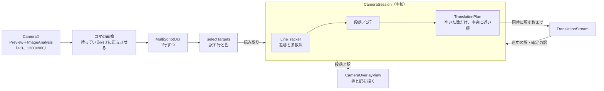

# カメラ翻訳

カメラ翻訳は、CameraX のコマを1枚ずつ文字認識し、行をコマをまたいで追って多数決で読み取りを決め、読み取りがそろった段落から翻訳の流れへ頼んで、映像の上に訳を重ねる。読み取りの安定は行の単位、表示と翻訳は段落の単位で扱う。段落は、文章のモードでは続く行をまとめ、表・メニューのモードでは1行ずつにする。訳は、翻訳の流れが無駄なく訳せる数だけ、その時点で画面に見えていて中央に近い段落を選んで渡す（深い待ち行列を作らない）。訳は追っている段落（番号を持つ「もの」）に結び付ける。画面をタップすると一時停止し、読むのを止めてそのコマを固定する。訳し方は変わらず、見えている段落を訳し続ける。

カメラ翻訳は、現地で文字の意味をその場で知るために使う。そのため、安定性（枠と段落の区切りがコマごとにちらつかず、同じ文の訳が出たり消えたりしない）、精度（読み続けるほど原文が正しくなる）、速さ（見ている文から待たされずに訳がそろう）を、この順に電池より先にする。電池は、この3つを損なわない範囲でだけ抑える。

## 操作

入口は、トップ画面の「カメラ」のタイルと、アイコンの長押しメニューの「カメラ翻訳」である。画面は縦向きに固定する。

| 操作 | 動き |
| --- | --- |
| カメラを向ける | 文字のある段落に枠が出て、読み取りがそろった段落から訳が重なる |
| 画面をタップ | 一時停止する。読むのを止めてそのコマを出し、見えている段落を、読み取りがそろうのを待たずに訳し続ける。もう一度タップで再開する（訳は捨てない） |
| 原文の言語のチップ（自動・韓国語・英語・中国語・他の言語 ▾） | 動かす認識器を絞り、翻訳にも原文の言語を渡す（「原文の言語」） |
| 「訳：日本語 ▾」 | 訳す先を53言語から選ぶ（「訳す先の言語」）。日本語以外のときはチップを選んだ状態の色にする |
| 文章／表・メニュー | 文章は行を段落にまとめて訳す。表・メニューは1行（1セル）ずつ訳す（「段落にまとめる」） |
| 翻訳モデル（上のバーの `ModelSwitch`） | 0.8B と2B を切り替える。読み込み中は青、読めないときは赤の帯を上のバーの下に出し、枠が出ても訳が出ない理由を示す |
| 💡 ライト | カメラのライトを点ける |
| 横向きに持つ | 持っている向きに正立させて読み、訳も同じ向きに描く（「映像の取り込みと向き」） |

原文の言語・訳す先・モードは SharedPreferences の `camera_translate`（`CameraPreferences`）に残し、次に開いたときも使う。

## 部品

判断と制御は中核（`core-pipeline` の `pipeline.camera`）に、端末とつなぐ部品は `app` の `camera/` に置く。

| クラス | 置き場 | 役割 |
| --- | --- | --- |
| `CameraSession` | 中核 | 制御（「制御」）。出来事を受け取り、追跡・段落（番号を持つ `CameraParagraph`）・訳の対応表・訳す計画を進め、流れを開く・文を渡すなどの作業を返す。設定の変更で何を捨てるかもここで決める。描く段落（`CameraBox`）を出す |
| `TranslationPlan` | 中核 | 訳す計画。候補から、読み取りがそろったものを先に、画面の中央に近い順に、同じ文を1つにして空いた数だけ選ぶ |
| `LineTracker` | 中核 | コマをまたいで同じ行を追い（行に番号を付ける）、読み取りを持つ（`Reading`・`Track`） |
| `ReadingFusion` | 中核 | 行の何回分もの読み取りを、文字ごとの（重みを掛けた）多数決で1つの文にし、確かさを出す |
| `Sharpness` | 中核 | 1行の画像の鋭さを測る（手ぶれ・ピンぼけのコマの票を軽くするため）。画素は `LiveTranslator` が渡す |
| `StableGrouping` | 中核 | 段落の区切りを、直近のコマでまとめ方と違い続けた段落だけ置き換えて安定させる（ヒステリシス） |
| `TextSimilarity` | 中核 | 読み揺れを吸収する比べ方（キーと Dice 係数）。多数決と訳の対応表で共通に使う |
| `CameraText` | 中核 | 段落の行のつなぎ方 |
| `CameraTranslateActivity` | `app` | 画面（Compose）。CameraX の取り込み、カメラの許可、端末の傾きの判定、操作 |
| `LiveTranslator` | `app` | 外とつなぐ。コマを文字認識し、端末の出来事（読み取り・設定・エンジン・一時停止・流れの結果）を `CameraSession` へ渡し、返った作業（流れを開く・文を渡す・止めた画像を読み直す）を行う。画面に渡す1コマ（`LiveFrame`・`LiveBox`）を作る |
| `CameraGeometry` | 縦持ちの画像・正立した画像・画面の座標の変換と、画面に見えている範囲（`visibleRect`）。描画と訳す順番で共通に使う |
| `CameraOverlayView` | `app` | 映像か一時停止の画像の上に、枠と訳を描く（Android の View） |
| `CameraLanguage.kt` | `app` | 選べる原文・訳す先の言語と、言語ごとに動かす認識器（`Language.ocrLanguage`） |
| `CameraPreferences` | `app` | 原文の言語・訳す先・表のモードの保存 |

文字認識の `MultiScriptOcr`（`core-ocr`）と、訳す対象を選ぶ `selectTargets`（`overlay/`）は画面翻訳と共通である（`docs/設計/画面翻訳.md`）。

## 仕組み

`LiveTranslator` と `CameraSession` の状態は、すべてメインスレッドで触る。コマの画像への変換は `ImageAnalysis` に渡した専用のスレッド1本で行い、文字認識はメインスレッドのコルーチンから呼ぶ。

### 映像の取り込みと向き

- 映像（`Preview`）と文字認識に渡す画像（`ImageAnalysis`）を同じ4:3にそろえ、どちらも「中央を切り抜いて全体を埋める」表示にする。枠の位置を同じ計算で画面の座標へ移すためである。
- 文字認識が終わるまで次のコマは捨てる（`STRATEGY_KEEP_ONLY_LATEST` と `busy`）。一時停止中もコマを捨てる。
- 画面は縦向きに固定し、端末の傾き（`OrientationEventListener`）から持っている向き（0・90・180・270°）を決める。今の向きから60°を超えて傾けたときだけ切り替える（斜め45°付近で行き来しないように）。
- コマは端末を立てた向きに回した画像（縦持ちの画像）にし、さらに持っている向きに回した正立した画像で文字を読む。枠の座標は正立した画像のもので、描くときに `CameraGeometry` が画面の座標へ回す。向きが変わったら、追っていた行を捨てる。

### 文字認識

- `MultiScriptOcr` で1行ずつ読む。行を追ってからまとめる。コマごとに読み揺れるので、読んだ時点で大きなまとまりにすると同じ文としてそろわないためである。
- 漫画用OCR は縦書きの漫画用で遅いので使わない。
- `selectTargets` で、訳す必要のある行を選び、行ごとの背景色と文字色を取る（中身は `docs/設計/画面翻訳.md`）。訳す必要があるかは、選んだ訳す先で決める（訳す先が日本語なら仮名を含む行は訳さず、韓国語ならハングルの行は訳さない）。
- 文字が1つだけの行は捨てる。韓国語のラベルを中国語の認識器が「太」「我」のように読み違える雑音が多いためである。

### 追跡と多数決

カメラは同じ行を何コマも続けて読めるので、その重なりで読み取りを安定させる（`LineTracker`）。

- 各コマの行を、前のコマの行のうち位置が重なるもの（IoU 0.3以上）に、無ければ近くにある同じ内容の行に結び付ける。
- 行ごとに直近8回の読み取りを持ち、文字ごとの多数決で原文を決める（`ReadingFusion`。音声認識の結果を合わせる ROVER と同じ考え方）。ほかの読み取りといちばん似ているもの（キーどうしの Dice 係数の合計が最大）を土台にし、各読み取りを編集距離で土台に並べて、位置ごとに最も多い文字を採る（同数なら土台の文字。文字はコードポイントで数え、票の重みの合計は小数の誤差で同数が崩れないよう丸めて比べる）。文字の間に挟まった文字は、過半数の読み取りが挟んだときだけ採る。1回1回が崩れていても、重ねた文は1回の読み取りより正しくなる。読み取りが3回以上あれば使い、数が偶数ならいちばん軽い1回（同じ重みなら古い方）を除いて奇数にする（重みがそろっているときの同数の割れを減らす。いちばん軽い1回を除くので、鋭い読み取りは多数決から外れない）。2回までは、ほかといちばん似ている読み取りをそのまま使う。
- 手ぶれ・ピンぼけのコマの読み取りは、票を軽くする（`Track.weights`）。`LiveTranslator` が、文字認識した画像から行ごとの範囲の画素を取り出し、中核の `Sharpness` で鋭さを測って読み取りに付ける。鋭さは、行の高さを24画素にそろえて（面積の平均で縮めて）明るさにし、ラプラシアンの分散を明るさの分散で割った値で、露出が変わっても同じ尺度になる。値の大きさは書体や文字の詰まり方で行ごとに違い、写る大きさでも少し変わる（24画素より低い行は縮めずに測る。縮めるときの画素の区切り方でも変わる）。そこで、同じ行の、行の高さが1.25倍以内のコマどうしでだけ比べる（`Track.ratios`）。重みは、その中でいちばん鋭かったコマに対する割合で、7割以上なら1、それより低ければ割合に比例して軽くする（下限0.1）。基準を中央値でなくいちばん鋭いコマにするのは、ぶれたコマが多数のときも鋭いコマを重く数えるためである。土台の選び方、文字ごとの票、ほぼ同じ読み取りの数は、すべて重みを掛けて数える。鋭さを測れない読み取り（小さすぎる、白飛びなどで一様な行）は重み1。止めた画像の読み直しも鋭さを測るが、原文の言語を変えて行を捨てた後なので、行ごとに読み取りは1回で、重みは1になる。
- 行の読み取りが「そろった」（`Track.settled`）とは、ほぼ同じ読み取りが（重みの合計で）2回分あるか、多数決にかけた読み取りの重みの合計が2回分以上あって、文字ごとの多数決で採った文字の得票の割合の平均が0.75以上のこと。重みの合計の条件は、ぶれた読み取りの票が軽いせいで、鋭い1回の票だけで確かさが高く出たときに、そろったとしないためである。どの2回も別の位置が崩れていて互いに一致しなくても、位置ごとに多数が決まれば、そろったとみなす。
- 2回以上読めた行を表示と翻訳に使う。1回しか読めなかった行は、一時停止中だけ出す。
- 読めなかったコマが2回までなら行を残す（1コマの読み落としで枠がちらつかないように）。そのコマで読めた行に重なる古い行は、カメラが動いてずれた枠なので消す。
- 同じ行が二重に読めた枠（小さい方の5割以上が重なる。認識器ごとに少しずれた枠ができる）は、確かな方（そのコマで読めた、多数決の原文とほぼ同じ読み取りの重みの合計が大きい）だけを残す。
- 「ほぼ同じ」は、キー（文字と数字だけを小文字にしたもの）どうしの Dice 係数が0.8以上で、短い方の長さが長い方の7割以上のこと（`TextSimilarity.similar`）。1〜2文字の語は完全一致だけを同じとみなす。

### 段落にまとめる

`CameraSession` が、安定した行を表示と翻訳の単位（`CameraParagraph`）にまとめる。段落には番号（「もの」の名前）を付け、行が加わったり欠けたりしても、行の番号が重なる前の段落の番号を受け継ぐ。まとめ方の規則は画面翻訳と同じ中核の部品（文章は `TextGrouper`、表・メニューは `MenuGrouper`）。

コマごとのまとめ方の結果を、そのまま段落にはしない（`StableGrouping`）。境目の行がコマのたびに付いたり離れたりし、段落の原文が変わって訳し直しと枠のちらつきが起きるためである。区切り全体を1つの状態として持ち、今の段落ごとに、そのコマのまとめ方と顔ぶれが違ったか（見えている行が1つの段落に入り、そこにほかの段落の行が混じっていないか）を直近6コマで数える。違ったコマが6割を超え、かつ3コマ以上になったときだけ、その段落をそのコマのまとめ方の段落で置き換える（ヒステリシス）。置き換えに使うのは必ずどこかのコマのまとめ方の段落なので、まとめ方の規則の約束（文章の行数の上限、番号・記号で始まる行での区切り、表・メニューの2行まで）は崩れない。数えるのはコマの数で、時間ではない（読む間隔が延びれば、切り替わりも遅れる）。

新しく見えた行は、そのコマで今の段落の1つと同じまとまりに入り、その段落の見えている行がすべてそのまとまりにあれば、すぐその段落に入れる（段落が伸びたとき）。そうでなければ、新しい行だけで段落を作る。区切りは、見えている全部の行（読み取りがそろっていない行も）で決め、表示と翻訳に使う行に後で絞る。隠れていても追跡が続く行は区切りに残し、追跡が切れた行は忘れる。段落の中の行の並べ方は、まとめ方と同じ規則（`TextLayout.unitOf`。横書きは上から、縦書きは右から）にする。原文の言語・まとめ方（文章／表・メニュー）が変わったとき、向きが変わったときは、区切りを捨てる。段落のすべての行の読み取りがそろったら、その段落を訳す候補にする（一時停止中は、そろっていない段落も候補にする）。

- **文章のモード**：文章のまとめ方（規則の正本は `docs/設計/画面翻訳.md`「まとめる」）。番号付きの注意書きが1つの段落になると、訳が遅く、1行の読み揺れで全体を訳し直すので、番号・記号で始まる行で区切り、行数に上限を置く。
- **表・メニューのモード**：メニューのまとめ方（同じく「まとめる」）。表を段落にまとめると、隣のセルや下の行がつながって訳の質が下がるので1行（1セル）ずつにし、ボタンの2段書き（「바람／세기」）だけは1つにまとめる。1語ずつだと「세기」が「世紀」になる。
- 行をつなぐとき、ハングルか英字を含めば空白を入れ、そうでなければ詰める。

### 翻訳

翻訳は、ほかの機能と同じ翻訳の契約（`TranslationStream`。`docs/設計/翻訳コア.md`「翻訳の契約」）で訳す。行の訳し直し・生成の打ち切り・長い文の分け方は、契約の側で決まる。何をいつ流れに渡すかは、`CameraSession`（「制御」）が決める。

- **流れ**：`Translations.open` で1本を開いたままにする。原文の言語・訳す先・モード（背景）・翻訳モデルのエンジンが変わったら、`CameraSession` が開き直しを頼み、渡していた文と前の訳を捨てる（原文の言語を変えたら、追っていた行も捨てる。一時停止中なら、止めた画像を新しい認識器で1回読み直す）。翻訳モデルの切り替えは、`LiveTranslator` が `EngineHolder.state` を購読して知らせる。流れの設定（背景を付けるか）は `CameraSession.Settings` が組み立てる。データベースの控えは使わない（読み揺れで似た文が大量にできるため）。
- **背景**：表・メニューのモードでは、翻訳に「家電や機器のボタン・表示画面、メニュー、看板、表などに書かれた短い表記。」という背景（PFML3 の `context`、`CameraSession.TABLE_CONTEXT`）を渡す。短い語の意味を決める手がかりにするためで、効果は限られる（`docs/判断/2026-11-06_カメラ翻訳に表とメニューのモードを足す.md`）。
- **訳す計画**：流れに渡しておく文を、流れが無駄なく訳せる数（`intakeFor`。翻訳の側が同時に訳す数の設定から決める。1件ずつのコアは行をつないで1回で訳すので8件、同時に訳すコアは同時に訳す数）までにとどめる。設定で変わるので、コマごとに確かめる。読み取りや訳の確定のたびに空きを数え、空いた数だけ、その時点の候補からいちばん先に訳すべき段落を選んで渡す（`TranslationPlan`）。並んで待つ文が無いので、カメラを動かしても一時停止しても、次に渡す文が変わるだけで、並べ替えも取り消しも要らない（`docs/判断/2026-11-13_カメラ翻訳は空いた分だけその時点で選んで訳す.md`）。
- **候補と順番**：画面に見えていて、まだ訳が無い段落が候補になる。読み取りがそろった段落を先に選び、空きが残れば、そろっていない段落（読み揺れが収まらない、つながるかどうかが揺れる段落）も訳す。流れが空いているのに枠が埋まらないままにしないためである。映している間は、2回以上読めた行の段落だけが候補になり、一時停止中は1回だけ読めた行の段落も入る。文字認識の画像は4:3なので、縦長の画面では左右（縦持ちで横幅の約4割）がはみ出して見えない。画面に見えている範囲を正立した画像の座標で求め（`visibleRect`）、見えていない段落は候補にしない。候補は画面の中央に近い順に選ぶ（見えている範囲が分からなければ上から）。
- **同じ段落・同じ文を2回渡さない**：渡している段落は、原文が読み揺れや行の増減で変わっても、確定するまで渡し直さない（訳している途中の訳も、その段落に出し続ける）。ほかの段落でほぼ同じ文（`TextSimilarity.similar`）を渡していれば、訳がまだ1文字も出ていなくても渡さない。原文が変わった段落には、新しい版の訳が出るまで、同じ段落で最後に確定した訳を出し続ける。
- **一時停止**：読むのを止めて、見えている段落を固定するだけにする。訳し方は変えず、候補に読み取りがそろっていない段落が加わる。一時停止の後に終わったコマの読み取りは捨てる（止めた画面の枠を差し替えないため）。再開しても訳は捨てない。
- **訳の対応表**：枠に出す訳を、原文のキー（`TextSimilarity.key`）で持つ表示の状態（`CameraSession` の中）。翻訳の契約の控えとは別物で、確定した訳（300件まで）と訳している途中の訳からなり、ほぼ同じ文の枠にも出す。カメラを戻して同じ文が別の段落として現れたときにも使う。訳が空なら「（訳せませんでした）」として入れる（入れないと枠が「訳待ち」のまま残る）。失敗した文は、すぐには渡し直さず次の出来事で候補に戻す。同じ文（読み揺れを含む）が2回失敗したら「（訳せませんでした）」として終わらせる。

隣の段落が訳の手がかりとしてモデルに見えるのは、同時に訳す数が1のときだけである（`docs/設計/翻訳コア.md`「片とコア」）。

### 制御

`CameraSession.handle` が、出来事を受け取って状態を進め、外でする作業を返す。いつ何を訳すかは、ここだけで決める（画面翻訳の `ScreenSession.reduce` と同じ考え方。追った行の読み取りの履歴を持つので、状態は `CameraSession` の中に持つ）。`LiveTranslator` は、端末の出来事を渡し、返った作業を行うだけにする。

| 出来事 | 状態の変化 |
| --- | --- |
| 出来事 | 状態の変化と、返す作業 |
| --- | --- |
| `Read`（1コマの読み取りと、見えている範囲） | 行を追い、段落をまとめ直して番号を付け、見えている範囲を入れ替える。一時停止中は捨てる（止めた画像の読み直しだけ受け取る） |
| `Paused`・`Resumed` | 読むのを止める・再開する。一時停止中は、1回だけ読めた行の段落も候補にする |
| `Rotated` | 追っていた行を捨てる（座標の向きが変わるため） |
| `SettingsChanged`（原文の言語・訳す先・モード） | 前の訳と渡していた文を捨て、`OpenStream`（流れを開き直す）を返す。原文の言語なら追っていた行も捨て、一時停止中は `ReadStill`（止めた画像を読み直す）を返す |
| `EngineChanged`・`IntakeChanged` | 翻訳モデルが変わったら、前の訳を捨てて `OpenStream` を返す。渡しておく数を入れ替える |
| `StreamOpened` | 開いた流れに渡せるようにする |
| `Partial`・`Final`・`Failed` | 途中の訳・確定した訳を対応表と段落に入れる。失敗の回数を数える。前の流れの番号の結果は無視する |

途中の訳のほかは、どの出来事の後も、空いた数だけ候補を選んで `Submit`（流れに渡す文）を返す。一時停止の後に見えている段落の訳がすべてそろったら、1度だけ `VisibleComplete` を返す（ログに時間を出す）。描く段落は `boxes` で読む。

### 描き方

`CameraOverlayView` が、正立した画像の座標で配置を決めて描き、最後に画面の座標へ回す。

- まだ訳の無い段落は、枠線だけを描く。
- 訳は、`selectTargets` が取った背景色で枠を塗り、文字色で描く。枠に収まる最大の大きさ（画面上で7〜26sp）を選び、最小でも収まらない分は切って、ほかの枠に被せない。
- 文章のモードでは、日本語の訳が原文より長くなりやすいので、訳の枠を広げる。右は同じ段落の右端まで（元の幅の半分まで、右隣の文字の手前まで）、下は次の行の手前まで（行の高さの1倍まで。下に行が無ければ半分まで）。
- 表・メニューのモードでは枠を広げず、元の文字の範囲に収める。広げると隣のボタンやセルを覆うためである。

## 原文の言語

翻訳は53言語を訳せるので、原文に選べる言語は文字認識が読める文字で決まる。アプリに入れている ML Kit の認識器は、ラテン文字・中国語・日本語・韓国語の4つである。原文の言語を選ぶと、要らない認識器を動かさないので速くなり、読み違いも減る。

| 選べる言語 | 動かす認識器（`OcrLanguage`） |
| --- | --- |
| 自動 | すべて。翻訳モデルが原文の言語を判定する |
| 日本語 | 日本語（`JAPANESE`。縦書きの漫画用OCRと ML Kit 日本語） |
| 韓国語 | 韓国語 |
| 中国語（簡体字）・中国語（繁体字） | 中国語（簡体字と繁体字の両方を読む） |
| ラテン文字で書く25言語（英語、ドイツ語、フランス語、スペイン語、ベトナム語、インドネシア語など。一覧は `CameraLanguage.kt` の `LATIN_SCRIPT`） | ラテン文字（`LATIN`） |

- 訳す先と同じ言語は、原文の選択肢に出さない（日本語へ訳すときは日本語を、英語へ訳すときは英語を出さない。簡体字と繁体字は同じ言語とみなす）。訳す先を変えて原文と同じ言語になったら、原文は自動に戻す。
- 下の欄のチップは自動と、日本語・韓国語・英語・中国語のうち訳す先と違う3つで、ほかの言語は「他の言語 ▾」のメニューに並べる。
- セルビア語は、看板がキリル文字のことが多いので入れていない。
- キリル文字・アラビア文字・ヘブライ文字・タイ文字・インド系の文字などの言語は、読める認識器が無いので選べない。
- ラテン文字の行は、英語と同じ整え方（`EnglishText`）を通してから訳す。ドイツ語の名詞の大文字が小文字になる影響と、声調の印の多いベトナム語をラテン文字の認識器がどこまで読めるかは、確かめていない（`docs/バックログ.md`）。

## 訳す先の言語

既定は日本語で、下の欄の「訳：日本語 ▾」から53言語のどれにでも変えられる。訳す先は、訳す必要があるかの判定（「文字認識」）にも使う。

## 扱わないこと

- 縦書きは扱わない。訳は横書きで描く。
- 大きな画面（短辺600dp以上）の Android 16 では縦向きの固定が効かない。`CameraGeometry` は画面が縦向きである前提なので、そうした端末で枠がずれるおそれがあるが、確かめていない（`docs/バックログ.md`）。

## 性能の目安

一時停止から見えている段落の訳がそろうまでの時間は、ログの「カメラ翻訳: 一時停止から見えている訳がそろうまで …ms」で測る。今の作り（空いた分だけ選んで渡す）での値は、まだ測っていない（`docs/バックログ.md` の「2Bで一時停止から全部の訳がそろうまで」）。訳文の生成の速さは `docs/設計/翻訳コア.md`「今の性能の目安」にある。

## 確かめ方

判断と制御は単体テストで、描き方と端末での速さは実機で確かめる。

- **単体テスト**：`core-pipeline` の `pipeline.camera` の `CameraSessionTest`（渡しておく数、読み揺れ・段落の伸び・境目の行の揺れで頼み直さない、見えていない段落を渡さない、中央に近い順、一時停止と再開、向き、設定の変更と流れの開き直し、止めた画像の読み直し、失敗の上限）、`StabilityTest`（崩れた読み取りが混じっても文字ごとの多数決で正しい文になる、同数の割れの決め方、互いに一致しない読み取りでも多数決が確かならそろう、ぶれたコマの票が軽い、偶数回のときに鋭い読み取りを除かない、鋭い1回の票だけではそろわない、鋭さを測れない読み取りと写る大きさの違うコマの扱い、鋭さの小さな揺れと小数の誤差、境目の行が1〜2コマ揺れても段落が変わらない、はっきり離れたら切り替える、切り替えた段落はそのコマのまとめ方の段落になる、段落の伸び、隠れた行と追跡の切れた行）、`SharpnessTest`（ぼけた行は鋭さが低い、露出と写る大きさでは変わらない、測れない行）と `CameraTextTest`（キーの作り方、ほぼ同じ文の判定、番号・記号で始まる行、行のつなぎ方）。`app` の `CameraLanguageTest`（選べる言語と認識器の対応）。まとめ方の規則は `core-pipeline` の `GroupersTest`。
- **実機**：REDMAGIC 11 Pro で、韓国語の説明書のような番号付きの文章、家電のボタンやメニュー（表・メニューのモード）を映し、次を見る。ログはタグ `PlamoTranslate` の「カメラ翻訳:」の行に、1件ごとの翻訳の時間（頼んでから確定まで）、一時停止したときの訳待ちの件数とそれまでに渡した件数・うち段落の訳し直しの件数・読めた行の数・うちぶれたコマとして票を軽くした（重み0.5未満の）数、一時停止から見えている訳がそろうまでの時間が出る。
  1. 読み取りがそろった段落から、見えている中央に近い順に訳が重なり、枠がちらつかない。
  2. 番号付きの項目が別々の段落になり、表・メニューのモードでは1行ずつ訳され、枠が隣のボタンを覆わない。
  3. タップで一時停止すると、見えている段落が中央に近い順に訳されてそろい、止めた画面の枠が差し替わらない。
  4. 横向きに持つと、正立して読み、訳も同じ向きに描かれる。
  5. 原文の言語・訳す先・モード・翻訳モデルを変えると、訳が新しい設定で出直す。
