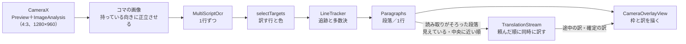

# カメラ翻訳

カメラ翻訳は、CameraX のコマを1枚ずつ文字認識し、行をコマをまたいで追って多数決で読み取りを決め、読み取りがそろった段落から翻訳の流れへ頼んで、映像の上に訳を重ねる。読み取りの安定は行の単位、表示と翻訳は段落の単位で扱う。段落は、文章のモードでは続く行をまとめ、表・メニューのモードでは1行ずつにする。訳は画面に見えていて中央に近い段落から頼み、一度頼んだ文は取り消さない。画面をタップすると一時停止し、そのコマを止めて、見えている段落を全部訳す。

## 操作

入口は、トップ画面の「カメラ」のタイルと、アイコンの長押しメニューの「カメラ翻訳」である。画面は縦向きに固定する。

| 操作 | 動き |
| --- | --- |
| カメラを向ける | 文字のある段落に枠が出て、読み取りがそろった段落から訳が重なる |
| 画面をタップ | 一時停止する。そのコマを止めて出し、見えている段落を、読み取りがそろうのを待たずに全部訳す。もう一度タップで再開する |
| 原文の言語のチップ（自動・韓国語・英語・中国語・他の言語 ▾） | 動かす認識器を絞り、翻訳にも原文の言語を渡す（「原文の言語」） |
| 「訳：日本語 ▾」 | 訳す先を53言語から選ぶ（「訳す先の言語」）。日本語以外のときはチップを選んだ状態の色にする |
| 文章／表・メニュー | 文章は行を段落にまとめて訳す。表・メニューは1行（1セル）ずつ訳す（「段落にまとめる」） |
| 翻訳モデル（上のバーの `ModelSwitch`） | 0.8B と2B を切り替える。読み込み中は青、読めないときは赤の帯を上のバーの下に出し、枠が出ても訳が出ない理由を示す |
| 💡 ライト | カメラのライトを点ける |
| 横向きに持つ | 持っている向きに正立させて読み、訳も同じ向きに描く（「映像の取り込みと向き」） |

原文の言語・訳す先・モードは SharedPreferences の `camera_translate`（`CameraPreferences`）に残し、次に開いたときも使う。

## 部品

すべて `app` の `camera/` に置く。

| クラス | 役割 |
| --- | --- |
| `CameraTranslateActivity` | 画面（Compose）。CameraX の取り込み、カメラの許可、端末の傾きの判定、操作 |
| `LiveTranslator` | 中身の司令塔。コマごとの文字認識、追跡と段落、訳したい文の一覧（`wanted`）、翻訳の流れへの依頼、枠に出す訳の対応表（`translated`・`translating`）。画面に渡す1コマ（`LiveFrame`・`LiveBox`）を作る |
| `LineTracker` | コマをまたいで同じ行を追い、多数決で読み取りを決める（`Reading`・`Track`） |
| `Paragraphs` | 安定した行を段落にまとめる（`Paragraph`） |
| `TextSimilarity` | 読み揺れを吸収する比べ方（キーと Dice 係数）。多数決と訳の対応表で共通に使う |
| `CameraGeometry` | 縦持ちの画像・正立した画像・画面の座標の変換と、画面に見えている範囲（`visibleRect`）。描画と訳す順番で共通に使う |
| `CameraOverlayView` | 映像か一時停止の画像の上に、枠と訳を描く（Android の View） |
| `CameraLanguage.kt` | 選べる原文・訳す先の言語と、言語ごとに動かす認識器（`Language.ocrLanguage`） |
| `CameraPreferences` | 原文の言語・訳す先・表のモードの保存 |

文字認識の `MultiScriptOcr`（`core-ocr`）と、訳す対象を選ぶ `selectTargets`（`overlay/`）は画面翻訳と共通である（`docs/設計/画面翻訳.md`）。

## 仕組み

`LiveTranslator` の状態は、すべてメインスレッドで触る。コマの画像への変換は `ImageAnalysis` に渡した専用のスレッド1本で行い、文字認識はメインスレッドのコルーチンから呼ぶ。

### 映像の取り込みと向き

- 映像（`Preview`）と文字認識に渡す画像（`ImageAnalysis`）を同じ4:3にそろえ、どちらも「中央を切り抜いて全体を埋める」表示にする。枠の位置を同じ計算で画面の座標へ移すためである。
- 文字認識が終わるまで次のコマは捨てる（`STRATEGY_KEEP_ONLY_LATEST` と `busy`）。一時停止中もコマを捨てる。
- 画面は縦向きに固定し、端末の傾き（`OrientationEventListener`）から持っている向き（0・90・180・270°）を決める。今の向きから60°を超えて傾けたときだけ切り替える（斜め45°付近で行き来しないように）。
- コマは端末を立てた向きに回した画像（縦持ちの画像）にし、さらに持っている向きに回した正立した画像で文字を読む。枠の座標は正立した画像のもので、描くときに `CameraGeometry` が画面の座標へ回す。向きが変わったら、追っていた行を捨てる。

### 文字認識

- `MultiScriptOcr` で1行ずつ読む。行を追ってからまとめる。コマごとに読み揺れるので、読んだ時点で大きなまとまりにすると同じ文としてそろわないためである。
- 漫画用OCR は縦書きの漫画用で遅いので使わない。
- `selectTargets` で、訳す必要のある行を選び、行ごとの背景色と文字色を取る（中身は `docs/設計/画面翻訳.md`）。訳す必要があるかは、選んだ訳す先で決める（訳す先が日本語なら仮名を含む行は訳さず、韓国語ならハングルの行は訳さない）。
- 文字が1つだけの行は捨てる。韓国語のラベルを中国語の認識器が「太」「我」のように読み違える雑音が多いためである。

### 追跡と多数決

カメラは同じ行を何コマも続けて読めるので、その重なりで読み取りを安定させる（`LineTracker`）。

- 各コマの行を、前のコマの行のうち位置が重なるもの（IoU 0.3以上）に、無ければ近くにある同じ内容の行に結び付ける。
- 行ごとに直近8回の読み取りを持ち、ほかの読み取りといちばん似ているもの（キーどうしの Dice 係数の合計が最大）を原文にする。1回崩れて読めても結果は乱れない。
- ほぼ同じ読み取りが2回そろった行だけを、表示と翻訳に使う。1回しか読めなかった行は、一時停止中だけ出す。
- 読めなかったコマが2回までなら行を残す（1コマの読み落としで枠がちらつかないように）。そのコマで読めた行に重なる古い行は、カメラが動いてずれた枠なので消す。
- 同じ行が二重に読めた枠（小さい方の5割以上が重なる。認識器ごとに少しずれた枠ができる）は、確かな方（そのコマで読めた、多数決で同じ読み取りが多い）だけを残す。
- 「ほぼ同じ」は、キー（文字と数字だけを小文字にしたもの）どうしの Dice 係数が0.8以上で、短い方の長さが長い方の7割以上のこと（`TextSimilarity.similar`）。1〜2文字の語は完全一致だけを同じとみなす。

### 段落にまとめる

`Paragraphs` が、安定した行を表示と翻訳の単位にまとめる。まとめ方の規則は画面翻訳と同じ中核の部品（文章は `TextGrouper`、表・メニューは `MenuGrouper`）。段落のすべての行の読み取りがそろったら、その段落を訳す。

- **文章のモード**：すぐ下に続く行（横に重なり、行間が行の高さの0.8倍以内、高さの比が1.6倍以内）を同じ段落にする。番号・記号で始まる行（「1.」「1)」「1 」「①」「・」「※」など。`TextGrouper.ITEM_START`）は新しい段落にし、1段落は6行までにする。番号付きの注意書きが1つの段落になると、訳が遅く、1行の読み揺れで全体を訳し直すためである。
- **表・メニューのモード**：1行（1セル）ずつにする。表を段落にまとめると、隣のセルや下の行がつながって訳の質が下がるためである。ただし、行間がほとんどなく（行の高さの0.3倍以内）、中央がそろい、幅が近い上下2行（ボタンの2段書き「바람／세기」）だけは1つにまとめる。1語ずつだと「세기」が「世紀」になる。
- 行をつなぐとき、ハングルか英字を含めば空白を入れ、そうでなければ詰める。

### 翻訳

翻訳は、ほかの機能と同じ翻訳の契約（`TranslationStream`。`docs/設計/翻訳コア.md`「翻訳の契約」）で訳す。行の訳し直し・生成の打ち切り・長い文の分け方・同時に訳す数は、契約の側で決まる。

- **流れ**：`Translations.open` で1本を開いたままにする。原文の言語・訳す先・モード（背景）・翻訳モデルのエンジンが変わったら開き直す。データベースの控えは使わない（読み揺れで似た文が大量にできるため）。
- **背景**：表・メニューのモードでは、翻訳に「家電や機器のボタン・表示画面、メニュー、看板、表などに書かれた短い表記。」という背景（PFML3 の `context`、`LiveTranslator.TABLE_CONTEXT`）を渡す。短い語の意味を決める手がかりにするためで、効果は限られる（`docs/判断/2026-11-06_カメラ翻訳に表とメニューのモードを足す.md`）。
- **訳す順番**：文字認識の画像は4:3なので、縦長の画面では左右（縦持ちで横幅の約4割）がはみ出して見えない。画面に見えている範囲を正立した画像の座標で求め（`visibleRect`）、見えている段落を先に、その中では画面の中央に近い順に並べる。状態表示の件数と「訳待ち」も、見えている枠だけを数える。
- **頼み方**：映している間は、コマごとに、読み取りがそろってまだ訳も依頼も無い段落で訳したい文の一覧（`wanted`）を作り直し、その順に `submit` で流れへ足す。流れは頼んだ順に、空いた流れですぐ訳す。訳している途中の訳も枠に出す。頼んだ文は画面から外れても取り消さない。
- **一時停止**：見えている段落を、読み取りがそろうのを待たずに一覧の先頭へ入れ、それまでの一覧は後ろに残す。一時停止の後に終わったコマの読み取りは捨てる（止めた画面の枠を差し替えないため）。
- **訳の対応表**：枠に出す訳を、原文のキー（`TextSimilarity.key`）で持つ表示の状態。翻訳の契約の控えとは別物で、確定した訳（`translated`、300件まで）と訳している途中の訳（`translating`）からなり、ほぼ同じ文（`TextSimilarity.similar`）の枠にも出す。訳が空なら「（訳せませんでした）」として入れる（入れないと枠が「訳待ち」のまま残る）。失敗した文は入れず、後のコマでもう一度頼む。
- **設定を変えたとき**：原文の言語・訳す先・モードを変えたら、訳の対応表を捨てて流れを `clear` する（表・メニューのモードは背景を渡すので訳が変わる）。一時停止中なら、見えている段落をすぐ訳し直す。翻訳モデルを切り替えたときは、次に頼むときに流れを開き直し、確定した訳の表を捨てる。

隣の段落が訳の手がかりとしてモデルに見えるのは、同時に訳す数が1のときだけである（`docs/設計/翻訳コア.md`「片とコア」）。

### 描き方

`CameraOverlayView` が、正立した画像の座標で配置を決めて描き、最後に画面の座標へ回す。

- まだ訳の無い段落は、枠線だけを描く。
- 訳は、`selectTargets` が取った背景色で枠を塗り、文字色で描く。枠に収まる最大の大きさ（画面上で7〜26sp）を選び、最小でも収まらない分は切って、ほかの枠に被せない。
- 文章のモードでは、日本語の訳が原文より長くなりやすいので、訳の枠を広げる。右は同じ段落の右端まで（元の幅の半分まで、右隣の文字の手前まで）、下は次の行の手前まで（行の高さの1倍まで。下に行が無ければ半分まで）。
- 表・メニューのモードでは枠を広げず、元の文字の範囲に収める。広げると隣のボタンやセルを覆うためである。

## 原文の言語

翻訳は53言語を訳せるので、原文に選べる言語は文字認識が読める文字で決まる。アプリに入れている ML Kit の認識器は、ラテン文字・中国語・日本語・韓国語の4つである。原文の言語を選ぶと、要らない認識器を動かさないので速くなり、読み違いも減る。

| 選べる言語 | 動かす認識器（`OcrLanguage`） |
| --- | --- |
| 自動 | すべて。翻訳モデルが原文の言語を判定する |
| 韓国語 | 韓国語 |
| 中国語（簡体字）・中国語（繁体字） | 中国語（簡体字と繁体字の両方を読む） |
| ラテン文字で書く25言語（英語、ドイツ語、フランス語、スペイン語、ベトナム語、インドネシア語など。一覧は `CameraLanguage.kt` の `LATIN_SCRIPT`） | ラテン文字（`LATIN`） |

- 下の欄のチップは自動・韓国語・英語・中国語で、ほかの言語は「他の言語 ▾」のメニューに並べる。
- 日本語は原文の選択肢に出さない。訳す先を日本語以外にして日本語を読むときは、自動で読む。
- セルビア語は、看板がキリル文字のことが多いので入れていない。
- キリル文字・アラビア文字・ヘブライ文字・タイ文字・インド系の文字などの言語は、読める認識器が無いので選べない。
- ラテン文字の行は、英語と同じ整え方（`EnglishText`）を通してから訳す。ドイツ語の名詞の大文字が小文字になる影響と、声調の印の多いベトナム語をラテン文字の認識器がどこまで読めるかは、確かめていない（`docs/バックログ.md`）。

## 訳す先の言語

既定は日本語で、下の欄の「訳：日本語 ▾」から53言語のどれにでも変えられる。訳す先は、訳す必要があるかの判定（「文字認識」）にも使う。

## 扱わないこと

- 縦書きは扱わない。訳は横書きで描く。
- 大きな画面（短辺600dp以上）の Android 16 では縦向きの固定が効かない。`CameraGeometry` は画面が縦向きである前提なので、そうした端末で枠がずれるおそれがあるが、確かめていない（`docs/バックログ.md`）。

## 性能の目安

頼んだ順に同時に訳す今の作りでの速さ（一時停止から見えている段落の訳がそろうまで）は、まだ測っていない（未確認。`docs/バックログ.md` の「2Bで一時停止から全部の訳がそろうまで」）。訳文の生成の速さは `docs/設計/翻訳コア.md`「今の性能の目安」にある。

## 確かめ方

文字列だけで決まる判定は単体テストで、枠の位置を使う判定と描き方は実機で確かめる。

- **単体テスト**：`app/src/test/java/app/plamotranslate/camera/` の `CameraTextTest`（キーの作り方、ほぼ同じ文の判定、番号・記号で始まる行、行のつなぎ方）と `CameraLanguageTest`（選べる言語と認識器の対応）。
- **実機**：REDMAGIC 11 Pro で、韓国語の説明書のような番号付きの文章、家電のボタンやメニュー（表・メニューのモード）を映し、次を見る。ログはタグ `PlamoTranslate` の「カメラ翻訳:」の行に、1件ごとの翻訳の時間と控えに当たったかが出る。
  1. 読み取りがそろった段落から、見えている中央に近い順に訳が重なり、枠がちらつかない。
  2. 番号付きの項目が別々の段落になり、表・メニューのモードでは1行ずつ訳され、枠が隣のボタンを覆わない。
  3. タップで一時停止すると、見えている段落が全部訳され、止めた画面の枠が差し替わらない。
  4. 横向きに持つと、正立して読み、訳も同じ向きに描かれる。
  5. 原文の言語・訳す先・モード・翻訳モデルを変えると、訳が新しい設定で出直す。
