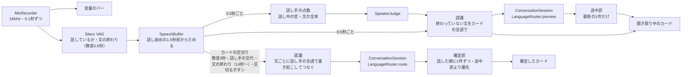

# 会話翻訳

会話翻訳は、端末を2人の間に置き、マイクを入れたまま話すと、話している最中から聞き取った文字とその訳（途中訳）を出し、カードが確定するたびに確定訳を出す。話せる言語は、設定の画面で選んだ音声認識モデル（`SpeechModel`）が聞ける言語のうち PLaMo が訳せるもので、その中から自分の言語と相手の言語を選んで双方向に訳す。既定の SenseVoice Small は日本語・韓国語・英語・中国語（簡体字・繁体字と広東語）、Qwen3-ASR 0.6B はそれに露・仏・独・西・ヒンディーなどを足した21言語を聞く。音声の区切り方は中核の `SpeechSegmenter`、VAD と認識は `core-asr`（sherpa-onnx）で、テキスト翻訳の音声入力も同じ設定のモデルを使う。何をいつ訳すかと訳す方向は、中核の `ConversationSession` が決める。訳文は押したときだけ読み上げる（`core-tts`）。

## 全体の流れ

`ConversationViewModel` は外とつなぐだけで、判断と制御は中核に置く（`docs/設計/アーキテクチャ.md`「設計の原則」）。マイクの音声は録音の側で音量を測ってから、上限の無い列で専用の1本のスレッド（`PlamoAsr`）へ渡し、`SpeechSegmenter.accept` に渡す。書き起こしの重いモデルで認識が遅れても、音量のバーは止まらず、音声も落とさない。認識が録音から1秒以上遅れたら、その秒数を話し中のカードに出す。区切るボタンは同じ列に区切りの印を入れ、押した時点の音声の位置で区切る。停止は録音だけを止め、列にたまった音声を書き起こしてから `flush` する。返ってきた出来事（`SpeechEvent`）を画面のスレッドで `ConversationSession.handle` に渡す。`ConversationSession` は、カードと聞き取り中の表示を持ち、確定訳・途中訳を渡す作業と途中訳の取り消しを返す。`ConversationViewModel` はその作業を翻訳の流れで行い、結果を出来事として返す。停止すると、話しかけの分も `flush` で確定させて訳す。



## 画面

`ConversationActivity` は縦向きに固定し、会話中は画面を点けたままにする（`FLAG_KEEP_SCREEN_ON`）。トップ画面のタイルと、アイコンの長押しメニューから開く。

操作欄は3つの列に分け、真ん中に大きな丸い区切るボタンを置く。左の列は話すこと（開始・停止、自分と相手の言語）、右の列は見せ方とそのほか（対面・1画面、ログ、翻訳モデル）で、その下に状態を1行出す。

| 操作 | 動き |
| --- | --- |
| 開始・停止 | 開始は、音声認識と翻訳モデルの両方の準備が済むまで押せない |
| 区切る | 操作欄の真ん中の大きな丸いボタン（欄の高さいっぱい）。今話している分を確定して次のカードにする（聞くのは続ける）。押したその場で、話し中のカードを書き起こし待ちのカードとして並べ、新しい話し中のカードを始める（認識が遅れていても、区切られたことがすぐ分かる）。聞いている間だけ押せる。相手も押すので、名前は自分と相手の両方の言語で出す（日本語「区切る」、韓国語「여기까지」、英語「Done」、中国語「说完了／說完了」など。名前を持たない言語は「Done」）。対面では相手の言語を上に逆さに、1画面では自分の言語の下に小さく出す。周りの輪がマイクの音量で、話していると判定している間は色が変わる |
| 対面・1画面 | 並べ方を切り替える。`ConversationPreferences` に保存する |
| 自分 ▾ | 音声認識モデルの言語から選ぶ（既定は日本語）。保存する。相手を同じ言語に固定していたら、相手は自動に戻る |
| 相手 ▾ | 自動と、自分以外の会話の言語。保存しないので、開くたびに自動から始まる。自動で決まった相手は、ボタンに「相手：英語（自動）」、状態の行に「（自動で判定）」と出し、まだ相手が話していなければ「相手の言語は話したら判定」と出す |
| ログ ▾ | 共有・ファイルに保存・画面の発話を消去（「会話ログ」） |
| 翻訳モデル | `ModelSwitch` で0.8Bと2Bを切り替える（`docs/設計/翻訳コア.md`） |
| 画面を離れる | `onStop` でマイクと読み上げを止める。フォアグラウンドサービスは無い |

| 表示 | 並べ方 |
| --- | --- |
| 対面 | 上下2分割で、操作欄が境目になる。上半分は相手向けに逆さに出す。各カードは、その面を読む人の言語の方を上に大きく出す |
| 1画面 | 1つの一覧に、自分の発話を右、相手の発話を左に置き、原文の下に訳を大きく出す |

相手向けの面は、一覧ごと180°回さず、各カードだけを回して並びを下から上（`reverseLayout`）にする。一覧ごと回すと、指を離したときのフリングの向きがずれて急に止まるためである（`docs/判断/2026-11-06_対面の相手向けの面は一覧でなくカードごとに回す.md`）。一覧（`FollowingList`）は新しい発話や訳が伸びるたびに末尾へ送るが、スクロールを止めた位置が末尾でなければ読み返し中とみなして動かさない。

カード（`ConversationCards.kt`）は、2人が注視して読むものとして作る。

- **対面のカード**：その面を読む人の言語の文が面を占めるようにする。読む人の言語の文は26sp、もう一方は14sp（読む人には読めない言語なので、話した人が聞き取りを確かめられる程度にする）。見出しとかかった時間は出さない（誰が何語で話したかは、色と左右と読む人の言語で分かる）。余白も詰める。
- **1画面のカード**：2人が同じカードの全部を読むので、「自分・日本語 → 韓国語」の見出し、原文（20sp）、訳（26sp）、かかった時間を出す。原文を小さくしないのは、話した人が自分の言葉がどう聞き取られたかを確かめるためである。
- **色**：話した人ごとに分け、対面の上下どちらでも同じ人は同じ色にする。
- **状態**：確定訳が届くまでは訳を薄い色で出す。
- **話し中のカード**（`LiveCard`）：枠で囲み、見出しに誰が何語で話しているかを出す（自分の面と1画面は「● 相手・韓国語」、相手の面はその言語自身の名前で「● 한국어」）。枠・見出し・カードの下の音量のバーは話した人の色にし、話し手が代わるとカードが替わったことがひと目で分かるようにする（話し手が分かる前は中立の色）。文字がまだ無い間は「書き起こし中… N秒」（相手の面は「… Ns」）を出し、書き起こしの重いモデルでも聞いていることが両方の面から分かるようにする。
- **書き起こし待ちのカード**（`QueuedCard`）：区切るボタンで区切ったが、まだ確定していないカード。話し中のカードと同じ形で、枠を細く薄くし、見出しを「⏳ 相手・韓国語・書き起こし中」にする。何枚でも並び、音声認識が追いつくと古い順に確定したカードへ置き換わる。区切った位置より前の音声の途中結果は、先頭の待ちのカードを更新する（`ConversationSession.queued`）。
- **読み上げ**：確定したカードの訳文をタップすると読む（「読み上げ」）。読んでいる間は、1画面は見出しに、対面はカードの頭に🔊を出す。

## 音声の取り込み

`MicRecorder`（`audio/`）は、`AudioRecord` の音源 `VOICE_RECOGNITION`（端末の音量調整と雑音処理が音声認識向けになる）で、16kHz・モノラル・PCM16を録り、floatに直して0.1秒ずつ流す。権限は `RECORD_AUDIO` だけで、画面を開いている間だけ聞く。音量のバーは、0.1秒ごとの二乗平均の-55〜-15dBFSを0〜1に割り当てる。

## 音声認識

### エンジンと出来事

| モデル | 役割 | 設定 |
| --- | --- | --- |
| Silero VAD | 話しているかの判定と、文の終わり（無音0.6秒）の合図 | 閾値0.5、最短の発話0.25秒、最長600秒（長い発話はVADに区切らせない） |
| SenseVoice Small int8（2024-07-17版） | 文字にし、言語（`ja`・`ko`・`en`・`zh`・`yue`）を判定する。既定のモデル | `language=auto`、句読点と数字の書き言葉化あり、CPU 4スレッド |
| Qwen3-ASR 0.6B int8 | 文字にする（言語は返さない）。言語を指定すると、その言語として書き起こす | `language` の指定、CPU 6スレッド |
| Whisper tiny int8（言語の識別） | Qwen3-ASR の前で、会話の言語ごとの点数（確率）を出す | ONNX Runtime で直接動かす（エンコーダー1回、デコーダー1手）、CPU 2スレッド |

Whisper tiny は、sherpa-onnx の識別が一番の言語の名前しか返さず、2つの言語のどちらに近いかを比べられないので、ONNX Runtime（漫画用OCRと同じ onnxruntime-android）で直接動かす（`WhisperLanguageIdentifier`。log-mel は openai/whisper と同じ計算）。sherpa-onnxは、ONNX Runtimeを静的に組み込んだAARを使う（理由は `docs/設計/アーキテクチャ.md`「採用している技術」、版は `docs/現在地.md`「固定した版」）。SenseVoice は初回の「モデルの準備」で `files/models/asr/` に置く。Qwen3-ASR と Whisper tiny は、設定の画面から取る仕組みがまだ無く、adb で置く（`docs/作業中/会話翻訳に守備範囲の広い音声認識を足す.md`）。会話翻訳は画面を開いたときに、テキスト翻訳は初めてマイクを押したときに、それぞれ別に読み込む。

音声認識の契約は中核の `SpeechEngine` で、1本のスレッドから音声を渡すと、出来事（`SpeechEvent`）の一覧を同期で返す。`close` の後の呼び出しは何もしない（画面を閉じると、後始末の `flush` が解放の後に届くことがある）。実装は中核の `SpeechSegmenter` で、VAD と認識を差し込み口から受け取る。`core-asr` の `SpeechEngines.load` が、選んだモデル（`SpeechModel`）ごとに `SileroVoiceActivity`（`VoiceActivity`）と認識（`SpeechRecognizer`）を差して組み立てる。

言語の識別は2層にする。モデル自身が言語を判定でき、その方が確かなモデル（SenseVoice）は、書き起こした結果の言語を点数1の判定として使う（話し手の根拠になる判定だけ。`LanguageEvidence`）。そうでないモデル（Qwen3-ASR）は、既定の識別（`LanguageIdentifier`、Whisper tiny）を前に置く `IdentifiedRecognizer` で組み立て、会話の言語ごとの点数を出す（`SpeechRecognizer.scores`）。どちらも、話し手は点数から `SpeakerJudge` が決め（「カードの区切り方」）、決めた言語を指定して書き起こす。違う言語を指定すると書き起こしが崩れるので、会話の言語の外は選ばない。決められない音声は前の話し手として扱い、カードの言語（無ければ直前のカードの言語、それも無ければ自分の言語。`SpeechLanguages.primary`）を指定して書き起こす。言語を指定しないと Qwen3-ASR が中国語で書くことがあるためである。Qwen3-ASR の結果の終わりの印（`<|endoftext|>` など）より後ろは、モデルが作り出した続きなので捨てる。言語を指定せずに書き起こすのは、会話の言語を持たないテキスト翻訳の音声入力だけで、そのときは一番の言語を指定し、決まらなければ書き起こした文の文字の種類で決める（`ScriptLanguage`）。仮名が無く、日本語では使わない漢字（Shift_JIS に無い漢字）がある文は、日本語ではなく中国語とみなす。

| 部品 | 種類 | 役割 |
| --- | --- | --- |
| `SpeechSegmenter` | 区切り（中核） | 音声を文とカードに区切り、途中結果と確定結果を出す。VAD は中から呼び、認識は仕事（`RecognitionJob`）として出して結果を `onResult` で受け取る、状態を持つ区切り。話し手の判断は `SpeakerTrack` の判定を実行するだけ |
| `SpeechBuffer` | 中核 | 話している間の音声をためる。話し始めの前の音声を頭に足す |
| `SpeakerJudge` | 判定（中核） | 会話の言語ごとの点数から、話し手の言語を決める（決められなければ決めない） |
| `SpeakerTrack` | 判定（中核） | 1枚のカードの話し手の時系列。位置の付いた根拠（話し中の窓・文の全体）から、カードの話し手と、話し手が代わった位置の手がかりを決める。`SpeechSegmenter` は判定を実行するだけで、決め直さない |
| `LanguageEvidence` | 判定（中核） | 書き起こして言語を判定する認識器（SenseVoice）の結果が、話し手の根拠になる言語か |
| `CutPoint` | 判定（中核） | 区切ると決めた範囲の中で、区切る位置。長い発話（`longUtterance`）と言語の継ぎ目（`languageSeam`）で入口を分ける |
| `TranscriptCleanup` | 判定（中核） | 雑音や息の聞き違い（あいづちだけの結果）を取り除く |
| `SegmentationProfile` | 値の組（中核） | 用途ごとの区切り方の値（話し終わり・文の区切りの無音、話し始めの前に足す長さ、長い発話の区切り） |
| `SpeechModel` | 値の組（中核） | 音声認識モデルの一覧：聞ける言語、言語を自分で判定するか、書き起こしが重いか（`heavy`） |
| `IdentifiedRecognizer`・`ScriptLanguage`・`TranscriptJoin` | つなぎ・判定（中核） | 識別の点数と言語を指定した書き起こしのつなぎ、文字の種類での言語の推定、文ごとの書き起こしのつなぎ方 |
| `SileroVoiceActivity`・`SenseVoiceRecognizer`・`Qwen3Recognizer`・`WhisperLanguageIdentifier` | 外とつなぐ（`core-asr`） | VAD の合図、音声の文字と言語、言語の識別の点数。認識器の癖は実装が直す：SenseVoice の語の間の空白は `SenseVoiceRecognizer`、Qwen3-ASR が話していない短い音声に返す会話の型の役の名前（「system」「システム」だけの結果）は `Qwen3Recognizer` が空にする |

| 出来事 | 意味 |
| --- | --- |
| `Speaking(true/false)` | 話し始めた・カードが確定して話し終わった |
| `Partial` | 途中の文字と、カードの話し手の言語。同じカードの間は、前のものを置き換える。文字が空なら言語だけの知らせ（カードの向きだけ決め、訳さない） |
| `Final` | 確定したカード（`Utterance`：文字・カードの話し手の言語・始まり・長さ・認識の時間） |

VADは「話しているか」と「文の終わり」の合図にだけ使い、認識する音声は `SpeechBuffer` にためた分から取る。途中と確定の文字が同じ音声から作られ、カードを区切っても音声が途切れない。

### 途中結果

どのモデルも、文が終わるたびにその文だけを1回、話し手の言語で書き起こして覚え、途中結果は「覚えた文＋まだ終わっていない文」、確定は「覚えた文＋区切る位置までの残り」にする（疑似ストリーミング）。話し終わりは後ろが無音なので、文として書き起こさなかった短い最後の文だけを残りとして書き起こす。つなぎ方は、空白で語を区切る文字どうしは空白を挟み、仮名・漢字・タイ文字があれば詰める（`TranscriptJoin`）。まだ終わっていない文はカードの言語で書き起こすので、カードの言語が決まるまでは文字を出さず、決まったら文字より先に言語を知らせる（空の途中結果）。文の音声は文を作った時点で写しを取り、話し手を決めてから書き起こすまでに区切られても欠けない。

- **頭の補い**：VADは話し始めを遅れて検出する（作者の端末の録音で0.7〜1.3秒）ので、直前の1.5秒を常に残し、ためる音声の頭に足す。話し終わりの後に聞き直した音声だけなので、前のカードの音は入らない。カードの言語の窓と、途中結果を出し始める長さは、足した分の後ろから測る。
- **間隔**：0.5秒ごと。ただし1回の認識にかかった時間の3倍（書き起こしの重いモデルは2倍）より短くせず、長い発話でもCPUを使い切らない。0.4秒たまるまでは出さない。
- **書き起こしの重いモデル**（`SpeechModel.heavy`、Qwen3-ASR。5秒の発話に1〜2秒かかる）：話し始めの前に足した音声のうち、声の始まり（`SpeechOnset`）より前の無音は渡さない。書き起こしの時間は音声の長さに比例するためである。話し手の点数は書き起こさずに識別の担当で出す（`SpeechRecognizer.identifies`）。
- **同じ文字は出さない**：カードが確定するまでの無音の間に、同じ文を訳し直さないためである。
- **空白**：日本語・中国語・広東語は、SenseVoiceが語の間に入れる空白を取り、英数字どうしの間だけ残す（`SenseVoiceRecognizer.removeCjkSpaces`）。韓国語は分かち書きがあるので触らない。
- **雑音の聞き違い**（`TranscriptCleanup.dropFillers`）：句読点だけや、あいづちだけ（「Yeah.」「I.」「嗯」など）の結果は、何も話していないものとして扱い、カードにも言語の判定にも使わない。日本語・韓国語・中国語の文の頭と末尾の英語のあいづちも取る。「Yes」「OK」「No」は残す（`docs/判断/2026-11-06_雑音の聞き違いを何も話していないものとして扱う.md`）。

### カードの区切り方

カードの粒度の目標は、1枚が話した人の1〜2文のまとまりで、文の途中で切らず、対面の面でスクロールせずに読める長さ（主の文26spで6〜7行、日本語で約80〜90文字）に収まり、1〜2語だけの断片を作らないこと。話し手が代わったら必ず分ける。この目標に照らした採点は「動作確認」にある。

区切りは「文」と「カード」の2段にする（`SpeechSegmenter.accept`）。値は `SegmentationProfile`、根拠ごとの話し手は `SpeakerJudge`、カードの話し手と交代は `SpeakerTrack`、区切る位置は `CutPoint` が決める。カードの話し手を決めるのは `SpeakerTrack` だけで、文・区切った残り・確定は、カードの話し手の言語で書き起こす。区切ると決めた後に届いた文の判定では区切らず、確かな話し手も変えない（決め直すと、同じカードに別の言語を付けて、前の話し手の文を違う言語で書き起こす）。言いよどみで同じ人の話が切れないことと、話し手が代わったらすぐ別のカードになることを両立するためである（`docs/判断/2026-11-06_カードを話し手の交代でも区切る.md`）。

話し手は、音声の点数を頼む2つの入口から決める。

- **話し中の窓**：話した音声0.5秒ごとに直近1.5秒（途中結果とは別の間隔で数え、見張り1回にかかった時間の3倍より短くしない。識別の担当があるモデルでは0.5秒のまま、書き起こしの担当で点数を出すモデルでは担当が混むと延びる）。カードの言語がまだ無ければ、話し始めから（既定2秒、`SegmentationProfile.cardLanguageSeconds`）の音声で決める。文の後の無音の間は頼まない（無音の窓は、識別がどの言語とも言い切ることがある）。
- **文の全体**：文が終わったとき。決めた言語で、その文を書き起こす。話し手を決める最後の機会で、窓より確かなので、順位も窓より先にする（`RecognitionPriority.PHRASE_LANGUAGE`）。

`SpeakerJudge` は、自分の言語の確率と、それ以外の言語の確率の合計を比べて、自分の話かを決める。それ以外の言語を名指しするのは、その言語の点数だけでしきい値に届いたときに限る（相手が分かった後は候補が自分と相手の2つなので、合計と同じ）。名指しした言語は相手の発話の確定で相手の言語になり、会話の終わりまで残るので、相手らしくても言語が確かでなければ決めない。確からしさが窓は0.75、文の全体は0.6に届かなければ決めない（前の話し手のまま扱う。短い文・雑音・あいづち）。PC で、作者の日本語の頭の1.5秒を韓国語0.95〜0.99と判定した窓があり、文の全体では日本語0.99だったので、短い窓だけでは区切らない。

カードの話し手は、文の全体で決まるか、窓が3回（`SegmentationProfile.liveSwitchChecks`）続けて同じ言語と決まると「確か」になる。それまでは仮で、途中結果を書き起こす言語にだけ使う。

| 区切り | 決め方 |
| --- | --- |
| 文 | VADが0.6秒の無音で区切る |
| カード（話し終わり） | 文の終わりから無音が合わせて3秒（`SegmentationProfile.endSilenceSeconds`。考える間でまとまりの途中が切れないよう、区切るボタンがあるので粘らせる）。書き起こした文をつなぐ |
| カード（話し手の交代・文） | 文の全体の話し手が、カードの確かな話し手と違えば、その文の頭で区切り、文は次のカードの文として書き起こす。間を空けた交代も、間を空けない交代のうち話し中に気づけなかったものも、ここで区切る |
| カード（話し手の交代・話し中） | 窓が3回続けて同じ別の言語と決まったとき（決められない窓は数えも数え直しもしない）。カードの話し手が確かなら、最初に違った窓の頭の1秒前から今までを0.25秒ずつずらした1秒の窓で新しい言語が始まったところを探し（気づくのは交代から数秒後なので、気づいた時点から逆算すると新しい話し手の頭が前のカードに残る）、そこから後ろの音声の全体も新しい言語と決まれば、その前後で一番静かな0.1秒（`CutPoint.languageSeam`）で区切る。決まらなければ区切らない。カードの話し手がまだ仮なら、カードの全体の点数を見て、全体も新しい言語なら話し始めの窓の誤りとして仮の言語を替え、そうでなければ同じく継ぎ目を探して区切る |
| カード（長い発話） | 話し始めから14秒たまったら（前に足した音声は数えない）、書き起こした文の終わりと、直近の途中結果に付いた文の切れ目（句点・疑問符、無ければ読点。SenseVoice が句読点に付ける時刻）のうち、直近6秒の一番後ろで切る。切れ目の時刻の前後の一番静かな0.1秒にそろえる。切れ目が無ければ、直近4秒のうち一番静かな0.1秒で切る（`CutPoint.longUtterance`）。話し手は同じまま続ける |
| カード（手で区切り） | 区切るボタンを押したとき。ためた分を確定し、続く音声は次のカードの頭にする（`SpeechEngine.cut`） |

- どの区切りでも音声の受け付けは止めず、区切った後ろの音声は次のカードの頭に残す。区切る位置より後ろで終わっていた文は、次のカードの文として書き起こし直す。区切った残り（まだ文として書き起こしていない音声）は、カードの話し手の言語で書き起こす（カードの言語がまだ無いときだけ、残りの点数で決める）。
- 話し手の点数は、会話の言語（`SpeechEngine.languages`。相手不明なら自分と探す候補、相手確定なら自分と相手。「言語の判定と訳す方向」）の中で比べる。
- SenseVoice の点数にする判定は、次をすべて満たすものだけ（`LanguageEvidence`）：判定した言語と認識した文字の種類が合う（韓国語ならハングル、英語なら英字、日本語なら仮名か漢字、中国語なら漢字）、中身が1語より多い（英語は2語以上、ほかは3文字以上）、会話の言語のどれか。作者の会話の録音で、誤った区切りのほとんどは、「ま」を韓国語、話の間の「Now.」を英語、のような判定から起きていた。
- 相手も自分も中国語でなければ、`zh`・`yue` の判定を日本語と同じに扱う。漢字の多い日本語が中国語と判定されることがあるためである。どちらかが中国語のとき（`SpeechLanguages.separateChinese`）は、`zh` と `yue` を1つにまとめて日本語と分ける。
- 雑音の聞き違いの文は言語を持たないので、決められない音声として前の話し手のまま扱う。

## 言語の判定と訳す方向

`LanguageRouter`（中核。`ConversationSession` が持つ）がカードごとに方向（`Direction`）を決める。

1. **話した言語**（`spokenLanguage`）：`ja`・`ko`・`en` はそのまま使う。`zh`・`yue` は、自分か相手が中国語で、仮名を含まなければ中国語（`zh`→簡体字、`yue`→繁体字）とする。日・韓・英・中の外の言語（言語の識別か文字の種類で決めたもの）はそのまま使う。判定なしは、文字の種類で決める（ハングル→韓国語、英字が多い→英語、それ以外→日本語）。
2. **話した人**：話した言語が自分の言語なら自分、それ以外は相手とする。簡体字と繁体字は同じ言語とみなす。
3. **方向**：次の表に従う。

| 相手の設定 | 自分の発話 | 相手の発話 |
| --- | --- | --- |
| 自動 | 相手の言語が分かってから、その言語へ。分かる前の発話は原文だけを出し、分かったらさかのぼって訳す | 自分の言語へ訳す。相手不明なら、話した言語を相手の言語にする |
| 日本語・韓国語・英語 | 固定した言語へ | 自分の言語へ。判定が違っても固定した言語として扱う |
| 中国語（簡体字・繁体字） | 固定した字体へ | 自分の言語へ。原文の字体は判定に従い、ほかの言語と判定されたら固定した中国語として扱う |

- 言語の状態は2段だけにする（`LanguageRouter`）。相手不明（自動の始まり）の間、音声認識は自分の言語か、モデルが聞けるほかの言語のどれかを決める。相手の発話が1回確定したら、その言語を相手にして相手確定へ移り、音声認識は自分と相手の2択になる。相手を固定したときは最初から相手確定である。相手確定の後は、利用者が相手の言語を選び直すときだけ変わる。誤って決まったら選び直せるように、自動で決まった相手は「英語（自動で判定）」のように出す。
- 自分の発話は、相手の言語を選び直したら新しい相手の言語へ訳し直す（`ConversationSession`）。自動を選び直すと相手不明に戻り、訳した発話はそのまま残す。
- 相手不明の間に探す候補から、自分が日本語なら中国語を、自分が中国語なら日本語を除く。漢字の多い日本語の聞き違いで、自分の発話を相手と決めてしまうためである。その組み合わせの相手は、相手の言語を選んで話す。
- PLaMo 3 Translateに広東語は無いので、広東語は繁体字の中国語として訳し、相手が広東語でも書き言葉の繁体字で返す。広東語の口語の字を含む原文の訳の質は未確認である（`docs/バックログ.md`）。
- 途中訳の方向（`preview`）はその時点の判定で決め、相手の言語としては決めない。途中では判定が揺れやすいためである。相手不明の間の自分の途中の文字は訳さない。

## 翻訳への渡し方

翻訳は、ほかの機能と同じく `Translations.open` で開いた `TranslationStream` に1文ずつ `translateOne` で渡す（`docs/設計/翻訳コア.md`）。エンジンは推論スレッド1本で1回ずつ実行するので、別々に開いた確定訳と途中訳の流れは同時には訳されず、後の方は前の実行が終わるまで待つ（「同時に訳す数」が効く範囲は `docs/設計/翻訳コア.md`「機能ごとの使い方」）。そこで `ConversationSession` が確定訳を優先し、古い途中訳を捨てる。`ConversationViewModel` は、返ってきた作業（確定訳・途中訳を渡す、途中訳を取り消す）を流れで行い、訳の途中と終わりを出来事として返す。

- **確定訳**：話した順に並べ、1件ずつ訳す（前の確定訳が終わってから次を渡す）。訳はトークンごとにカードへ出す。
- **途中訳**：渡している途中訳が終わるまで、届いた途中の文字のうち最新の1件だけを持つ。走っている途中訳は、新しい途中の文字では取り消さない。0.5秒ごとに取り消すと、長い文で訳が1つも出なくなるためである。生成は160トークンまで。
- **確定訳の優先**：確定が届いたら、走っている途中訳を取り消す作業を返す（`ConversationViewModel` がコルーチンを取り消し、流れも閉じて、生成は次のトークンで止まる）。訳し終わっていない確定訳がある間は、途中訳を始めない（その間に届いた途中の文字は捨てる）。
- **古い途中訳を捨てる**：`Speaking` と `Final` のたびに世代番号を進め、訳し終えたときに番号が変わっていれば出さない。新しい途中訳ができるまでは、前の途中訳を出しておく。
- **訳の形**：日本語への訳は `form = polite`（`Options` の既定）。直近の会話は文脈として渡していない（`docs/バックログ.md`）。

確定訳と途中訳は、1件ごとに流れを開いて閉じる。会話翻訳が `clear` を使うことはない。

## 会話ログ

操作欄の「ログ」から、画面に出ている発話をテキストで共有するか、保存先を選んで `会話ログ_YYYY-MM-DD_HHmm.md` に書く（`ConversationLogExport`）。後から振り返ったり、議事録を作るアプリやAIに渡したりするためである。発話はアプリの中に残さないので、画面を閉じると消える。

書式は `ConversationLog` が作る。原文と訳の改行は空白にまとめ、訳がまだなら「（翻訳中）」と書く。

```markdown
# 会話ログ 2026-11-06 14:03〜14:10

- 言語：日本語 ⇄ 韓国語
- 発話：3件
- Mockingwordの端末内の音声認識と翻訳による。聞き違い・訳し違いを含むことがある

**14:03:05 相手（韓国語）**
原文：안녕하세요
訳（日本語）：こんにちは
```

## テキスト翻訳の音声入力

テキスト翻訳の原文の欄の右端のマイクで、原文を音声で入れる（`TranslateViewModel.startVoice`）。設定の音声認識モデルで `SpeechEngines.load` が組み立てた音声認識と `MicRecorder` を、会話翻訳とは別のインスタンスとスレッド（`PlamoVoiceInput`）で使う。区切り方の値は会話と同じ組（`SegmentationProfile.CONVERSATION`）。

- 押すと聞き始め、途中の文字を欄に出す。最初の `Final` が届くと止めて訳す。カードの区切り（無音3秒・言語の交代・長い発話）のどれでも止まり、区切りより後ろの音声は捨てる。
- ■を押すと、話しかけの分も確定させて止める。話し始めずに8秒たつと止まる。
- すでにある原文の後ろに足す。日本語・中国語どうしは詰め、それ以外は空白を挟む（`joinSpoken`）。
- 原文の言語を中国語にしているときだけ、中国語を日本語と別の言語として区切る。

## 読み上げ

訳文は押したときだけ読む。`ReadAloud` が一度に1つだけを読み、別のものを押すと前のものを止め、同じものをもう一度押すと止める。

- **入口**：会話翻訳は確定したカードの訳文のタップ（訳した先の言語で読み、読んでいる間は見出しに🔊）。テキスト翻訳は訳文の右端の🔊。
- **マイクとの関係**：読んでいる間と読み終わってから0.4秒は、会話翻訳がマイクの音を無音に置き換えて音声認識へ渡す（`ReadAloud.isAudible`）。読み上げの声を相手の発話として拾わないためである。話しかけのカードはそこで区切られる。
- **読むもの**：設定の画面の「読み上げ」で選ぶ（`SpeechPreferences`）。既定はSupertonic 3（`SupertonicSpeaker`）。モデルを取る前と、Supertonic 3が読めない中国語は、Androidの読み上げエンジン（`SystemSpeaker`）で読む。声・速さ（×0.8〜×1.4）・段数（3〜16、既定8）を選び、例文で試せる。

`SupertonicSpeaker`（`core-tts`）は、sherpa-onnxの `OfflineTts` で動かす。

- **重み**：sherpa-onnx向けのint8版に、vocoderだけ公式のfp32版を組み合わせる（約220MB、設定でSupertonic 3を選んだときに `files/models/tts/supertonic-3/` へ取る）。int8のvocoderは話している最中にザラつきが乗るためである（`docs/判断/2026-11-08_読み上げのvocoderだけfp32版にし段数を既定8にする.md`）。
- **実行**：CPU 4スレッド、言語は `extra["lang"]`、読めるのは中国語を除く31言語。TTSは同時に使えないので専用スレッド（`PlamoSpeech`）に寄せる。モデルは初めて使うときに読み込み、アプリを閉じるまで持つ。
- **文ごとに鳴らす**：sherpa-onnxは渡した文を作り終えてから音を返すので、訳文を文（`。！？!?`、空白の前の `.`、改行）に分けて1文ずつ作り、`AudioTrack` で鳴らしている間に次の文を作る。
- **すぐ黙る**：`AudioTrack` へは約46ミリ秒（2048フレーム）ずつ書き、区切りごとに止めるかを見る。
- **コールバック**：ネイティブ側は `invoke(float[]): Integer` を名前と型で探すので、ラムダではなく `object : (FloatArray) -> Int` で渡す。ラムダでは `NoSuchMethodError` で落ちる。

## 性能の目安

REDMAGIC 11 Proで、翻訳は0.8BをGPUで動かした値である（2Bは約2.5倍遅い。`docs/設計/翻訳コア.md`）。

| 項目 | 目安 | 測った日 |
| --- | --- | --- |
| 1回の認識（3〜6秒の発話） | SenseVoice 0.2秒以内。Qwen3-ASR（6スレッド）0.6〜1.5秒＋Whisper tiny の識別0.23〜0.3秒（sherpa-onnx の識別で測った値。ONNX Runtime で直接動かす識別は未計測） | 2026-11-06、Qwen3-ASR は 2026-11-15 |
| 音声認識の読み込みで増えるメモリ | Qwen3-ASR で約1.1GB | 2026-11-15 |
| 途中訳 | 途中の文字の0.1〜0.9秒後。途中訳があっても確定訳の時間は変わらない | 2026-11-06 |
| 確定訳 | 話し終わってから約3.5〜4秒（無音3秒を含む。2秒だったときの測った値に1秒を足した見込み） | 2026-11-06 |
| 読み上げの最初の音（段数8） | 約1.1秒。初回はモデルの読み込み0.8〜0.9秒が加わる | 2026-11-08 |

読み上げの計測は `docs/判断/2026-11-08_読み上げは文ごとに作って鳴らす.md`。

## 動作確認

デバッグ版は、adbから音声ファイル（16kHz・モノラル・16bitのWAV）を渡すと、マイクの代わりに0.1秒ずつ実時間で流し、結果をlogcatに出す（`ConversationViewModel.startFromWav`）。音声認識と翻訳モデルの準備が済んでから流し、末尾に3秒の無音を足す。

試験音声は、`tools/get-sherpa-onnx.ps1 -Models` で取ったSenseVoiceのモデルに付属する `models/asr/sherpa-onnx-sense-voice-zh-en-ja-ko-yue-int8-2024-07-17/test_wavs/`（`ja.wav`・`ko.wav`・`en.wav`・`zh.wav`・`yue.wav`）を使う。

```powershell
adb shell setprop log.tag.PlamoTranslate V
adb push models/asr/sherpa-onnx-sense-voice-zh-en-ja-ko-yue-int8-2024-07-17/test_wavs/ja.wav /sdcard/Android/data/app.plamotranslate/files/asr-test/
adb shell am start -S -n app.plamotranslate/.conversation.ConversationActivity --es wav /sdcard/Android/data/app.plamotranslate/files/asr-test/ja.wav
adb logcat -s PlamoTranslate   # 「会話: 途中 …」「会話: 途中訳 …」「会話: 認識 …」「会話: 翻訳 …」（話した言葉と訳を含むので、詳しい記録を残すときだけ出る）
```

区切りを変えたら、言語をつないだ音声も流し、区切りの前後で文が欠けないかを見る。終わったら `asr-test/` を消す（`docs/手順/開発環境.md`「端末の片付け」）。

作者の実際の会話で区切りと認識を調べるときは、詳しい記録を残す設定（デバッグ版の既定。正式版は詳細設定で選ぶ）で会話翻訳を使う。このとき、聞いている間に音声認識へ渡した音声（読み上げの間に無音に置き換えたものを含む）を、開始から停止までごとに `asr-rec/conv_YYYYMMDD_HHmmss.wav` に書く。同じ入口（`--es wav`）でそのまま流し直せる。会話の中身なので Git に入れず、調べ終えたら端末とPCの両方から消す。

区切りの良し悪しは、録音に付けた正解の区切りに照らして `tools/score-conv.py` で数える。正解は1行が1つのまとまり（カードにしてよい単位。話した人が言い切った1〜2文）で、作者が確かめる。録音と正解は会話の中身なので `tools/testdata/conversation/`（Git に入れない）に置く。録音を流し直したときの logcat を渡すと、カードの切れ目が正解のまとまりの切れ目・まとまりの中の文の終わり・文の途中のどれに当たったか、まとまりの切れ目で切らなかった数、長すぎる（90文字超）・断片の（5文字未満）カード、文字の誤りの割合、切れ目の近くで消えた文字を出す。

詳しい記録を残すときのログには、区切りと言語の判定の経過が「会話の認識: …」の行で出る。

- 「言語の判定（目的）始め〜終わり: [言語] 文字」：言語を判定した窓。目的は、文の終わり・次の文の頭（間ありの交代）・カードの頭・直近（話し中の交代の見張り）・継ぎ目探し。
- 「文の終わり …、文の言語 …」：VADが文を区切った位置と、その文の言語。
- 「区切り（理由）始め〜終わり: 確定 [言語] 文 ／ 直前の途中 [言語] 文」：カードを区切った理由（話し終わり・言語の交代（間あり・話し中）・長い発話・停止）と、確定の文と直前の途中の文。途中の文は「会話: 途中 …」の行に出る。

位置は、聞き始めからの秒で書く。

単体テストは中核（`SpeechSegmenterTest`：偽の VAD と認識で区切り方、`SpeechBufferTest`、`LanguageEvidenceTest`、`CutPointTest`、`TranscriptCleanupTest`、`ConversationSessionTest`：訳す順番、`LanguageRouterTest`）、`core-asr`（`AsrTest`：言語タグ、SenseVoice の空白、WAV の読み書き）、`core-tts`（`SentencesTest`）、`app`（`ConversationLogTest`・`VoiceInputTest`）にある。
