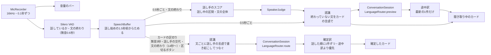
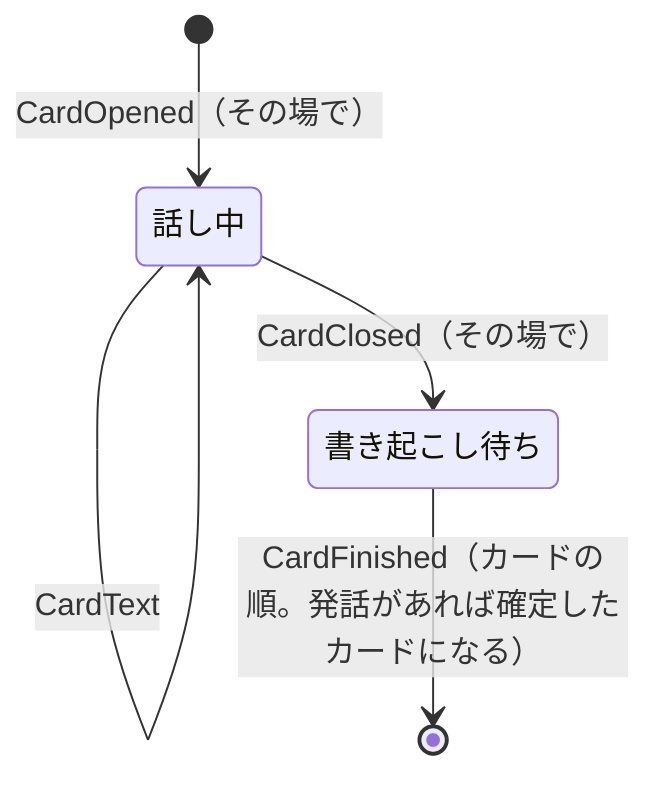

# 会話翻訳

会話翻訳は、端末を2人の間に置き、マイクを入れたまま話すと、話している最中から聞き取った文字とその訳（途中訳）を出し、カードが確定するたびに確定訳を出す。話せる言語は、設定の画面で選んだ音声認識モデル（`SpeechModel`）が聞ける言語のうち PLaMo が訳せるもので、その中から自分の言語と相手の言語を選んで双方向に訳す。既定の SenseVoice Small は日本語・韓国語・英語・中国語（簡体字・繁体字と広東語）、Qwen3-ASR 0.6B はそれに露・仏・独・西・ヒンディーなどを足した21言語を聞く。音声の区切り方は中核の `SpeechSegmenter`、Android の VAD と認識の組み立ては `core-asr` が担う。テキスト翻訳の音声入力も同じ設定のモデルを使う。何をいつ訳すかと訳す方向は、中核の `ConversationSession` が決める。訳文は押したときだけ読み上げる（`core-tts`）。

## 全体の流れ

`ConversationViewModel` は端末の部品と中核をつなぐだけで、判断と制御は中核に置く（`docs/設計/アーキテクチャ.md`「設計の原則」）。マイクの音声は録音のスレッドで音量を測ってから、音声認識（`SpeechPipeline`）の上限の無い列に入れる。音声認識は、セグメンター（`SpeechSegmenter`）と書き起こし・識別のワーカーを別々のスレッドで動かす（「認識の段と CPU の割り当て」）。書き起こしの重いモデルで認識が遅れても、音量のバーは止まらず、音声も落とさない。認識の遅れが1秒以上になったら、その秒数を話し中のカードに「認識がN秒遅れています」と出す（相手向けの面には出さない）。区切るボタンは同じ列に区切る命令を入れ、押した時点の音声の位置で区切る。返ってきた出来事（`SpeechEvent`）を画面のスレッドで `ConversationSession.handle` に渡す。`ConversationSession` は、確定したカードと聞き取り中のカード（「聞き取り中のカード」）を持ち、確定訳・途中訳を渡す作業と途中訳の取り消しを返す。`ConversationViewModel` はその作業を翻訳のストリームで行い、結果を出来事として返す。止める順番も `ConversationSession` が決める：停止（`StopRequested`）で、録音を止めてから `flush` する作業（`Effect.Flush`）を返し、話しかけの分まで確定し終えた（`Flushed`）ら聞き終える作業（`Effect.Finish`）を返す。認識が遅れていても、止める前に話した分は確定させて訳す。



## 画面

`ConversationActivity` は縦向きに固定し、会話中は画面を点けたままにする（`FLAG_KEEP_SCREEN_ON`）。トップ画面のタイル、アプリのショートカット、クイック設定の「会話翻訳」タイル（`ConversationTileService`。画面を開くだけ）から開く。

操作欄は3つの列に分け、真ん中に大きな丸い区切るボタンを置く。左の列は話すこと（開始・停止、自分と相手の言語）、右の列は見せ方とそのほか（対面・1画面、ログ、翻訳モデル）で、その下に状態を1行出す。

| 操作 | 動き |
| --- | --- |
| 開始・停止 | 画面を開くと音声認識と翻訳モデルの準備が済み次第、自動で聞き始める。マイクの権限が必要なら許可を求める。停止後や許可を断った後は、開始を押すと再開できる |
| 区切る | 操作欄の真ん中の大きな丸いボタン（欄の高さいっぱい）。今話している分を確定して次のカードにする（聞くのは続ける）。区切れるとき（聞いていて、話し中のカードがある。`ConversationSession.canCut`）だけ押せる。押すと話し中のカードが閉じて書き起こし待ちになる。区切れないときは押せず、名前を話すよう促す語（「話して」）にし、話し始めるとその場で「区切る」に変わる。相手も押すので、名前は自分と相手の両方の言語で出す（日本語「区切る／話して」、韓国語「여기까지／말하세요」、英語「Done／Speak」、中国語「说完了／请说」など。どちらも「区切る」と同じくらいの短い語にする。名前を持たない言語と、まだ決まっていない相手の言語は英語）。名前は丸の中に1行で収め、それでも収まらない名前は文字を小さくして全部見せる。対面では相手の言語を上に逆さに、1画面では自分の言語の下に小さく出す。周りの輪がマイクの音量で、話し中のカードがある間は色が変わる |
| 対面・1画面 | 並べ方を切り替える。`ConversationPreferences` に保存する |
| 自分 ▾ | 音声認識モデルの言語から選ぶ（既定は日本語）。保存する。相手を同じ言語に固定していたら、相手は自動に戻る |
| 相手 ▾ | 自動と、自分以外の会話の言語。保存しないので、開くたびに自動から始まる。自動で決まった相手は、ボタンに「相手：英語（自動）」、状態の行に「（自動で判定）」と出し、まだ相手が話していなければ「相手の言語は話したら判定」と出す |
| ログ ▾ | 共有・ファイルに保存・画面の発話を消去（「会話ログ」） |
| 翻訳モデル | `ModelSwitch` で0.8Bと2Bを切り替える（`docs/設計/翻訳コア.md`） |
| 画面を離れる | `onStop` でマイクと読み上げを止める。フォアグラウンドサービスは無い |

| 表示 | 並べ方 |
| --- | --- |
| 対面 | 上下2分割で、操作欄が境目になる。上半分は相手向けに逆さに出す。その面を読む人の発話を右、もう一方の発話を左に寄せ、各カードは、その面を読む人の言語の方を上に大きく出す |
| 1画面 | 1つの一覧に、自分の発話を右、相手の発話を左に置き、原文の下に訳を大きく出す |

相手向けの面は、一覧ごと180°回さず、各カードだけを回して並びを下から上（`reverseLayout`）にする。一覧ごと回すと、指を離したときのフリングの向きがずれて急に止まるためである（`docs/判断/2026-11-06_対面の相手向けの面は一覧でなくカードごとに回す.md`）。一覧（`FollowingList`）は新しい発話や訳が伸びるたびに末尾へ送るが、スクロールを止めた位置が末尾でなければ読み返し中とみなして動かさない。

カード（`ConversationCards.kt`）は、2人が注視して読むものとして作る。

- **対面のカード**：その面を読む人の言語の文が面を占めるようにする。読む人の言語の文は26sp、もう一方は14sp（読む人には読めない言語なので、話した人が聞き取りを確かめられる程度にする）。見出しとかかった時間は出さない（誰が何語で話したかは、色と左右と読む人の言語で分かる）。余白も詰める。
- **1画面のカード**：2人が同じカードの全部を読むので、「自分・日本語 → 韓国語」の見出し、原文（20sp）、訳（26sp）、かかった時間を出す。原文を小さくしないのは、話した人が自分の言葉がどう聞き取られたかを確かめるためである。
- **色**：話した人ごとに分け、対面の上下どちらでも同じ人は同じ色にする。
- **状態**：確定訳が届くまでは訳を薄い色で出す。
- **話し中のカード**（`LiveCard`）：枠で囲み、見出しに誰が何語で話しているかを出す（自分側と1画面は「● 相手・韓国語」、相手側はその言語自身の名前で「● 한국어」）。枠・見出し・カードの下の音量のバーは話した人の色にし、話し手が代わるとカードが替わったことがひと目で分かるようにする（話し手が分かる前は中立の色）。文字がまだ無い間は「書き起こし中… N秒」（相手側は「… Ns」）を出し、書き起こしの重いモデルでも聞いていることが両方の側から分かるようにする。
- **書き起こし待ちのカード**（`WaitingCard`）：閉じたが、まだ確定していないカード（区切る・話し終わり・話し手の交代などで閉じた）。話し中のカードと同じ形で、枠を細く薄くし、見出しを「⏳ 相手・韓国語・書き起こし中」にする。何枚でも並び、音声認識が追いつくとカードごとに確定したカードへ置き換わる。何も聞き取れなかったカードは消える。
- **読み上げ**：確定したカードの訳文をタップすると読む（「読み上げ」）。読んでいる間は、1画面は見出しに、対面はカードの頭に🔊を出す。
- **言語の入れ替え**：確定したカードを、もう一方の話し手のカードが寄る側（左右の反対側）へ横にずらすと、もう一方の話し手の言語として書き起こし直して訳し直す（「カードの言語の取り違えを直す」）。
  1. ずらす：カードは、もう一方の話し手のカードが寄る位置までしか動かない。動かすにつれて、色がもう一方の話し手の色へ移る。
  2. 届く：指を72dp動かすと届き、端末が短く振動する。
  3. 届いてから離す：カードは新しい話し手の位置と色のまま残る。原文は書き起こし直しが届くまで薄く出し、届いたら差し替える。訳は、書き起こし直しが届いてから訳し直し、トークンごとに出る。
  4. 届く前に離す：元の位置と色へ戻る。書き起こし直せなかったときも、理由は出さずに元の位置と色へ戻る（理由はログに書く）。

  位置と色は、どの場合も跳ばずに動く。カードの状態は会話の中核が決め（`Turn.swap`。`SwapState`）、画面はそれだけを見る。ずらせるのは入れ替えられるカード（`AVAILABLE`）だけで、ほかのカードは動かない。もう入れ替えられない古いカード（`EXPIRED`。音声認識が音声を破棄したもの）は、破棄したときに背景色（`surface`）を35%混ぜた色へ0.6秒で移り（文字の色は変えない）、ずらそうとすると6dpだけ動いて跳ね返る。入れ替えられるカードには何も足さない。相手がまだ決まっていない間の自分のカードと、書き起こし直している最中のカードは、古くはないので色を変えず、ずらしても動かない。同じ操作をアクセシビリティの操作（「言語を入れ替えて書き直す」）にも置く。

## 音声の取り込み

`MicRecorder`（`audio/`）は、`AudioRecord` の音源 `VOICE_RECOGNITION`（端末の音量調整と雑音処理が音声認識向けになる）で、16kHz・モノラル・PCM16を録り、floatに直して0.1秒ずつ流す。権限は `RECORD_AUDIO` だけで、画面を開いている間だけ聞く。音量のバーは、0.1秒ごとの二乗平均の-55〜-15dBFSを0〜1に割り当てる。

## 音声認識

確定文またはフレーズを登録したとき、`SpeechPipeline` は実行中の途中認識の番号を指定して取り消す。ワーカーは要求ごとのコルーチンを取り消し、GPU 待ちも解除する。`QwenAudioRecognizer` の JNI は要求ごとの直接バッファに番号と取消フラグを置く。取消はモデルの実行ロックを取らない。エンコーダーの評価点、音声入力のバッチ、生成トークンで確認し、実行の同期と KV の消去が済んでから次の要求に渡す。sherpa-onnx では演算終了後に結果を捨てる。

GGUF 用の `QwenAudioRecognizer` は 16 kHz モノラルの PCM を受け取り、音声エンコーダー・バッチ評価・生成のスレッド数を個別に指定できる。`QwenTranscript` が言語ラベルと本文を分ける。未知のラベルやラベルなしの結果でも本文を残す。指定した言語を返した結果は、音声から判定した言語と区別する。制御トークン以降と、会話の役名（system・user・assistant など）だけの出力は本文に含めない。文中の役名は残す。Windows の音声翻訳と、Android の会話翻訳・テキスト翻訳の音声入力がこの認識器を使う。

### エンジンと出来事

| モデル | 役割 | 設定 |
| --- | --- | --- |
| Silero VAD | 話しているかの判定と、文の終わり（無音0.6秒）の検出 | 閾値0.5、最短の発話0.25秒、最長600秒（長い発話はVADに区切らせない） |
| SenseVoice Small int8（2024-07-17版） | 文字にし、言語（`ja`・`ko`・`en`・`zh`・`yue`）を判定する。既定のモデル | `language=auto`、句読点と数字の書き言葉化あり、CPU 4スレッド |
| Qwen3-ASR 0.6B GGUF Q8_0 | 自動判定の確定文では本文と言語を返す。言語が会話の候補に入らなければ、言語を指定して書き直す。途中結果・入力言語の固定・書き起こし直しでは指定言語を使う | llama.cpp の mtmd。実行先とスレッド数は既知音声の試走で選ぶ |
| Whisper tiny int8（言語の識別） | Qwen3-ASR の前で、会話の言語ごとのスコア（確率）を出す | ONNX Runtime で直接動かす（エンコーダー1回、デコーダー1ステップ）、CPU 2スレッド |

Whisper tiny は、sherpa-onnx の識別が一番の言語の名前しか返さず、2つの言語のどちらに近いかを比べられないので、ONNX Runtime（漫画用OCRと同じ onnxruntime-android）で直接動かす（`WhisperLanguageIdentifier`。log-mel は openai/whisper と同じ計算）。sherpa-onnxは、ONNX Runtimeを静的に組み込んだAARを使う（理由は `docs/設計/アーキテクチャ.md`「採用している技術」、版は `docs/現在地.md`「固定した版」）。音声認識モデルは、初回の「モデルの準備」か設定の画面で選んだものを `files/models/asr/` に取る。Qwen3-ASR は言語の識別の Whisper tiny と1つの組で取る（`ModelBundle.QWEN3_ASR`）。Qwen を選んでいた利用者の設定は引き継ぐ。更新時は不足分の容量を表示し、利用者が取得を選ぶと GGUF の本体と mmproj（計約972 MiB）を取る。両方のサイズと SHA-256 が一致すると使える。旧 ONNX と共用の Whisper tiny・VAD は更新時に消さない。旧ファイルの整理は `docs/手順/開発環境.md`「モデルの取得と置き場」を参照。会話翻訳は画面を開いたときに、テキスト翻訳は初めてマイクを押したときに、それぞれ別に読み込む。

音声認識の契約は中核の `SpeechEngine` で、命令（`accept`・`cut`・`flush`・`reset`）はすぐ戻り、出来事（`SpeechEvent`）は `events: Flow` に発生順に届く。認識の混み具合は `load: StateFlow` で購読する。`close` の後の命令は何もせず、`flush` にだけはその場で `Flushed` を返す（画面を閉じると、後始末の `flush` が解放の後に届くことがある）。実装は中核の `SpeechPipeline` で、セグメンター（`SpeechSegmenter`）と認識のワーカーを持ち、VAD と認識をインターフェースで受け取る。`core-asr` の `SpeechEngines.load` が、選んだモデル（`SpeechModel`）ごとに `SileroVoiceActivity`（`VoiceActivity`）と認識（`SpeechRecognizer`）を差して組み立てる（`docs/判断/2026-11-17_音声認識モデルを設定で選び言語の識別を独立した段にする.md`）。

話し中の言語は、SenseVoice では認識結果の言語、Qwen3-ASR では別のワーカーで動く Whisper tiny のスコアから `SpeakerJudge` が決める。自動判定の確定文では、まず Qwen3-ASR に言語を指定せずに書き起こす。会話の言語を絞っていない場合や、モデルが会話の言語のどれかを返した場合は、その本文を使う。中国語と広東語は中国語の候補に含める。それ以外の言語やラベルなしの結果なら、同じジョブでカードの言語を指定して書き直す。本文が空の結果（雑音・無音）は書き直さない。言語を指定すると、雑音からも文を作ることがあるため。カードの言語がまだ決まっていなければ、前の話し手、自分の言語の順に使う。途中結果や利用者が言語を指定した書き起こしは、その言語を指定して処理する。

設定の「音声認識」で、Qwen3-ASR の実行先を選べる。「CPU だけで動かす」と書き起こし用の GPU 退避を優先する。Android の GPU 候補は翻訳と共通の OpenCL に限る。Android の Vulkan では異常終了または言語ラベルの欠落が起きた。

| 音声認識の実行先 | `TranscriptionTuner` が行う準備 |
| --- | --- |
| 自動 | CPU の候補を計測し、GPU が使える場合は GPU も計測する。GPU の中央値が最速の CPU の80%以下なら GPU を採用する。同じ条件で保存した選択があれば、その候補だけを1回ならして本文と言語を照合する。 |
| CPU | 保存した CPU の候補を1回ならして本文と言語を照合する。該当する選択がなければ CPU の候補を計測し、最速の候補を保存する。 |
| GPU | GPU を1回ならして本文と言語を照合する。準備に失敗した場合は書き起こし用の GPU の障害を記録し、CPU の候補から選ぶ。 |

計測には「The door is open.」の合成音声（16 kHz、モノラル）を使う。各候補を1回ならし、続く3回すべてで本文と言語が正解と一致することを確かめ、処理時間の中央値を比べる。CPU の既定の候補はエンコーダー／一括評価／生成の順に 4/4/4、6/6/6、8/8/4 スレッドで、使用可能な CPU 数を上限とする。比較中は暫定首位と計測中の認識器だけを保持し、採用した認識器をそのまま書き起こしに使う。保存した選択はモデル・実装・実行環境・試走音声・候補・判定方法が同じときに再利用する。NX809J で測った実行先と準備時間は[AndroidのQwen3-ASRをGGUFに切り替え実行先を試走で選ぶ](../判断/2026-11-24_AndroidのQwen3-ASRをGGUFに切り替え実行先を試走で選ぶ.md)を参照。


| 部品 | 種類 | 役割 |
| --- | --- | --- |
| `SpeechSegmenter` | 状態遷移（中核） | セグメンター。音声を文とカードに区切り、途中結果と確定結果を出す。VAD は中から呼び、認識はジョブ（`RecognitionJob`）として出して結果を `onResult` で受け取る。話し手の判断は `SpeakerTrack` の判定を実行するだけ（実行する関数は1つ） |
| `RecognitionRequests` | 中核 | セグメンターがジョブを出して結果を受け取る口。音声認識モデルの性質による違い（スコアを識別のワーカーに回すか、書き起こしの重いモデルに声の始まりより前を渡さないか、途中結果と話し中の区間の間隔）はここだけで扱う |
| `CardTranscript` | 中核 | 1枚のカードの文の書き起こしと途中結果をつなぎ、途中結果と確定の文字にする。いつ文にするか・区切るかは決めない |
| `CardEvents` | 中核 | 確定と止め終わり（`Flushed`）を、カードを開いた順に出す（「聞き取り中のカード」） |
| `SpeakerHandoff` | 判定（中核） | カードをまたぐ話し手。前のカードの話し手を覚え、決められない音声に使う言語（カードの言語→前の話し手→自分の言語）と、5秒話しても決まらないときの仮の言語を決める。区切って開く次のカードの話し手は、区切る理由ごとに `SpeechSegmenter` が渡す（話し手の交代なら後ろの話し手で確か、長い発話なら前のカードの話し手（確かかも引き継ぐ）、手で区切ったなら決めない） |
| `RecognitionQueue`・`RecognitionWorker`・`RecognitionRunner`・`SpeechPipeline` | 判定（中核）・実行 | 認識のジョブの待ち行列、ジョブの種類に合わせた認識器の呼び分け（`RecognitionRunner`）、スレッドでの実行。確定に要るジョブを先にし、閉じたカードの途中結果・話し中の区間の判定・境界探しは捨てる。`reset` と `close` の間に頼んだジョブには、処理しても捨てても失敗しても必ず1回だけ結果を返す。ワーカーは `submit`・`cancel` を受け、世代とジョブ番号を添えて成功・取消・失敗を `results` に1回流す。文・確定の登録時は処理中の途中結果を取り消し、sherpa の計算が戻っても本文に使わない。失敗はセグメンターで空の結果として扱う。セグメンターは結果を受けてから次を決めるので、返さないとカードが確定しなくなる。`reset` と `close` は待ち行列を結果を返さずに捨てるが、セグメンターも待っているジョブを忘れるので止まらない（処理中だったジョブの結果は届いても使わない） |
| `SpeechBuffer` | 中核 | 話している間の音声をためる。話し始めの前の音声を頭に足す |
| `SpeakerJudge` | 判定（中核） | 会話の言語ごとのスコアから、話し手の言語を決める（決められなければ決めない） |
| `SpeakerTrack` | 判定（中核） | 1枚のカードの話し手の時系列。位置の付いた根拠（話し中の区間・文の全体・書き起こしの言語）から、カードの話し手と、話し手が代わった位置の手がかりと、カードの表示の言語（`label`）を決める。`SpeechSegmenter` は判定を実行するだけで、決め直さない |
| `LanguageEvidence` | 判定（中核） | 書き起こして言語を判定する認識器（SenseVoice）の結果が、話し手の根拠になる言語か |
| `UtteranceRetention` | 状態（中核） | 確定した発話の音声を直近10枚だけ取り置き、利用者が指定した言語で書き起こし直す（「カードの言語の取り違えを直す」）。`SpeechPipeline` が持ち、セグメンターのスレッドで動く |
| `CutPoint` | 判定（中核） | 区切ると決めた範囲の中で、区切る位置。長い発話（`longUtterance`）と言語の境界（`languageSeam`）で入口を分ける |
| `TranscriptCleanup` | 判定（中核） | 雑音や息の聞き違い（あいづちだけの結果）を取り除く |
| `SegmentationProfile` | 値の組（中核） | 用途ごとの区切り方の値（話し終わり・文の区切りの無音、話し始めの前に足す長さ、長い発話の区切り） |
| `SpeechModel` | 値の組（中核） | 音声認識モデルの一覧：聞ける言語、言語を自分で判定するか、書き起こしが重いか（`heavy`） |
| `IdentifiedRecognizer`・`ScriptLanguage`・`TranscriptJoin` | つなぎ・判定（中核） | 識別のスコアと言語を指定した書き起こしのつなぎ、文字の種類での言語の推定、文ごとの書き起こしのつなぎ方 |
| `ScriptCounts` | 部品（中核） | 文の文字を文字の種類ごとに数え、言語ごとの合い方を出す（「文字の種類で言語を当てる・確かめる」） |
| `SileroVoiceActivity`・`SenseVoiceRecognizer`・`QwenAudioRecognizer`・`WhisperLanguageIdentifier` | アダプター（`core-asr`・`core-asr-sherpa`・`core-llm-jvm`） | VAD の判定、音声の文字と言語、言語の識別のスコア。認識器の癖は実装が直す：SenseVoice の語の間の空白は `SenseVoiceRecognizer`、Qwen3-ASR が話していない短い音声に返す会話の型の役の名前（「system」「システム」だけの結果）は `QwenAudioRecognizer` が空にする |

聞き取り中のカードの出来事は、音声認識のカードの番号（`SpeechSegmenter` が付ける。確定した発話の `Utterance.id` と同じ）を持ち、どのカードの何かを示す。会話の側はカードを推し量り直さず、この番号で聞き取り中のカードを持つ（「聞き取り中のカード」）。

| 出来事 | 出す時機 | 意味 |
| --- | --- | --- |
| `CardOpened` | その場で | 話し始めて、カードを開いた（話し中） |
| `CardText` | その場で（話し中のカードだけ） | 話し中のカードの途中の文字と、カードの話し手の言語。前のものを置き換える。文字が空なら言語だけの知らせ（カードの向きだけ決め、訳さない） |
| `CardClosed` | その場で | カードを閉じた（話し終わり・長い発話・話し手の交代・区切る・止める）。確定まで書き起こし待ち |
| `CardFinished` | カードの順 | カードを確定した。確定した発話（`Utterance`：番号・文字・カードの表示の言語・始まり・長さ・認識の時間）か、何も聞き取れなければ無し |
| `Flushed` | すべてのカードの後 | 止める命令（`flush`）を終えた。閉じた後でも、認識が失敗しても1回届く |
| `Retranscribed`・`RetranscribeFailed` | 頼んだ発話ごとに1回 | 書き起こし直し（`SpeechEngine.retranscribe`）の結果。失敗は理由（音声を手放した・何も聞き取れなかった・音声認識が無い）を持つ |
| `Released` | 確定の後 | 発話の音声を手放した（直近10枚より古くなった）。もう書き起こし直せない |

開く・閉じる・途中の文字をその場で出すのは、区切れるか・話し中かが今の状態で、前のカードの書き起こしを待つと画面が遅れるためである。確定をカードの順に出すのは、訳す順番と会話の順をそろえるためで、前のカードの確定が届くまで次のカードの確定は持っておく（`CardEvents`）。

VADは「話しているか」と「文の終わり」の判定にだけ使い、認識する音声は `SpeechBuffer` にためた分から取る。途中と確定の文字が同じ音声から作られ、カードを区切っても音声が途切れない。

### 聞き取り中のカード

`ConversationSession.listeningCards` は、開いてから確定するまでのカードを番号ごとに1枚ずつ持つ（話し中か、書き起こし待ちか）。`CardOpened` で足し、`CardClosed` で書き起こし待ちにし、`CardFinished` で外して、発話があれば確定したカードにする。区切るボタンを押せるか（`canCut`）は、聞いていて話し中のカードがあるかで、別の状態は持たない。止めた後（`Flushed` を待つ間）に届いた途中の文字は出さず、途中訳もしない。止める前に渡した音声のカードは、止めた後に開いたものも確定まで出して訳す。始める・止める・画面を閉じるの順番も `ConversationSession` が決め、聞き始める作業（`Effect.Begin`）と聞き終える作業（`Effect.Finish`）を1回ずつ対で返す。画面を閉じたら（`Closed`）確定を待たずに聞き終える。

Android の新しい会話画面ではモデルの準備を待つ。両方がそろった最初の通知（`ModelsReady`）で入力の確認に進み、マイクの許可または試験用の音声ファイルを確認すると聞き始める。準備中や権限待ちに画面を離れた場合も停止扱いにする。同じ画面で翻訳モデルを読み込み直しても、聞いている間はマイク入力を続け、停止中は開始操作を待つ。音声認識モデルは新しい会話画面を開いたときに設定を読み、その準備が済むと聞き始める。



### 認識の段と CPU の割り当て

音声の区切りは止めず、重い書き起こしは別のスレッドで後から追いつかせる（`SpeechPipeline`）。止まってはいけない処理と重い推論を別のスレッドに置く規則は `docs/設計/アーキテクチャ.md`「計算資源の割り当て」、この形にした理由は `docs/判断/2026-11-17_認識を段に分け確定に要る処理を先にする.md`。

| スレッド | 受け持つこと |
| --- | --- |
| 録音（`Dispatchers.IO`。`ConversationViewModel`） | マイクの音声を受け、音量を測って、音声認識の列に入れる |
| セグメンター（`PlamoAsrSegmenter`） | 音声・区切る・止める・始め直す（`reset`）の命令と認識の結果を、届いた順に1つの列から受け取り、`SpeechSegmenter` に渡す。状態はこのスレッドだけが持つ。VAD もここで動き、軽いので、書き起こしの間も音声は遅れずに区切られる。`SpeechSegmenter` はジョブを出して待たずに進み、結果を受けてから次を決める |
| 書き起こしのワーカー（`PlamoAsr-transcribe`） | 待ち行列（`RecognitionQueue`）から書き起こしのジョブを1件ずつ取って処理する。識別のワーカーが無いモデル（SenseVoice）では、話し手のスコアと境界探しも、書き起こした言語をスコアにして受け持つ |
| 識別のワーカー（`PlamoAsr-identify`） | 言語だけを識別できる認識器（Qwen3-ASR の前の Whisper tiny）のときだけ立て、話し手のスコアと境界探しのジョブを処理する。重い書き起こしの間も話し手の判定が止まらない |

ジョブの順位は `RecognitionPriority` で、小さいほど先に処理する。

| 順位 | ジョブ |
| --- | --- |
| `FINAL` | 区切った残り（「カードの区切り方」）の書き起こし |
| `PHRASE` | 文の書き起こし |
| `PHRASE_LANGUAGE` | 文の全体の話し手の判定と、カードの言語がまだ無いときの区切った残りの話し手の判定 |
| `RETRANSCRIBE` | 確定した発話の書き起こし直し |
| `LANGUAGE` | 話し中の区間の判定と境界探し |
| `PARTIAL` | 途中結果の書き起こし |

`RETRANSCRIBE`（利用者が頼んだ書き起こし直し）は、確定に要るジョブの後、話し中の区間の判定より先にする。

VAD が文末を検出してから次の発話を検出するまで（`SpeechSegmenter` の `inGap`）は、途中の書き起こしを新しく頼まない。この間にカードの言語が決まったときも、確定に使う文の認識を進める。発話が再開すれば、同じカードでも途中結果を更新する。

並びは処理の順だけを決める。確定に要るか（`RecognitionPriority.urgent`）と、カードが閉じたら捨てるか（`RecognitionPriority.droppable`。途中結果と話し中の区間の判定だけ）は、名前で決める。書き起こし直しはカードに属さず、捨てない。

`FINAL`・`PHRASE`・`PHRASE_LANGUAGE` が確定に要るジョブである。確定に要るジョブどうしは前のカードのものを先にし、同じカードの中で順位の順にする（`RecognitionQueue.take`）。確定はカードの順に出すので（前のカードの確定が届くまで、次のカードの確定を `CardEvents` が持っておく）、後ろのカードの区切った残りが前のカードの文を追い越すと、前のカードの確定が待たされ、後ろのカードの確定も早くならない。言語を指定した書き起こしは識別を省き、境界探しは調べる区間を二分探索で選ぶ。

画面に出す認識の遅れ（`RecognitionLoad.behindSeconds`）は、待っているか処理中の確定に要るジョブのうち一番古い音声の終わりが、セグメンターが受け取った音声の終わりより何秒前か（0.1秒刻み）である。

CPU は音声認識と翻訳で分け合う。翻訳（llama.cpp）は GPU で動いていても CPU のスレッドを持ち、話している間は途中訳がほぼずっと走る。そこで、確定に要るジョブが待っているか処理中の間（`RecognitionLoad.urgent`）は途中訳を始めない。`ConversationSession` は最新の途中の文字を1件持っておき、空いたら訳す（`Event.RecognitionBusy`）。スレッド数（書き起こし・識別・会話中の翻訳）は詳細設定の「音声認識の調整」が1か所で決め（`RecognitionPreferences`。ファイルは `app` の `RecognitionSettings.kt`。`core-asr` の `AsrTuning`）、既定は `docs/設計/アーキテクチャ.md`「計算資源の割り当て」の表にある。

### 途中結果

どのモデルも、文が終わるたびにその文だけを1回書き起こして覚え、途中結果は「覚えた文＋まだ終わっていない文」、確定は「覚えた文＋区切る位置までの残り」にする（疑似ストリーミング）。話し終わりは後ろが無音なので、文として書き起こさなかった短い最後の文だけを残りとして書き起こす。つなぎ方は、空白で語を区切る文字どうしは空白を挟み、仮名・漢字・タイ文字があれば詰める（`TranscriptJoin`）。まだ終わっていない文はカードの言語で書き起こすので、カードの言語が決まるまでは文字を出さず、決まったら文字より先に言語を知らせる（空の途中結果）。文の音声は文を作った時点で写しを取り、話し手を決めてから書き起こすまでに区切られても欠けない。

- **頭の補い**：VADは話し始めを遅れて検出する（作者の端末の録音で0.7〜1.3秒）ので、直前の1.5秒を常に残し、ためる音声の頭に足す。話し終わりの後に聞き直した音声だけなので、前のカードの音は入らない。カードの言語の区間と、途中結果を出し始める長さは、足した分の後ろから測る。
- **間隔**：0.5秒ごと。ただし1回の認識にかかった時間（待ちを含む）の3倍（書き起こしの重いモデルは2倍）より短くせず、長い発話でもCPUを使い切らない。0.4秒たまるまでは出さない。
- **書き起こしの重いモデル**（`SpeechModel.heavy`、Qwen3-ASR）：話し始めの前に足した音声のうち、声の始まり（`SpeechOnset`）より前の無音は渡さない。書き起こしの時間は音声の長さに比例するためである。話し手のスコアは書き起こさずに識別のワーカーで出す（`SpeechRecognizer.identifies`）。
- **同じ文字は出さない**：カードが確定するまでの無音の間に、同じ文を訳し直さないためである。
- **空白**：日本語・中国語・広東語は、SenseVoiceが語の間に入れる空白を取り、英数字どうしの間だけ残す（`SenseVoiceRecognizer.removeCjkSpaces`）。韓国語は分かち書きがあるので触らない。
- **雑音の聞き違い**（`TranscriptCleanup.dropFillers`）：句読点だけや、あいづちだけ（「Yeah.」「I.」「嗯」など）の結果は、何も話していないものとして扱い、カードにも言語の判定にも使わない。日本語・韓国語・中国語の文の頭と末尾の英語のあいづちも取る。「Yes」「OK」「No」は残す（`docs/判断/2026-11-06_雑音の聞き違いを何も話していないものとして扱う.md`）。

### カードの区切り方

カードの粒度の目標は、1枚が話した人の1〜2文で、文の途中で切らず、対面の面でスクロールせずに読める長さ（メインの文26spで6〜7行、日本語で約80〜90文字）に収まり、1〜2語だけの断片を作らないこと。話し手が代わったら必ず分ける。この目標に照らした採点は「動作確認」にある。

#### 取りにいくことと諦めること

話し手の判定は、言語の識別（Whisper tiny）の限界の中で、利用者に一番効くものを取りにいく。全部は取れないので、諦めることを先に決めて、それを取りにいく決まりは足さない。

- **取りにいく**：3秒以上続く話し手の交代を、正しいカードに分けること。一方の言語の話が、もう一方の言語のカードに入ると、文が丸ごと違う言語で書き起こされて会話が通じない。
- **諦める**：
  - 2秒より短い返事や割り込み（「Yeah」「OK」）は、前後の話し手のカードに入ることがある。識別は1〜2秒の声が無いと言語を言い切れないためである。
  - 1つの文の中で2つの言語を混ぜて話すと、どちらかの言語で書き起こされる。
  - 同時に話した部分は分けられない。
  - 交代の確定は、根拠がそろうまで1〜2秒遅れる。
  - 区間の判定が言語を誤ったときの、間違った位置での区切りと、短い断片のカード。区切りは区間の判定から決めるので残る（訳す向きは、カードの表示の言語で直る）。
- **利用者が直す**：自動の判定で取り切れなかったカードの言語の取り違えは、利用者が直近のカードを入れ替えて直す（「カードの言語の取り違えを直す」）。
- **後回しにする**：相手を自動にしたときの最初の発話の言語の誤り。相手のボタンで直せるので、会話の途中の取り違えより後にする。

区切りは「文」と「カード」の2段にする（`SpeechSegmenter.accept`）。値は `SegmentationProfile`、根拠ごとの話し手は `SpeakerJudge`、カードの話し手と交代は `SpeakerTrack`、区切る位置は `CutPoint` が決める。カードの話し手を決めるのは `SpeakerTrack` だけで、文・区切った残り・確定は、カードの話し手の言語で書き起こす。区切ると決めた後に届いた文の判定では区切らず、確かな話し手も変えない（決め直すと、同じカードに別の言語を付けて、前の話し手の文を違う言語で書き起こす）。言いよどみで同じ人の話が切れないことと、話し手が代わったらすぐ別のカードになることを両立するためである（`docs/判断/2026-11-06_カードを話し手の交代でも区切る.md`）。

話し手は、音声のスコアを頼む2つの入口から決める。

- **話し中の区間**：話した音声0.5秒ごとに直近1.5秒（途中結果とは別の間隔で数え、監視1回にかかった時間（待ちを含む）の3倍より短くしない。書き起こしのワーカーでスコアを出すモデル（SenseVoice）では、ワーカーが混むと延びる）。カードの言語がまだ無ければ、話し始めからの音声で決める（話し始めから既定2秒たまってから。`SegmentationProfile.cardLanguageSeconds`、詳細設定の「音声認識の調整」で変えられる。短い音声で決めると誤った言語で書き起こし、後から戻らないため。`docs/判断/2026-11-23_新しいカードの言語は話し始めの2秒を待って決める.md`）。話し始めから5秒たっても決まらなければ、前の話し手の言語を仮に使う（決まらないと途中結果を出せない）。文の後の無音の間は頼まない（無音の区間は、識別がどの言語とも言い切ることがある）。
- **文の全体**：文が終わったとき。1つの文を1人が話していれば区間より確かだが、多数決なので、2人をまたぐ文では少ない方の話し手が消える。そのため、区間が話し手を決めていない文（短い文・区間の無い文）にだけ使う。順位は区間より先にする（`RecognitionPriority.PHRASE_LANGUAGE`）。

`SpeakerJudge` は、自分の言語の確率と、それ以外の言語の確率の合計を比べる。それ以外なら、そのうち一番の言語を話し手とする。確率が区間は0.75、文の全体は0.6に届かなければ決めない（前の話し手のまま扱う。短い文・雑音・あいづち）。

`SpeakerTrack` は、根拠を1本の時系列にして話し手を決める。続けて同じ言語と決まった区間をまとめて「連続区間」とし、連続区間が2回以上の判定からなり、区間が覆った音声が2秒（`SegmentationProfile.minTurnSeconds`）以上なら、その言語の人が話したとみなす（重なった区間は1回だけ数え、区間の間は数えない）。1回の判定だけでは決めない（PC で、作者の日本語の頭の1.5秒の区間を韓国語0.95〜0.99と判定したことがあった。`docs/判断/2026-11-15_会話翻訳の話し手は言語ごとのスコアから文の全体で決める.md`）。回数ではなく音声の長さで数えるのは、区間の間隔が端末の速さで変わるためである。決められない区間は、連続区間を伸ばしも切りもしない。境界が見つからなかった連続区間は聞き違いとして根拠から外す。文の全体の判定は、届いていない区間があればその区間の後に使う（スコアを出すワーカーでは文のスコア（`PHRASE_LANGUAGE`）が区間（`LANGUAGE`）より先に処理されるので、届く順で結果が変わらないようにする）。

カードの話し手は、カードの言語の連続区間が確かになるか、区間が話し手を決めていない文の全体で決まるか、確かな話し手を引き継ぐと「確か」になる。それまでは仮で、途中結果を書き起こす言語にだけ使う。仮の言語と違う連続区間が確かになったら、仮の言語は誤りだったとして替える（短い頭は諦める）。

| 区切り | 決め方 |
| --- | --- |
| 文 | VADが0.6秒の無音で区切る |
| カード（話し終わり） | 文の終わりから無音が合わせて3秒（`SegmentationProfile.endSilenceSeconds`。考える間で話の途中が切れないよう、区切るボタンがあるので粘らせる）。書き起こした文をつなぐ |
| カード（話し手の交代・文） | 区間が話し手を決めていない文で、文の全体の話し手がカードの確かな話し手と違えば、その文の頭で区切り、文は次のカードの文として書き起こす。間を空けた短い交代は、ここで区切る |
| カード（話し手の交代・話し中） | カードの確かな話し手と違う連続区間が確かになったとき。カードの話し手だと分かっている最後の根拠（カードの言語と同じだった最後の区間、または文）の頭から、新しい言語の連続区間の最初の区間の終わりの1秒後ろまでを、0.25秒ずつずらした1秒の区間で調べ（最初の区間は新しい言語が後ろ半分だけでもそう決まるので、調べる区間が交代の後ろに丸ごと入る余地を取る）、新しい言語が始まったところ（交代はこの間にある）の前後で一番静かな0.1秒（`CutPoint.languageSeam`）で区切る。交代の根拠は連続区間なので、境界の後ろの全体の多数決では確かめ直さない（2人の話が行き来する区間では、全体が新しい言語にならず区切れない）。新しい言語の区間が見つからなければ区切らず、その連続区間は使い終える。境界を探している間は、話し終わりと長い発話でカードを閉じない（閉じると、見つかった交代を区切れない）。話し終わりは位置を覚えておき、境界の結果を受けてからその位置で分ける（その間に次の人が話し始めても、次のカードに混ざらない） |
| カード（長い発話） | 話し始めから14秒たまったら（前に足した音声は数えない）、書き起こした文の終わりと、直近の途中結果に付いた文の切れ目（句点・疑問符・感嘆符、無ければ読点。SenseVoice が句読点に付ける時刻）のうち、直近6秒の一番後ろで切る。切れ目の時刻の前後の一番静かな0.1秒にそろえる。切れ目が無ければ、直近4秒のうち一番静かな0.1秒で切る（`CutPoint.longUtterance`）。話し手は同じまま続ける |
| カード（手で区切り） | 区切るボタンを押したとき。ためた分を確定し、続く音声は次のカードの頭にする（`SpeechEngine.cut`） |

- どの区切りでも音声の受け付けは止めず、区切った後ろの音声は次のカードの頭に残す。区切る位置より後ろで終わっていた文は、次のカードの文として書き起こし直す。区切った残り（区切る位置までのうち、まだ文として書き起こしていない音声）は、カードの話し手の言語で書き起こす（カードの言語がまだ無いときだけ、残りのスコアで決める）。ジョブの順位は「認識の段と CPU の割り当て」にある。
- 話し手のスコアは、会話の言語（`SpeechEngine.languages`。相手不明なら自分と探す候補、相手確定なら自分と相手。「言語の判定と訳す方向」）の中で比べる。
- SenseVoice のスコアにする判定は、次をすべて満たすものだけ（`LanguageEvidence`）：判定した言語の文字で書かれている（「文字の種類で言語を当てる・確かめる」の「確かめる」）、中身が1語より多い（ラテン文字の言語は2語以上、ほかは3文字以上）、会話の言語のどれか。作者の会話の録音で、誤った区切りのほとんどは、「ま」を韓国語、話の間の「Now.」を英語、のような判定から起きていた。
- 相手も自分も中国語でなければ、`zh`・`yue` の判定を日本語と同じに扱う。漢字の多い日本語が中国語と判定されることがあるためである。どちらかが中国語のとき（`SpeechLanguages.separateChinese`）は、`zh` と `yue` を1つにまとめて日本語と分ける。
- 雑音の聞き違いの文は言語を持たないので、決められない音声として前の話し手のまま扱う。

### カードの表示の言語

訳す向き（表示の言語）は、カードを書き起こしたときに認識器が音声から判定した言語を、区間で決めた話し手より先にして決める。区切る位置と、書き起こすときに指定する言語は、区間と文の全体で決める。どちらも `SpeakerTrack` が1本の時系列から決める。

| 用途 | 根拠の優先度 |
| --- | --- |
| 区切る位置、話し中のカードの話し手（`SpeakerTrack.lang`。書き起こす言語の指定に使う） | 話し中の区間の連続区間 ＞ 文の全体 |
| 表示の言語（`SpeakerTrack.label`。途中結果と確定の言語、つまり訳す向き） | 書き起こしの言語 ＞ 上の話し手 |

- **書き起こしの言語**：文・区切った残り・途中結果を、言語を指定せずに書き起こしたときに、認識器か言語の識別が音声から判定した言語（`Recognition.source` が `LanguageSource.JUDGED`）。言語を指定して書き起こした結果（指定した言語をそのまま返したもの）と、文字の種類から推定した結果は使わない。SenseVoice は言語を指定せずに書き起こすので、いつも根拠になる。Qwen3-ASR は自動判定の文と最終区間を言語未指定で書き起こし、採用した書き起こしのモデルのラベルを根拠にする。会話の候補から外れて書き直した文の言語は指定値なので、根拠にしない。途中結果で指定した話者の言語と利用者が固定した入力言語は根拠にしない。話し手の根拠になるもの（`LanguageEvidence`）を、書き起こした音声の長さで数える。一番長い言語が2秒（`minTurnSeconds`）以上で、根拠の半分を超えたらその言語にする。同じ頭から書き起こし直したもの（伸びていく途中結果、それを書き起こし直した文）は前の根拠を置き換える。
- **区切りには使わない**：区切った後のカードは1人の話し（の大部分）なので、カードの範囲の多数決を表示の言語に使える。区切る前の範囲の多数決は、2人をまたぐと少ない方の話し手を消す（`docs/設計/アーキテクチャ.md`「設計の原則」の7）。次のカードの「前の話し手」も、区間と文の全体で決めた話し手を引き継ぐ。
- **理由**：区間（1.5秒）の判定は聞き違えやすく、カードを書き起こした範囲（数秒〜十数秒）の判定の方が確かなため（`docs/判断/2026-11-19_会話のカードの言語を書き起こしの言語と利用者の指定でも決める.md`）。

### カードの言語の取り違えを直す

自動の判定が外れたカードを、利用者が直せるようにする。利用者の指定は、音声認識のどの判定より先にする（`docs/判断/2026-11-19_会話のカードの言語の入れ替えはずらしてその場で話し手を替える.md`）。

- **音声の保持**：確定した発話の音声を、直近10枚だけメモリに保持する（`UtteranceRetention`）。保持するのは会話翻訳だけで、テキスト翻訳の音声入力は保持しない（`SpeechEngines.load` の保持する数を0にする）。言語の取り違えに気づいて直すのは直近の数枚だからである。1秒あたり64KBで、カードは長い発話の区切りで最長約14秒なので、最大約9MBになる。ファイルには書かず、会話の画面を閉じると破棄する。停止してから開始し直したとき（`reset`）は破棄しない。11枚目を確定したら一番古い音声を破棄して `Released` を出す。
- **書き起こし直し**：`SpeechEngine.retranscribe(発話, 言語)`。保持した音声を、その言語として書き起こす専用のジョブ（`RecognitionJob.Retranscribe`）にする。ジョブの番号は、区切りと保持が1つの採番（`JobIds`）から取る。言語を自分で判定する認識器にも言語を指定する（`SpeechRecognizer.recognizeAs`）。結果は発話ごとに1回届く。待っている間に重ねて頼まれたら1つにまとめ、開始し直し（`reset`）で待ち行列が捨てられたら、保持した音声から出し直す。
- **言語の指定**：Qwen3-ASR は書き起こしごとに指定する。SenseVoice は言語を認識器の設定にしか持たないので、言語を固定した認識器を初めて頼まれたときに読み込み、最後に頼まれた言語の1つだけ持つ（`SenseVoiceRecognizer`）。書き起こしごとの `setOption("language")` は SenseVoice に効かず、設定の差し替え（`OfflineRecognizer.setConfig`）は SenseVoice の特徴量の設定を初期値に戻すので使わない。読み込みの時間とメモリの増え方は測っていない（`docs/バックログ.md`「測っていないこと」）。
- **会話の中核**：`ConversationSession` が `Event.LanguageSwapped` を受け、自分の発話なら相手の言語、相手の発話なら自分の言語を指定して書き起こし直しを頼む（`Effect.Retranscribe`）。向き（話し手と訳す先。`LanguageRouter.chosen`）はその場で替え、訳を空にし、入れ替える前の発話を `Turn.swappedFrom` に持つ（画面の見え方は「画面」の「言語の入れ替え」）。書き起こし直しを待っている間は訳さない（相手の言語を選び直しても、前の言語の原文は訳す列に入れない）。書き起こし直しが届いたら原文を差し替えて訳す。書き起こせなかったら（何も聞き取れない、指定した言語で書き起こせない、など）入れ替える前の原文と話し手に戻し、訳す先は今の相手の言語で決め直す（原文が指定した言語の文字で書かれていないことがあるので、言語だけを替えたままにはしない）。
- **認識器に指定する言語**：会話の中核は言語（`Language`）のまま頼み、認識器に指定する言語のコードは認識器が決める（`SpeechRecognizer.languageCode`。既定は言語のコードで、中国語は字体によらず `zh`）。SenseVoice は繁体字の中国語を広東語（`yue`）として書き起こす（`SenseVoiceRecognizer.languageCode`）。会話では SenseVoice の広東語の判定を繁体字の中国語として訳すので、繁体字の話し手を広東語の話し手として扱う。繁体字で北京語を話す相手のカードを入れ替えると、広東語として書き起こされる（`docs/バックログ.md`）。
- **入れ替えられるカード**（`Turn.swap` が `SwapState.AVAILABLE`）：音声を保持していて、書き起こし直している最中でなく、もう一方の話し手の言語が決まっているもの。相手を自動にしてまだ相手が決まっていない間の自分の発話は、相手の言語が分からないので入れ替えられない。自動で誤って決まった相手の言語は、カードを入れ替えても変わらない（相手のボタンで選び直す）。自分の発話を相手の発話に入れ替えたカードは、後で相手の言語を選び直しても訳し直さない（相手の発話として、自分の言語へ訳したまま）。

## 文字の種類で言語を当てる・確かめる

書き起こした文の文字から言語を推し量る判定は、用途で2つに分け、どちらも中核の同じ部品の上に置く（`speech/Script.kt`）。

- **部品**（`ScriptCounts`）：文の文字を文字の種類ごとに数え、言語ごとの合い方（`fit`。その言語の文字が文字の何割を占めるか、0〜1）を出す。言語の確率ではないので、同じ文字を使う言語どうし（英語とフランス語など）は同じ値になる。日本語は仮名と日本語でも使う漢字（Shift_JIS にある漢字）を、中国語は漢字を数え、仮名があれば中国語は0にする。その言語の文字で書かれている（`fits`）のは、合い方が半分以上のとき。どの言語がどの文字かは `Script.ofLanguage` の1か所。
- **確かめる**（`LanguageEvidence`）：判定された言語が、書かれた文字と合うか。話し手の根拠にしてよいかに使う（「カードの区切り方」）。
- **当てる**（`ScriptLanguage.pick`）：判定の無い文が、候補の言語のどれか。文字の種類が合う候補が1つならそれ、いくつも合えば合い方の一番高いもの、同じ高さなら決めない。漢字だけの日本語は日本語と中国語に同じだけ合うので決めず、簡体字などを含む文は中国語の方が高くなる。言語を指定せずに書き起こしたとき（`ScriptLanguage.guess`）と、訳す向き（`LanguageRouter`）が使う。

その言語の文字で書かれているか（半分以上）と、当てたときの同点の扱いは部品と2つの判定の中だけに置き、使う側は文字の数や合い方の値を比べず、答えだけを受け取る。当てられなかった文を誰の発話にするかは、訳す向きの決まり（「言語の判定と訳す方向」）が決める。

## 言語の判定と訳す方向

`LanguageRouter`（中核。`ConversationSession` が持つ）がカードごとに方向（`Direction`）を決める。

1. **話した言語**（`spokenLanguage`）：`ja`・`ko`・`en` はそのまま使う。`zh`・`yue` は、自分か相手が中国語のとき（相手不明なら、探す候補に中国語があるとき。`LanguageRouter.chinese`）で、仮名を含まなければ中国語（`zh`→簡体字、`yue`→繁体字）とする。日・韓・英・中の外の言語（言語の識別か文字の種類で決めたもの）はそのまま使う。`zh`・`yue` は、中国語の相手でなく会話に日本語があれば漢字の多い日本語の聞き違いなので、日本語か中国語の文字で書かれた文は日本語とする。中国語の相手でも、中国語の文字で書かれていない文（ハングルの文など）は中国語としない。判定なしと、それ以外の文は、文字の種類で会話の言語から当てる（「文字の種類で言語を当てる・確かめる」の「当てる」。簡体字と繁体字は1つの言語として比べる）。当てられなければ、文字があって自分の言語の文字でない文は相手の言語（相手が分かっていれば）、それ以外（数字だけの文など）は自分の言語とする。
2. **話した人**：話した言語が自分の言語なら自分、それ以外は相手とする。簡体字と繁体字は同じ言語とみなす。
3. **方向**：次の表に従う。

| 相手の設定 | 自分の発話 | 相手の発話 |
| --- | --- | --- |
| 自動 | 相手の言語が分かってから、その言語へ。分かる前の発話は原文だけを出し、分かったらさかのぼって訳す | 自分の言語へ訳す。相手不明なら、話した言語を相手の言語にする |
| 中国語以外の言語 | 固定した言語へ | 自分の言語へ。判定が違っても固定した言語として扱う |
| 中国語（簡体字・繁体字） | 固定した字体へ | 自分の言語へ。原文の字体は判定に従い、ほかの言語と判定されたら固定した中国語として扱う |

- 言語の状態は2段だけにする（`LanguageRouter`）。相手不明（自動の始まり）の間、音声認識は自分の言語か、モデルが聞けるほかの言語のどれかを決める。相手の発話が1回確定したら、その言語を相手にして相手確定へ移り、音声認識は自分と相手の2択になる。相手を固定したときは最初から相手確定である。相手確定の後は、利用者が相手の言語を選び直すときだけ変わる。誤って決まったら選び直せるように、自動で決まった相手は「英語（自動で判定）」のように出す。
- 自分の発話は、相手の言語を選び直したら新しい相手の言語へ訳し直す（`ConversationSession`）。自動を選び直すと相手不明に戻り、訳した発話はそのまま残す。
- 相手不明の間に探す候補から、自分が日本語なら中国語を、自分が中国語なら日本語を除く。漢字の多い日本語の聞き違いで、自分の発話を相手と決めてしまうためである。その組み合わせの相手は、相手の言語を選んで話す。
- PLaMo 3 Translateに広東語は無いので、広東語は繁体字の中国語として訳し、相手が広東語でも書き言葉の繁体字で返す。広東語の口語の字を含む原文の訳の質は未確認である（`docs/バックログ.md`）。
- 途中訳の方向（`preview`）はその時点の判定で決め、相手の言語としては決めない。途中では判定が揺れやすいためである。相手不明の間の自分の途中の文字は訳さない。
- 利用者が今回の発話の言語を指定する入力では、`SpeechLanguages.specified` で認識器に言語を指定し、`ConversationSession.Event.Speech` にも発話者の言語を添える。指定のあるカードは識別せず、途中・確定の両方で指定された言語から翻訳方向を決める。

## 翻訳への渡し方

翻訳は、ほかの機能と同じく `Translations.open` で開いた `TranslationStream` に1文ずつ `translateOne` で渡す（`docs/設計/翻訳コア.md`）。エンジンは推論スレッド1本で1回ずつ実行するので、別々に開いた確定訳と途中訳のストリームは同時には訳されず、後の方は前の実行が終わるまで待つ（「同時に訳す数」が効く範囲は `docs/設計/翻訳コア.md`「機能ごとの使い方」）。そこで `ConversationSession` が確定訳を優先し、古い途中訳を捨てる。`ConversationViewModel` は、返ってきた作業（確定訳・途中訳を渡す、途中訳を取り消す）をストリームで行い、訳の途中と終わりを出来事として返す。

- **確定訳**：話した順に1件ずつ訳す。カードが確定したとき、同じカードに同じ方向の途中訳が出ていれば、未確定の表示のまま残す。確定訳の最初の文字が届くと途中訳を置き換え、以後はトークンごとに表示を更新する。確定訳が直接届けばその全文を出す。失敗したカードには失敗の理由を出す。
- **途中訳**：渡している途中訳が終わるまで、届いた途中の文字のうち最新の1件だけを持つ。走っている途中訳は、新しい途中の文字では取り消さない。0.5秒ごとに取り消すと、長い文で訳が1つも出なくなるためである。生成は160トークンまで。
- **確定訳の優先**：確定が届いたら、走っている途中訳を取り消す作業を返す（`ConversationViewModel` がコルーチンを取り消し、ストリームも閉じて、生成は次のトークンで止まる）。訳し終わっていない確定訳がある間は、途中訳を始めない（その間に届いた途中の文字は捨てる）。
- **古い途中訳を捨てる**：途中訳はカードの番号で持つ。話し中でなくなったカードの途中の文字は訳し始めず、訳し終えた途中訳は、そのカードがまだ聞き取り中ならそのカードに出す。新しい途中訳ができるまでは、前の途中訳を出しておく。
- **訳の形**：日本語への訳は `form = polite`（`Options` の既定）。直近の会話は文脈として渡していない（`docs/バックログ.md`）。

確定訳と途中訳は、1件ごとにストリームを開いて閉じる。会話翻訳が `clear` を使うことはない。

## 会話ログ

操作欄の「ログ」から、画面に出ている発話をテキストで共有するか、保存先を選んで `会話ログ_YYYY-MM-DD_HHmm.md` に書く（`ConversationLogExport`）。後から振り返ったり、議事録を作るアプリやAIに渡したりするためである。発話はアプリの中に残さないので、画面を閉じると消える。

書式は `ConversationLog` が作る。原文と訳の改行は空白にまとめ、訳がまだなら「（翻訳中）」と書く。

```markdown
# 会話ログ 2026-11-06 14:03〜14:10

- 言語：日本語 ⇄ 韓国語
- 発話：3件
- Mockingwordの端末内の音声認識と翻訳による。聞き違い・訳し違いを含むことがある

**14:03:05 相手（韓国語）**
原文：안녕하세요
訳（日本語）：こんにちは
```

## テキスト翻訳の音声入力

テキスト翻訳の原文の欄の右端のマイクで、原文を音声で入れる（`TranslateViewModel.startVoice`）。設定の音声認識モデルで `SpeechEngines.load` が組み立てた音声認識（`SpeechPipeline`）を、会話翻訳とは別のインスタンスで持つ。初めてマイクを押したときに読み込み、テキスト翻訳の画面を閉じるまで持つ。録音（`MicRecorder`）は `Dispatchers.IO` で音声認識の列に入れ、セグメンターとワーカーのスレッドは会話翻訳と同じ組み立て（「認識の段と CPU の割り当て」）で、インスタンスごとに立つ。区切り方の値は会話と同じ組（`SegmentationProfile.CONVERSATION` に詳細設定のカードの言語を決める長さを入れたもの）。会話の言語を渡さない（`SpeechLanguages` の言語の組も自分の言語も無い）ので、話し手は識別で一番の言語にする（`SpeakerJudge`）。

- 押すと聞き始め、最初に開いたカード（`CardOpened`）の途中の文字だけを欄に出す。そのカードの確定（`CardFinished`）が届くと止めて訳す。カードの区切り（無音3秒・言語の交代・長い発話）のどれでも止まり、区切りより後ろの音声（後のカード）は欄に出さず捨てる。最初のカードが何も聞き取れずに確定したら、次に開いたカードを使う。
- ■を押すと、話しかけの分も確定させて止める。話し始めずに8秒たつと止まる。
- すでにある原文の後ろに足す。日本語・中国語どうしは詰め、それ以外は空白を挟む（`joinSpoken`）。
- 原文の言語を中国語にしているときだけ、中国語を日本語と別の言語として区切る。

## 読み上げ

訳文は押したときだけ読む。`ReadAloud` が一度に1つだけを読み、別のものを押すと前のものを止め、同じものをもう一度押すと止める。

- **入口**：会話翻訳は確定したカードの訳文のタップ（訳した先の言語で読み、読んでいる間は見出しに🔊）。テキスト翻訳は訳文の右端の🔊。
- **マイクとの関係**：読んでいる間と読み終わってから0.4秒は、会話翻訳がマイクの音を無音に置き換えて音声認識へ渡す（`ReadAloud.audible`。読み始めで真になり、読み終わり・止めたときから0.4秒後に偽になる状態）。読み上げの声を相手の発話として拾わないためである。話しかけのカードはそこで区切られる。
- **モデルを持つ間**：読み上げのモデル（Supertonic 3、約220MB）は初めて読むときに読み込み、読み上げを使う画面（会話翻訳・テキスト翻訳・設定）を離れたら手放す（`ReadAloud.release`。読んでいる途中なら止まるのを待ってから）。会話翻訳では続けて何度も読むので、画面にいる間は持っておく。次に読むときは読み込みの0.8〜0.9秒が加わる。
- **失敗**：読み上げに失敗したら、読み上げを使う画面が知らせる（`ReadAloud.failures` を画面にいる間だけ購読して出す）。画面にいる間だけ知らせることと、離れたら手放すことは、読み上げを使う画面が `ReadAloud.attach` の1か所で結ぶ。
- **読むもの**：初回の「モデルの準備」か設定の画面の「読み上げ」で選ぶ（`SpeechPreferences`）。初回の画面の初期選択はAndroidの読み上げエンジン（`SystemSpeaker`）で、Supertonic 3（`SupertonicSpeaker`）を選ぶとモデルを取る。Supertonic 3を選んでいても、利用条件に同意していない・モデルが無い・Supertonic 3が読めない言語（中国語）のときは、Androidの読み上げエンジンで読む（`ReadAloud`）。声・速さ（×0.8〜×1.4）・ステップ数（3〜16、既定8）を選び、例文で試せる。

`SupertonicSpeaker`（`core-tts`）は、sherpa-onnxの `OfflineTts` で動かす。

- **重み**：sherpa-onnx向けのint8版に、vocoderだけ公式のfp32版を組み合わせる（約220MB、設定でSupertonic 3を選んだときに `files/models/tts/supertonic-3/` へ取る）。int8のvocoderは話している最中にザラつきが乗るためである（`docs/判断/2026-11-08_読み上げのvocoderだけfp32版にしステップ数を既定8にする.md`）。
- **実行**：CPU 4スレッド、言語は `extra["lang"]`、読めるのは中国語を除く31言語。TTSは同時に使えないので専用スレッド（`PlamoSpeech`）に寄せる。モデルは初めて使うときに読み込み、アプリを閉じるまで持つ。
- **文ごとに鳴らす**：sherpa-onnxは渡した文を作り終えてから音を返すので、訳文を文（`。！？!?`、空白の前の `.`、改行）に分けて1文ずつ作り、`AudioTrack` で鳴らしている間に次の文を作る。
- **すぐ黙る**：`AudioTrack` へは約46ミリ秒（2048フレーム）ずつ書き、区切りごとに止めるかを見る。
- **コールバック**：ネイティブ側は `invoke(float[]): Integer` を名前と型で探すので、ラムダではなく `object : (FloatArray) -> Int` で渡す。ラムダでは `NoSuchMethodError` で落ちる。

## Windows 版の音声翻訳

「音声翻訳」ではマイクと PC の再生音を切り替え、聞き取り中と確定した発話の原文・訳をカードに出す。マイクでは自分の言語を選び、相手の言語を自動または固定にする。話す人は発話ごとに見分けるか、固定した言語から手で指定する。カードは自分と相手で左右が異なる。対面表示では上下に分け、相手側を180度回して読む人の言語を上に置く。音声が残っているカードは話す人を入れ替えて書き起こし直せる。

PC の再生音は指定した原文言語から訳す先への一方向で、別の字幕ウィンドウにも直近の同じ発話の原文と訳を組で出す。字幕ウィンドウは常に手前に半透明で表示し、位置と大きさを保存する。字幕だけ閉じても音声の取り込みは続く。

- `WindowsAudio` は WASAPI で既定のマイク、またはプロセスループバックの再生音を取り込む。ループバックはこのアプリのプロセスと子プロセスの音を除く。WASAPI の共有モードで 16 kHz・モノラルに変換し、PCM を `SpeechPipeline` に渡す。
- `DesktopAsr` は Silero VAD と、設定で選んだ音声認識モデルを `SpeechPipeline` に渡す。音声翻訳の画面を開くと認識器を読み込む。準備中に開始を押した場合は同じ読み込みが終わってから取り込む。SenseVoice はマイクでは認識時に言語を返す。再生音では選んだ言語専用の認識器を録音前に用意し、自動判定用の認識器を読み込まない。Qwen3-ASR は `QwenAudioRecognizer` が llama.cpp・mtmd で動かす。自動判定では Whisper tiny が話者の交代を調べ、確定用の書き起こしは Qwen が返す言語も根拠に使う。Windows の sherpa-onnx JNI は最上位の言語だけを返すため、Android と違い、指定した候補の間で確率を比べられない。手で話す人を指定したときと再生音では言語を指定して書き起こす。モデルと DLL の配置は `docs/手順/開発環境.md`「Windows で音声翻訳を使う」。
- 音声翻訳を開いたとき、`DesktopSpeechModels` が示す必須ファイルがそろっていなければ「モデルの準備」を表示する。準備と読み込みは同じ一覧でファイルの有無を調べる。音声認識モデルの設定がない場合は、配置済みのモデルを優先し、なければ SenseVoice Small を選ぶ。Qwen3-ASR を手動で置いた場合、PC の再生音は Whisper tiny がなくても訳せる。マイクでは Whisper tiny が必要で、「設定」の「音声認識」から取得できる。
- `AudioPresenter` は両方の音声を `ConversationSession` に渡し、`DesktopTranslations` の `TranslationStream` に接続する。区切り、途中訳の取り消し、確定訳の順番は中核が決める。カードの「区切りから確定まで」は、カードを閉じてから書き起こしがそろうまでの待ち時間。発話中に済んだ認識と、カードを閉じるための無音は含まない。マイクの確定した発話は、会話の記録として Markdown に保存またはコピーできる。音声や会話の記録を自動でファイルに保存することはない。音の出どころや認識設定を変えると、新しい記録を始める。

## 性能の目安

REDMAGIC 11 Proで、翻訳は0.8BをGPUで動かした値である（2Bは約2.5倍遅い。`docs/設計/翻訳コア.md`）。

| 項目 | 目安 | 測った日 |
| --- | --- | --- |
| 1回の認識（3〜6秒の発話） | SenseVoice 0.2秒以内。旧 ONNX 版 Qwen3-ASR（6スレッド）0.6〜1.5秒＋Whisper tiny の識別0.23〜0.3秒（sherpa-onnx の識別で測った値。ONNX Runtime で直接動かす識別は未計測）。今の作りでは識別は別のワーカーで動き、言語を指定した書き起こしは識別を省くので、2つの時間は1回の書き起こしに足されない | 2026-11-06、Qwen3-ASR は 2026-11-15 |
| 音声認識の読み込みで増えるメモリ | 旧 ONNX 版 Qwen3-ASR で約1.1GB | 2026-11-15 |
| 途中訳 | 途中の文字の0.1〜0.9秒後。途中訳があっても確定訳の時間は変わらない | 2026-11-06 |
| 確定訳 | 話し終わってから約3.5〜4秒（無音3秒を含む。2秒だったときの測った値に1秒を足した見込み） | 2026-11-06 |
| 読み上げの最初の音（ステップ数8） | 約1.1秒。初回はモデルの読み込み0.8〜0.9秒が加わる | 2026-11-08 |

次の表は Windows 11（Core i3-12100、4コア8スレッド、RTX 4060、メモリ32 GB）での実測。Qwen3-ASR は旧 ONNX 版を使用した。翻訳は PLaMo 0.8B を Vulkan・CPU 4スレッドで準備し、音声翻訳画面を開いて12秒後に開始した。英語「The train to the airport leaves at seven in the morning.」の合成音声を日本語へ訳した。下の値は各条件1回、単位は秒。

| 入力・認識器 | 開始操作から入力受付 | 発声開始から最初の途中原文 | 発声開始から最初の途中訳 | 発声終了から確定原文 | 発声終了から確定訳 |
| --- | ---: | ---: | ---: | ---: | ---: |
| PC の再生音・SenseVoice | 0.062 | 0.88 | 1.21 | 3.09 | 3.15 |
| PC の再生音・Qwen3-ASR | 0.007 | 1.41 | 1.49 | 3.58 | 3.71 |
| マイク相当・SenseVoice | 0.001 | 3.48 | 3.78 | 3.02 | 3.13 |
| マイク相当・Qwen3-ASR | 0.001 | 5.10 | 5.46 | 3.00 | 3.05 |

- 再生音は別プロセスで WAV を再生し、WASAPI から 16 kHz・160サンプル（10ms）ずつ届いた。マイク相当は同じ WAV の前に1秒の無音を置き、同じ長さの PCM を実時間で入力した。自分は日本語、相手は英語。話した人は自動判定。書き起こしは両モデルとも自動（この PC では4スレッド）、Whisper tiny は2スレッド。
- 発声の始めと終わりは入力の振幅が 0.006 を超えた最初と最後のパケット（間隔2.57秒）。書き起こし・訳の時刻は実際の認識器・翻訳器から会話カードの状態が更新された時刻。画面の再描画と物理マイクの遅延は含まない。同じ PC で別のビルドが動き得る条件で、短い発話では途中訳より先に確定原文が届く回もある。
- マイク相当入力では、話し始めの音声が既定の2秒分たまり、話し手の言語が決まってから途中の書き起こしを頼む。この計測で使った旧認識器は、文末検出前に始まった途中認識が終わるまで確定用の文を待たせた。日・英・韓の発話と短い合成音声による5枚ずつの比較は [文末の無音では途中の書き起こしを頼まない](../判断/2026-11-23_文末の無音では途中の書き起こしを頼まない.md)。書き起こしを6スレッドにしても、一貫して4スレッドより速くなる結果は得られていない。

読み上げの計測は `docs/判断/2026-11-08_読み上げは文ごとに作って鳴らす.md`。

## 動作確認

デバッグ版は、adbから音声ファイル（16kHz・モノラル・16bitのWAV）を渡すと、マイクの代わりに0.1秒ずつ実時間で流し、結果をlogcatに出す（`ConversationViewModel.startFromWav`）。音声認識と翻訳モデルの準備が済んでから流し、末尾に4秒（話し終わりの無音3秒＋1秒）の無音を足す。

試験音声は、`tools/get-sherpa-onnx.ps1 -Models` で取ったSenseVoiceのモデルに付属する `models/asr/sherpa-onnx-sense-voice-zh-en-ja-ko-yue-int8-2024-07-17/test_wavs/`（`ja.wav`・`ko.wav`・`en.wav`・`zh.wav`・`yue.wav`）を使う。

```powershell
adb shell setprop log.tag.PlamoTranslate V
adb push models/asr/sherpa-onnx-sense-voice-zh-en-ja-ko-yue-int8-2024-07-17/test_wavs/ja.wav /sdcard/Android/data/app.plamotranslate/files/asr-test/
adb shell am start -S -n app.plamotranslate/.conversation.ConversationActivity --es wav /sdcard/Android/data/app.plamotranslate/files/asr-test/ja.wav
adb logcat -s PlamoTranslate   # 「会話: 途中 …」「会話: 途中訳 …」「会話: 認識 …」「会話: 翻訳 …」（話した言葉と訳を含むので、詳しい記録を残すときだけ出る）
```

終わったら `asr-test/` を消す（`docs/手順/開発環境.md`「端末の片付け」）。

作者の実際の会話で区切りと認識を調べるときは、詳しい記録を残す設定（デバッグ版の既定。正式版は詳細設定で選ぶ）で会話翻訳を使う。このとき、聞いている間に音声認識へ渡した音声（読み上げの間に無音に置き換えたものを含む）を、開始から停止までごとに `asr-rec/conv_YYYYMMDD_HHmmss.wav` に書く。同じ入口（`--es wav`）でそのままリプレイできる。相手の言語は保存しないので、相手を決めて流すときは `--es partner en` のように言語のコードも渡す。会話の中身なので Git に入れず、調べ終えたら端末とPCの両方から消す。

カードの区切りの良し悪しは、録音に付けた正解の区切りに照らして `tools/score-conv.py` で数える（実行のしかたは `docs/手順/開発環境.md`「会話の録音をリプレイする」）。正解は1行が1つの単位（カードにしてよい単位。話した人が言い切った1〜2文）で、作者が確かめる。録音と正解は会話の中身なので `tools/testdata/conversation/`（Git に入れない）に置く。人の声を録らずに比べるときは、公開の音声データの文をつないだ見立ての会話（正解と声の言語の基準も一緒にできる）を `tools/make-conv.py` で作る（`docs/手順/開発環境.md`「見立ての会話を作る」）。PC のリプレイの結果か、端末で録音を `--es wav` でリプレイしたときの logcat を渡すと、カードの切れ目が正解の単位の切れ目・単位の中の文の終わり・文の途中のどれに当たったか、単位の切れ目で切らなかった数、長すぎる（90文字超）・断片の（5文字未満）カード、文字の誤りの割合、切れ目の近くで消えた文字を出す。

詳しい記録を残すときのログには、セグメンターの経過が「会話の認識: …」の行で出る（`SpeechSegmenter` の `trace`）。位置は、聞き始めからの秒（「12.34秒」）で書く。

- 「スコア（目的）始め〜終わり: 言語=確率, …」：話し手のスコアの上位3つ（出せなければ null）。目的は、話し中の区間・文の全体・区切った残り。
- 「書き起こし（目的）始め〜終わり 言語の指定 言語: [言語] 文」：書き起こした区間と結果。目的は、文・途中・確定の残り（区切った残りの書き起こし）。SenseVoice が文の全体のスコアと一緒に書き起こした文は「書き起こし（文・スコアのもの）始め〜終わり: [言語] 文」と出る。
- 「文の終わり 位置」：VAD が文を区切った位置。
- 「カードの言語 言語（確か／仮）」：カードの話し手の言語が決まった、または替わった。
- 「境界 位置（前の言語→新しい言語）」：境界探しの結果。見つからなければ位置は「なし」。
- 「区切ると決めた（理由）始め〜終わり」と「確定（理由）始め〜終わり: [言語] 文 ／ 直前の途中 文（区切ってからNms）」：カードを区切ると決めたときと、書き起こしがそろって確定を出したとき。理由は、話し終わり・話し手の交代（文：前の言語→新しい言語）・話し手の交代（話し中：前の言語→新しい言語）・長い発話・手で区切り・停止。途中の文は「会話: 途中 …」の行にも出る。

ジョブごとの待ち時間と処理時間は「会話の認識: 認識 目的（ワーカー）音声N秒 待ちNms 処理Nms」の行に出る（`SpeechPipeline`。ワーカーは `transcribe` か `identify`、目的は上の書き起こしとスコアの目的と境界探し）。話した言葉を含まないので、詳しい記録を残さないときも書く。詳細設定の「音声認識の調整」で値を変えたときの比べに使う。

音声認識モデルどうしの比べは、デバッグ版の `AsrBenchActivity` で行う。外部ファイル置き場の `bench/asr/` の WAV を、SenseVoice・Whisper tiny の識別・Qwen3-ASR（言語の指定なし／識別した言語を指定）で1つずつ処理し、時間と結果を logcat と `bench/asr-result.tsv` に書く。

区切りを変えたら、次の2つを行う。

- 端末で試験音声と、言語をつないだ音声を流し、区切りの前後で文が欠けないかを見る。端末のモデルとスレッドの組み立てで、区切りが壊れていないことを確かめるためである。
- 会話の録音を PC でリプレイし、変更の前と後を採点で比べる（`docs/手順/開発環境.md`「会話の録音をリプレイする」）。実際の会話で、話し手の判定とカードの区切りが悪くなっていないことを確かめるためである。

採点は、悪化していないかの確認に使う。手元の録音は少なく、話し手の採点（`tools/score-speaker.py`）の基準は、判定に使うのと同じ Whisper tiny が録音の全体を見通して作るので、Whisper tiny が言語を誤る声は判定と基準の両方で誤り、採点に現れないためである。

単体テストは中核（`SpeechSegmenterTest`：偽の VAD と認識で区切り方、`CardTranscriptTest`：書き起こしのつなぎ方、`CardEventsTest`：確定の順、`SpeakerHandoffTest`：カードをまたぐ話し手、`SpeakerTrackTest`：話し手の時系列、`SpeakerJudgeTest`：スコアから話し手を決める、`UtteranceRetentionTest`：音声の保持と書き起こし直し、`RecognitionQueueTest`：ジョブの順と捨て方、`SpeechPipelineTest`：止め終わりの約束、`IdentifiedRecognizerTest`、`SpeechBufferTest`、`LanguageEvidenceTest`、`CutPointTest`、`TranscriptCleanupTest`、`ConversationSessionTest`：訳す順番、`LanguageRouterTest`、`QwenTranscriptTest`：言語ラベルと役名の処理）、`core-asr`（`AsrTest`：言語タグ、SenseVoice の空白、WAV の読み書き、録音のリプレイの `ConversationReplayTest`）、`core-tts`（`SentencesTest`）、`app`（`ConversationLogTest`・`VoiceInputTest`）にある。
