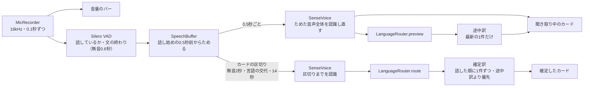

# 会話翻訳

会話翻訳は、端末を2人の間に置き、マイクを入れたまま話すと、話している最中から聞き取った文字とその訳（途中訳）を出し、カードが確定するたびに確定訳を出す。日本語・韓国語・英語・中国語（簡体字・繁体字と広東語）のうち、自分の言語と相手の言語を双方向に訳す。音声認識は `core-asr` の `SenseVoiceAsr`（sherpa-onnxのSilero VADとSenseVoice Small）で、テキスト翻訳の音声入力も同じものを使う。訳文は押したときだけ読み上げる（`core-tts`）。

## 全体の流れ

`ConversationViewModel` が、マイクの音声を専用の1本のスレッド（`PlamoAsr`）で `SenseVoiceAsr.accept` に渡し、返ってきた出来事から途中訳と確定訳を作る。停止すると、話しかけの分も `flush` で確定させて訳す。



## 画面

`ConversationActivity` は縦向きに固定し、会話中は画面を点けたままにする（`FLAG_KEEP_SCREEN_ON`）。トップ画面のタイルと、アイコンの長押しメニューから開く。

| 操作 | 動き |
| --- | --- |
| 開始・停止 | 開始は、音声認識と翻訳モデルの両方の準備が済むまで押せない |
| 対面・1画面 | 並べ方を切り替える。`ConversationPreferences` に保存する |
| 自分 ▾ | 日本語（既定）・韓国語・英語・中国語（簡体字）・中国語（繁体字・広東語）。保存する。相手を同じ言語に固定していたら、相手は自動に戻る |
| 相手 ▾ | 自動と、自分以外の会話の言語。保存しないので、開くたびに自動から始まる |
| ログ ▾ | 共有・ファイルに保存・画面の発話を消去（「会話ログ」） |
| 翻訳モデル | `ModelSwitch` で0.8Bと2Bを切り替える（`docs/設計/翻訳コア.md`） |
| 画面を離れる | `onStop` でマイクと読み上げを止める。フォアグラウンドサービスは無い |

| 表示 | 並べ方 |
| --- | --- |
| 対面 | 上下2分割で、操作欄が境目になる。上半分は相手向けに逆さに出す。各カードは、その面を読む人の言語の方を上に大きく出す |
| 1画面 | 1つの一覧に、自分の発話を右、相手の発話を左に置き、原文の下に訳を大きく出す |

相手向けの面は、一覧ごと180°回さず、各カードだけを回して並びを下から上（`reverseLayout`）にする。一覧ごと回すと、指を離したときのフリングの向きがずれて急に止まるためである（`docs/判断/2026-11-06_対面の相手向けの面は一覧でなくカードごとに回す.md`）。一覧（`FollowingList`）は新しい発話や訳が伸びるたびに末尾へ送るが、スクロールを止めた位置が末尾でなければ読み返し中とみなして動かさない。

カード（`ConversationCards.kt`）は、2人が注視して読むものとして作る。

- **文字**：主の文は26sp、もう一方は20sp。原文を小さくしないのは、話した人が自分の言葉がどう聞き取られたかを確かめるためである。小さい文字はかかった時間だけ。
- **見出しと色**：「自分・日本語 → 韓国語」のように出し、相手向けの面は日本語を読めないので「JA → KO」にする。色は話した人ごとに分け、対面の上下どちらでも同じ人は同じ色にする。
- **状態**：確定訳が届くまでは訳を薄い色で出す。話し中のカード（`LiveCard`）は枠で囲み、「● 話し中」（相手向けは「● LIVE」）を付ける。
- **読み上げ**：確定したカードの訳文をタップすると読む（「読み上げ」）。

## 音声の取り込み

`MicRecorder`（`audio/`）は、`AudioRecord` の音源 `VOICE_RECOGNITION`（端末の音量調整と雑音処理が音声認識向けになる）で、16kHz・モノラル・PCM16を録り、floatに直して0.1秒ずつ流す。権限は `RECORD_AUDIO` だけで、画面を開いている間だけ聞く。音量のバーは、0.1秒ごとの二乗平均の-55〜-15dBFSを0〜1に割り当てる。

## 音声認識

### エンジンと出来事

| モデル | 役割 | 設定 |
| --- | --- | --- |
| Silero VAD | 話しているかの判定と、文の終わり（無音0.6秒）の合図 | 閾値0.5、最短の発話0.25秒、最長600秒（長い発話はVADに区切らせない） |
| SenseVoice Small int8（2024-07-17版） | 文字にし、言語（`ja`・`ko`・`en`・`zh`・`yue`）を判定する | `language=auto`、句読点と数字の書き言葉化あり、CPU 4スレッド |

sherpa-onnxは、ONNX Runtimeを静的に組み込んだAARを使う（理由は `docs/設計/アーキテクチャ.md`「採用している技術」、版は `docs/現在地.md`「固定した版」）。モデルは初回の「モデルの準備」で `files/models/asr/` に置く。会話翻訳は画面を開いたときに、テキスト翻訳は初めてマイクを押したときに、それぞれ別に読み込む。

`AsrEngine` は差し替え口で、1本のスレッドから音声を渡すと、出来事（`AsrEvent`）の一覧を同期で返す。`close` の後の呼び出しは何もしない（画面を閉じると、後始末の `flush` が解放の後に届くことがある）。

| 出来事 | 意味 |
| --- | --- |
| `Speaking(true/false)` | 話し始めた・カードが確定して話し終わった |
| `Partial` | 途中の文字と言語。同じカードの間は、前のものを置き換える |
| `Final` | 確定したカード（`Utterance`：文字・言語・始まり・長さ・認識の時間） |

VADは「話しているか」と「文の終わり」の合図にだけ使い、認識する音声は `SpeechBuffer` にためた分から取る。途中と確定の文字が同じ音声から作られ、カードを区切っても音声が途切れない。

### 途中結果

SenseVoiceは発話をまとめて認識するので、話している間は、ためた音声全体を認識し直して途中の文字を出す（疑似ストリーミング）。

- **頭の補い**：VADは話し始めを遅れて検出するので、直前の0.5秒を常に残し、ためる音声の頭に足す。
- **間隔**：0.5秒ごと。ただし1回の認識にかかった時間の3倍より短くせず、長い発話でもCPUを使い切らない。0.4秒たまるまでは出さない。
- **同じ文字は出さない**：カードが確定するまでの無音の間に、同じ文を訳し直さないためである。
- **空白**：日本語・中国語・広東語は、SenseVoiceが語の間に入れる空白を取り、英数字どうしの間だけ残す（`removeCjkSpaces`）。韓国語は分かち書きがあるので触らない。
- **雑音の聞き違い**（`dropFillers`）：句読点だけや、あいづちだけ（「Yeah.」「I.」「嗯」など）の結果は、何も話していないものとして扱い、カードにも言語の判定にも使わない。日本語・韓国語・中国語の文の頭と末尾の英語のあいづちも取る。「Yes」「OK」「No」は残す（`docs/判断/2026-11-06_雑音の聞き違いを何も話していないものとして扱う.md`）。

### カードの区切り方

区切りは「文」と「カード」の2段にする（`SenseVoiceAsr.accept`）。言いよどみで同じ人の話が切れないことと、話し手が代わったらすぐ別のカードになることを両立するためである（`docs/判断/2026-11-06_カードを話し手の交代でも区切る.md`）。

| 区切り | 決め方 |
| --- | --- |
| 文 | VADが0.6秒の無音で区切る |
| カード（話し終わり） | 文の終わりから無音が合わせて2秒（`END_SILENCE_SECONDS`）。最後の文の終わりまでを確定させる |
| カード（話し手の交代・間あり） | 次の文が1秒たまったら言語を判定し、前の文と違えば前の文の終わりで区切る |
| カード（話し手の交代・間なし） | 途中結果を出すたびに直近1.5秒の言語を判定し、2回続けてカードの言語と違えば区切る。位置は、3.5秒前〜1秒前を0.25秒ずつずらして1秒ずつ言語を判定し、新しい言語が始まったところの前後で一番静かな0.1秒 |
| カード（長い発話） | 14秒たまったら、直近4秒のうち一番静かな0.1秒で区切る |

- どの区切りでも音声の受け付けは止めず、区切った後ろの音声は次のカードの頭に残す。
- カードの言語は最初の2秒で決める。言語の判定が1回違っただけでは区切らない（外来語や固有名詞で揺れるため）。
- 相手も自分も中国語でなければ、`zh`・`yue` の判定を日本語と同じに扱う。漢字の多い日本語が中国語と判定されることがあるためである。どちらかが中国語のとき（`AsrEngine.separateChinese`）は、`zh` と `yue` を1つにまとめて日本語と分ける。
- 雑音の聞き違いの文は言語を持たないので、前の文の言語を引き継ぎ、話し手の交代の判定に使わない。

## 言語の判定と訳す方向

`LanguageRouter` がカードごとに方向（`Direction`）を決める。

1. **話した言語**（`spokenLanguage`）：`ja`・`ko`・`en` はそのまま使う。`zh`・`yue` は、自分か相手が中国語で、仮名を含まなければ中国語（`zh`→簡体字、`yue`→繁体字）とする。それ以外と判定なしは、文字の種類で決める（ハングル→韓国語、英字が多い→英語、それ以外→日本語）。
2. **話した人**：話した言語が自分の言語なら自分、それ以外は相手とする。簡体字と繁体字は同じ言語とみなす。
3. **方向**：次の表に従う。

| 相手の設定 | 自分の発話 | 相手の発話 |
| --- | --- | --- |
| 自動 | 覚えた相手の言語へ。初期値は日本語・韓国語・英語のうち自分以外の先頭 | 自分の言語へ訳し、話した言語を相手の言語として覚える |
| 日本語・韓国語・英語 | 固定した言語へ | 自分の言語へ。判定が違っても固定した言語として扱う |
| 中国語（簡体字・繁体字） | 固定した字体へ | 自分の言語へ。原文の字体は判定に従い、ほかの言語と判定されたら固定した中国語として扱う |

- 自動の候補に中国語を入れないのは、漢字の多い日本語の聞き違いで、自分の発話が中国語として扱われるためである。
- PLaMo 3 Translateに広東語は無いので、広東語は繁体字の中国語として訳し、相手が広東語でも書き言葉の繁体字で返す。広東語の口語の字を含む原文の訳の質は未確認である（`docs/バックログ.md`）。
- 途中訳の方向（`preview`）はその時点の判定で決め、相手の言語としては覚えない。途中では判定が揺れやすいためである。

## 翻訳への渡し方

翻訳は、ほかの機能と同じく `Translations.open` で開いた `TranslationStream` に1文ずつ `translateOne` で渡す（`docs/設計/翻訳コア.md`）。エンジンは推論スレッド1本で1回ずつ実行するので、別々に開いた確定訳と途中訳の流れは同時には訳されず、後の方は前の実行が終わるまで待つ（「同時に訳す数」が効く範囲は `docs/設計/翻訳コア.md`「機能ごとの使い方」）。そこで `ConversationViewModel` が確定訳を優先し、古い途中訳を捨てる。

- **確定訳**：`Channel`（`UNLIMITED`）に積み、話した順に1件ずつ訳す。訳はトークンごとにカードへ出す。
- **途中訳**：依頼は `Channel.CONFLATED` で最新の1件だけを持つ。走っている途中訳は、新しい途中の文字では取り消さない。0.5秒ごとに取り消すと、長い文で訳が1つも出なくなるためである。生成は160トークンまで。
- **確定訳の優先**：確定が届いたら、走っている途中訳のコルーチンを取り消す（流れも閉じ、生成は次のトークンで止まる）。訳し終わっていない確定訳がある間（`finalsInFlight`）は、途中訳を始めない。
- **古い途中訳を捨てる**：`Speaking` と `Final` のたびに世代番号を進め、訳し終えたときに番号が変わっていれば出さない。新しい途中訳ができるまでは、前の途中訳を出しておく。
- **訳の形**：日本語への訳は `form = polite`（`Options` の既定）。直近の会話は文脈として渡していない（`docs/バックログ.md`）。

確定訳と途中訳は、1件ごとに流れを開いて閉じる。会話翻訳が `clear` を使うことはない。

## 会話ログ

操作欄の「ログ」から、画面に出ている発話をテキストで共有するか、保存先を選んで `会話ログ_YYYY-MM-DD_HHmm.md` に書く（`ConversationLogExport`）。後から振り返ったり、議事録を作るアプリやAIに渡したりするためである。発話はアプリの中に残さないので、画面を閉じると消える。

書式は `ConversationLog` が作る。原文と訳の改行は空白にまとめ、訳がまだなら「（翻訳中）」と書く。

```markdown
# 会話ログ 2026-11-06 14:03〜14:10

- 言語：日本語 ⇄ 韓国語
- 発話：3件
- Mockingwordの端末内の音声認識と翻訳による。聞き違い・訳し違いを含むことがある

**14:03:05 相手（韓国語）**
原文：안녕하세요
訳（日本語）：こんにちは
```

## テキスト翻訳の音声入力

テキスト翻訳の原文の欄の右端のマイクで、原文を音声で入れる（`TranslateViewModel.startVoice`）。`SenseVoiceAsr` と `MicRecorder` を、会話翻訳とは別のインスタンスとスレッド（`PlamoVoiceInput`）で使う。

- 押すと聞き始め、途中の文字を欄に出す。最初の `Final` が届くと止めて訳す。カードの区切り（無音2秒・言語の交代・14秒）のどれでも止まり、区切りより後ろの音声は捨てる。
- ■を押すと、話しかけの分も確定させて止める。話し始めずに8秒たつと止まる。
- すでにある原文の後ろに足す。日本語・中国語どうしは詰め、それ以外は空白を挟む（`joinSpoken`）。
- 原文の言語を中国語にしているときだけ、中国語を日本語と別の言語として区切る。

## 読み上げ

訳文は押したときだけ読む。`ReadAloud` が一度に1つだけを読み、別のものを押すと前のものを止め、同じものをもう一度押すと止める。

- **入口**：会話翻訳は確定したカードの訳文のタップ（訳した先の言語で読み、読んでいる間は見出しに🔊）。テキスト翻訳は訳文の右端の🔊。
- **マイクとの関係**：読んでいる間と読み終わってから0.4秒は、会話翻訳がマイクの音を無音に置き換えて音声認識へ渡す（`ReadAloud.isAudible`）。読み上げの声を相手の発話として拾わないためである。話しかけのカードはそこで区切られる。
- **読むもの**：設定の画面の「読み上げ」で選ぶ（`SpeechPreferences`）。既定はSupertonic 3（`SupertonicSpeaker`）。モデルを取る前と、Supertonic 3が読めない中国語は、Androidの読み上げエンジン（`SystemSpeaker`）で読む。声・速さ（×0.8〜×1.4）・段数（3〜16、既定8）を選び、例文で試せる。

`SupertonicSpeaker`（`core-tts`）は、sherpa-onnxの `OfflineTts` で動かす。

- **重み**：sherpa-onnx向けのint8版に、vocoderだけ公式のfp32版を組み合わせる（約220MB、設定でSupertonic 3を選んだときに `files/models/tts/supertonic-3/` へ取る）。int8のvocoderは話している最中にザラつきが乗るためである（`docs/判断/2026-11-08_読み上げのvocoderだけfp32版にし段数を既定8にする.md`）。
- **実行**：CPU 4スレッド、言語は `extra["lang"]`、読めるのは中国語を除く31言語。TTSは同時に使えないので専用スレッド（`PlamoSpeech`）に寄せる。モデルは初めて使うときに読み込み、アプリを閉じるまで持つ。
- **文ごとに鳴らす**：sherpa-onnxは渡した文を作り終えてから音を返すので、訳文を文（`。！？!?`、空白の前の `.`、改行）に分けて1文ずつ作り、`AudioTrack` で鳴らしている間に次の文を作る。
- **すぐ黙る**：`AudioTrack` へは約46ミリ秒（2048フレーム）ずつ書き、区切りごとに止めるかを見る。
- **コールバック**：ネイティブ側は `invoke(float[]): Integer` を名前と型で探すので、ラムダではなく `object : (FloatArray) -> Int` で渡す。ラムダでは `NoSuchMethodError` で落ちる。

## 性能の目安

REDMAGIC 11 Proで、翻訳は0.8BをGPUで動かした値である（2Bは約2.5倍遅い。`docs/設計/翻訳コア.md`）。

| 項目 | 目安 | 測った日 |
| --- | --- | --- |
| 1回の認識（3〜6秒の発話） | 0.2秒以内 | 2026-11-06 |
| 途中訳 | 途中の文字の0.1〜0.9秒後。途中訳があっても確定訳の時間は変わらない | 2026-11-06 |
| 確定訳 | 話し終わってから約2.5〜3秒（無音2秒を含む） | 2026-11-06 |
| 読み上げの最初の音（段数8） | 約1.1秒。初回はモデルの読み込み0.8〜0.9秒が加わる | 2026-11-08 |

読み上げの計測は `docs/判断/2026-11-08_読み上げは文ごとに作って鳴らす.md`。

## 動作確認

デバッグ版は、adbから音声ファイル（16kHz・モノラル・16bitのWAV）を渡すと、マイクの代わりに0.1秒ずつ実時間で流し、結果をlogcatに出す（`ConversationViewModel.startFromWav`）。音声認識と翻訳モデルの準備が済んでから流し、末尾に3秒の無音を足す。

試験音声は、`tools/get-sherpa-onnx.ps1 -Models` で取ったSenseVoiceのモデルに付属する `models/asr/sherpa-onnx-sense-voice-zh-en-ja-ko-yue-int8-2024-07-17/test_wavs/`（`ja.wav`・`ko.wav`・`en.wav`・`zh.wav`・`yue.wav`）を使う。

```powershell
adb shell setprop log.tag.PlamoTranslate V
adb push models/asr/sherpa-onnx-sense-voice-zh-en-ja-ko-yue-int8-2024-07-17/test_wavs/ja.wav /sdcard/Android/data/app.plamotranslate/files/asr-test/
adb shell am start -S -n app.plamotranslate/.conversation.ConversationActivity --es wav /sdcard/Android/data/app.plamotranslate/files/asr-test/ja.wav
adb logcat -s PlamoTranslate:I   # 「会話: 途中 …」「会話: 途中訳 …」「会話: 認識 …」「会話: 翻訳 …」
```

区切りを変えたら、言語をつないだ音声も流し、区切りの前後で文が欠けないかを見る。終わったら `asr-test/` を消す（`docs/手順/開発環境.md`「端末の片付け」）。

単体テストは `core-asr`（`AsrTest`・`SpeechBufferTest`）、`core-tts`（`SentencesTest`）、`app`（`LanguageRouterTest`・`ConversationLogTest`・`VoiceInputTest`）にある。
