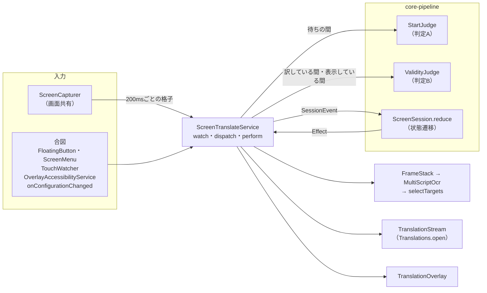
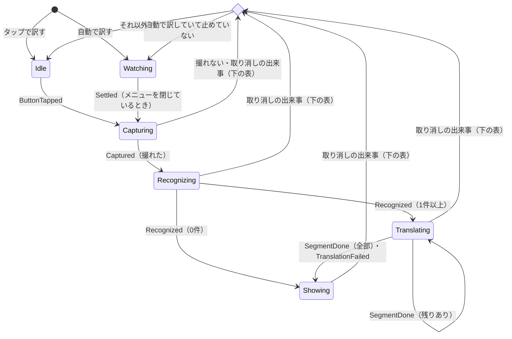

# 画面翻訳

画面翻訳は、画面共有で撮ったほかのアプリの画面の文字を読み、まとまりごとに日本語へ訳して、元の位置へ重ねる。一般のアプリ画面と漫画を同じ処理で扱い、ゲーム向けには「動く画面」の場面の設定を持つ。

- 制御は、中核の状態遷移 `ScreenSession.reduce` だけが決める。`ScreenTranslateService` は、起きたことを出来事にして渡し、返った作業を端末の部品で行う。
- 「いつ訳し始めるか」は開始の判定A（`StartJudge`）、「出している訳がまだ有効か」は有効性の判定B（`ValidityJudge`）が決める。しきい値は場面の設定（`SceneProfile`）が持つ。
- 文字認識は、複数の認識器を並列に動かし、行ごとに文字種に合う結果を選んでから、まとまりに束ねる。
- 訳は翻訳の契約（`TranslationStream`）で流し込み、メモリと端末のデータベースに控える。
- 機能を足すときは「将来の機能の差し込み口」の場所に差す。

全体の設計の原則（状態遷移は1か所、命令と購読、層とモジュール）は `docs/設計/アーキテクチャ.md`、翻訳の契約とコアは `docs/設計/翻訳コア.md`、前提にした端末の事実は `docs/資料/端末の能力.md` にある。

## 部品とつながり

`ScreenTranslateService` が部品をつなぐ。状態遷移と判定器は `core-pipeline`（`app.plamotranslate.pipeline.screen`）にあり、Android に依存しない。

| 役割 | 実装 | 場所 |
| --- | --- | --- |
| 制御 | `ScreenSession.reduce`（出来事 → 次の状態と作業） | `core-pipeline/.../pipeline/screen/ScreenSession.kt` |
| 作業の実行 | `ScreenTranslateService.dispatch`・`perform` | `app/.../screen/ScreenTranslateService.kt` |
| 見張り | `ScreenTranslateService.watch`、格子の計算は `ScreenChange` | 同上、`ScreenChange.kt` |
| 判定 | `StartJudge`・`ValidityJudge` | `Judges.kt` |
| 場面の設定 | `SceneProfile.NORMAL`・`MOTION` | `SceneProfile.kt` |
| 画面の取り込み | `ScreenCapturer`（`capture`・`captureFrames`・`latestThumb`） | `app/.../screen/ScreenCapturer.kt` |
| 重ね方 | `FrameStack.median` | `app/.../screen/FrameStack.kt` |
| 文字の読み方 | `MultiScriptOcr.recognize`・`recognizeOutlined` | `core-ocr` |
| 訳す対象と枠 | `selectTargets`・`ColorSampler`・`BubbleFit` | `app/.../overlay/` |
| 訳の枠 | `TranslationOverlay`（`OverlayViews.kt`） | `app/.../screen/` |
| 合図 | `FloatingButton`・`ScreenMenu`・`TouchWatcher`・`OverlayAccessibilityService`・`onConfigurationChanged` | `app/.../screen/` |
| 設定の保存 | `ScreenPreferences`（`screen_translate`） | `app/.../screen/ScreenPreferences.kt` |

## 操作

画面翻訳は浮遊ボタンで操作し、ほかのアプリへの操作は邪魔しない。

| 操作 | 動き |
| --- | --- |
| 開始 | トップ画面の「画面翻訳」のタイル、アイコンの長押しメニュー、クイック設定のタイル。どれも `MainActivity` で毎回画面共有の許可を得る（Android 14以降は許可を使い回せない）。動作中はタイルの色が変わる |
| 浮遊ボタンのタップ | タップで訳すとき：訳していなければ撮って訳し、訳している途中か訳を出していれば消す。自動で訳すとき：自動の見張りを止める（ボタンが薄くなり、訳も消す）か再開する |
| 浮遊ボタンの長押し | メニュー（`ScreenMenu`）：原文の言語（自動・中国語・韓国語・英語）、翻訳の始め方（タップ・自動）、認識モード（通常・動く画面）、訳の枠（元の文字に合わせる・吹き出しいっぱいに広げる）、翻訳モデル（0.8B・2B。端末に無いモデルは選べない）、終了。翻訳モデル以外は `ScreenPreferences` に残し、次に始めたときも使う。翻訳モデルはアプリ全体で1つなので、ほかの画面のモデルも変わる |
| 浮遊ボタンの字 | タップで訳すなら「訳」、自動なら「自」。言語を指定したら下に「中」「韓」「英」 |
| 浮遊ボタンのドラッグ | ボタンを動かす。画面の外へは出さない |
| 訳の枠に触れる | 何もしない。操作は奥のアプリへ届く（訳の上をスワイプしてスクロールできる） |
| 上部の小さな表示のタップ | 訳を消す（訳している途中なら取り消す） |
| ほかのアプリの画面に触れる | 「状態遷移」の `OutsideTouched` |
| 終了 | メニュー、通知の「終了」、トップ画面のタイル、クイック設定のタイル |

## 状態遷移（`ScreenSession`）

画面翻訳の制御は `ScreenSession.reduce(state, event)` だけが決める。出来事（`SessionEvent`）を受け取り、次の状態と行う作業（`Effect`）を返す純粋な関数で、撮影・文字認識・翻訳・表示は自分では行わない。

- 1回の翻訳（セッション）は番号を持つ。作業の結果はセッション番号つきの出来事として戻り、今の状態とセッション番号が合わなければ捨てる（`ifPhase`）。取り消した後に遅れて届いた結果が、次の画面に出ることは起きない。
- 取り消しは `rest` の1つだけで、どこから来ても同じ作業を出す：`Cancel(セッション)`（セッションがあれば）、`ClearOverlay`、`EndValidity`、自動で訳していれば `ResetStart`。行き先は、自動で訳していれば `Watching`、そうでなければ `Idle`。

| 出来事 | 出どころ | 状態遷移の扱い |
| --- | --- | --- |
| `ButtonTapped` | 浮遊ボタン | タップで訳す：セッションがあれば `rest`、無ければ撮る。自動：見張りを止める・再開する（どちらも `rest`、止めたらボタンを薄くしてトースト） |
| `TriggerChanged` | メニュー | 始め方を変えて `rest` |
| `Settled` | 判定A | `Watching` でメニューを閉じていれば撮る |
| `Captured`・`Recognized`・`SegmentDone`・`TranslationFailed` | 作業の結果 | 今の状態とセッション番号が合うときだけ進む。撮れなければ `rest` して上部に知らせる。訳す文字が0件でも、翻訳に失敗しても `Showing` に移り、上部に知らせて判定Bを続ける |
| `Invalidated` | 判定B、のぞき、`OverlayAccessibilityService`（切り替わり・スクロール） | セッションがあれば `rest` |
| `OutsideTouched` | `TouchWatcher` | 撮影〜翻訳の途中なら `rest`。訳を出しているとき、タップで訳すなら `rest`、自動なら `Peek`（枠の下をのぞく）。セッションが無ければ何もしない |
| `MenuOpened` | 浮遊ボタンの長押し | `rest`。訳の枠はメニューより手前に出て触れなくなるため |
| `MenuClosed` | メニュー | `Watching` なら `ResetStart` |
| `Rotated`・`ModelChanged`・`StatusTapped` | `onConfigurationChanged`・メニュー・上部の表示 | `rest` |

撮れた（`Captured`）ときに `BeginValidity` が出て、判定Bはそのとき撮った画面を基準に始まる。撮っている間（`Capturing`）は判定Bが動いていないので、取り消しは触れた知らせとユーザー補助の合図だけが受け持つ。

### スレッドと取り消し

- 状態・判定器・セッションの材料（`ScreenTranslateService.Work`）は、メインスレッドだけで触る。`dispatch` は出来事を1つずつ順に処理する。
- 1つのセッションの作業（撮影・文字認識・翻訳・のぞき）は、セッションの `Work.job` の子のコルーチンで行う。`Cancel` は `job` を取り消し、撮影画像を捨て、隠していた浮遊ボタンを戻す。
- 翻訳の流れはセッションごとに `Translations.open` で開き、`finally` で `close()` する。生成は次のトークンで止まる（`docs/設計/翻訳コア.md`）。
- ML Kit と漫画用OCRの処理は途中では止まらず、終わった結果を、取り消したコルーチンが受け取らずに捨てる。

## 判定器

判定A・Bは互いを呼ばず、判定Aの雑音の除き方（中央値・動いたます目の除外）を判定Bは使わない。どちらも `Thumb`（画面を横48ます目の明るさの格子に縮めたもの、`ScreenChange`）を比べる。ます目は明るさの差16以上で「変わった」と数える。

### 見張り（`ScreenTranslateService.watch`）

200msごとに、新しく届いた画面を格子に縮め（`ScreenCapturer.latestThumb`）、`Watching` の間は判定Aへ、判定Bが動いている間（撮れてから `rest` まで）は判定Bへ渡す。画像に変えずに受け取った画面から数万点を読むだけなので、文字認識より桁違いに軽い。新しい画面が届いていなければ、画面は変わっていない。撮る・のぞくために自分の表示を隠している間と、メニューを開いている間は渡さない。

### 開始の判定A（`StartJudge`）

問いは「画面が落ち着いたので訳し始めてよいか」。自動で訳すときの `Watching` の間だけ使う。

- 直前の格子との変化が `stable` 未満の状態が `settleMs` 続いたら `Settled` を出す。浮遊ボタンの下のます目は比べない。
- `medianOf` が3以上なら直近の格子のます目ごとの中央値で比べ、`ignoreActive` なら直近の格子の間で明るさが動いたます目（動く背景）も比べない（`ScreenChange.median`・`active`）。
- `maxWaitMs` があれば、待ちに入ってからその時間で、止まるのを待たずに訳す。
- 待ちに入るたびに `ResetStart` で最初からやり直す。

### 有効性の判定B（`ValidityJudge`）

問いは「訳した原文が、まだ同じ場所にあるか」。基準は、セッションで撮った画面（自分の表示を隠して撮った1枚。動く画面のモードは重ねた1枚）の格子。新しい格子は自分の表示が写っているので、自分の表示（訳の枠・上部の表示・浮遊ボタン）のます目は比べない。規則1は届いた1枚で、規則2・3は `medianOf` が3以上なら直近の格子のます目ごとの中央値で比べる。次の順に見て、当てはまれば `Invalidated` を出す。

1. **画面が切り替わった**：自分の表示の外の変化が `switch` 以上。戻る・ホームのジェスチャーはここで拾う（ジェスチャーの帯はシステムの窓なので `TouchWatcher` に届かない）。
2. **原文の周りが変わった**：訳の枠の外周 `ringMargin`（2ます）の変化が `ring` 以上。原文が動いた・消えたとみる。訳の枠を出す前（文字認識の間）と、訳す文字が無かったときは見ない。
3. **画面が変わった**：自動で訳すときだけ、自分の表示の外の変化が `outside` 以上。数行のスクロールで超える。

規則1〜3は訳の枠の真下を見ない。真下だけが変わる場面（ゲームの台詞送り）は、触れたときののぞき（`ValidityJudge.peek`）で拾う。

### 触れたときののぞき（`Peek`）

自動で訳を出しているときにほかのアプリの画面に触れると、0.35秒待ち、訳の枠を隠して画面を撮り（枚数と間隔は場面の設定の `ValidityParams.peekFrames`・`peekIntervalMs`。動く画面のモードは80ms以上あけて3枚撮った中央値）、訳の枠の範囲のます目だけを基準と比べる。`peek`（15%）以上変わっていれば `Invalidated`、変わっていなければ枠を戻す。動く背景のます目は外さない（半透明の台詞の枠は、奥を図形が通ると動く背景とみなされ、外すと台詞の変化に気づけない）。誤って消しても、控えがあるので訳し直しは速い。

### 合図

画像を待たずに状態遷移へ届く合図は、触れた知らせ・ユーザー補助・画面の回転から来る。

| 合図 | 受け取り方 | 出来事 |
| --- | --- | --- |
| ほかのアプリの画面に触れた | 左上に置いた見えない1画素の窓（`TouchWatcher`、`FLAG_WATCH_OUTSIDE_TOUCH`）。撮影の間も置いたままにする。自分のボタン・メニュー・上部の表示への操作は、80ms待って `OwnTouch` の記録で除く | `OutsideTouched` |
| ほかのアプリの画面の切り替わり | `OverlayAccessibilityService` が `TYPE_WINDOW_STATE_CHANGED` を受ける。自分のパッケージの出来事は除く | `Invalidated` |
| ほかのアプリのスクロール | 同じく `TYPE_VIEW_SCROLLED`。移動量が0の知らせとシステムUI（通知の引き出し）は除く | `Invalidated` |
| 画面の回転 | `onConfigurationChanged`（向きが変わったとき） | `Rotated` |

ユーザー補助の合図はセッションがあるときだけ出来事にする。知らせは約0.1秒間引いて届くので、通常のモードでは判定Bの規則3が先に取り消すことが多く、判定Bが遅い動く画面のモードで先に効く（`docs/判断/2026-11-12_ユーザー補助の知らせを予備の取り消しの合図にする.md`）。戻る操作そのものは受け取れない（`docs/資料/端末の能力.md`「問い1」）。

## 場面の設定（`SceneProfile`）

場面の設定は、撮る枚数・文字の読み方・判定A・判定Bの設定の組に名前を付けたもの。メニューの認識モードで選び、`applyProfile` が判定器を作り直す。状態遷移は場面で変えない。値の正本は `SceneProfile.kt`。

| 設定 | `NORMAL`（チャット・ウェブ・漫画） | `MOTION`（ゲーム） |
| --- | --- | --- |
| 撮る枚数（`stackFrames`・`stackIntervalMs`） | 1枚 | 5枚・110msごと |
| 白縁の文字の読み方（`outlinedText`） | 使わない | 使う |
| 判定A `stable`・`settleMs`・`maxWaitMs` | 2%・0.6秒・なし | 4%・0.6秒・3秒 |
| 判定A `medianOf`・`ignoreActive` | 1・しない | 5・する |
| 判定B `switch`・`ring`・`outside` | 50%・30%・6% | 60%・30%・見ない |
| 判定B `medianOf`・`peek` | 1・15% | 3・15% |

動く画面のモードでは背景が動き続けるので、判定Aは中央値と動いたます目の除外で「止まった」を見て、3秒で打ち切る。判定Bは画面全体の変化（規則3）を見ず、原文の周りと画面の切り替わりで見る。

## 使える能力と組み立て

ユーザー補助（`OverlayAccessibilityService`）がつながっているかと、設定の「訳の枠を透かさない」で、使う部品が替わる。状態遷移はどの組み合わせでも同じ。

| 状態 | 訳の枠 | 合図 | 知らせ |
| --- | --- | --- | --- |
| つながっている・「透かさない」オン | ユーザー補助の重ね表示（不透明） | 触れた知らせ、切り替わり、スクロール | — |
| つながっている・「透かさない」オフ | ふつうの重ね表示（不透明度0.8） | 同上 | — |
| 有効でない | ふつうの重ね表示（0.8） | 触れた知らせだけ | — |
| 有効なのにつながっていない（端末に切り離された） | ふつうの重ね表示（0.8） | 触れた知らせだけ | 「透かさない」がオンなら、始めて3秒後とつながりが切れたときに、上部の表示とトーストで「オフにしてからオンにする」よう知らせる。設定の画面にも出す |

画面の取り込みと判定Bの画像は、どの状態でも画面共有。ユーザー補助の窓単位の撮影（訳の枠を写さずに原文を撮れる）は入れていない（`docs/判断/2026-11-12_窓単位の撮影は今は入れない.md`）。REDMAGIC のゲーム支援がユーザー補助を切り離すことは `docs/資料/端末の能力.md`「設計に効く、思わぬ事実」。

## 画面の撮影

`ScreenCapturer` が画面共有の画面を常に受け、撮るときは自分の表示を隠した後に届いた画面を返す。

| 項目 | 内容 |
| --- | --- |
| サービス | `foregroundServiceType="mediaProjection"`。フォアグラウンドに上げてから `getMediaProjection` を呼ぶ |
| コールバック | `createVirtualDisplay` の前に `MediaProjection.Callback` を登録する（Android 14以降の必須条件） |
| 取得 | `ImageReader`（RGBA_8888）を常駐させる。撮るときは浮遊ボタンと訳の枠を隠し、50ms待って、隠した後に届いた1枚を使う（`ScreenCapturer.capture`）。画面が止まっていると新しい画面は届かないので、500ms待っても届かなければ手元の最新の1枚を使う（`timeoutMillis`） |
| 数枚を重ねる | 動く画面のモードは、110msごとに最大5枚撮り、画素ごとの中央値の1枚にする（`captureFrames`・`FrameStack.median`）。間隔の間に新しい画面が届かなければ（画面が止まっている）そこで打ち切る |
| 画面の向き | 撮る前に今の画面の大きさ（`maximumWindowMetrics`）と比べ、違えば `VirtualDisplay.resize` で大きさだけ変え、`ImageReader` を差し替えて（前の大きさの画像は捨てる）、合わせた後に届いた1枚を使う。待つのは最大1.5秒（`RESIZE_TIMEOUT_MS`）。Android 14以降は1つの許可で仮想ディスプレイを1回しか作れない |
| 写らない画面 | `FLAG_SECURE` のアプリは黒く写り、訳す文字が見つからない |

中央値で重ねると、止まっている文字は残り、5枚中2枚までにしか写らない動きは消え、半透明の枠の奥で動くものは枠の色にならされる。1字ずつ出る台詞や流れる字幕は、出きっていない字が残るので、通常のモードで読む。

画面を回したら、前の向きで置いた訳の枠は位置が合わないので `Rotated` で消す。浮遊ボタンは今の画面の同じ割合の位置へ移す（`FloatingButton.fitToScreen`）。

## 文字認識

`core-ocr` の `MultiScriptOcr` が複数の認識器を並列に動かし、`BlockMerger` が結果をまとめて、まとまりごとの文字・位置・文字種・縦書きか（`OcrBlock`）を返す。カメラ翻訳は同じ `MultiScriptOcr` を、まとまりにしない設定（`groupLines = false`）と漫画用OCRなしで使う（`docs/設計/カメラ翻訳.md`）。

### 使う認識器

| 認識器 | 読めるもの | 役割 |
| --- | --- | --- |
| 漫画用OCR（PP-OCRv6 manga、`MangaOcr`） | 中国語・日本語。縦書きも読める | 中国語・日本語の行は原則これを採る。確信度0.8未満で、ML Kit 韓国語がハングルを2字以上崩れずに読めた範囲は韓国語に譲る |
| ML Kit 中国語 | 簡体字・繁体字、ラテン文字 | 横書きの中国語。漫画用OCRが無いときは、1文字ずつの位置から縦書きの列を組み直す（`VerticalColumns`） |
| ML Kit 韓国語 | ハングル、ラテン文字 | 韓国語（漫画用OCRは韓国語を読めない） |
| ML Kit 日本語 | 仮名・漢字、ラテン文字 | 日本語の行を見分けて、訳さないために使う |
| ML Kit 英字 | ラテン文字 | 英語。手書き風の大文字の写植を、ほかの認識器より正しく読む |

漫画用OCRのモデルは端末の `files/models/ocr/manga/`（`det.onnx`・`rec.onnx`・`dict.txt`）に置き、無ければ ML Kit だけで動く。前処理と復号はモデルカードに合わせ、検出の後処理は APK を大きくしないため OpenCV を使わず Kotlin で書いている。縦長の行は90度回して横書きとして読む。

### 原文の言語の指定

言語を指定すると、要らない認識器を動かさず（`Recognizers.of`）、翻訳にも原文の言語を伝える（`ScreenLanguage.kt` の `sourceLanguage`）。自動では PLaMo が原文から言語を判定する。

| 指定 | 動かす認識器 | PLaMo に渡す言語 |
| --- | --- | --- |
| 自動（既定） | すべて | なし |
| 中国語 | 漫画用OCR＋ML Kit 中国語 | `zh-hans`（繁体字の指定は無いので、繁体字は自動のほうが無難） |
| 韓国語 | ML Kit 韓国語だけ | `ko` |
| 英語 | ML Kit 英字だけ | `en` |

言語を足すときは、`OcrLanguage`（`core-ocr`）、`Recognizers`、`ScreenLanguage.kt` の表（メニュー名・ボタンの字・PLaMo へ渡す言語）をそろえる。

### 行の選び方とまとめ方（`BlockMerger`）

行ごとに1つの結果を選んでから、まとまりを組み直す。日韓の混ざった段落でも、行ごとに合う認識器を使える。

1. **縦書きの行を決める**：漫画用OCRの行を採り、その範囲に3割以上重なる ML Kit の行（縦書きを横に読み違えた行）を捨てる。
2. **行ごとに1つ選ぶ**：位置が重なる行（IoU 0.4以上）を突き合わせ、各認識器が自分の文字をいくつ読めたかで行の言語を決める。

   | 条件 | 採る結果 |
   | --- | --- |
   | 漢字・仮名・ハングルが無い（英語） | ML Kit 英字。無ければ、崩れておらずラテン文字を最も多く読めたもの |
   | 仮名が2字以上で、ハングル以上 | 日本語 |
   | ハングルが漢字より多い | 韓国語 |
   | 漢字がある | 中国語 |
   | どれも崩れている（`TextQuality`） | 後段で訳さない |

3. **まとまりに束ねる**（`LineClusterer`）：横書きの行は上下に詰まった行（行間が行の高さの0.8倍未満）、縦書きの列は左右に詰まった列をつなぐ。範囲が2割以上重なる行は形に関係なくつなぐ（重なったまま別の枠に描くと読めない）。仮名を含む行とそれ以外の行はつながない。
4. **読み順に並べる**：縦書きは右の列から、横書きは上の行から。高さの半分以上重なる行は同じ段とみなして左から並べる。

### 縦書き

- 高さが幅の1.5倍以上の行を縦書きとする。英字だけの行は、狭い吹き出しで縦長になっても横書きとして扱う。
- 縦書きの約物は横書きの形に戻して訳へ渡す（`VerticalColumns.normalize`）。Unicode の縦書き用表示形（U+FE10〜FE19、U+FE30〜FE4F）は NFKC で戻す。横書き用のOCRは縦の破折号「——」を「|」、縦の省略号「……」を「:」に読むので、1字分の高さがあるものだけ置き換える（中国語の縦書きで両者を字面中央に縦に置く規則は W3C clreq 5.1・5.4.1、GB/T 15834—2011）。

### 英語

大文字だけの文は、翻訳が固有名詞とみなして英語のまま残すので、`EnglishText` で整えてから訳す。

- 英字の8割以上が大文字なら、文頭と単独の「I」だけ大文字の文に直す。
- 行末のハイフンで切れた語はつなぐ（「COM-」「PARED」→「COMPARED」）。敬称（「NATORI-CHAN」の「-CHAN」など）のハイフンは残す。

### 白縁の文字

動く画面のモードでは、元の画像に加えて、画素ごとに RGB の最小値を取った灰色の画像も読む（`MultiScriptOcr.recognizeOutlined`）。白い縁は白のまま、色の付いた字の中身はどの色でも暗くなり、白い紙に黒い字の形になる。暗い背景の上の色の字はかえって薄くなるので、両方を読む。

- 2つの画像を1行ずつ読み、行ごとに点の高い方を採ってから、まとまりに束ねる（`BlockMerger.group`）。最小値の画像には漫画用OCRを使わない。
- 点は、行の文字種の字を1点とし、ほかの文字種の字を3点、崩れた文字列を10点、空白の抜けた16字以上のラテン文字の語を1つ6点引く（`OutlinedText.score`）。元の読み取りを優先し、最小値の画像の方が4点以上高いときだけ置き換える。片方にしかない行は、崩れておらず文字が2字以上あれば足す。
- 点が同じなら元の読み取りが残る。最小値の画像の方が正しくても、元の読み違いと同点なら置き換わらない。

## 訳す対象と翻訳

`selectTargets`（`overlay/TranslationTargets.kt`）が、まとまりから訳す対象を選び、訳の枠の位置と色を撮影画像から決める。訳す先は呼ぶ側が渡す（画面翻訳は `SCREEN_TARGET` ＝日本語）。色を読むので、撮影画像を捨てる前に呼ぶ。カメラ翻訳と評価も使うので、変えるときはその影響も見る。

- 状態バーの高さより上から始まるまとまりは訳さない。状態バーの高さは撮るたびに今の画面から読む（`statusBarHeight`。全画面のアプリで隠れていれば0）。
- 訳さないもの（`needsTranslation`）：訳す先が日本語なら仮名を含むまとまり、数字・記号だけのまとまり、崩れたまとまり、1文字だけの欧文。漢字・ハングルは1文字でも訳す（漫画の「咦」「嘟」）。
- 翻訳に渡す原文（`joinedText`）は行の折り返しをつなぐ。韓国語・欧文は空白で、日本語・中国語は詰めてつなぎ、英文は `EnglishText` で整える。

訳す対象は、セッションごとに `Translations.open` で開く翻訳の流れに、まとまり1つを1つの片として読み順に `submit` する。行をつなぐ・同時に訳す・長文を分ける・訳し直すは、流れの裏のコアが決める（`docs/設計/翻訳コア.md`）。訳文は途中から枠へ流し込み、全部確定したら上部に件数・時間・モデルを出す。動く画面のモードで2枚以上重ねたときは、撮る時間も合計に含め、重ねた枚数を「N枚重ね」と出す（画面が止まっていると5枚より前で打ち切るので、5枚とは限らない）。

### 訳の控え

同じ原文の訳は、メモリの控え（`MemoryCache`）と端末のデータベース（SQLite、`SqlitePersistentCache`、`translation_cache.db`）に残す。メモリの控えの持ち方と捨てるとき、2段の控えの引き方と書く訳の選び方は `docs/設計/翻訳コア.md`「控え」にあり、ここではデータベースの控えを書く。

- データベースの鍵は、原文の言語（自動は `auto`）・訳す先・背景・原文。翻訳モデルは鍵に入れず、訳の確かさの順位（0.8B＜2B、`TranslationModel.cacheRank`）を列に持つ。引くときは自分以上の順位の訳だけ使い、書くときは自分より確かな訳があれば書かない。同じ原文に残る訳は1つ。
- 書くときは、エンジンの1回の実行で訳し終えた片を1つのトランザクションで書く。
- 2万件を超えたら、最後に使った時刻の古いものから消して1万8千件にする。
- 設定の画面の「画面翻訳の訳の控え」で件数を見て、全部消せる。消すと `generation` が増え、動いている画面翻訳のメモリの控えも次の翻訳で捨てる。消す前に始めた翻訳の訳は、データベースに書かない。
- カメラ翻訳と評価（`BenchActivity`）はデータベースを使わない。

## 訳文の重ね表示

`TranslationOverlay`（`OverlayViews.kt`）が、訳を1つずつ小さな窓にして元の位置へ重ねる。

| 項目 | 内容 |
| --- | --- |
| 権限 | `SYSTEM_ALERT_WINDOW`（設定画面で許可する） |
| 窓 | 訳1つにつき小さな窓を1つ置く（全画面の窓だと下のアプリを操作できない）。撮影画像と同じ座標に置くため、切り欠きやバーの分を避けない設定（`fitInsetsTypes = 0`・切り欠き領域も使う）にする |
| 触れたとき | 枠の窓は `FLAG_NOT_TOUCHABLE` で、操作は奥のアプリへ届く。Android 12以降は、ほかのアプリの重ね表示を通り抜ける操作は、窓の不透明度が `InputManager.maximumObscuringOpacityForTouch`（既定0.8）を超えると捨てられるので、ふつうの重ね表示では不透明度をこの上限に合わせ、原文がわずかに透ける |
| 透けない訳の枠 | 「使える能力と組み立て」の条件で、`OverlayAccessibilityService` の `WindowManager` から `TYPE_ACCESSIBILITY_OVERLAY` で置く。この窓は通り抜けの制限を受けないので、不透明のまま操作を通せる。枠の View もそのサービスを Context にして作る |
| 枠の大きさ | 認識した枠を左右4dp・上下2dp広げ、原文の端を隠す（`OverlayStyle.padded`） |
| 吹き出しまで広げる | メニューの「吹き出しいっぱいに広げる」で、枠を吹き出しの内側まで広げる（`BubbleFit`）。文字の周りの背景色の範囲を格子の上で塗りつぶし、探す窓（元の枠の長い辺の0.8倍まわり）の端や画面の外に届いたら「開いている」として広げない。閉じていて元の枠の6倍以内なら、その範囲に収まる長方形を枠にする。広げた枠がほかの文字（訳さない日本語も含む）にかかるなら広げない。広げた枠は余白を足さず、横書きは真ん中に寄せる |
| 色 | 背景は枠を少し広げた外周の最頻色、文字は枠の中で背景から十分に離れた画素の中央値（`ColorSampler`）。文字色は、彩度0.25未満なら背景に合わせて黒か白にし、色付きなら色味を残してコントラスト比7まで黒か白へ寄せる（`ColorSampler.readable`） |
| 文字の形 | 太字にし、背景色でぼかした縁取り（半径2.5dp）を付ける（`OverlayStyle.applyHalo`）。透けた元の文字の線と見分けやすくする |
| 横書き | `HorizontalTextView` で、枠に収まる最大の大きさ（7〜22sp）を二分探索で選び、上下の真ん中に描く（`Yokogaki`）。訳が流し込まれるたびと枠の大きさが変わるたびに選び直す |
| 縦書き | 縦書きの原文には縦書きで描く（`Tategaki`）。右の列から左へ、句読点は右上に寄せ、長音・ダッシュ・波線・三点リーダーは90度回し、括弧は縦書き用の字形にする（W3C JLReq の縦組み）。文字の大きさは横書きと同じ範囲 |
| 表示の順序 | 空の枠を先に並べ、訳し終わった部分から流し込む |
| 上部の小さな表示 | 画面上部の中央に、進み具合・件数・時間・知らせを出す。いつもふつうの重ね表示で置く |

枠の広げ方・文字の大きさの範囲・縁取りは `OverlayStyle` にまとめ、評価の描画（`BenchActivity.render`）も同じ値を使う。

## 将来の機能の差し込み口

機能を足すときは、次の場所に差す。状態遷移に症状に合わせた例外やフラグを足さない。差し込み口が無ければ、先にこの表を直す。

| 機能 | 差し込む場所 |
| --- | --- |
| 訳す先の言語を選ぶ | `SCREEN_TARGET`（`ScreenLanguage.kt`）を設定にし、`selectTargets` と `TranslationStream.Options` に渡す。訳さない文字種（`needsTranslation`）とデータベースの控えの鍵は、既に訳す先で変わる。状態遷移・判定器は変えない |
| 原文の言語を足す | `OcrLanguage`・`Recognizers`・`ScreenLanguage.kt` の表 |
| アプリごとの場面の自動の切り替え | 切り替わりの出来事のパッケージ名から `SceneProfile` を選んで `applyProfile` する部品。今の `OverlayAccessibilityService.onWindowChanged` はパッケージ名を渡さないので、渡す形にする |
| 場面の組み合わせを足す（白縁の文字の漫画など） | `SceneProfile` に組を足す。撮る枚数と白縁の読み方は独立した設定 |
| 訳の枠の追従 | `Validity` に「ずれた（dx, dy）」を足して `ValidityJudge` が返し、`ScreenSession` に枠を動かす作業を足す。スクロールの移動量は `OverlayAccessibilityService` で既に受けている（今は取り消しにだけ使う） |
| 窓単位の撮影 | `ScreenCapturer` と並ぶ画面の取り込みを足し、判定Bに「訳の枠の下（原文そのもの）」の規則を足す。状態遷移は変えない。権限と撮れる間隔（約0.33秒に1回）は `docs/資料/端末の能力.md`「問い2」「問い3」 |
| ほかのOCR | `OcrEngine` の実装（今は `MultiScriptOcr`） |
| 画像を直接訳すモデル | 文字認識と翻訳を1つにした作業として、状態遷移に「訳す対象と訳」が同時に届く出来事を足す |

## 性能の目安

REDMAGIC 11 Pro で測った値。

| 場面 | 値 | 測った日 |
| --- | --- | --- |
| 文字認識（自動） | 漫画1ページ0.5〜1.0秒、文字の多い画面1.7〜3.1秒 | 2026-11-05 |
| 文字認識（韓国語・英語を指定） | 韓国語0.12〜0.19秒、英語0.13〜0.24秒 | 2026-11-05〜06 |
| 動く画面のモード | 撮影と重ね合わせ0.67〜0.76秒、合計1.9〜2.2秒（背景が動き続ける試験の画面） | 2026-11-12 |
| 白縁の文字の読み方 | 文字認識0.6秒→1.3秒 | 2026-11-12 |
| データベースの控えに全部ある画面 | 翻訳0.05秒（控えが無いと2.2秒、Discord風の画面15片） | 2026-11-12 |

1画面の時間の大半は訳文の生成で、その速さは `docs/設計/翻訳コア.md`。

## 確かめ方

画面翻訳を変えたら、変えた所に応じて、単体テスト・実機の確認・評価のどれかで前後を確かめる。

### 単体テスト

状態遷移と判定器は `core-pipeline` の `ScreenSessionTest`・`JudgesTest`・`ScreenChangeTest` で、端末なしで確かめる。出来事の並びを与えて状態と作業を確かめる（例：訳している途中に切り替わりが来たら取り消して待ちに戻り、後から届いた前のセッションの結果は枠に出ない）。動かし方は `docs/手順/開発環境.md`「ビルドと実行」。

### 実機の確認

状態遷移・判定器・合図を変えたら、REDMAGIC 11 Pro で次を通す。どの操作でも約1秒以内に訳が消え、背景が動いても誤って消えないことを見る。ログはタグ `PlamoTranslate` の「画面翻訳:」「自動翻訳:」の行に、取り消した理由と判定Bの値が出る。

1. Discord で、訳し始めと同時に戻る。スクロールする。
2. 漫画のアプリでページを送る。
3. 背景が動く画面を、動く画面のモードで訳し、台詞を送る。
4. 画面を回す。メニューを開く。
5. ユーザー補助を切った状態で、1〜4 の一部を繰り返す。

### 評価

文字認識・まとまり・訳す対象の選び方を変えたら、変更の前後で評価を回して比べる。評価は、保存したスクリーンショットにデバッグ版の `BenchActivity` で画面翻訳と同じ処理をかけ、正解（`truth.json`：吹き出しの位置と原文）と比べて採点する。画像の置き場・回し方・片付けは `docs/手順/開発環境.md`「画面翻訳の評価」。

結果は画像ごとの所要時間と訳（`results.jsonl`）と、訳を元の位置に描いた画像（PNG、半分の大きさ）で、`truth.json` があれば `tools/eval-screen.py` が次の観点で採点する。

| 観点 | 数え方 |
| --- | --- |
| 認識率 | 正解の吹き出しのうち、訳が1つ以上入った割合 |
| 一まとまり率 | 正解の吹き出しのうち、訳がちょうど1つ入った割合 |
| 欠け | 最小の文字（7sp）でも枠に収まらなかった訳の数と、9sp未満の訳の数 |
| 文字の正解率 | 正解の原文と読み取った原文の一致の割合（正解に原文があるページだけ） |

`BenchActivity` は、画面翻訳と同じ `MultiScriptOcr.recognize`・`selectTargets`・`TranslationStream`・`OverlayStyle` を通す。測れるのは通常のモードの、吹き出しまで広げない枠だけで、数枚の重ね・白縁の読み方・吹き出しまで広げる枠は通らない。画像ごとに流れを開き直し、データベースの控えを使わないので、控えの効果も測らない。過去の結果は `docs/判断/2026-11-06_評価データを消し評価のたびに作り直す.md`。
