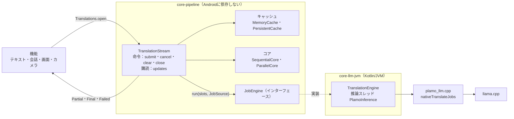

# 翻訳コア

翻訳は、どの機能も翻訳のストリーム `TranslationStream` に文を頼み、文ごとの結果を購読する1本の形で通る。ストリームは文をチャンクに分け、設定の「同時に訳す数」で選ぶコアがチャンクをエンジンへの依頼にまとめ、キャッシュに当たったチャンクはエンジンへ渡さない。エンジン `TranslationEngine` は llama.cpp を JNI で包み、1本の推論スレッドで最大8件の依頼を1回の `llama_decode` で一緒に進める。プロンプトはチャットテンプレートを使わず、PFML3 を直接組み立てる。翻訳モデルは0.8B（既定）と2Bで、Snapdragon の端末は GPU、それ以外は CPU で動き、CPU の動かし方は設定の「性能」で端末に合わせる。

この文書は、翻訳の契約とエンジンの正本である。各機能が契約をどう使うかは要点だけを「機能ごとの使い方」に置き、細部は各機能の文書に置く。

## 構成



- 契約・コア・キャッシュ・生成の点検（`TranslationChecks`）・プロンプトの組み立て（`Pfml3PromptBuilder`・`Language`・`TranslationRequest`）は `core-pipeline` に置き、偽のエンジンで単体テストする（`TranslationStreamTest`・`TranslationChecksTest`・`Pfml3PromptBuilderTest`）。プロンプトの組み立てのパッケージは `app.plamotranslate.llm`。
- `app` の `Translations.open`（`translation/Translations.kt`）が、`EngineHolder` の今のエンジンをストリームに渡す。機能は `TranslationEngine` を直接呼ばない。

## 翻訳の契約

`TranslationStream` は、返り値の無い命令と購読する `Flow` でつなぐ翻訳の契約で、テキスト・会話・画面・カメラの4機能すべてがこれを通る。機能は `Translations.open(scope, context, options, cache, persistent)` でストリームを開く。`Options` は原文の言語（null ならモデルが判定する）・訳す先・文体・背景（PFML3 の `context`）・生成の上限（既定1024トークン）を持つ。判断は `docs/判断/2026-11-12_翻訳の契約をTranslationStreamの1本にしコアを付け替える.md`。

### 命令と購読

| 命令 | 働き |
| --- | --- |
| `submit(segments)` | 文（番号つきの `Segment`）を頼む。空白だけの文は、すぐ空の確定を返す |
| `submitBatch(segments)` | 計画済みのバッチを1件頼む。1件は空白だけでない行を最大8行・合計400字まで含む。単独行には字数の上限を設けない |
| `cancel(ids)` | その文をやめる。ほかの文が待っていないチャンクは、まだ訳していなければ並びから外す。訳している途中のチャンクは止めず、訳し終えたらキャッシュに入る。今はどの機能も使っていない |
| `clear()` | 頼んだ文を全部やめる。訳している途中の依頼は次のトークンで止まり、その結果は捨てる |
| `close()` | `clear()` し、ストリームの処理のコルーチンを取り消して `updates` を閉じる。訳し終えたチャンクは、取り消しの中でも永続キャッシュに書く（「スレッドと取り消し」） |

結果は `updates`（`Flow<SegmentUpdate>`）で文ごとに届く。

- `Partial`：訳している途中の訳（その時点までの全体）
- `Final`：確定した訳。キャッシュだけで決まったか（`cached`）、頼んでから確定までの時間、おおよその生成トークン数を持つ
- `Failed`：訳せなかった（モデルが読めない、推論の失敗）

`updates` はチャンネルを流すので、購読は1か所だけにする（2か所で購読すると結果を取り合う）。1文だけを訳す `translateOne(text, onPartial)` は `submit` と `updates` の上に作った便利な関数で、確定か失敗を返す。

`submitBatch` はキャッシュで確定した行を除き、指定されたバッチの残りを、並列設定にかかわらず1回の依頼へまとめる。複数のバッチは、エンジンに空きがあれば同時に進む。1200字を超える単独行は文の切れ目で分け、途中訳は先頭のチャンクだけを知らせる。先頭のチャンクが確定しても、段落の残りを訳している間は行の完了を通知しない。複数行の出力で改行を受け取ったときは、対応する `Partial` の `lineComplete` を立てる。出力が打ち切られたか行数が違うときは全行を、原文の写しがあれば該当行を別々に訳し直す。訳し直す行の途中訳は空の `Partial` で取り下げる。

### チャンクとコア

ストリームは文をチャンクに分け、同じ原文のチャンクは1回だけ訳して、待っている文すべてに配る。文はまず改行で行に分け、行ごとにチャンクにする。チャンクは改行を含まない。依頼の行と訳の行の対応（逐次のコアのつなぎ方、生成の打ち切りの行数、途中の訳の行送り）はこの前提に立つ。チャンクの訳は、行の中では `TranslationChecks.joinPieces`（欧文の語の間だけ空白を入れる）でつなぎ、行どうしは元の改行でつなぐ。空の行は空の行のまま残る。チャンクの分け方と依頼へのまとめ方はコアの中に閉じ、呼ぶ側は文の単位で頼み、文の単位で受け取る。コアは、訳し始めるたびにエンジンの「同時に訳す数」（`JobEngine.parallel`）から選ぶ（`coreFor`）。

| | `SequentialCore`（同時に訳す数が1） | `ParallelCore`（2以上） |
| --- | --- | --- |
| 文の分け方 | 1200字を超える文を、文の切れ目で分ける（`LONG_TEXT`） | 150字を超える文を、文の切れ目でおよそ150字ずつに分ける（`PARALLEL_SPLIT`）。1文より細かくは分けない |
| 1回の依頼 | チャンクを8行・400字まで改行でつなぐ | 1チャンク |
| 訳し直し | 2チャンク以上をつないだ依頼だけ点検する。訳の行数がずれたら、つないだチャンクを全部、1チャンクずつ並びの先頭へ戻して訳し直す。行数が合っても、訳されていないチャンク（下の「生成の点検」）はそのチャンクだけ訳し直す。1チャンクの依頼（訳し直しの依頼を含む）は点検せずに確定する | しない |
| この形の理由 | 1件ずつ訳すので、依頼ごとにかかるPFML3の前置きの処理を減らす（`docs/判断/2026-11-05_画面翻訳は複数のブロックをまとめて訳す.md`） | 行をつなぐと行のずれ・写しで訳し直しが出て、そのチャンクが遅れる。長いチャンクが1本のシーケンスを使う間も、ほかのシーケンスで短いチャンクが進む |

`ParallelCore` では前後のチャンクがモデルに見えないので、長い文のつながりが悪くなることがある。チャンクごとにキャッシュするので、同時に訳す数を1と2以上で切り替えると、長い文はキャッシュに当たらない。判断は `docs/判断/2026-11-12_同時に訳すときは1チャンクずつ訳し訳し直さない.md`と`docs/判断/2026-11-12_同時に訳すときは長いブロックを約150字ずつに分ける.md`。

### 生成の点検

点検は `TranslationChecks` にあり、4機能すべてに効く（`docs/判断/2026-11-12_Chrome拡張のまとめ訳しの点検を持ち込む.md`）。

- **打ち切り**（`runaway`）：送った行数より2行以上多くなったら、送った行数までで止める。末尾が同じ並びの3回の繰り返し（3回で24字以上）になったら止める。ただし訳が原文の1.2倍＋16字を超えるまでは止めない（原文に表の単位などの繰り返しがあると、正しい訳も繰り返しになるため）。止めた依頼は、そこまでの訳を使う。
- **訳されていないチャンク**（`untranslated`、`SequentialCore` の2チャンク以上をつないだ依頼だけ）：原文のままのチャンクか、訳す先が日本語なのに日本語の字が1つも無いチャンク。3語以下・24字以下の英字だけのチャンク（製品名・ボタン名）は原文のままでよいので除く。
- **シーケンス1本に入らないチャンク**：シーケンス1本が使えるのはコンテキストの「同時に訳す数」分の1で、プロンプトと同じ長さの訳が入らない依頼は、エンジンが訳さずに返す（`onTooLong`）。同時に訳す数が2以上なら、ストリームはその回の実行が終わった後にシーケンス1本（コンテキストを全部使う）で訳し直し、それでも入らなければ空の訳にする。同時に訳す数が1なら、既にコンテキストを全部使っているので、すぐ空の訳にする。

### キャッシュ

キャッシュは翻訳の契約の一部で、2層からなる多層キャッシュである。どの層も同じキーと同じ約束に従い、約束は `TranslationStreamTest` の試験が守る。キャッシュに当たったチャンクはエンジンへ渡さない。

| 層 | 型 | 置き場と寿命 | 使う機能 |
| --- | --- | --- | --- |
| 1次：メモリのキャッシュ | `MemoryCache`（中核の具体的な型） | メモリ。ストリームごとか、機能が持ってストリームどうしで共有する。500件で、最後に使ったものから捨てる | すべて。共有するのは画面翻訳（1回の翻訳ごとにストリームを開くので、サービスが1つ持つ） |
| 2次：永続キャッシュ | `PersistentCache`（インターフェース） | 実装が決める。Android はデータベース（`SqlitePersistentCache`）、Windows はファイル（`DesktopPdfCache`、`docs/設計/PDF翻訳.md`） | 画面翻訳、PDF 翻訳 |

1次は、ロックの中や推論スレッドから同期で引くのでインターフェースにしない。2次は Android の SQLite に依存するのでインターフェースにする。

**キー**：どの層も「範囲＋チャンクの原文」で引く。範囲 `CacheScope` は訳を変える依頼の条件（原文の言語・訳す先・言い方 `form`・背景 `context`）で、契約が `Options.cacheScope` から作る。機能も層の実装も範囲を組まない。原文の言語の自動と明示は、プロンプトが変わるので別の範囲にする。値は訳と、訳したモデルの品質（`ModelOrigin.quality`）で、層から層へ移しても品質を保つ（`CachedTranslation`）。Android の永続キャッシュは記録用に重みの識別子（`ModelOrigin.id`）も持つ。

**約束**：

1. **引く順番**：1次 → 2次 → エンジン。2次で当たったチャンクは1次にも入れる。エンジンを動かしている途中に頼まれたチャンクは1次だけを引き、推論を待たせない。
2. **品質**：どの層も、今のモデル以上の品質の訳だけを使い、同じキーにより品質の高い訳があれば書き換えない。モデルを切り替えても層を捨てない。品質はモデルごとに決めた値（`TranslationModel.quality`。0.8B＝0＜2B＝1）で、端末のデータベースに残るので並び順では決めない。値を変えたら永続キャッシュの版（`DB_VERSION`）を上げて作り直す。
3. **書く約束**：1次には確定した訳をそのまま入れる。2次には、エンジンで訳したチャンクのうち空でも原文の写しでもないものを、実行1回ごとにまとめて書く。書くのは、ストリームを閉じても、開いたスコープが取り消されても止めない。確定はエンジンが戻る前に届くので、購読する側は最後の確定を受け取ってすぐ閉じてよい。
4. **消す**：2次を消すと世代（`PersistentCache.generation`）が進み、2次を使うストリームは次の実行で1次を捨てる。2次を使わないストリームは世代に触れないので、使うストリームと1次を共有しても捨て合わない。2次に書くときは訳し始める前の世代を渡し、実装はそれが今と違えば書かない（消す前に始めた翻訳の訳を書き戻さない）。
5. **持ち主**：どの層を使うか、1次をどのストリームと共有するかは機能が `Translations.open` の `cache`・`persistent` で決める。範囲がキーに入るので、範囲の違うストリームどうしで1次を共有しても混ざらない。

カメラ翻訳の `CameraSession` が持つ訳の対応表は、このキャッシュの層ではなく、枠に訳を当てる表示の状態である（`docs/設計/カメラ翻訳.md`）。

### スレッドと取り消し

ストリームの状態（頼まれた文・チャンクの並び・途中の訳）は1つのロックで守るので、命令はどのスレッドから出してもよい。ストリームは開いたときのスコープで処理のコルーチンを1つ動かし、そこから `JobEngine.run` を呼ぶ。エンジンは推論スレッドへ移り、`JobSource` の `next`・`onText`・`onFinished`・`onTooLong` を推論スレッドから順に呼ぶ。結果は上限の無いチャンネルに入れるので、推論スレッドは購読する側を待たない。

| 出来事 | 生成の止まり方 |
| --- | --- |
| `clear()` | ストリームの世代を進める。訳している途中の依頼は、次のトークンでその依頼だけ止まり（`onText` が true）、結果は捨てる |
| `cancel(ids)` | 訳している途中のチャンクは止めない |
| `close()`、ストリームを開いたスコープの取り消し | 処理のコルーチンが取り消され、エンジンは次のトークンで全部の依頼を止める。訳し終えたチャンクは、取り消しの中でも永続キャッシュに書く |
| 生成の打ち切り | その依頼だけ止める |
| 翻訳モデルの切り替え | `ModelHost` が今のエンジンを閉じる。閉じるのは推論スレッドなので、走っている実行が終わってから閉じる。閉じた後の実行は失敗し、ストリームは頼まれていた文を全部 `Failed` にする。次に頼まれた文は、訳し始めるときに新しいエンジンを受け取る |

モデルが読めないとき（`EngineHolder.awaitEngine` が null）と、実行が例外で終わったときも、頼まれていた文を全部 `Failed` にする。

同じモデルの実行は専用スレッドで直列にする。これとは別に、`LlamaRuntime` が同じ GPU のモデル準備と推論にプロセス内で1つの利用権を渡す。CPU 同士・CPU と GPU は互いを待たない。待ち順は中核の `InferencePolicy` が決め、確定書き起こしを先に、同じ優先度では到着順にする（PC と Android の Qwen3-ASR は同じ利用権を使う）。翻訳は `TranslationTurn` が先頭の組を取り出した後、ほかの GPU 待ちがあれば新しい文を取らず、開始済みの文を終えてから利用権を返す。再取得後は未着手の文から続ける。初回準備と並列数の計測も同じ利用権を通る。

### ストリームを通さない呼び出し

次の3つは、依頼を1つだけ出す `SingleRequest`（または決まった依頼を出すだけの `JobSource`）で `JobEngine.run` を直接呼ぶ。エンジンそのものを準備し測る道具で、キャッシュ・点検・コアを通すと測るものが変わるためである。機能の翻訳はこの形を使わない。

- 読み込み直後のウォームアップ（`LlamaEngineLoader.warmUp`）
- 速さの計測（Android は `EngineBenchmark`、PC は `DesktopTranslationBenchmark`。同時に訳す数の計測は `ParallelTranslationBenchmark` を共有）
- モデルの比べ（デバッグ版の `TranslateBenchActivity`）

会話翻訳は、聞いている間だけ翻訳のスレッド数を詳細設定の値に変え、止めたら設定の「性能」の値に戻す（`ConversationViewModel.configureTranslation` が `TranslationEngine.configure` を呼ぶ）。訳す依頼ではなくエンジンの設定で、モデルを読み直さずに性能ヒントとスレッド数を変える口（`nativeConfigure`）を使う。デバッグ版の画面翻訳のブロードキャスト `DEBUG_CONFIG`（`docs/手順/開発環境.md`「GPUとCPU、デバッグ版の入口」）も同じ口を使う。設定の「性能」で変えた値は、この口ではなくモデルを読み直して効かせる（「性能の設定」）。

`awaitEngine` でエンジンそのものを受け取るのは、翻訳のストリームの入口（Android は `Translations.open`、PC は `DesktopTranslations.open`）と、上の速さの計測と、スレッド数を変える口（`ConversationViewModel.configureTranslation`・`DEBUG_CONFIG`）だけである。ウォームアップとモデルの比べは、読み込んだエンジンを自分で持つ。

デバッグ版の評価 `BenchActivity` も `Translations.open` でストリームを開く。永続キャッシュを渡さず、画像ごとに新しいメモリのキャッシュでストリームを開き直すので、キャッシュの効果を含まない時間を測れる（`docs/設計/画面翻訳.md`「評価」）。

## 機能ごとの使い方

| 機能 | ストリームの開き方 | 頼み方 | やめ方 | 詳しく |
| --- | --- | --- | --- | --- |
| テキスト翻訳 | 訳すたびに開き、終わったら閉じる | `translateOne` で1文 | 新しく訳すとき、前の翻訳のコルーチンを取り消す | `TranslateViewModel` |
| テキスト翻訳（PC） | 訳すたびに `DesktopTranslations.open` で開き、終わったら閉じる | `translateOne` で1文。入力、貼り付け、マイクから訳し、途中訳と確定訳を画面に反映する | 入力や言語の変更、取り消しの操作で前の翻訳を取り消す | `TextPresenter` |
| 会話翻訳（確定訳） | 発話ごとに開いて閉じる | `translateOne` で1文。確定した発話を話した順に1件ずつ | — | `docs/設計/会話翻訳.md`「翻訳への渡し方」 |
| 会話翻訳（途中訳） | 途中訳のたびに開いて閉じる。生成は160トークンまで | `translateOne` で1文 | 確定した発話が来たら、途中訳のコルーチンを取り消す | `docs/設計/会話翻訳.md`「途中結果」 |
| 画面翻訳 | 1回の翻訳（セッション）ごとに開いて閉じる。キャッシュは2段とも使う（「キャッシュ」） | 訳す対象を読み順に、1回の `submit` で全部 | 後片付けでセッションのコルーチンを取り消す | `docs/設計/画面翻訳.md`「訳す対象と翻訳」 |
| カメラ翻訳 | 1本を開いたままにする。原文の言語・訳す先・モード（背景）・エンジンが変わったら開き直す | 読み取りがそろった段落を、`submit` で足していくだけ | 原文の言語・訳す先・モードを変えたら `clear`。頼んだ文は画面から外れても取り消さない | `docs/設計/カメラ翻訳.md`「翻訳」 |
| PDF翻訳（PC） | 開始から中止または完了まで1本。PDFの翻訳用の永続キャッシュを使う | `PdfTranslationPlan` が組み立てたバッチを `submitBatch` で頼む | 中止、別の文書を開く、訳す先を変えるときはストリームを閉じる | [PDF翻訳の「訳す順番と確定」](PDF翻訳.md#訳す順番と確定) |

テキスト翻訳と会話翻訳は1文ずつ頼むので、同時に訳すのは、1文の行や長い文を分けたチャンクどうしだけになる。画面翻訳とカメラ翻訳は複数の文を頼むので、文どうしが同時に訳される。

PC のテキスト翻訳では、原文言語が固定のときだけ方向を入れ替え、訳文があれば原文欄へ移す。訳す先は PDF 翻訳と共通である。クリップボードから貼り付けた文、マイクで最初に確定した発話を原文欄に入れたときはそのまま訳す。マイクは音声翻訳と同じ認識設定を使い、会話で使用中は開かない。

## エンジン

GGUF の音声認識も `LlamaRuntime` で初期化と GPU 利用権を共有する。翻訳用コンテキストと音声認識用コンテキストは共有しない。

`TranslationEngine`（`core-llm-jvm`）は `JobEngine` の実装で、llama.cpp のモデルとコンテキストを1つずつ持つ。llama.cpp は git submodule（plamo3 に対応した版を固定。版は `docs/現在地.md`「固定した版」）で、自前の JNI（`core-llm/src/main/cpp/plamo_llm.cpp`）で包む。Android の Gradle `externalNativeBuild` と Windows の `desktop-native` は、ビルド設定を分けて同じ C++ を使う。判断は `docs/判断/2026-11-05_llama.cppを自前でビルドしPFML3を直接組み立てる.md`。

Windows の設定では、0.8B・2Bの公式配布版を選べる。ダウンロードが途中で止まっても、同じモデルを選び直すと残りを取得する。サイズと SHA-256 が一致したファイルだけを `%LOCALAPPDATA%\Mockingword\models` に置き、`ModelHost` が切り替える。別の GGUF は「モデルの詳細」から指定できる。

Windows は Vulkan 優先と CPU のみを切り替えられる。CPU のみで起動したときは Vulkan の DLL を読み込まない。Vulkan の読み込みと初回の推論の前に設定へマーカーを残す。前回の終了理由は取れないため、完了しない起動が2回続くと CPU に戻し、設定で再試行するまで維持する。

### 読み込み

アプリ全体で1つのエンジンを読み込んで持ち、どの機能も同じエンジンを使う。読み込み・切り替え・読み直しの判断は中核の状態遷移 `ModelHost` が持ち、`app` の `EngineHolder` は設定を保存して命令を渡す口、`LlamaEngineLoader`（中核の `EngineLoader` の実装）が読み込みの中身（`TranslationEngine.load`、GPU を使うかの判定、初回の準備）を持つ。

- **命令と購読**：画面とサービスは命令（`ensureLoaded`・`select`・`reload`・`setParallel`）を出し、`state`（読み込み中・使える・ファイルが無い・失敗）を購読する。使える状態（`ModelState.Ready`）は、モデル・世代の番号（読み込むたびに増える）・同時に訳す数・GPU で動いているかを持ち、エンジンそのものは持たない。
- **エンジンを受け取る口**：`EngineHolder.awaitEngine` の1つだけで、使うのは翻訳のストリームの入口（`Translations.open`）と「ストリームを通さない呼び出し」に挙げた所だけ。
- **読み込みは1つずつ**：読み込み中に選び直した・読み直しを頼まれたら、今の読み込みが終わってから、そのときに選ばれているモデルを読み直す。切り替えと読み直しは、今のエンジンを閉じてから読み込む（2つのモデルを同時にメモリに置かない）。同じモデルを選んでも読み直さない。同時に訳す数の変更は今のエンジンにすぐ効かせ、世代の番号は変えない。

| 項目 | 値 | 理由 |
| --- | --- | --- |
| コンテキスト | 4096トークン。`n_batch` も同じ | 同時に訳す全部のシーケンスのプロンプトと訳が入る。プロンプトを1回の decode で処理する |
| シーケンス | 8本（`n_seq_max`）。KVキャッシュは全部のシーケンスで1つ（`kv_unified`） | シーケンス1本で訳すときは、コンテキストを全部使える |
| GPU層 | GPUを使う端末は99（全層）、ほかは0 | REDMAGIC は前面のアプリの CPU クロックを抑えるので、GPU のほうが安定して速い（`docs/判断/2026-11-05_翻訳は全層をGPUのOpenCLで動かす.md`） |
| CPUのスレッド | 自動は `TranslationEngine.threadsFor`。最高周波数が一番低いコア（小さいコア）がコアの半分以下なら大きいコアの数、そうでなければコア数−2。どちらも2〜6。REDMAGIC 11 Pro は6、15T Pro は4 | 小さいコアに処理が回ると、ほかのスレッドが待たされて全体が遅くなる（`docs/判断/2026-11-08_CPUの動かし方を設定で切り替えスレッド数を大きいコアの数にする.md`） |
| サンプリング | 貪欲法（温度0）。全部のシーケンスで1つのサンプラーを使う | 貪欲法は状態を持たない |
| 推論のスレッド | 専用の1本 `PlamoInference` | llama.cpp のコンテキストは同時に使えない。性能ヒントの対象スレッドを固定する |
| 量子化 | Q4_K_M | `docs/判断/2026-11-05_量子化はQ4_K_Mのままにする.md` |

- GPU を使うかは端末で決まり、Qualcomm の端末だけが GPU を使う（`docs/設計/アーキテクチャ.md`「GPUとCPUの切り替え」）。GPU で読み込めなければ `load` が CPU で読み込み直し、どちらで動いているかを `usesGpu` で返す。
- 読み込んだ直後に短い文を1回訳す（`LlamaEngineLoader.warmUp`）。GPU は初回の推論でカーネルを準備するので、利用者の最初の翻訳を待たせないためである。組み立てたカーネルは、環境変数 `GGML_OPENCL_KERNEL_CACHE_DIR` でアプリのキャッシュ `cl-cache/` に残す。
- ビルドの設定は `core-llm/src/main/cpp/CMakeLists.txt` が正本で、構成の全体は `docs/設計/アーキテクチャ.md`「ビルド時の構成」にある。arm64-v8a だけを作り、`GGML_OPENCL`・`GGML_CPU_KLEIDIAI` を有効にし、バックエンドを実行時に読み込む（`GGML_BACKEND_DL`・`GGML_CPU_ALL_VARIANTS`）。

### GPUで落ちたときの切り替え

GGUF の書き起こしは翻訳と独立して実行先を選ぶ。`TranscriptionTuner` は段別の CPU スレッド数を端末で使える数に収め、各候補を順番に開く。「The door is open.」の合成音声（16 kHz、モノラル）で1回ならし、3回の本文と言語を照合する。GPU を選ぶのは、3回とも正しく、時間の中央値が最速の CPU の80%以下の場合だけ。強制 GPU でも正しさを確認し、全体の CPU 指定と役割別の退避を優先する。モデル・実装・環境・音声・判定方法が同じなら選択を再利用し、ならし運転だけを行う。再試行はその役割の退避と選択だけを消す。

llama.cpp の OpenCL は、カーネルの組み立てに失敗すると戻り値を返さず `exit(1)` でプロセスごと終わる（`ggml-opencl.cpp` の `build_program_from_source_ex` など）。`load` の CPU へのやり直しが働かず、Android がアプリを開き直すたびに同じ所で終わる。そこで `GpuGuard` が、GPU での読み込みから初回の推論までの間に落ちたら、次の起動から CPU で動かす。

1. GPU で読み込む直前に「読み込み中」のマーカー（プロセスID）を役割別の `GpuPreferences` へすぐ書き（`commit`）、`warmUp` が済んだら消す。
2. 起動時にマーカーが残っていれば、Android が記録した前回の終了理由（`ApplicationExitInfo`。`diagnostics/ProcessExits` が中核の `ProcessExit` に読み替える）を見る。異常終了（中核の `ExitJudge.abnormal`。クラッシュ、応答なし、初期化の失敗、終了コードが0以外の `exit`、SIGKILL 以外のシグナル）ならすぐ CPU に切り替える。強制停止やメモリ不足のような終了理由は、2回続いたら切り替える。
3. CPUへの退避はアプリやOSの更新後も維持する。退避の記録は役割（翻訳・書き起こし）ごとに独立させ、旧記録は翻訳へ移す。判断は中核の `GpuStartupPolicy`、保存とOSの終了記録の取得は `GpuGuard` が担う。設定の「性能」に理由と日時を出し、「GPUをもう一度試す」という明示操作で退避を解除する。手動の「CPUだけで動かす」は利用者の選択なので、自動退避では書き換えない。退避した時点の版は診断情報としてだけ保存する。設定による再起動は、終了前に `ProcessMarks.markIntendedExit` で意図した終了を記録するため、GPUの異常とは扱わない。

マーカーを置くのは読み込みから初回の推論までなので、その後の翻訳の途中で GPU が落ちたときは切り替わらない。判断は `docs/判断/2026-11-15_CPUへの自動退避を明示的な再試行まで維持する.md`。

起動診断（ログの「起動診断:」の行）は、バックエンドの初期化・モデル読込・コンテキスト作成と、初回推論のKVメモリのクリア・入力の準備・最初の入力計算・最初のトークン選択・最初の生成計算の前後を記録する。各段階にプロセスのRSSと端末のMemAvailable・MemTotalをkBで添え、取得できない値は「取得不可」とする。モデルのファイル名とOpenCLのデバイス名・ドライバー版も残す。細かい段階の記録はモデルを読み込んだ後の最初の推論だけに限定し、通常の翻訳のログ量を増やさない。

### 複数の文を同時に訳す

`nativeTranslateJobs` は、呼ぶ側から依頼を1件ずつ受け取り、最大「同時に訳す数」本のシーケンスで同時に訳す。生成の処理はこの1本だけで、1文を訳すときもシーケンス1本でこれを使う。小さいモデルの生成は重みをメモリから読む時間で決まるので、複数のシーケンスの次の1トークンを1回の `llama_decode` で一緒に進めても、1回の時間はあまり増えない。

1. 実行の初めに KV キャッシュを空にする。実行をまたいでプロンプトの先頭を使い回すことはしない。シーケンス1本が使えるのは、コンテキストの「同時に訳す数」分の1である。
2. 空いたシーケンスがあれば、そのたびに次の依頼を聞く（`nextJob`）。`onFinished` の中で訳し直しの依頼が足されるので、一度「無い」と返されても聞き直す。プロンプトと同じ長さの訳がシーケンス1本に入らない依頼は、訳さずに `onTooLong` で返す。生成の上限は、頼まれた上限とシーケンス1本の残りの小さい方。
3. 1回の decode に、生成中のシーケンスの次の1トークンと、空いたシーケンスに入れた新しい依頼のプロンプトをまとめて入れる。
4. シーケンスごとに、UTF-8 の文字の切れ目で `onToken` を呼ぶ。戻り値は0＝続ける、1＝この依頼だけ止める、2＝全部止める。`TranslationEngine` は、呼んだコルーチンが取り消されていれば2、ストリームが止めると言えば1を返す。
5. `<|plamo:tag|>`・`<|plamo:bos|>`・終わりのトークンが出たら、その依頼を終える（出力に含めない）。訳し終わったシーケンスは `llama_memory_seq_rm` で空け、ほかのシーケンスを待たずに次の依頼を入れる。
6. 依頼が無くなり全部のシーケンスが空いたら戻り、logcat に1行を出す（「速さの確かめ方」）。

同時に訳す数は設定の「性能」で選び（既定4）、読み直さずに次の実行から効く。判断は `docs/判断/2026-11-12_複数の文を同時に訳す.md`と`docs/判断/2026-11-12_訳し終わったシーケンスにすぐ次の依頼を入れる.md`。

### JNIの関数

`LlamaNative`（`core-llm-jvm`）の関数は、初期化は `LlamaRuntime`、モデルの操作は `TranslationEngine` が専用スレッドから呼ぶ。引数の一覧はコードを正本とする。

| 関数 | 働き |
| --- | --- |
| `nativeInitCpu` | CPU の版を選んで登録し `llama_backend_init` を実行する。プロセスで1回だけ |
| `nativeRegisterGpu` | CPU 限定では呼ばない。GPU が必要になった役割の準備中に一度だけ同じ登録先へ追加する。登録中は他のモデルのネイティブ実行と重ねない |
| `nativeCpuBackend` | 読み込んだ CPU バックエンドのファイル名（設定の画面に出す。GPU を使う読み込みでは空） |
| `nativeLoad`・`nativeFree` | モデルとコンテキストを作る・解放する。コンテキスト長・スレッド数・GPU層・性能の設定・シーケンスの数を受け取る。失敗なら0 |
| `nativeTranslateJobs` | 上の「複数の文を同時に訳す」。全部の依頼の生成トークン数か、負のエラーコード（-3 推論の失敗、-4 受け渡しの失敗）を返す |
| `nativeConfigure` | 性能ヒントとスレッド数を、モデルを読み直さずに変える（「ストリームを通さない呼び出し」） |

プロンプトは `llama_tokenize` を `add_special = true`・`parse_special = true` で呼んでトークンにする。`parse_special` を有効にしないと、`<|plamo:tag|>` などの区切りが特殊トークンにならない。先頭の BOS は llama.cpp が付けるので、プロンプトに書かない。性能ヒントを有効にすると、推論スレッドと常駐のワーカーに ADPF（`APerformanceHint`）のセッションを作る。

## PFML3プロンプト

`Pfml3PromptBuilder.build` は、`TranslationRequest`（原文・原文の言語・訳す先・文体・背景）から次の順に要素を並べ、改行を入れずに1行でつなぐ。

1. `<|plamo:tag|>dataset<|plamo:msg|>translation`
2. `context`：背景があるときだけ
3. `input`：原文。原文の言語が分かれば `lang` を書く
4. `output`：本文を空にして終える。`lang` に訳す先を書き、訳す先が日本語なら `form` も書く

```text
<|plamo:tag|>dataset<|plamo:msg|>translation
<|plamo:tag|>context<|plamo:msg|>家電や機器のボタン・表示画面、メニュー、看板、表などに書かれた短い表記。
<|plamo:tag|>input<|plamo:key|>lang<|plamo:val|>ko<|plamo:msg|>송풍
<|plamo:tag|>output<|plamo:key|>lang<|plamo:val|>ja<|plamo:key|>form<|plamo:val|>polite<|plamo:msg|>
```

| 属性 | 書く場所 | 値 |
| --- | --- | --- |
| `lang` | `output`（必ず）、`input`（原文の言語が分かるとき） | 言語コード（日本語 `ja`、韓国語 `ko`、簡体字 `zh-hans` など）。`Language` がモデルカードの53言語すべてを持つ |
| `form` | `output` | 日本語へ訳すときだけ、`plain`（だ・である）か `polite`（です・ます）。今はどの機能も `polite` |

- 原文の言語が分からないとき（自動）は `input` に `lang` を書かず、モデルが原文から判定する。
- 原文と背景から `<|plamo:` を取り除いてから組み立てる。区切りと誤認されるためである。
- PFML3 は履歴（`input` と `output` の組）と用語集（`glossary`）も書けるが、今は組み立てない（`docs/バックログ.md`）。
- 選べる言語は、テキスト翻訳は53言語すべて、会話翻訳とカメラ翻訳は前段の音声認識・文字認識が扱える言語だけである（`docs/設計/会話翻訳.md`、`docs/設計/カメラ翻訳.md`「原文の言語」）。

## 翻訳モデルの大きさ

翻訳モデルは0.8B（既定）と2Bから選び、どちらも Q4_K_M である。2B は約2.5倍遅いが、意味の取り違えが減る（`docs/判断/2026-11-06_翻訳モデルは0.8Bと2Bを選べるようにし初回は0.8Bだけ取る.md`）。

- **選び方**：設定の画面の「翻訳モデル」か、会話・カメラ・テキストの画面の切り替えボタン（`ModelSwitch`）で選ぶ。選んだものは SharedPreferences の `translation` に残し、次の起動でも使う。選んだモデルが端末に無ければ0.8Bを読む。
- **取得と大きさ**：初回に取るのは0.8Bだけで、2B は設定の画面で選んだときに取る。取る組とファイルの大きさは `docs/設計/アーキテクチャ.md`「モデルのダウンロード」。
- **切り替え**：`EngineHolder.select` で、今のエンジンを閉じてから選んだモデルを読み込む（読み込み中なら、読み込みの後に読み直す。「読み込み」）。翻訳のストリームは訳し始めるたびに今のエンジンを受け取る（「スレッドと取り消し」）。キャッシュは捨てず、新しいモデルの品質以上の訳だけを使う（「キャッシュ」）。

## 性能の設定

設定の画面の「性能」で、スレッド数と同時に訳す数を端末に合わせる。スレッド数を変えると `CpuOptions` を渡してモデルを読み直す。同時に訳す数は読み直さずに効く。Android の値は `TranslationPreferences`（SharedPreferences の `cpu`）に保存する。

PC 版は `GetLogicalProcessorInformationEx` で物理コアごとの `EfficiencyClass` を取得する。性能クラスが複数ある CPU では最も高いクラスの物理コア数を、均一な CPU では全物理コア数を既定のスレッド数にする。取得できない場合は1スレッドで動かす。

PC 版の「同時に訳す数」の初期値は `TranslationEngine.DEFAULT_PARALLEL` とする。「速さを調整」を押すと `ParallelTuner` で候補を比較し、選んだ数を自動設定として保存する。調整結果と手動の上書きはモデルのパスと実行先（CPU・Vulkan）の組ごとに `DesktopSettings` に保存する。モデルを読み込んだ後、実際に選ばれた実行先の設定を適用する。

| 設定 | 既定 | 中身 |
| --- | --- | --- |
| 同時に訳す数 | 4 | 1なら `SequentialCore`、2以上なら `ParallelCore`。翻訳機能すべてに効く |
| スレッド数 | 自動 | llama.cpp の `n_threads`。Android の自動設定は「読み込み」 |
| 性能ヒント | 有 | ADPF のセッションを作り、推論のスレッドの周波数・配置を上げてもらう |
| 待つ間もCPUを回し続ける | 有 | スレッドプールのスピン待機（`poll`）。有は50、無は0（眠って待つ） |
| スレッドを常駐させる | 有 | 自前のスレッドプールを作る。無なら llama.cpp が推論のたびにスレッドを用意する |
| メモリマップで読む | 有 | 無なら `load_mode` を `LLAMA_LOAD_MODE_NONE` にし、モデルをメモリへ全部読む |
| CPUだけで動かす | 無 | Snapdragon の端末でも GPU を使わない。起動し直すと効く |
| CPU向けの処理の版 | 自動 | CPUバックエンド（`libggml-cpu-*.so`）のうち使う版を固定する。GPU を使う端末では効かず、CPU で動くときだけ効く。バックエンドは起動ごとに1回だけ読み込むので、起動し直すと効く |

「速さを測る」は、決まった日本語の1文を英語へ訳し、最初の文字までの時間と生成の速さ（テキスト翻訳・会話翻訳の目安）を出す。加えて、今の「同時に訳す数」で訳したときの合計の速さ（下の「自動で調整」と同じ測り方）も出す。合計の速さはプロンプトの処理を含むので、1文の生成の速さより小さく出る。

### 自動で調整

「自動で調整」は、同時に訳す数の候補1・2・4・8本のうち3回だけ測って、端末に合う数を設定に入れる（測るのは設定の画面、次に測る数と選ぶ数を決めるのは中核の `ParallelTuner`）。

1. 4本を測る（REDMAGIC の最適値に近い真ん中）。
2. 1本を測る（比べる基準）。
3. 4本が1本の1.1倍以上速ければ8本を、そうでなければ2本を測る。

一番速い数を選ぶ。少ない数で一番速い値の9割以上が出ていれば、少ない方を選ぶ。同時に訳す数が多いほど1つの依頼が短くなり、前後の文が訳の手がかりにならないためである。Android は測るたびにその時点の最適値を適用し、PC 版は測定が済んだ時点で適用する。測るのは、長さのそろった日本語の文 N 件を英語へ40トークンまで同時に訳す時間で、プロンプトの処理も含めた全部のトークン/秒である（`ParallelTranslationBenchmark.measure`）。初回だけ遅くなる分を除くため、測る前に同じ件数で短く1回訳す。判断は `docs/判断/2026-11-12_同時に訳す数を3回の計測で自動調整する.md`。

## 今の性能の目安

速さは端末の温まり方で1.5倍ほど変わる。判断に使った計測と候補の比べは `docs/判断/` にある。

| 項目 | 値 | 条件 |
| --- | --- | --- |
| 1文ずつ訳す速さ | 0.8B 約51、2B 約19トークン/秒 | REDMAGIC 11 Pro、GPU、`tools/translate-bench.tsv` の13文の合計から、2026-11-06 |
| 同時に訳す速さ | 2B で1本25・4本36・8本39トークン/秒（生成だけ。ログの「翻訳（同時N本）」） | REDMAGIC 11 Pro、GPU、2026-11-12 |
| 1文の翻訳 | 0.8B 0.16〜0.55秒、2B 0.46〜1.3秒 | REDMAGIC 11 Pro、GPU、`tools/translate-bench.tsv` の13文、2026-11-06 |
| CPUでの生成 | 56〜62トークン/秒（4スレッド） | 15T Pro（Dimensity 9400+）、0.8B、2026-11-08 |
| モデルの読み込み | 0.8B 2.9秒、2B 8.5秒（`warmUp` の前） | REDMAGIC 11 Pro、GPU、2026-11-06 |
| GPUの初回の準備 | 初回の推論で約4秒。入れ直した直後の最初の起動はカーネルの組み立てに約67秒、2回目以降の起動は約7.5秒。CPU で動く端末は約2秒 | REDMAGIC 11 Pro、2026-11-05〜06 |

アプリが使うメモリ（コンテキスト4096・シーケンス8本の KV キャッシュを含む）は測っていない。

## 速さの確かめ方

- **アプリ内のログ**：エンジンの1回の実行ごとに、logcat に `翻訳（同時N本）: …件、プロンプト … トークン、生成 … トークン、…ms（合計 … トークン/秒、最大N本が同時） ヒント=… threads=… cpuset=… MHz=…` を出す。合計のトークン/秒はプロンプトと生成を合わせた数で、後ろの項目は性能ヒントの有無・スレッド数・プロセスの cpuset・各コアの今のクロックである。ログの開け方は `docs/手順/開発環境.md`「ログを見る」。
- **設定の画面**：「速さを測る」と「自動で調整」（「性能の設定」）。
- **端末上のCLI**：アプリの外で端末の素の速さを測る。作り方・動かし方・片付けは `docs/手順/開発環境.md`「端末でCLIを動かして測る」。同時に訳す速さは、同じ構成で `--target llama-batched-bench` を作り、`llama-batched-bench` で測れる。

### モデルの比べ方

デバッグ版の `TranslateBenchActivity` は、同じ文の組を選んだモデルで訳し、時間と訳文を logcat と `files/` の TSV に書く。アプリのエンジンとは別にモデルを GPU 優先で読み込み、短い文を1回訳して（ウォームアップ）から測る。logcat の「訳比較:」の行はデバッグの重さで、詳細設定の「詳しい記録を残す」がオン（デバッグ版の既定）のときだけ出る。

```powershell
adb push tools/translate-bench.tsv /sdcard/Android/data/app.plamotranslate/files/
adb shell am force-stop app.plamotranslate
adb shell am start -n app.plamotranslate/.TranslateBenchActivity --es model LARGE   # SMALL で0.8B
adb logcat -s PlamoTranslate:D   # 「訳比較: …」
```

- 別の文の組は、`tools/` の `<名前>.tsv` を同じ場所へ送り、`--es set <名前>` を付ける。結果は `files/<名前>-<model>.tsv`。
- TSV の1行は「原文の言語 TAB 訳先の言語 TAB 原文」。段落のある長文は、1行の中に `\n` と書いて改行を表す。
- `--es context <文>` を付けると、すべての文にその背景を渡して訳し、結果を `files/<名前>-<model>-ctx.tsv` に書く。
- 測り終えたら、端末の `files/` に送った TSV と結果の TSV を消す。

| 文の組 | 中身 |
| --- | --- |
| `translate-bench.tsv` | 韓・英・中→日、日→韓・英の13文。速さと訳の比べ |
| `translate-quality.tsv` | 作者の品質評価の7本（長文5件＋旅行の短文28件） |
| `translate-tricky.tsv` | 口語の難しい文54文（二重否定・反語・皮肉・婉曲な断り・慣用句）。4列目が正しい意味 |
| `translate-labels.tsv`・`translate-labels-batch.tsv` | エアコンのリモコンなどの短い語。`-batch` は改行でつないだもの |

過去の比べの訳の全文は `tools/bench-results/` にある。
