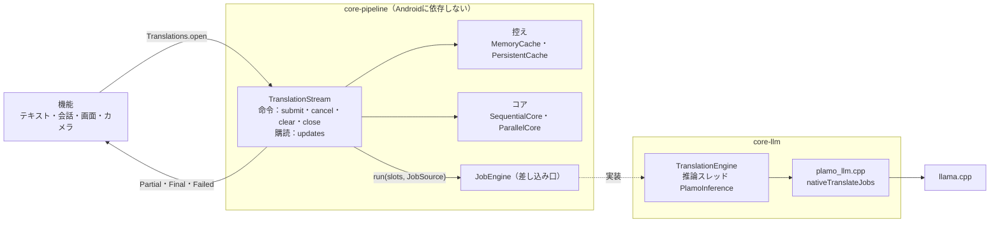

# 翻訳コア

翻訳は、どの機能も翻訳の流れ `TranslationStream` に文を頼み、文ごとの結果を購読する1本の形で通る。流れは文を片に分け、設定の「同時に訳す数」で選ぶコアが片をエンジンへの依頼にまとめ、控えに当たった片はエンジンへ渡さない。エンジン `TranslationEngine` は llama.cpp を JNI で包み、1本の推論スレッドで最大8件の依頼を1回の `llama_decode` で一緒に進める。プロンプトはチャットテンプレートを使わず、PFML3 を直接組み立てる。翻訳モデルは0.8B（既定）と2Bで、Snapdragon の端末は GPU、それ以外は CPU で動き、CPU の動かし方は設定の「パフォーマンス」で端末に合わせる。

この文書は、翻訳の契約とエンジンの正本である。各機能が契約をどう使うかは要点だけを「機能ごとの使い方」に置き、細部は各機能の文書に置く。

## 構成



- 契約・コア・控え・生成の点検（`TranslationChecks`）・プロンプトの組み立て（`Pfml3PromptBuilder`・`Language`・`TranslationRequest`）は `core-pipeline` に置き、偽のエンジンで単体テストする（`TranslationStreamTest`・`TranslationChecksTest`・`Pfml3PromptBuilderTest`）。プロンプトの組み立てのパッケージは `app.plamotranslate.llm`。
- `app` の `Translations.open`（`translation/Translations.kt`）が、`EngineHolder` の今のエンジンを流れに渡す。機能は `TranslationEngine` を直接呼ばない。

## 翻訳の契約

`TranslationStream` は、返り値の無い命令と購読する流れでつなぐ翻訳の契約で、テキスト・会話・画面・カメラの4機能すべてがこれを通る。機能は `Translations.open(scope, context, options, cache, persistent)` で流れを開く。`Options` は原文の言語（null ならモデルが判定する）・訳す先・文体・背景（PFML3 の `context`）・生成の上限（既定1024トークン）を持つ。判断は `docs/判断/2026-11-12_翻訳の契約をTranslationStreamの1本にしコアを付け替える.md`。

### 命令と購読

| 命令 | 働き |
| --- | --- |
| `submit(segments)` | 文（番号つきの `Segment`）を頼む。空白だけの文は、すぐ空の確定を返す |
| `cancel(ids)` | その文をやめる。ほかの文が待っていない片は、まだ訳していなければ並びから外す。訳している途中の片は止めず、訳し終えたら控えに入る。今はどの機能も使っていない |
| `clear()` | 頼んだ文を全部やめる。訳している途中の依頼は次のトークンで止まり、その結果は捨てる |
| `close()` | `clear()` し、流れの仕事のコルーチンを取り消して `updates` を閉じる。訳し終えた片は、取り消しの中でも永続の控えに書く（「スレッドと取り消し」） |

結果は `updates`（`Flow<SegmentUpdate>`）で文ごとに届く。

- `Partial`：訳している途中の訳（その時点までの全体）
- `Final`：確定した訳。控えだけで決まったか（`cached`）、頼んでから確定までの時間、おおよその生成トークン数を持つ
- `Failed`：訳せなかった（モデルが読めない、推論の失敗）

`updates` はチャンネルを流すので、購読は1か所だけにする（2か所で購読すると結果を取り合う）。1文だけを訳す `translateOne(text, onPartial)` は `submit` と `updates` の上に作った便利な関数で、確定か失敗を返す。

### 片とコア

流れは文を片に分け、同じ原文の片は1回だけ訳して、待っている文すべてに配る。文はまず改行で行に分け、行ごとに片にする。片は改行を含まない。依頼の行と訳の行の対応（逐次のコアのつなぎ方、生成の打ち切りの行数、途中の訳の行送り）はこの前提に立つ。片の訳は、行の中では `TranslationChecks.joinPieces`（欧文の語の間だけ空白を入れる）でつなぎ、行どうしは元の改行でつなぐ。空の行は空の行のまま残る。片の分け方と依頼へのまとめ方はコアの中に閉じ、呼ぶ側は文の単位で頼み、文の単位で受け取る。コアは、訳し始めるたびにエンジンの「同時に訳す数」（`JobEngine.parallel`）から選ぶ（`coreFor`）。

| | `SequentialCore`（同時に訳す数が1） | `ParallelCore`（2以上） |
| --- | --- | --- |
| 文の分け方 | 1200字を超える文を、文の切れ目で分ける（`LONG_TEXT`） | 150字を超える文を、文の切れ目でおよそ150字ずつに分ける（`PARALLEL_SPLIT`）。1文より細かくは分けない |
| 1回の依頼 | 片を8行・400字まで改行でつなぐ | 1片 |
| 訳し直し | 2片以上をつないだ依頼だけ点検する。訳の行数がずれたら、つないだ片を全部、1片ずつ並びの先頭へ戻して訳し直す。行数が合っても、訳されていない片（下の「生成の点検」）はその片だけ訳し直す。1片の依頼（訳し直しの依頼を含む）は点検せずに確定する | しない |
| この形の理由 | 1件ずつ訳すので、依頼ごとにかかるPFML3の前置きの処理を減らす（`docs/判断/2026-11-05_画面翻訳は複数のまとまりをまとめて訳す.md`） | 行をつなぐと行のずれ・写しで訳し直しが出て、その片が遅れる。長い片が1本の流れを使う間も、ほかの流れで短い片が進む |

`ParallelCore` では前後の片がモデルに見えないので、長い文のつながりが悪くなることがある。片ごとに控えるので、同時に訳す数を1と2以上で切り替えると、長い文は控えに当たらない。判断は `docs/判断/2026-11-12_同時に訳すときは1片ずつ訳し訳し直さない.md`と`docs/判断/2026-11-12_同時に訳すときは長いブロックを約150字ずつに分ける.md`。

### 生成の点検

点検は `TranslationChecks` にあり、4機能すべてに効く（`docs/判断/2026-11-12_Chrome拡張のまとめ訳しの点検を持ち込む.md`）。

- **打ち切り**（`runaway`）：送った行数より2行以上多くなったら、送った行数までで止める。末尾が同じ並びの3回の繰り返し（3回で24字以上）になったら止める。ただし訳が原文の1.2倍＋16字を超えるまでは止めない（原文に表の単位などの繰り返しがあると、正しい訳も繰り返しになるため）。止めた依頼は、そこまでの訳を使う。
- **訳されていない片**（`untranslated`、`SequentialCore` の2片以上をつないだ依頼だけ）：原文のままの片か、訳す先が日本語なのに日本語の字が1つも無い片。3語以下・24字以下の英字だけの片（製品名・ボタン名）は原文のままでよいので除く。
- **流れ1本に入らない片**：流れ1本が使えるのはコンテキストの「同時に訳す数」分の1で、プロンプトと同じ長さの訳が入らない依頼は、エンジンが訳さずに返す（`onTooLong`）。同時に訳す数が2以上なら、流れはその回の実行が終わった後に流れ1本（コンテキストを全部使う）で訳し直し、それでも入らなければ空の訳にする。同時に訳す数が1なら、既にコンテキストを全部使っているので、すぐ空の訳にする。

### 控え

控えは翻訳の契約の一部で、2層からなる多層の控えである。どの層も同じ鍵と同じ約束に従い、約束は `TranslationStreamTest` の試験が守る。控えに当たった片はエンジンへ渡さない。

| 層 | 型 | 置き場と寿命 | 使う機能 |
| --- | --- | --- | --- |
| 1次：メモリの控え | `MemoryCache`（中核の具体的な型） | メモリ。流れごとか、機能が持って流れどうしで共有する。500件で、最後に使ったものから捨てる | すべて。共有するのは画面翻訳（1回の翻訳ごとに流れを開くので、サービスが1つ持つ） |
| 2次：永続の控え | `PersistentCache`（差し込み口） | 実装が決める。今はデータベース（`SqlitePersistentCache`、`docs/設計/画面翻訳.md`「訳の控え」） | 画面翻訳 |

1次は、ロックの中や推論スレッドから同期で引くので差し込み口にしない。2次は Android の SQLite に依存するので差し込み口にする。

**鍵**：どの層も「範囲＋片の原文」で引く。範囲 `CacheScope` は訳を変える依頼の条件（原文の言語・訳す先・言い方 `form`・背景 `context`）で、契約が `Options.cacheScope` から作る。機能も層の実装も範囲を組まない。原文の言語の自動と明示は、プロンプトが変わるので別の範囲にする。値は訳と、訳したモデルの確かさ（`ModelOrigin.quality`）で、層から層へ移しても確かさを保つ（`CachedTranslation`）。永続の控えは記録用に重みの識別子（`ModelOrigin.id`）も持つ。

**約束**：

1. **引く順番**：1次 → 2次 → エンジン。2次で当たった片は1次にも入れる。エンジンを動かしている途中に頼まれた片は1次だけを引き、推論を待たせない。
2. **確かさ**：どの層も、今のモデル以上の確かさの訳だけを使い、同じ鍵により確かな訳があれば書き換えない。モデルを切り替えても層を捨てない。確かさはモデルの並び（`TranslationModel.origin`。0.8B＜2B）で決まる。
3. **書く約束**：1次には確定した訳をそのまま入れる。2次には、エンジンで訳した片のうち空でも原文の写しでもないものを、実行1回ごとにまとめて書く。書くのは、流れを閉じても、開いたスコープが取り消されても止めない。確定はエンジンが戻る前に届くので、購読する側は最後の確定を受け取ってすぐ閉じてよい。
4. **消す**：2次を消すと世代（`PersistentCache.generation`）が進み、2次を使う流れは次の実行で1次を捨てる。2次を使わない流れは世代に触れないので、使う流れと1次を共有しても捨て合わない。2次に書くときは訳し始める前の世代を渡し、実装はそれが今と違えば書かない（消す前に始めた翻訳の訳を書き戻さない）。
5. **持ち主**：どの層を使うか、1次をどの流れと共有するかは機能が `Translations.open` の `cache`・`persistent` で決める。範囲が鍵に入るので、範囲の違う流れどうしで1次を共有しても混ざらない。

カメラ翻訳の `LiveTranslator` が持つ訳の対応表は、この控えの層ではなく、枠に訳を当てる表示の状態である（`docs/設計/カメラ翻訳.md`）。

### スレッドと取り消し

流れの状態（頼まれた文・片の並び・途中の訳）は1つのロックで守るので、命令はどのスレッドから出してもよい。流れは開いたときのスコープで仕事のコルーチンを1つ動かし、そこから `JobEngine.run` を呼ぶ。エンジンは推論スレッドへ移り、`JobSource` の `next`・`onText`・`onFinished`・`onTooLong` を推論スレッドから順に呼ぶ。結果は上限の無いチャンネルに入れるので、推論スレッドは購読する側を待たない。

| 出来事 | 生成の止まり方 |
| --- | --- |
| `clear()` | 流れの世代を進める。訳している途中の依頼は、次のトークンでその依頼だけ止まり（`onText` が true）、結果は捨てる |
| `cancel(ids)` | 訳している途中の片は止めない |
| `close()`、流れを開いたスコープの取り消し | 仕事のコルーチンが取り消され、エンジンは次のトークンで全部の依頼を止める。訳し終えた片は、取り消しの中でも永続の控えに書く |
| 生成の打ち切り | その依頼だけ止める |
| 翻訳モデルの切り替え | `EngineHolder.select` が推論スレッドで今のエンジンを閉じるので、走っている実行が終わってから閉じる。閉じた後の実行は失敗し、流れは頼まれていた文を全部 `Failed` にする。次に頼まれた文は、訳し始めるときに新しいエンジンを受け取る |

モデルが読めないとき（`EngineHolder.awaitReady` が null）と、実行が例外で終わったときも、頼まれていた文を全部 `Failed` にする。

機能のあいだに優先度は無い。エンジンは1本のスレッドで1回の実行ずつ動くので、別の流れの実行は、前の実行が終わる（その流れの並びが空になる）まで待つ。会話翻訳で確定訳を途中訳より先にするのは、呼ぶ側が途中訳を取り消して行う。

### 流れを通さない呼び出し

次の3つは、依頼を1つだけ出す `SingleRequest`（または決まった依頼を出すだけの `JobSource`）で `JobEngine.run` を直接呼ぶ。エンジンそのものを準備し測る道具で、控え・点検・コアを通すと測るものが変わるためである。機能の翻訳はこの形を使わない。

- 読み込み直後の空訳し（`EngineHolder.warmUp`）
- 速さの計測（`EngineBenchmark`。設定の「速さを測る」「自動で調整」）
- モデルの比べ（デバッグ版の `TranslateBenchActivity`）

デバッグ版の評価 `BenchActivity` は流れを通すが、`Translations.open` を通さずに `TranslationStream` を直接作り、読み込み済みのエンジンを渡す。永続の控えを渡さず、画像ごとに流れを開き直すので、控えの効果を含まない時間を測れる（`docs/設計/画面翻訳.md`「評価」）。

## 機能ごとの使い方

| 機能 | 流れの開き方 | 頼み方 | やめ方 | 詳しく |
| --- | --- | --- | --- | --- |
| テキスト翻訳 | 訳すたびに開き、終わったら閉じる | `translateOne` で1文 | 新しく訳すとき、前の翻訳のコルーチンを取り消す | `TranslateViewModel` |
| 会話翻訳（確定訳） | 発話ごとに開いて閉じる | `translateOne` で1文。確定した発話を話した順に1件ずつ | — | `docs/設計/会話翻訳.md`「翻訳への渡し方」 |
| 会話翻訳（途中訳） | 途中訳のたびに開いて閉じる。生成は160トークンまで | `translateOne` で1文 | 確定した発話が来たら、途中訳のコルーチンを取り消す | `docs/設計/会話翻訳.md`「途中結果」 |
| 画面翻訳 | 1回の翻訳（セッション）ごとに開いて閉じる。控えは2段とも使う（「控え」） | 訳す対象を読み順に、1回の `submit` で全部 | 後片付けでセッションのコルーチンを取り消す | `docs/設計/画面翻訳.md`「訳す対象と翻訳」 |
| カメラ翻訳 | 1本を開いたままにする。原文の言語・訳す先・モード（背景）・エンジンが変わったら開き直す | 読み取りがそろった段落を、`submit` で足していくだけ | 原文の言語・訳す先・モードを変えたら `clear`。頼んだ文は画面から外れても取り消さない | `docs/設計/カメラ翻訳.md`「翻訳」 |

テキスト翻訳と会話翻訳は1文ずつ頼むので、同時に訳すのは、長い文を分けた片どうしだけになる。画面翻訳とカメラ翻訳は複数の文を頼むので、文どうしが同時に訳される。

## エンジン

`TranslationEngine`（`core-llm`）は `JobEngine` の実装で、llama.cpp のモデルとコンテキストを1つずつ持つ。llama.cpp は git submodule（plamo3 に対応した版を固定。版は `docs/現在地.md`「固定した版」）で、Gradle の `externalNativeBuild`（CMake）から一緒にビルドし、自前の JNI（`core-llm/src/main/cpp/plamo_llm.cpp`）で包む。判断は `docs/判断/2026-11-05_llama.cppを自前でビルドしPFML3を直接組み立てる.md`。

### 読み込み

`EngineHolder` がアプリ全体で1つのエンジンを読み込んで持ち（`TranslationEngine.load`）、どの機能も同じエンジンを使う。

| 項目 | 値 | 理由 |
| --- | --- | --- |
| コンテキスト | 4096トークン。`n_batch` も同じ | 同時に訳す全部の流れのプロンプトと訳が入る。プロンプトを1回の decode で処理する |
| 流れ（シーケンス） | 8本（`n_seq_max`）。KVキャッシュは全部の流れで1つ（`kv_unified`） | 流れ1本で訳すときは、コンテキストを全部使える |
| GPU層 | GPUを使う端末は99（全層）、ほかは0 | REDMAGIC は前面のアプリの CPU クロックを抑えるので、GPU のほうが安定して速い（`docs/判断/2026-11-05_翻訳は全層をGPUのOpenCLで動かす.md`） |
| CPUのスレッド | 自動は `TranslationEngine.threadsFor`。最高周波数が一番低いコア（小さいコア）がコアの半分以下なら大きいコアの数、そうでなければコア数−2。どちらも2〜6。REDMAGIC 11 Pro は6、15T Pro は4 | 小さいコアに仕事が回ると、ほかのスレッドが待たされて全体が遅くなる（`docs/判断/2026-11-08_CPUの動かし方を設定で切り替えスレッド数を大きいコアの数にする.md`） |
| サンプリング | 貪欲法（温度0）。全部の流れで1つのサンプラーを使う | 貪欲法は状態を持たない |
| 推論のスレッド | 専用の1本 `PlamoInference` | llama.cpp のコンテキストは同時に使えない。性能ヒントの対象スレッドを固定する |
| 量子化 | Q4_K_M | `docs/判断/2026-11-05_量子化はQ4_K_Mのままにする.md` |

- GPU を使うかは端末で決まり、Qualcomm の端末だけが GPU を使う（`docs/設計/アーキテクチャ.md`「GPUとCPUの切り替え」）。GPU で読み込めなければ `load` が CPU で読み込み直し、どちらで動いているかを `usesGpu` で返す。
- 読み込んだ直後に短い文を1回訳す（`EngineHolder.warmUp`）。GPU は初回の推論でカーネルを準備するので、利用者の最初の翻訳を待たせないためである。組み立てたカーネルは、環境変数 `GGML_OPENCL_KERNEL_CACHE_DIR` でアプリのキャッシュ `cl-cache/` に残す。
- ビルドの設定は `core-llm/src/main/cpp/CMakeLists.txt` が正本で、構成の全体は `docs/設計/アーキテクチャ.md`「ビルド時の構成」にある。arm64-v8a だけを作り、`GGML_OPENCL`・`GGML_CPU_KLEIDIAI` を有効にし、計算部分を実行時に読み込む（`GGML_BACKEND_DL`・`GGML_CPU_ALL_VARIANTS`）。

### GPUで落ちたときの切り替え

llama.cpp の OpenCL は、カーネルの組み立てに失敗すると戻り値を返さず `exit(1)` でプロセスごと終わる（`ggml-opencl.cpp` の `build_program_from_source_ex` など）。`load` の CPU へのやり直しが働かず、Android がアプリを開き直すたびに同じ所で終わる。そこで `GpuGuard` が、GPU での読み込みから初回の推論までの間に落ちたら、次の起動から CPU で動かす。

1. GPU で読み込む直前に「読み込み中」の印（プロセスID）を `TranslationPreferences` へすぐ書き（`commit`）、`warmUp` が済んだら消す。
2. 起動時に印が残っていれば、Android が記録した前回の終わり方（`ApplicationExitInfo`）を見る。異常終了（クラッシュ、応答なし、初期化の失敗、終了コードが0以外の `exit`、SIGKILL 以外のシグナル）ならすぐ CPU に切り替える。強制停止やメモリ不足のような終わり方は、2回続いたら切り替える。
3. アプリの版か端末のビルド（`Build.FINGERPRINT`。GPU のドライバーを含む）が変わったら、もう一度 GPU を試す。設定の「パフォーマンス」に切り替えた理由と日時を出し、「GPUをもう一度試す」で戻せる。アプリが自分で起動し直すときは印を消すので、GPU で落ちたとはみなさない。

印を置くのは読み込みから初回の推論までなので、その後の翻訳の途中で GPU が落ちたときは切り替わらない。判断は `docs/判断/2026-11-09_GPUの読み込み中に落ちたら次の起動からCPUで動かす.md`。

### 複数の文を同時に訳す

`nativeTranslateJobs` は、呼ぶ側から依頼を1件ずつ受け取り、最大「同時に訳す数」本の流れで同時に訳す。生成の処理はこの1本だけで、1文を訳すときも流れ1本でこれを使う。小さいモデルの生成は重みをメモリから読む時間で決まるので、複数の流れの次の1トークンを1回の `llama_decode` で一緒に進めても、1回の時間はあまり増えない。

1. 実行の初めに KV キャッシュを空にする。実行をまたいでプロンプトの先頭を使い回すことはしない。流れ1本が使えるのは、コンテキストの「同時に訳す数」分の1である。
2. 空いた流れがあれば、そのたびに次の依頼を聞く（`nextJob`）。`onFinished` の中で訳し直しの依頼が足されるので、一度「無い」と返されても聞き直す。プロンプトと同じ長さの訳が流れ1本に入らない依頼は、訳さずに `onTooLong` で返す。生成の上限は、頼まれた上限と流れ1本の残りの小さい方。
3. 1回の decode に、生成中の流れの次の1トークンと、空いた流れに入れた新しい依頼のプロンプトをまとめて入れる。
4. 流れごとに、UTF-8 の文字の切れ目で `onToken` を呼ぶ。戻り値は0＝続ける、1＝この依頼だけ止める、2＝全部止める。`TranslationEngine` は、呼んだコルーチンが取り消されていれば2、流れが止めると言えば1を返す。
5. `<|plamo:tag|>`・`<|plamo:bos|>`・終わりのトークンが出たら、その依頼を終える（出力に含めない）。訳し終わった流れは `llama_memory_seq_rm` で空け、ほかの流れを待たずに次の依頼を入れる。
6. 依頼が無くなり全部の流れが空いたら戻り、logcat に1行を出す（「速さの確かめ方」）。

同時に訳す数は設定の「パフォーマンス」で選び（既定4）、読み直さずに次の実行から効く。判断は `docs/判断/2026-11-12_複数の文を同時に訳す.md`と`docs/判断/2026-11-12_訳し終わった流れにすぐ次の依頼を入れる.md`。

### JNIの関数

`LlamaNative`（`core-llm`）の関数は、どれも `TranslationEngine` が推論スレッドから呼ぶ。引数の一覧はコードを正本とする。

| 関数 | 働き |
| --- | --- |
| `nativeInit` | 計算部分のライブラリを `nativeLibraryDir` から読み込む。起動ごとに最初の1回だけ効く。GPU が使えるかを返す。CPU の版を固定する指定も受け取る |
| `nativeCpuBackend` | 読み込んだ CPU の計算部分のファイル名 |
| `nativeLoad`・`nativeFree` | モデルとコンテキストを作る・解放する。コンテキスト長・スレッド数・GPU層・パフォーマンスの設定・流れの数を受け取る。失敗なら0 |
| `nativeTranslateJobs` | 上の「複数の文を同時に訳す」。全部の依頼の生成トークン数か、負のエラーコード（-3 推論の失敗、-4 受け渡しの失敗）を返す |
| `nativeConfigure` | 計測用。性能ヒントとスレッド数を読み直さずに変える |

プロンプトは `llama_tokenize` を `add_special = true`・`parse_special = true` で呼んでトークンにする。`parse_special` を有効にしないと、`<|plamo:tag|>` などの区切りが特殊トークンにならない。先頭の BOS は llama.cpp が付けるので、プロンプトに書かない。性能ヒントを有効にすると、推論スレッドと常駐のワーカーに ADPF（`APerformanceHint`）のセッションを作る。

## PFML3プロンプト

`Pfml3PromptBuilder.build` は、`TranslationRequest`（原文・原文の言語・訳す先・文体・背景）から次の順に要素を並べ、改行を入れずに1行でつなぐ。

1. `<|plamo:tag|>dataset<|plamo:msg|>translation`
2. `context`：背景があるときだけ
3. `input`：原文。原文の言語が分かれば `lang` を書く
4. `output`：本文を空にして終える。`lang` に訳す先を書き、訳す先が日本語なら `form` も書く

```text
<|plamo:tag|>dataset<|plamo:msg|>translation
<|plamo:tag|>context<|plamo:msg|>家電や機器のボタン・表示画面、メニュー、看板、表などに書かれた短い表記。
<|plamo:tag|>input<|plamo:key|>lang<|plamo:val|>ko<|plamo:msg|>송풍
<|plamo:tag|>output<|plamo:key|>lang<|plamo:val|>ja<|plamo:key|>form<|plamo:val|>polite<|plamo:msg|>
```

| 属性 | 書く場所 | 値 |
| --- | --- | --- |
| `lang` | `output`（必ず）、`input`（原文の言語が分かるとき） | 言語コード（日本語 `ja`、韓国語 `ko`、簡体字 `zh-hans` など）。`Language` がモデルカードの53言語すべてを持つ |
| `form` | `output` | 日本語へ訳すときだけ、`plain`（だ・である）か `polite`（です・ます）。今はどの機能も `polite` |

- 原文の言語が分からないとき（自動）は `input` に `lang` を書かず、モデルが原文から判定する。
- 原文と背景から `<|plamo:` を取り除いてから組み立てる。区切りと誤認されるためである。
- PFML3 は履歴（`input` と `output` の組）と用語集（`glossary`）も書けるが、今は組み立てない（`docs/バックログ.md`）。
- 選べる言語は、テキスト翻訳は53言語すべて、会話翻訳とカメラ翻訳は前段の音声認識・文字認識が扱える言語だけである（`docs/設計/会話翻訳.md`、`docs/設計/カメラ翻訳.md`「原文の言語」）。

## 翻訳モデルの大きさ

翻訳モデルは0.8B（既定）と2Bから選び、どちらも Q4_K_M である。2B は約2.5倍遅いが、意味の取り違えが減る（`docs/判断/2026-11-06_翻訳モデルは0.8Bと2Bを選べるようにし初回は0.8Bだけ取る.md`）。既定をどちらにするかは決まっていない（`docs/バックログ.md`）。

- **選び方**：設定の画面の「翻訳モデル」か、会話・カメラ・テキストの画面の切り替えボタン（`ModelSwitch`）で選ぶ。選んだものは SharedPreferences の `translation` に残し、次の起動でも使う。選んだモデルが端末に無ければ0.8Bを読む。
- **取得と大きさ**：初回に取るのは0.8Bだけで、2B は設定の画面で選んだときに取る。取る組とファイルの大きさは `docs/設計/アーキテクチャ.md`「モデルのダウンロード」。
- **切り替え**：`EngineHolder.select` が今のエンジンを閉じてから、選んだモデルを読み込む。翻訳の流れは訳し始めるたびに今のエンジンを受け取る（「スレッドと取り消し」）。控えは捨てず、新しいモデルの確かさ以上の訳だけを使う（「控え」）。

## パフォーマンスの設定

設定の画面の「パフォーマンス」で、エンジンの動かし方を端末に合わせる。値は `TranslationPreferences`（SharedPreferences の `cpu`）に残し、`EngineHolder` が読み込むときに `CpuOptions` として `TranslationEngine.load` へ渡す。変えるとモデルを読み直す。「同時に訳す数」だけは読み直さずに効く。

| 設定 | 既定 | 中身 |
| --- | --- | --- |
| 同時に訳す数 | 4 | 1・2・3・4・6・8。1なら `SequentialCore`、2以上なら `ParallelCore`。4機能すべてに効く |
| スレッド数 | 自動 | llama.cpp の `n_threads`。自動の決め方は「読み込み」 |
| 性能ヒント | 有 | ADPF のセッションを作り、推論のスレッドの周波数・配置を上げてもらう |
| 回して待つ | 有 | スレッドプールの `poll`。有は50、無は0（眠って待つ） |
| スレッドを常駐させる | 有 | 自前のスレッドプールを作る。無なら llama.cpp が推論のたびにスレッドを用意する |
| ファイルの写像で読む | 有 | 無なら `load_mode` を `LLAMA_LOAD_MODE_NONE` にし、モデルをメモリへ全部読む |
| CPUだけで動かす | 無 | Snapdragon の端末でも GPU を使わない。起動し直すと効く |
| CPUの計算部分の版 | 自動 | `libggml-cpu-*.so` のうち使う版を固定する。計算部分は起動ごとに1回だけ読み込むので、起動し直すと効く |

「速さを測る」は、決まった日本語の1文を英語へ訳し、最初の文字までの時間と生成の速さ（テキスト翻訳・会話翻訳の目安）を出す。加えて、今の「同時に訳す数」で訳したときの合計の速さ（下の「自動で調整」と同じ測り方）も出す。合計の速さはプロンプトの処理を含むので、1文の生成の速さより小さく出る。

### 自動で調整

「自動で調整」は、同時に訳す数の候補1・2・4・8本のうち3回だけ測って、端末に合う数を設定に入れる（`ParallelTuner`）。

1. 4本を測る（REDMAGIC の最適値に近い真ん中）。
2. 1本を測る（比べる基準）。
3. 4本が1本の1.1倍以上速ければ8本を、そうでなければ2本を測る。

測るたびに、そこまでで一番合う数を設定に入れる。一番速い数を選ぶが、それより少ない数で一番速い値の9割以上出ていれば、少ない方を選ぶ。同時に訳す数が多いほど1つの依頼が短くなり、前後の文が訳の手がかりにならないためである。測るのは、長さのそろった日本語の文 N 件を英語へ40トークンまで同時に訳す時間で、プロンプトの処理も含めた全部のトークン/秒である（`EngineBenchmark.runParallel`）。初回だけ遅くなる分を除くため、測る前に同じ件数で短く1回訳す。判断は `docs/判断/2026-11-12_同時に訳す数を3回の計測で自動調整する.md`。

## 今の性能の目安

速さは端末の温まり方で1.5倍ほど変わる。判断に使った計測と候補の比べは `docs/判断/` にある。

| 項目 | 値 | 条件 |
| --- | --- | --- |
| 1文ずつ訳す速さ | 0.8B 約51、2B 約19トークン/秒 | REDMAGIC 11 Pro、GPU、`tools/translate-bench.tsv` の13文の合計から、2026-11-06 |
| 同時に訳す速さ | 2B で1本25・4本36・8本39トークン/秒（生成だけ。ログの「翻訳（同時N本）」） | REDMAGIC 11 Pro、GPU、2026-11-12 |
| 1文の翻訳 | 0.8B 0.16〜0.55秒、2B 0.46〜1.3秒 | REDMAGIC 11 Pro、GPU、`tools/translate-bench.tsv` の13文、2026-11-06 |
| CPUでの生成 | 56〜62トークン/秒（4スレッド） | 15T Pro（Dimensity 9400+）、0.8B、2026-11-08 |
| モデルの読み込み | 0.8B 2.9秒、2B 8.5秒（`warmUp` の前） | REDMAGIC 11 Pro、GPU、2026-11-06 |
| GPUの初回の準備 | 初回の推論で約4秒。入れ直した直後の最初の起動はカーネルの組み立てに約67秒、2回目以降の起動は約7.5秒。CPU で動く端末は約2秒 | REDMAGIC 11 Pro、2026-11-05〜06 |

アプリが使うメモリ（コンテキスト4096・流れ8本の KV キャッシュを含む）は測っていない。

## 速さの確かめ方

- **アプリ内のログ**：エンジンの1回の実行ごとに、logcat に `翻訳（同時N本）: …件、プロンプト … トークン、生成 … トークン、…ms（合計 … トークン/秒、最大N本が同時）` を出す。ログの開け方は `docs/手順/開発環境.md`「ログを見る」。
- **設定の画面**：「速さを測る」と「自動で調整」（「パフォーマンスの設定」）。
- **端末上のCLI**：アプリの外で端末の素の速さを測る。作り方・動かし方・片付けは `docs/手順/開発環境.md`「端末でCLIを動かして測る」。同時に訳す速さは、同じ構成で `--target llama-batched-bench` を作り、`llama-batched-bench` で測れる。

### モデルの比べ方

デバッグ版の `TranslateBenchActivity` は、同じ文の組を選んだモデルで訳し、時間と訳文を logcat と `files/` の TSV に書く。アプリのエンジンとは別にモデルを読み込み、`warmUp` を1回してから測る。

```powershell
adb push tools/translate-bench.tsv /sdcard/Android/data/app.plamotranslate/files/
adb shell am force-stop app.plamotranslate
adb shell am start -n app.plamotranslate/.TranslateBenchActivity --es model LARGE   # SMALL で0.8B
adb logcat -s PlamoTranslate:I   # 「訳比較: …」
```

- 別の文の組は、`tools/` の `<名前>.tsv` を同じ場所へ送り、`--es set <名前>` を付ける。結果は `files/<名前>-<model>.tsv`。
- TSV の1行は「原文の言語 TAB 訳先の言語 TAB 原文」。段落のある長文は、1行の中に `\n` と書いて改行を表す。
- `--es context <文>` を付けると、すべての文にその背景を渡して訳し、結果を `files/<名前>-<model>-ctx.tsv` に書く。
- 測り終えたら、端末の `files/` に送った TSV と結果の TSV を消す。

| 文の組 | 中身 |
| --- | --- |
| `translate-bench.tsv` | 韓・英・中→日、日→韓・英の13文。速さと訳の比べ |
| `translate-quality.tsv` | 作者の品質評価の7本（長文5件＋旅行の短文28件） |
| `translate-tricky.tsv` | 口語の難しい文54文（二重否定・反語・皮肉・婉曲な断り・慣用句）。4列目が正しい意味 |
| `translate-labels.tsv`・`translate-labels-batch.tsv` | エアコンのリモコンなどの短い語。`-batch` は改行でつないだもの |

過去の比べの訳の全文は `tools/bench-results/` にある。
